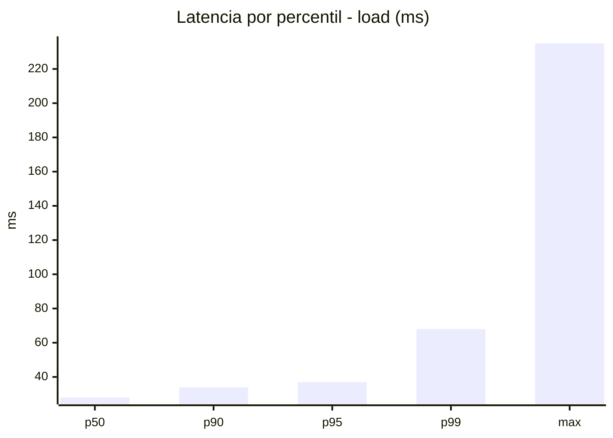
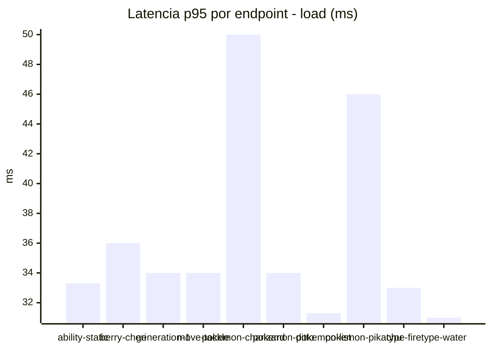
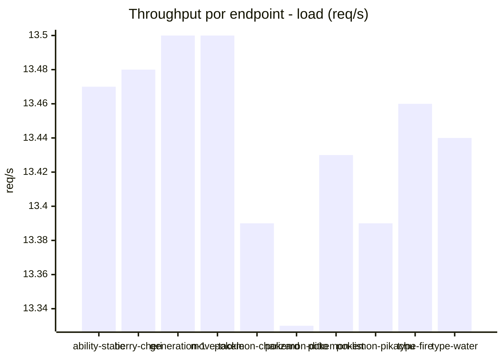
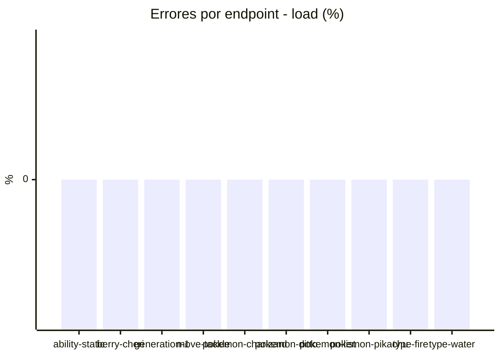
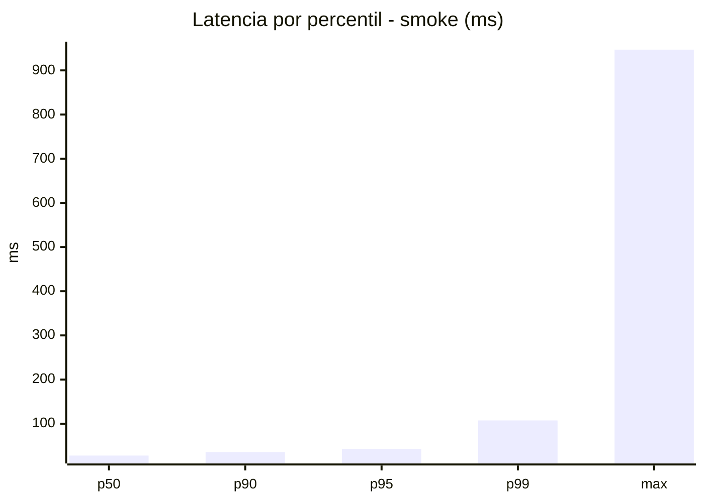
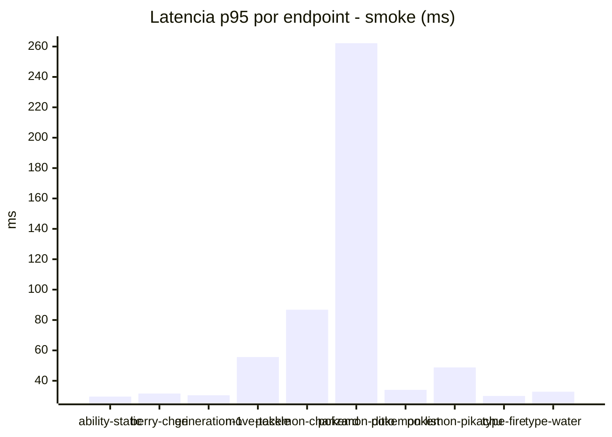
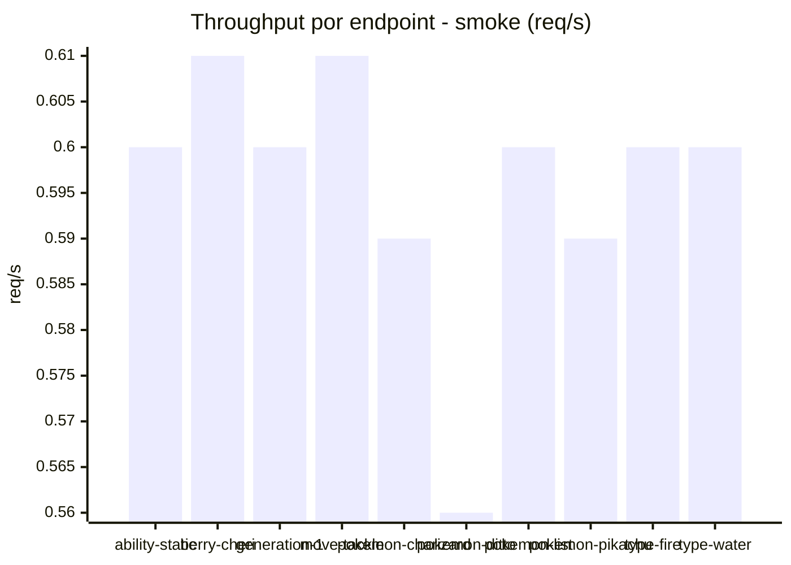

# Reporte de performance - PokeAPI

**Fecha:** 2026-10-11 17:55 UTC  
**Veredicto del agente:** `PASS`  
**Corrida:** [ver en GitHub Actions](https://github.com/lrbg/jmeter-pokeapi-lab/actions/runs/38161489341)  

## Validacion del agente de IA

PASS (fallback por umbrales)

- Error maximo: 0.0%
- p95 maximo: 43.0 ms

## Resultados

### Escenario: `load`

| Metrica | Valor |
| --- | --- |
| Muestras | 15943 |
| Errores | 0 (0.0%) |
| Latencia media | 29.6 ms |
| p50 / p90 / p95 / p99 | 28.0 / 34.0 / 37.0 / 68.0 ms |
| Min / Max | 21 / 235 ms |
| Throughput | 133.24 req/s |
| Duracion | 119.7 s |

Detalle por endpoint

| Endpoint | Muestras | Error % | avg | p95 | p99 | req/s |
| --- | --- | --- | --- | --- | --- | --- |
| ability-static | 1594 | 0.0% | 27.9 | 33.3 | 37.1 | 13.47 |
| berry-cheri | 1594 | 0.0% | 28.7 | 36.0 | 40.0 | 13.48 |
| generation-1 | 1594 | 0.0% | 28.7 | 34.0 | 45.1 | 13.5 |
| move-tackle | 1594 | 0.0% | 29.1 | 34.0 | 41.1 | 13.5 |
| pokemon-charizard | 1594 | 0.0% | 37.3 | 50.0 | 127.1 | 13.39 |
| pokemon-ditto | 1595 | 0.0% | 28.9 | 34.0 | 39.1 | 13.33 |
| pokemon-list | 1594 | 0.0% | 26.3 | 31.3 | 38.0 | 13.43 |
| pokemon-pikachu | 1594 | 0.0% | 34.7 | 46.0 | 76.1 | 13.39 |
| type-fire | 1595 | 0.0% | 27.8 | 33.0 | 41.2 | 13.46 |
| type-water | 1595 | 0.0% | 26.9 | 31.0 | 37.0 | 13.44 |

### Escenario: `smoke`

| Metrica | Valor |
| --- | --- |
| Muestras | 155 |
| Errores | 0 (0.0%) |
| Latencia media | 36.7 ms |
| p50 / p90 / p95 / p99 | 28.0 / 36.0 / 43.0 / 107.5 ms |
| Min / Max | 24 / 947 ms |
| Throughput | 5.33 req/s |
| Duracion | 29.1 s |

Detalle por endpoint

| Endpoint | Muestras | Error % | avg | p95 | p99 | req/s |
| --- | --- | --- | --- | --- | --- | --- |
| ability-static | 15 | 0.0% | 26.5 | 29.6 | 30.7 | 0.6 |
| berry-cheri | 15 | 0.0% | 27.2 | 31.6 | 32.7 | 0.61 |
| generation-1 | 15 | 0.0% | 26.7 | 30.5 | 33.3 | 0.6 |
| move-tackle | 15 | 0.0% | 33.1 | 55.6 | 79.1 | 0.61 |
| pokemon-charizard | 16 | 0.0% | 46.2 | 86.8 | 124.5 | 0.59 |
| pokemon-ditto | 16 | 0.0% | 86.2 | 262.2 | 810.0 | 0.56 |
| pokemon-list | 16 | 0.0% | 27.5 | 34.0 | 41.2 | 0.6 |
| pokemon-pikachu | 16 | 0.0% | 36.9 | 48.8 | 67.3 | 0.59 |
| type-fire | 15 | 0.0% | 27.1 | 30.0 | 30.0 | 0.6 |
| type-water | 16 | 0.0% | 27.4 | 32.8 | 36.9 | 0.6 |

