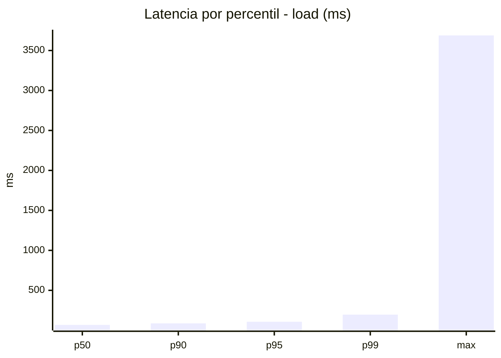
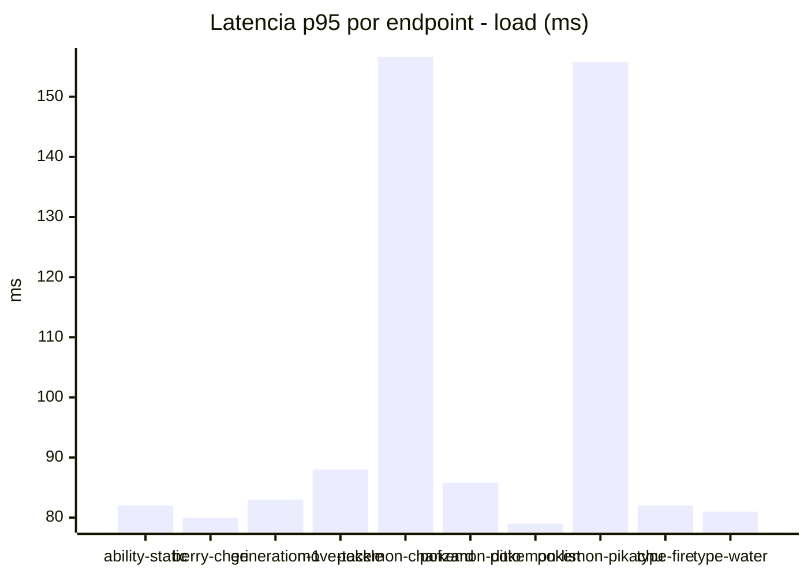
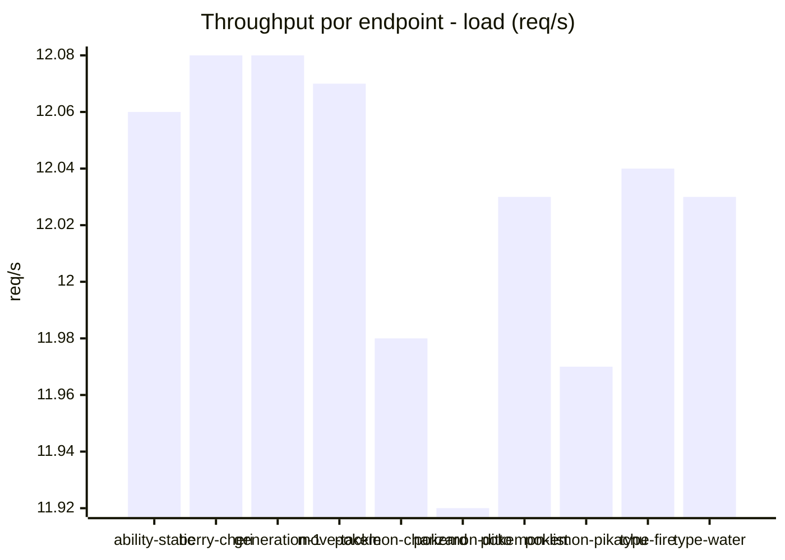
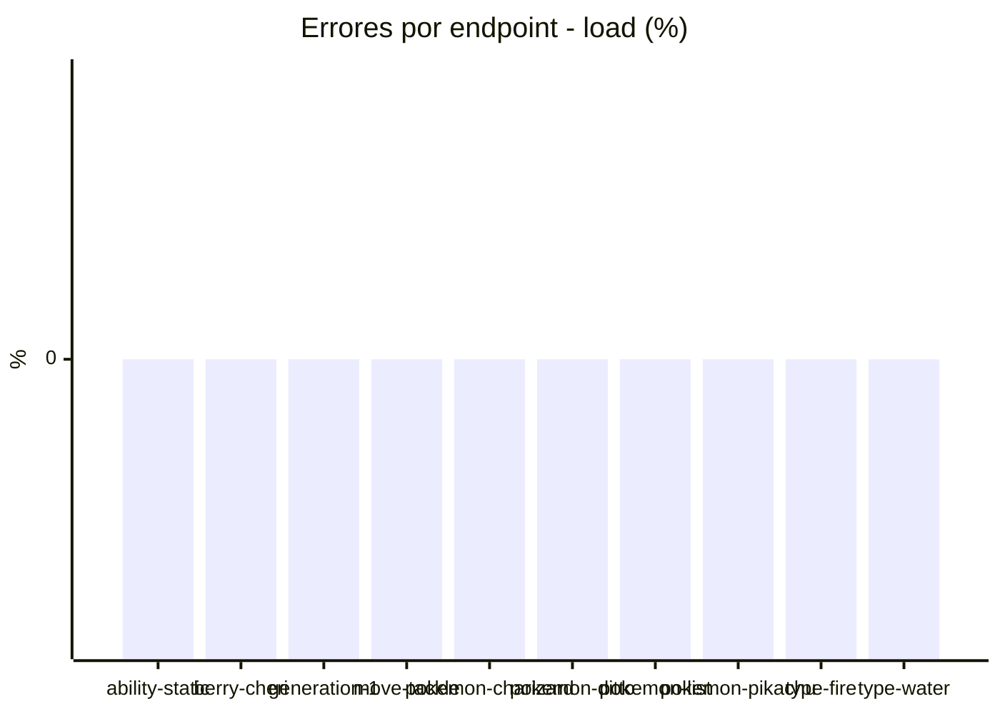
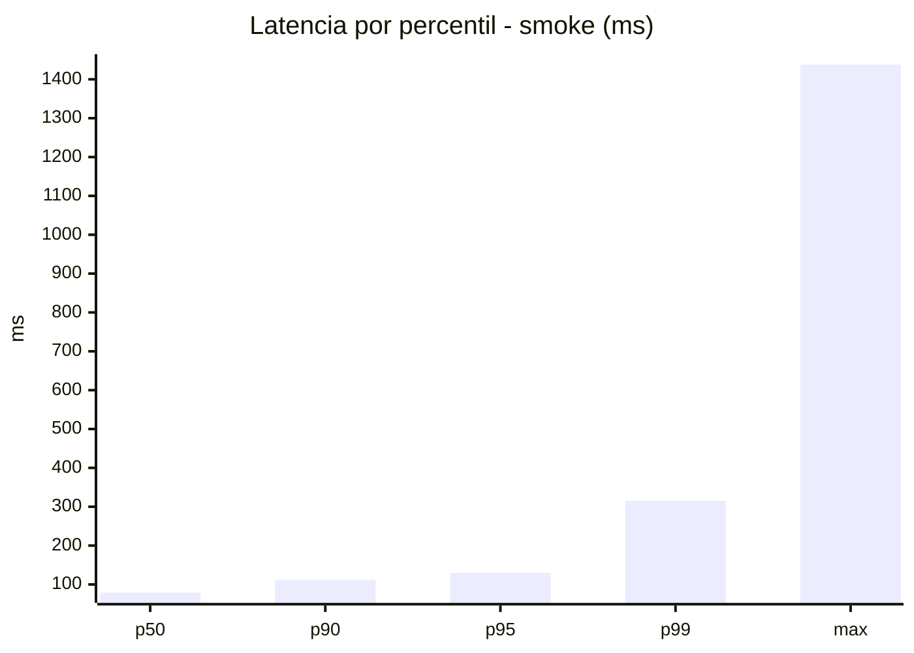
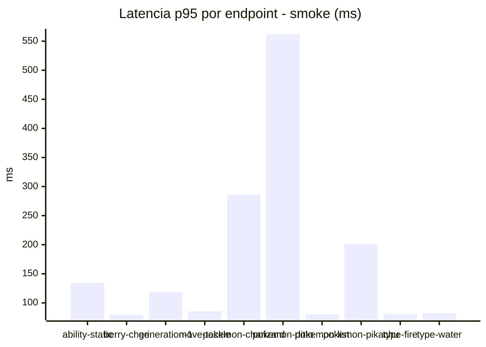
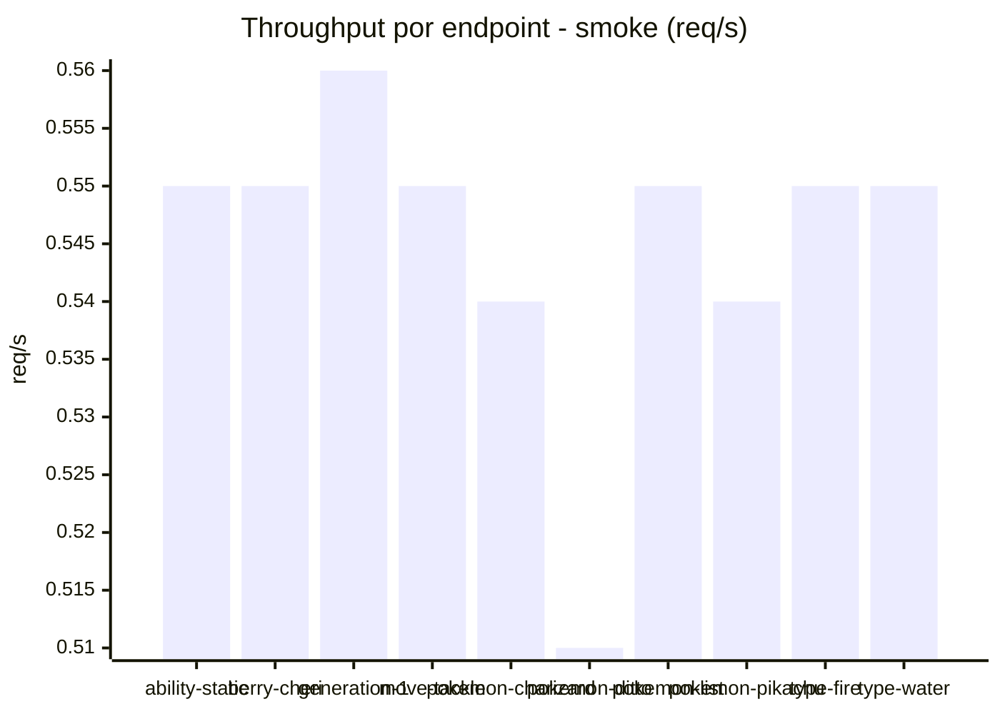

# Reporte de performance - PokeAPI

**Fecha:** 2026-10-12 21:34 UTC  
**Veredicto del agente:** `PASS`  
**Corrida:** [ver en GitHub Actions](https://github.com/lrbg/jmeter-pokeapi-lab/actions/runs/38311194990)  

## Validacion del agente de IA

PASS (fallback por umbrales)

- Error maximo: 0.0%
- p95 maximo: 129.6 ms

## Resultados

### Escenario: `load`

| Metrica | Valor |
| --- | --- |
| Muestras | 14249 |
| Errores | 0 (0.0%) |
| Latencia media | 68.8 ms |
| p50 / p90 / p95 / p99 | 68.0 / 87.0 / 107.0 / 196.5 ms |
| Min / Max | 21 / 3689 ms |
| Throughput | 119.09 req/s |
| Duracion | 119.6 s |

Detalle por endpoint

| Endpoint | Muestras | Error % | avg | p95 | p99 | req/s |
| --- | --- | --- | --- | --- | --- | --- |
| ability-static | 1425 | 0.0% | 65.3 | 82.0 | 127.3 | 12.06 |
| berry-cheri | 1425 | 0.0% | 61.5 | 80.0 | 118.8 | 12.08 |
| generation-1 | 1424 | 0.0% | 63.9 | 83.0 | 120.8 | 12.08 |
| move-tackle | 1424 | 0.0% | 67.4 | 88.0 | 181.5 | 12.07 |
| pokemon-charizard | 1425 | 0.0% | 91.0 | 156.6 | 304.6 | 11.98 |
| pokemon-ditto | 1426 | 0.0% | 64.0 | 85.8 | 133.0 | 11.92 |
| pokemon-list | 1425 | 0.0% | 59.4 | 79.0 | 129.0 | 12.03 |
| pokemon-pikachu | 1425 | 0.0% | 90.0 | 155.8 | 260.8 | 11.97 |
| type-fire | 1425 | 0.0% | 63.3 | 82.0 | 151.8 | 12.04 |
| type-water | 1425 | 0.0% | 62.0 | 81.0 | 145.4 | 12.03 |

### Escenario: `smoke`

| Metrica | Valor |
| --- | --- |
| Muestras | 139 |
| Errores | 0 (0.0%) |
| Latencia media | 94.6 ms |
| p50 / p90 / p95 / p99 | 79.0 / 111.2 / 129.6 / 315.0 ms |
| Min / Max | 58 / 1438 ms |
| Throughput | 4.82 req/s |
| Duracion | 28.8 s |

Detalle por endpoint

| Endpoint | Muestras | Error % | avg | p95 | p99 | req/s |
| --- | --- | --- | --- | --- | --- | --- |
| ability-static | 14 | 0.0% | 84 | 134.4 | 210.9 | 0.55 |
| berry-cheri | 14 | 0.0% | 71.9 | 79.3 | 79.9 | 0.55 |
| generation-1 | 13 | 0.0% | 80.8 | 118.8 | 127.0 | 0.56 |
| move-tackle | 14 | 0.0% | 75 | 85.3 | 85.9 | 0.55 |
| pokemon-charizard | 14 | 0.0% | 128.4 | 286.4 | 298.9 | 0.54 |
| pokemon-ditto | 14 | 0.0% | 171.6 | 561.8 | 1262.8 | 0.51 |
| pokemon-list | 14 | 0.0% | 70.1 | 80.3 | 80.9 | 0.55 |
| pokemon-pikachu | 14 | 0.0% | 118.1 | 200.8 | 298.6 | 0.54 |
| type-fire | 14 | 0.0% | 71.6 | 81.0 | 81.0 | 0.55 |
| type-water | 14 | 0.0% | 73.8 | 82.3 | 82.9 | 0.55 |

