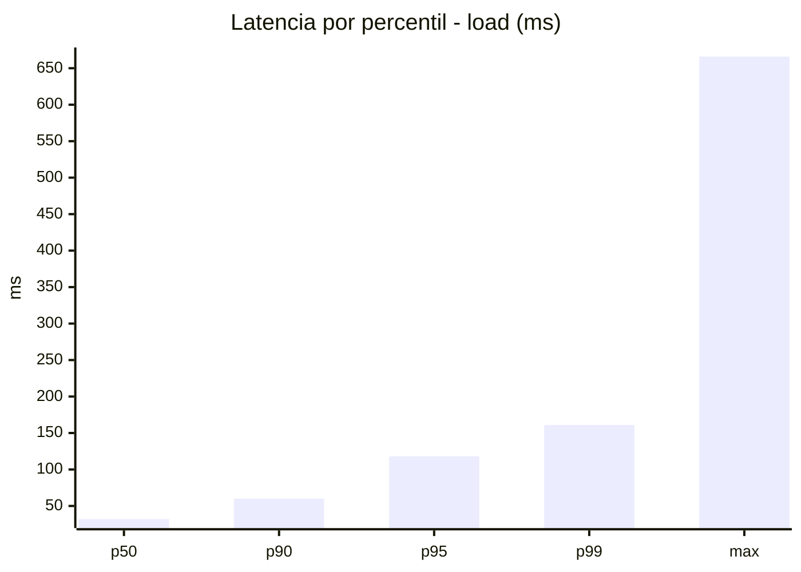
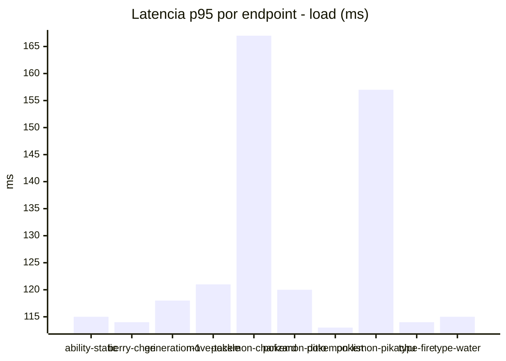
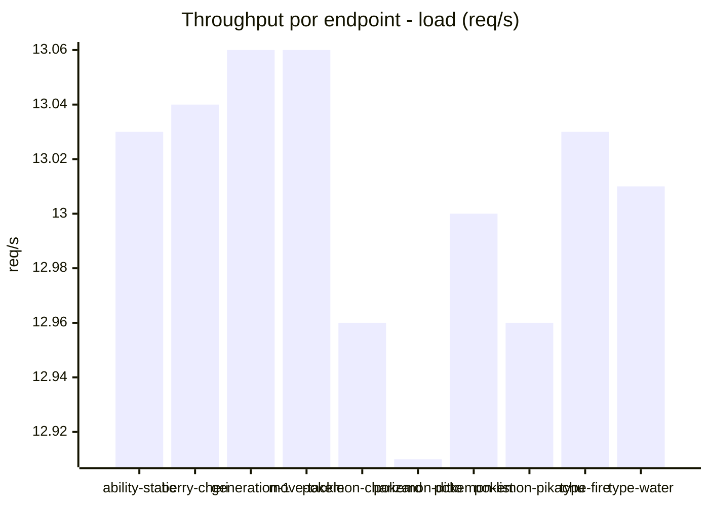
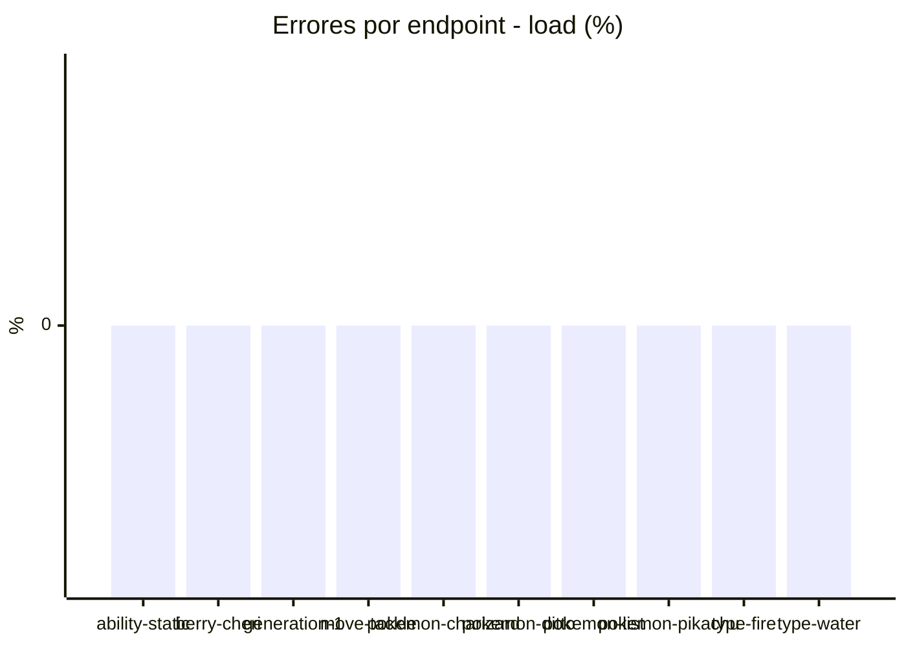
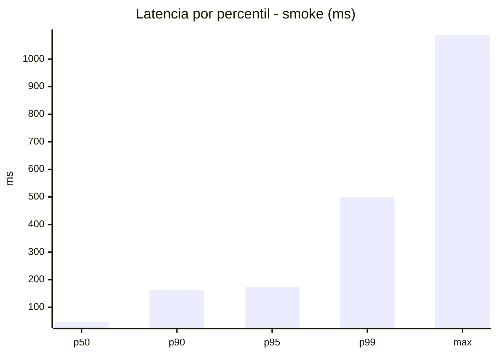
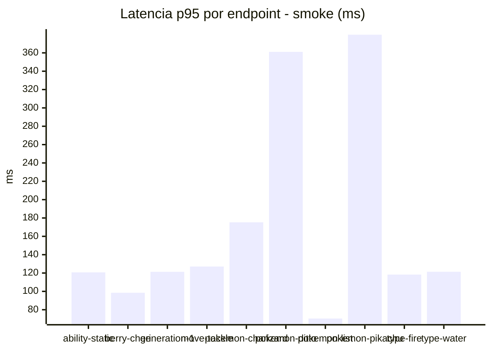
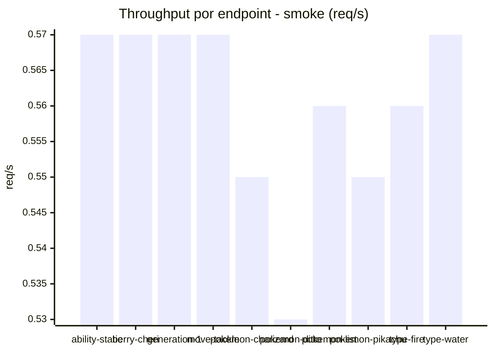

# Reporte de performance - PokeAPI

**Fecha:** 2026-10-13 19:46 UTC  
**Veredicto del agente:** `PASS`  
**Corrida:** [ver en GitHub Actions](https://github.com/lrbg/jmeter-pokeapi-lab/actions/runs/38457065051)  

## Validacion del agente de IA

PASS (fallback por umbrales)

- Error maximo: 0.0%
- p95 maximo: 173.0 ms

## Resultados

### Escenario: `load`

| Metrica | Valor |
| --- | --- |
| Muestras | 15433 |
| Errores | 0 (0.0%) |
| Latencia media | 40.5 ms |
| p50 / p90 / p95 / p99 | 32.0 / 60.0 / 118.0 / 161.0 ms |
| Min / Max | 14 / 666 ms |
| Throughput | 128.97 req/s |
| Duracion | 119.7 s |

Detalle por endpoint

| Endpoint | Muestras | Error % | avg | p95 | p99 | req/s |
| --- | --- | --- | --- | --- | --- | --- |
| ability-static | 1543 | 0.0% | 37.9 | 115.0 | 126.0 | 13.03 |
| berry-cheri | 1543 | 0.0% | 39.1 | 114.0 | 122.0 | 13.04 |
| generation-1 | 1543 | 0.0% | 39.4 | 118.0 | 124.0 | 13.06 |
| move-tackle | 1543 | 0.0% | 41.1 | 121.0 | 128.0 | 13.06 |
| pokemon-charizard | 1544 | 0.0% | 52.1 | 167.0 | 184.6 | 12.96 |
| pokemon-ditto | 1544 | 0.0% | 38.5 | 120.0 | 130.1 | 12.91 |
| pokemon-list | 1543 | 0.0% | 35.4 | 113.0 | 123.0 | 13.0 |
| pokemon-pikachu | 1544 | 0.0% | 47.1 | 157.0 | 168.0 | 12.96 |
| type-fire | 1543 | 0.0% | 36.6 | 114.0 | 125.0 | 13.03 |
| type-water | 1543 | 0.0% | 37.7 | 115.0 | 126.0 | 13.01 |

### Escenario: `smoke`

| Metrica | Valor |
| --- | --- |
| Muestras | 144 |
| Errores | 0 (0.0%) |
| Latencia media | 78.7 ms |
| p50 / p90 / p95 / p99 | 46.0 / 162.7 / 173.0 / 500.2 ms |
| Min / Max | 16 / 1087 ms |
| Throughput | 4.96 req/s |
| Duracion | 29.1 s |

Detalle por endpoint

| Endpoint | Muestras | Error % | avg | p95 | p99 | req/s |
| --- | --- | --- | --- | --- | --- | --- |
| ability-static | 14 | 0.0% | 48.4 | 120.7 | 121.7 | 0.57 |
| berry-cheri | 14 | 0.0% | 46.1 | 98.5 | 114.1 | 0.57 |
| generation-1 | 14 | 0.0% | 66.5 | 121.3 | 121.9 | 0.57 |
| move-tackle | 14 | 0.0% | 84.4 | 127.1 | 131.8 | 0.57 |
| pokemon-charizard | 15 | 0.0% | 103.9 | 175.3 | 175.9 | 0.55 |
| pokemon-ditto | 15 | 0.0% | 102.9 | 361.1 | 941.8 | 0.53 |
| pokemon-list | 15 | 0.0% | 37.6 | 70.4 | 108.5 | 0.56 |
| pokemon-pikachu | 15 | 0.0% | 151.1 | 379.8 | 629.6 | 0.55 |
| type-fire | 14 | 0.0% | 77.1 | 118.3 | 118.9 | 0.56 |
| type-water | 14 | 0.0% | 62.7 | 121.4 | 123.5 | 0.57 |

