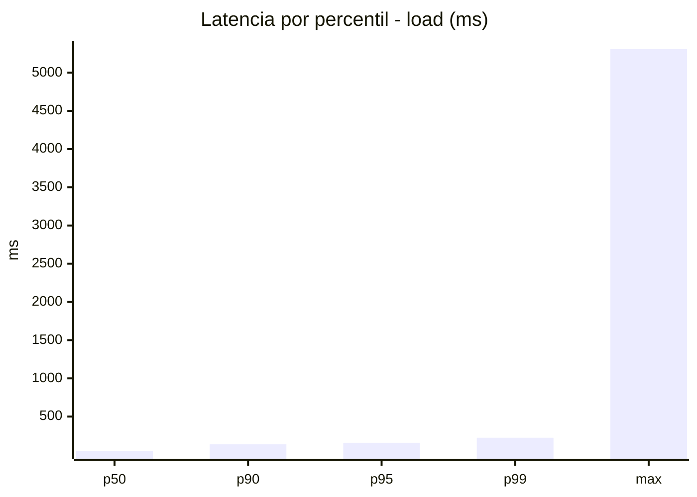
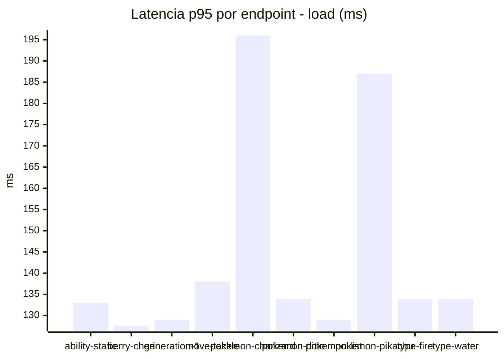
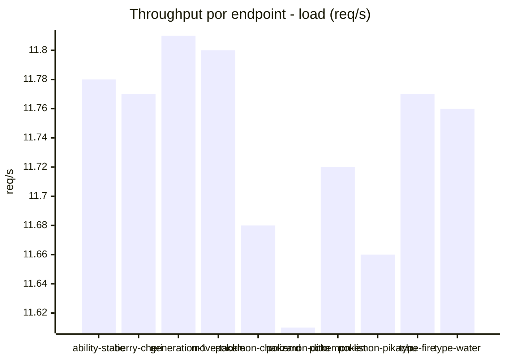
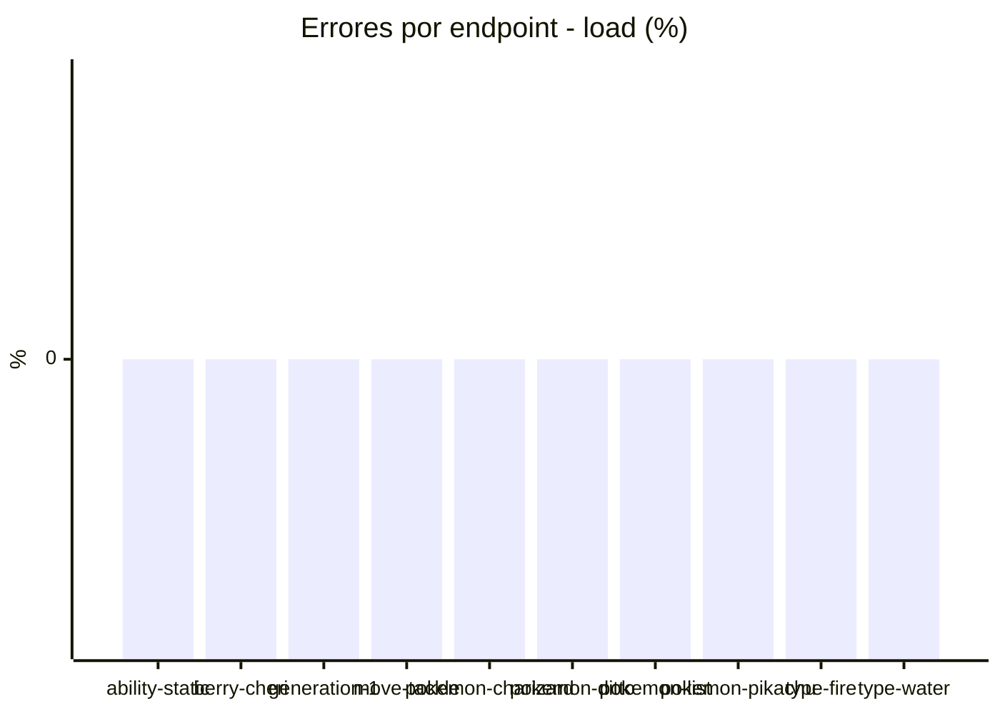
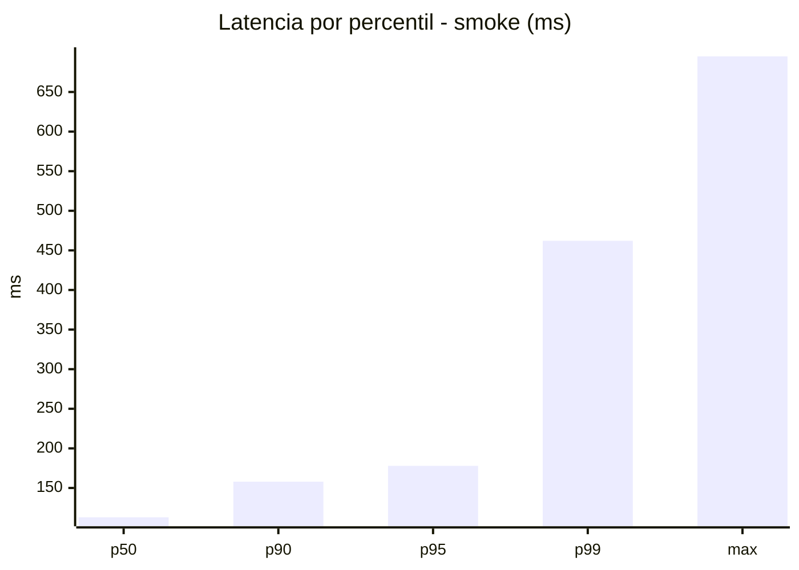
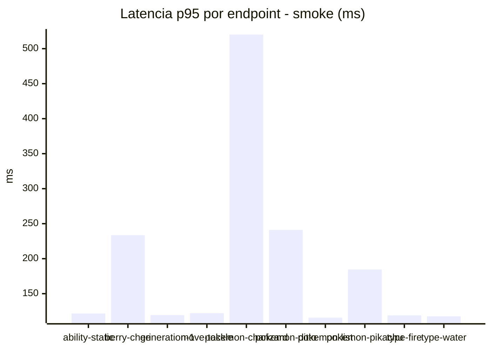
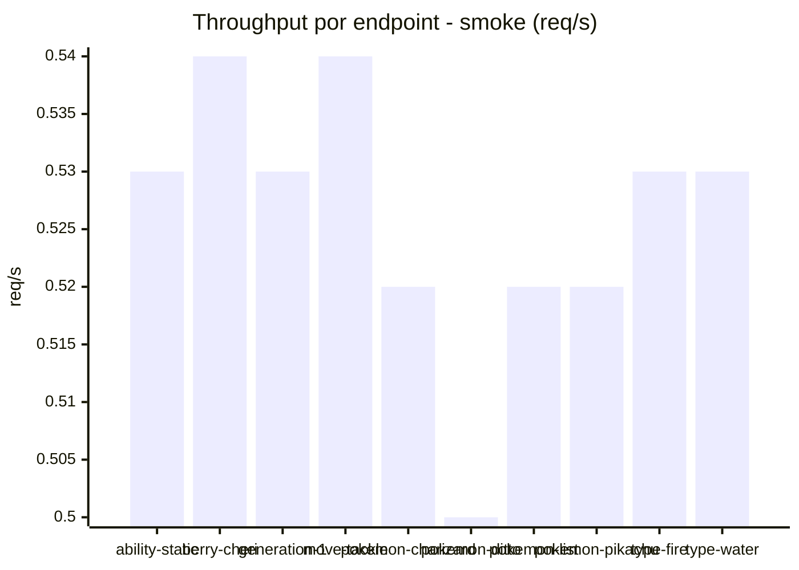

# Reporte de performance - PokeAPI

**Fecha:** 2026-10-14 17:48 UTC  
**Veredicto del agente:** `PASS`  
**Corrida:** [ver en GitHub Actions](https://github.com/lrbg/jmeter-pokeapi-lab/actions/runs/38609350835)  

## Validacion del agente de IA

PASS (fallback por umbrales)

- Error maximo: 0.0%
- p95 maximo: 177.9 ms

## Resultados

### Escenario: `load`

| Metrica | Valor |
| --- | --- |
| Muestras | 13884 |
| Errores | 0 (0.0%) |
| Latencia media | 78.5 ms |
| p50 / p90 / p95 / p99 | 49.0 / 137.0 / 157.0 / 223.0 ms |
| Min / Max | 36 / 5308 ms |
| Throughput | 115.97 req/s |
| Duracion | 119.7 s |

Detalle por endpoint

| Endpoint | Muestras | Error % | avg | p95 | p99 | req/s |
| --- | --- | --- | --- | --- | --- | --- |
| ability-static | 1388 | 0.0% | 72.2 | 133.0 | 144.3 | 11.78 |
| berry-cheri | 1388 | 0.0% | 69.5 | 127.6 | 137.1 | 11.77 |
| generation-1 | 1388 | 0.0% | 66.3 | 129.0 | 139.0 | 11.81 |
| move-tackle | 1388 | 0.0% | 71.4 | 138.0 | 150.4 | 11.8 |
| pokemon-charizard | 1389 | 0.0% | 110.4 | 196.0 | 427.6 | 11.68 |
| pokemon-ditto | 1389 | 0.0% | 72.7 | 134.0 | 148.1 | 11.61 |
| pokemon-list | 1389 | 0.0% | 71.0 | 129.0 | 137.0 | 11.72 |
| pokemon-pikachu | 1389 | 0.0% | 104.1 | 187.0 | 363.5 | 11.66 |
| type-fire | 1388 | 0.0% | 73.9 | 134.0 | 146.1 | 11.77 |
| type-water | 1388 | 0.0% | 73.3 | 134.0 | 141.0 | 11.76 |

### Escenario: `smoke`

| Metrica | Valor |
| --- | --- |
| Muestras | 138 |
| Errores | 0 (0.0%) |
| Latencia media | 109.2 ms |
| p50 / p90 / p95 / p99 | 113.0 / 158.0 / 177.9 / 462.1 ms |
| Min / Max | 41 / 695 ms |
| Throughput | 4.71 req/s |
| Duracion | 29.3 s |

Detalle por endpoint

| Endpoint | Muestras | Error % | avg | p95 | p99 | req/s |
| --- | --- | --- | --- | --- | --- | --- |
| ability-static | 14 | 0.0% | 86.7 | 121.7 | 122.7 | 0.53 |
| berry-cheri | 14 | 0.0% | 118.1 | 233.6 | 408.3 | 0.54 |
| generation-1 | 13 | 0.0% | 95.5 | 119.4 | 119.9 | 0.53 |
| move-tackle | 13 | 0.0% | 88 | 122.2 | 123.6 | 0.54 |
| pokemon-charizard | 14 | 0.0% | 202.4 | 520.1 | 660.0 | 0.52 |
| pokemon-ditto | 14 | 0.0% | 115.2 | 241.1 | 422.6 | 0.5 |
| pokemon-list | 14 | 0.0% | 79.8 | 115.8 | 118.3 | 0.52 |
| pokemon-pikachu | 14 | 0.0% | 125.4 | 184.6 | 224.1 | 0.52 |
| type-fire | 14 | 0.0% | 93.6 | 119.0 | 119.0 | 0.53 |
| type-water | 14 | 0.0% | 84.4 | 117.7 | 118.7 | 0.53 |

