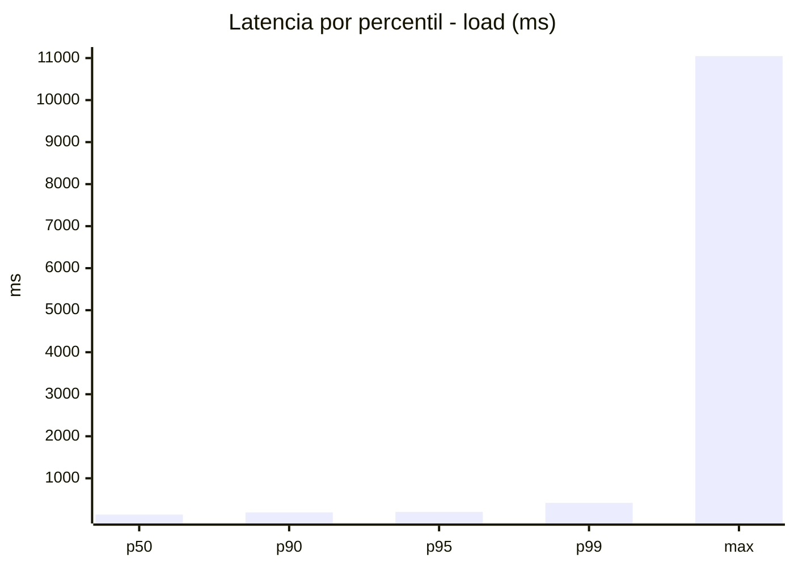
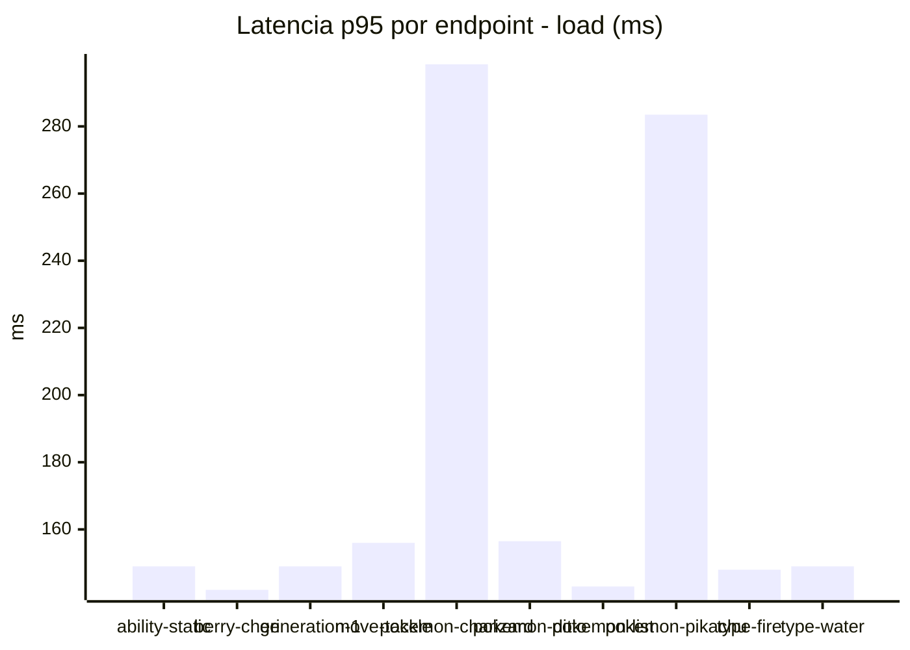
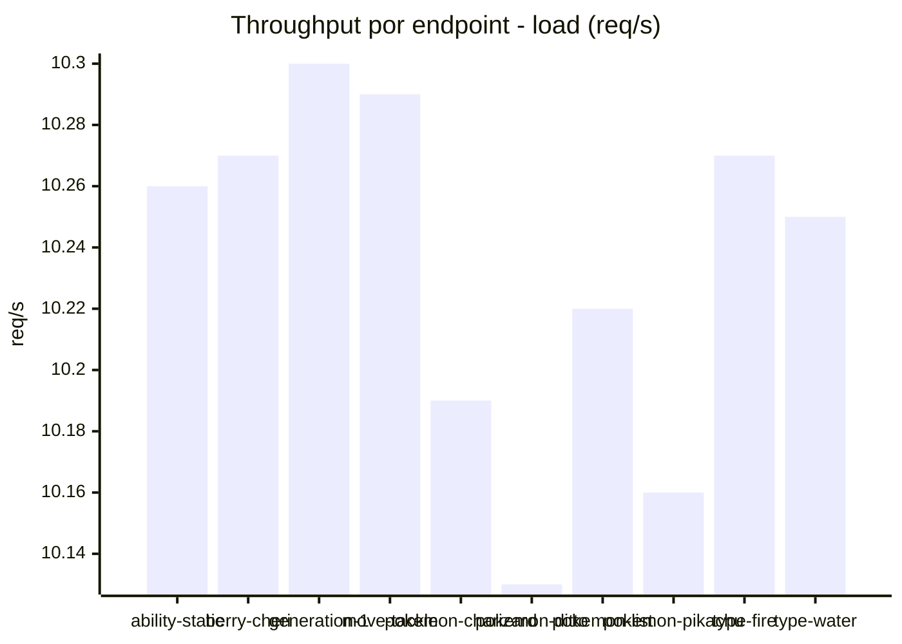
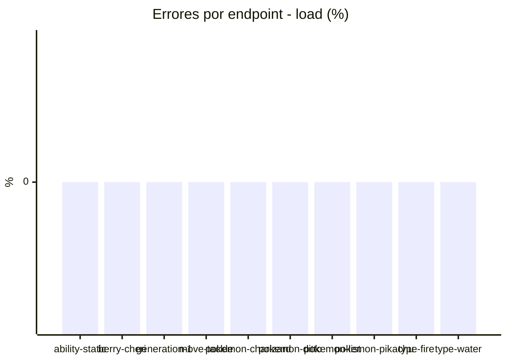
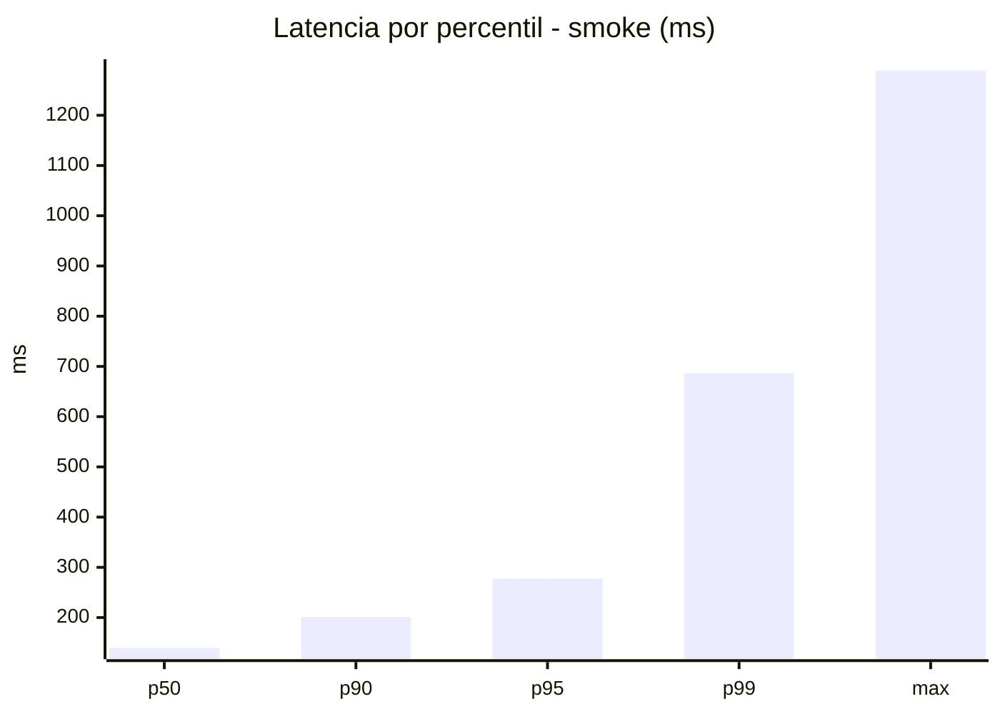
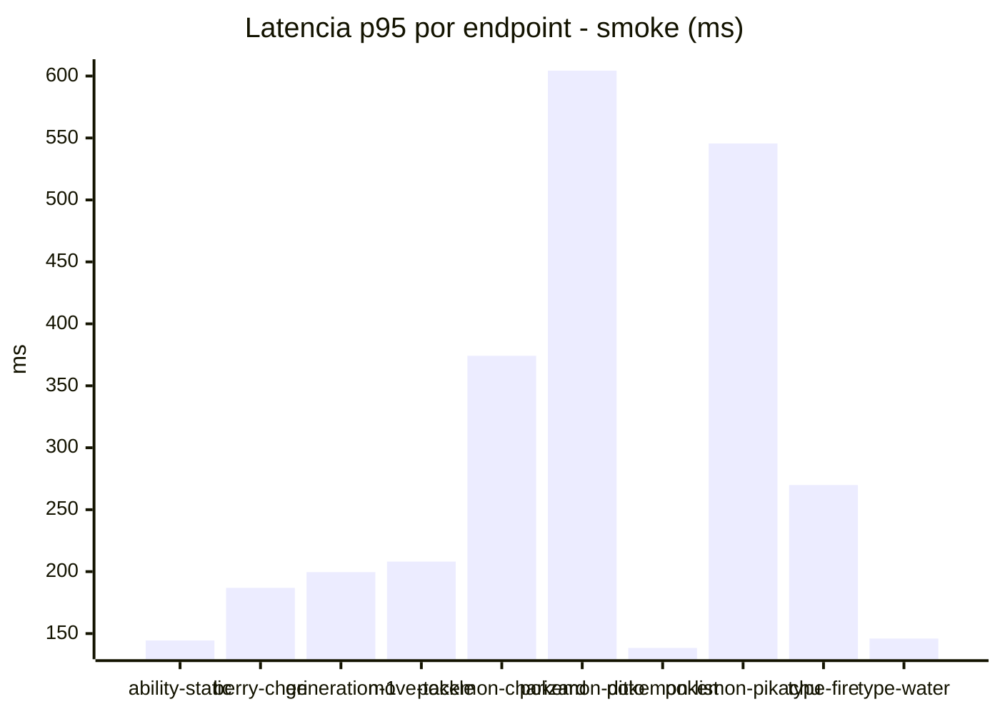
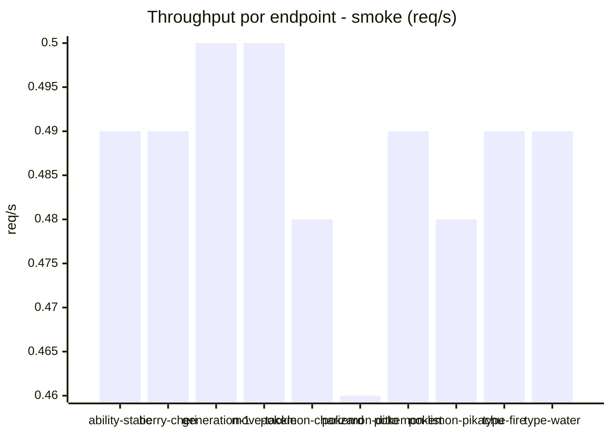

# Reporte de performance - PokeAPI

**Fecha:** 2026-10-15 17:36 UTC  
**Veredicto del agente:** `PASS`  
**Corrida:** [ver en GitHub Actions](https://github.com/lrbg/jmeter-pokeapi-lab/actions/runs/38778428219)  

## Validacion del agente de IA

PASS (fallback por umbrales)

- Error maximo: 0.0%
- p95 maximo: 277.6 ms

## Resultados

### Escenario: `load`

| Metrica | Valor |
| --- | --- |
| Muestras | 12107 |
| Errores | 0 (0.0%) |
| Latencia media | 134.1 ms |
| p50 / p90 / p95 / p99 | 137.0 / 189.0 / 201.0 / 416.0 ms |
| Min / Max | 36 / 11048 ms |
| Throughput | 101.12 req/s |
| Duracion | 119.7 s |

Detalle por endpoint

| Endpoint | Muestras | Error % | avg | p95 | p99 | req/s |
| --- | --- | --- | --- | --- | --- | --- |
| ability-static | 1210 | 0.0% | 118.2 | 149.0 | 224.8 | 10.26 |
| berry-cheri | 1210 | 0.0% | 117.1 | 142.0 | 155.0 | 10.27 |
| generation-1 | 1211 | 0.0% | 128.3 | 149.0 | 390.0 | 10.3 |
| move-tackle | 1210 | 0.0% | 133.2 | 156.0 | 411.9 | 10.29 |
| pokemon-charizard | 1211 | 0.0% | 181.8 | 298.5 | 552.4 | 10.19 |
| pokemon-ditto | 1212 | 0.0% | 131.5 | 156.5 | 377.9 | 10.13 |
| pokemon-list | 1211 | 0.0% | 110.8 | 143.0 | 164.7 | 10.22 |
| pokemon-pikachu | 1211 | 0.0% | 183.8 | 283.5 | 547.4 | 10.16 |
| type-fire | 1210 | 0.0% | 123.7 | 148.0 | 273.9 | 10.27 |
| type-water | 1211 | 0.0% | 112.9 | 149.0 | 221.5 | 10.25 |

### Escenario: `smoke`

| Metrica | Valor |
| --- | --- |
| Muestras | 124 |
| Errores | 0 (0.0%) |
| Latencia media | 173.9 ms |
| p50 / p90 / p95 / p99 | 139.5 / 201.4 / 277.6 / 686.6 ms |
| Min / Max | 126 / 1289 ms |
| Throughput | 4.25 req/s |
| Duracion | 29.1 s |

Detalle por endpoint

| Endpoint | Muestras | Error % | avg | p95 | p99 | req/s |
| --- | --- | --- | --- | --- | --- | --- |
| ability-static | 12 | 0.0% | 138.4 | 144.4 | 144.9 | 0.49 |
| berry-cheri | 12 | 0.0% | 141.2 | 186.9 | 235.8 | 0.49 |
| generation-1 | 12 | 0.0% | 146.5 | 199.6 | 255.9 | 0.5 |
| move-tackle | 12 | 0.0% | 153.2 | 208.1 | 246.4 | 0.5 |
| pokemon-charizard | 13 | 0.0% | 227.7 | 374.2 | 481.2 | 0.48 |
| pokemon-ditto | 13 | 0.0% | 229.5 | 604.4 | 1152.1 | 0.46 |
| pokemon-list | 13 | 0.0% | 134.1 | 138.4 | 138.9 | 0.49 |
| pokemon-pikachu | 13 | 0.0% | 254.5 | 545.6 | 701.1 | 0.48 |
| type-fire | 12 | 0.0% | 163.2 | 269.9 | 371.6 | 0.49 |
| type-water | 12 | 0.0% | 138.4 | 146.0 | 146.0 | 0.49 |

