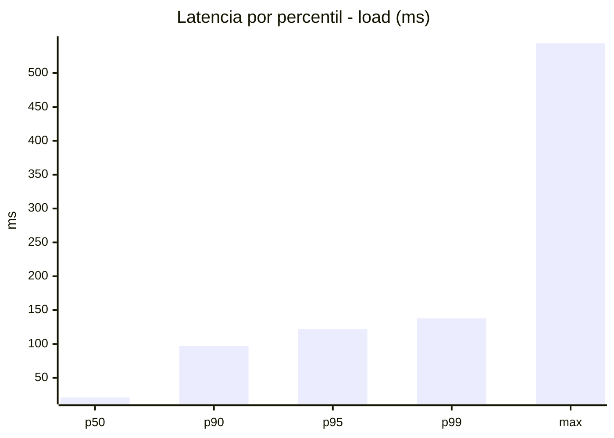
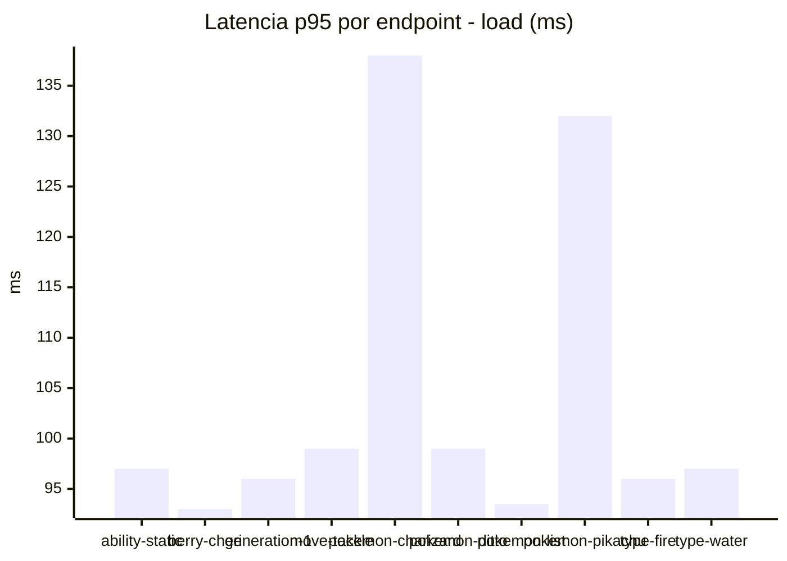
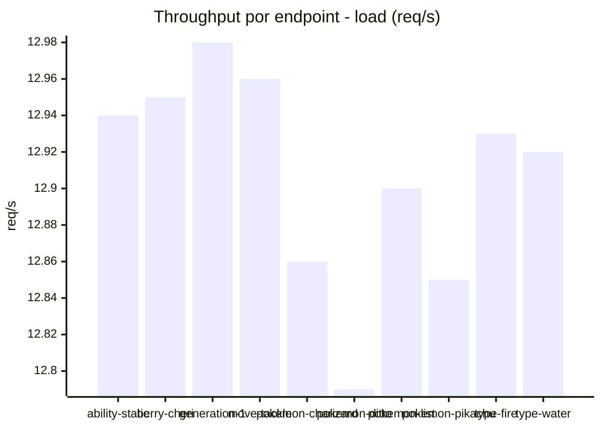
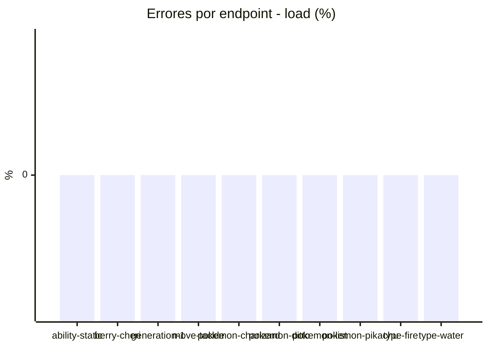
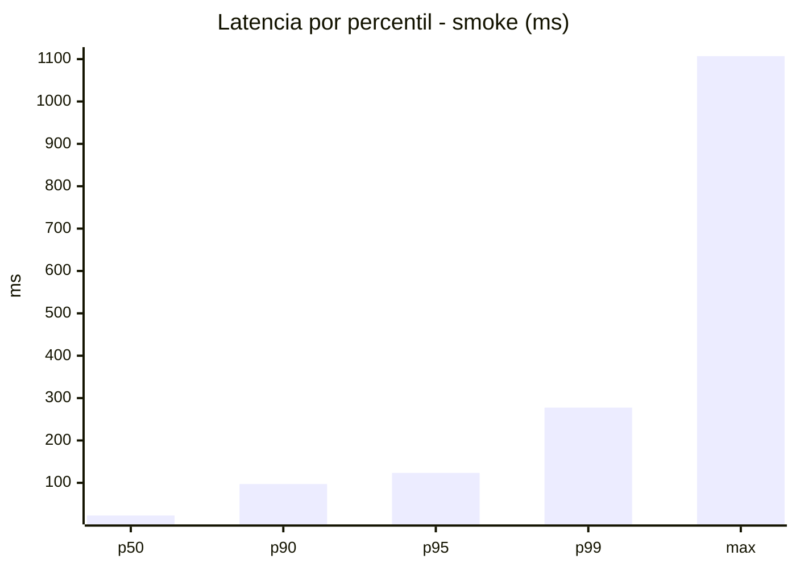
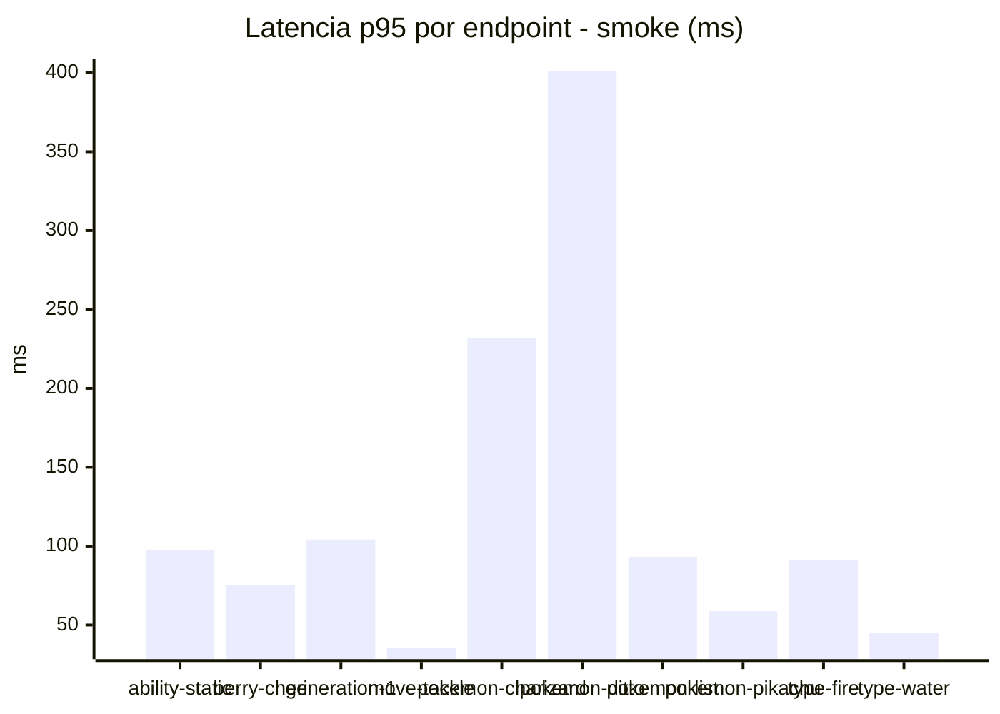
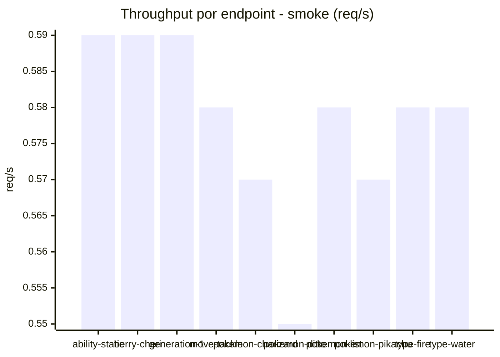

# Reporte de performance - PokeAPI

**Fecha:** 2026-10-16 17:11 UTC  
**Veredicto del agente:** `PASS`  
**Corrida:** [ver en GitHub Actions](https://github.com/lrbg/jmeter-pokeapi-lab/actions/runs/38937451984)  

## Validacion del agente de IA

PASS (fallback por umbrales)

- Error maximo: 0.0%
- p95 maximo: 123.5 ms

## Resultados

### Escenario: `load`

| Metrica | Valor |
| --- | --- |
| Muestras | 15300 |
| Errores | 0 (0.0%) |
| Latencia media | 43.5 ms |
| p50 / p90 / p95 / p99 | 21.0 / 97.0 / 122.0 / 138.0 ms |
| Min / Max | 12 / 544 ms |
| Throughput | 127.85 req/s |
| Duracion | 119.7 s |

Detalle por endpoint

| Endpoint | Muestras | Error % | avg | p95 | p99 | req/s |
| --- | --- | --- | --- | --- | --- | --- |
| ability-static | 1530 | 0.0% | 41.8 | 97.0 | 103.0 | 12.94 |
| berry-cheri | 1529 | 0.0% | 37.3 | 93.0 | 98.0 | 12.95 |
| generation-1 | 1530 | 0.0% | 37.7 | 96.0 | 101.0 | 12.98 |
| move-tackle | 1529 | 0.0% | 38.9 | 99.0 | 109.0 | 12.96 |
| pokemon-charizard | 1530 | 0.0% | 57.7 | 138.0 | 205.7 | 12.86 |
| pokemon-ditto | 1531 | 0.0% | 39.8 | 99.0 | 107.0 | 12.79 |
| pokemon-list | 1530 | 0.0% | 41.3 | 93.5 | 98.7 | 12.9 |
| pokemon-pikachu | 1531 | 0.0% | 56.3 | 132.0 | 289.4 | 12.85 |
| type-fire | 1530 | 0.0% | 41.0 | 96.0 | 101.7 | 12.93 |
| type-water | 1530 | 0.0% | 43.2 | 97.0 | 104.0 | 12.92 |

### Escenario: `smoke`

| Metrica | Valor |
| --- | --- |
| Muestras | 150 |
| Errores | 0 (0.0%) |
| Latencia media | 56.2 ms |
| p50 / p90 / p95 / p99 | 23.0 / 97.2 / 123.5 / 277.6 ms |
| Min / Max | 15 / 1107 ms |
| Throughput | 5.15 req/s |
| Duracion | 29.1 s |

Detalle por endpoint

| Endpoint | Muestras | Error % | avg | p95 | p99 | req/s |
| --- | --- | --- | --- | --- | --- | --- |
| ability-static | 15 | 0.0% | 79.2 | 97.6 | 98.7 | 0.59 |
| berry-cheri | 15 | 0.0% | 31.1 | 75.2 | 172.6 | 0.59 |
| generation-1 | 15 | 0.0% | 80.4 | 104.2 | 112.0 | 0.59 |
| move-tackle | 15 | 0.0% | 23.3 | 35.5 | 55.1 | 0.58 |
| pokemon-charizard | 15 | 0.0% | 101 | 231.8 | 330.4 | 0.57 |
| pokemon-ditto | 15 | 0.0% | 108.3 | 401.4 | 965.9 | 0.55 |
| pokemon-list | 15 | 0.0% | 53.5 | 93.3 | 93.9 | 0.58 |
| pokemon-pikachu | 15 | 0.0% | 31 | 58.7 | 80.5 | 0.57 |
| type-fire | 15 | 0.0% | 29.4 | 91.3 | 91.9 | 0.58 |
| type-water | 15 | 0.0% | 25.1 | 45.0 | 89.8 | 0.58 |

