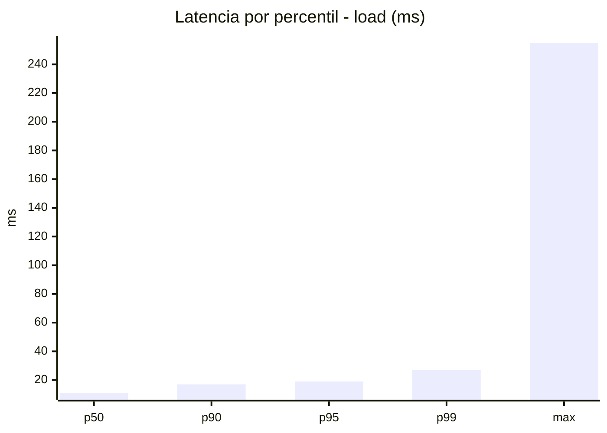
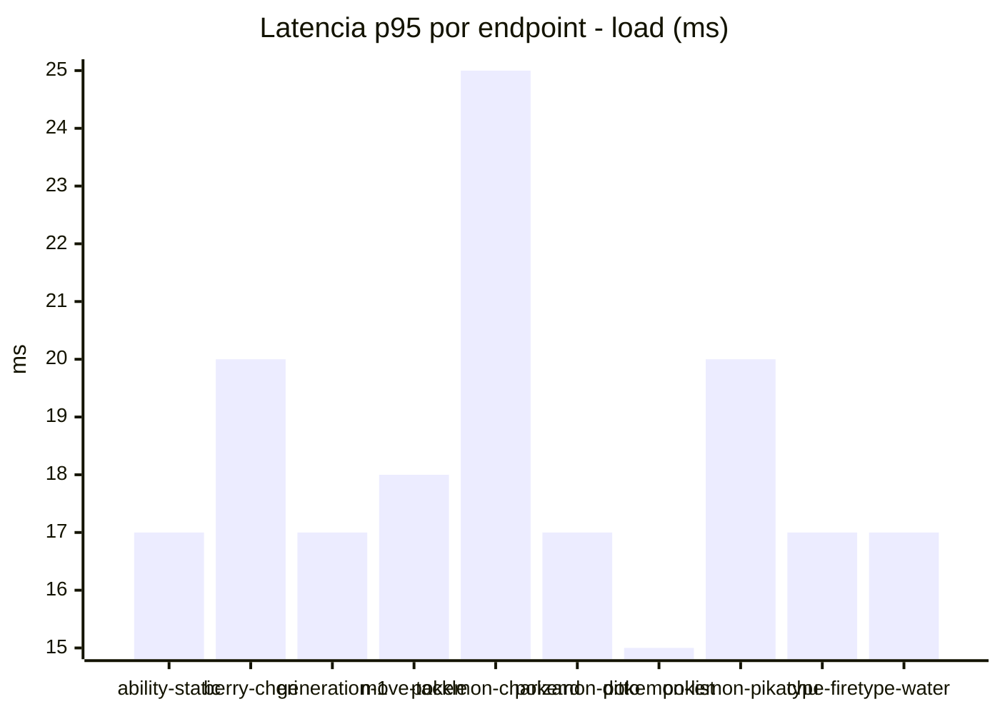
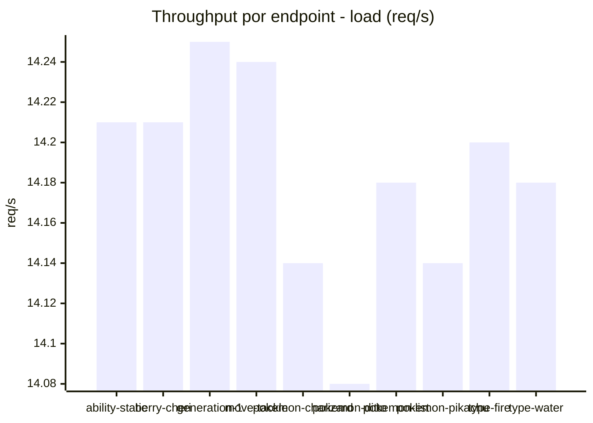
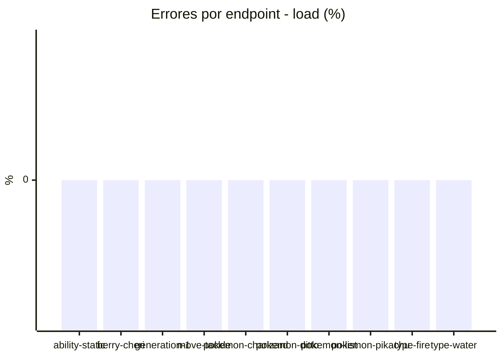
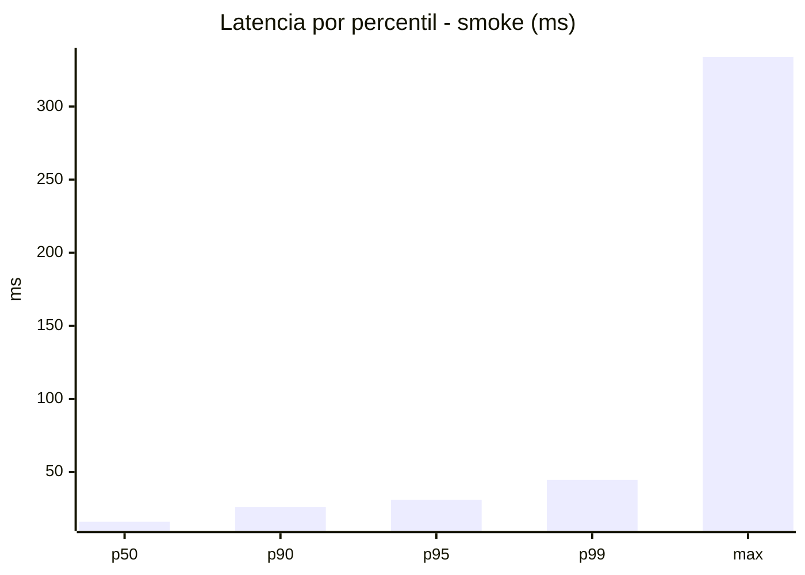
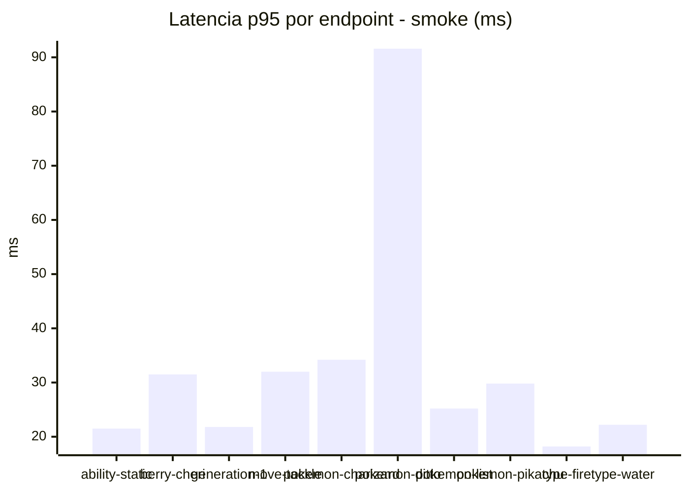
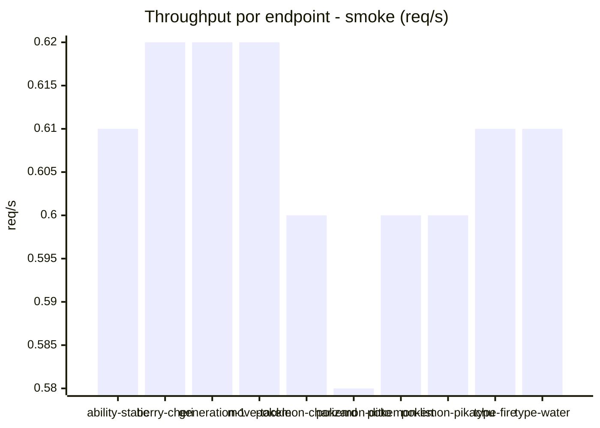

# Reporte de performance - PokeAPI

**Fecha:** 2026-10-17 16:09 UTC  
**Veredicto del agente:** `PASS`  
**Corrida:** [ver en GitHub Actions](https://github.com/lrbg/jmeter-pokeapi-lab/actions/runs/39047996983)  

## Validacion del agente de IA

PASS (fallback por umbrales)

- Error maximo: 0.0%
- p95 maximo: 31.0 ms

## Resultados

### Escenario: `load`

| Metrica | Valor |
| --- | --- |
| Muestras | 16828 |
| Errores | 0 (0.0%) |
| Latencia media | 12.3 ms |
| p50 / p90 / p95 / p99 | 11.0 / 17.0 / 19.0 / 27.0 ms |
| Min / Max | 6 / 255 ms |
| Throughput | 140.7 req/s |
| Duracion | 119.6 s |

Detalle por endpoint

| Endpoint | Muestras | Error % | avg | p95 | p99 | req/s |
| --- | --- | --- | --- | --- | --- | --- |
| ability-static | 1682 | 0.0% | 11.3 | 17.0 | 25.2 | 14.21 |
| berry-cheri | 1682 | 0.0% | 12.5 | 20.0 | 31.0 | 14.21 |
| generation-1 | 1683 | 0.0% | 11.5 | 17.0 | 24.0 | 14.25 |
| move-tackle | 1682 | 0.0% | 12.4 | 18.0 | 24.0 | 14.24 |
| pokemon-charizard | 1683 | 0.0% | 16.3 | 25.0 | 36.0 | 14.14 |
| pokemon-ditto | 1684 | 0.0% | 12.0 | 17.0 | 24.2 | 14.08 |
| pokemon-list | 1684 | 0.0% | 10.5 | 15.0 | 21.0 | 14.18 |
| pokemon-pikachu | 1683 | 0.0% | 13.5 | 20.0 | 28.0 | 14.14 |
| type-fire | 1682 | 0.0% | 11.7 | 17.0 | 25.2 | 14.2 |
| type-water | 1683 | 0.0% | 11.5 | 17.0 | 22.0 | 14.18 |

### Escenario: `smoke`

| Metrica | Valor |
| --- | --- |
| Muestras | 161 |
| Errores | 0 (0.0%) |
| Latencia media | 19.6 ms |
| p50 / p90 / p95 / p99 | 16.0 / 26.0 / 31.0 / 44.6 ms |
| Min / Max | 9 / 334 ms |
| Throughput | 5.53 req/s |
| Duracion | 29.1 s |

Detalle por endpoint

| Endpoint | Muestras | Error % | avg | p95 | p99 | req/s |
| --- | --- | --- | --- | --- | --- | --- |
| ability-static | 16 | 0.0% | 13.7 | 21.5 | 22.7 | 0.61 |
| berry-cheri | 16 | 0.0% | 19.5 | 31.5 | 32.7 | 0.62 |
| generation-1 | 16 | 0.0% | 15 | 21.8 | 23.5 | 0.62 |
| move-tackle | 16 | 0.0% | 19.3 | 32.0 | 46.4 | 0.62 |
| pokemon-charizard | 16 | 0.0% | 24.1 | 34.2 | 39.6 | 0.6 |
| pokemon-ditto | 17 | 0.0% | 35.4 | 91.6 | 285.5 | 0.58 |
| pokemon-list | 16 | 0.0% | 16.7 | 25.2 | 37.8 | 0.6 |
| pokemon-pikachu | 16 | 0.0% | 21 | 29.8 | 33.9 | 0.6 |
| type-fire | 16 | 0.0% | 15.4 | 18.2 | 18.9 | 0.61 |
| type-water | 16 | 0.0% | 15.3 | 22.2 | 22.9 | 0.61 |

