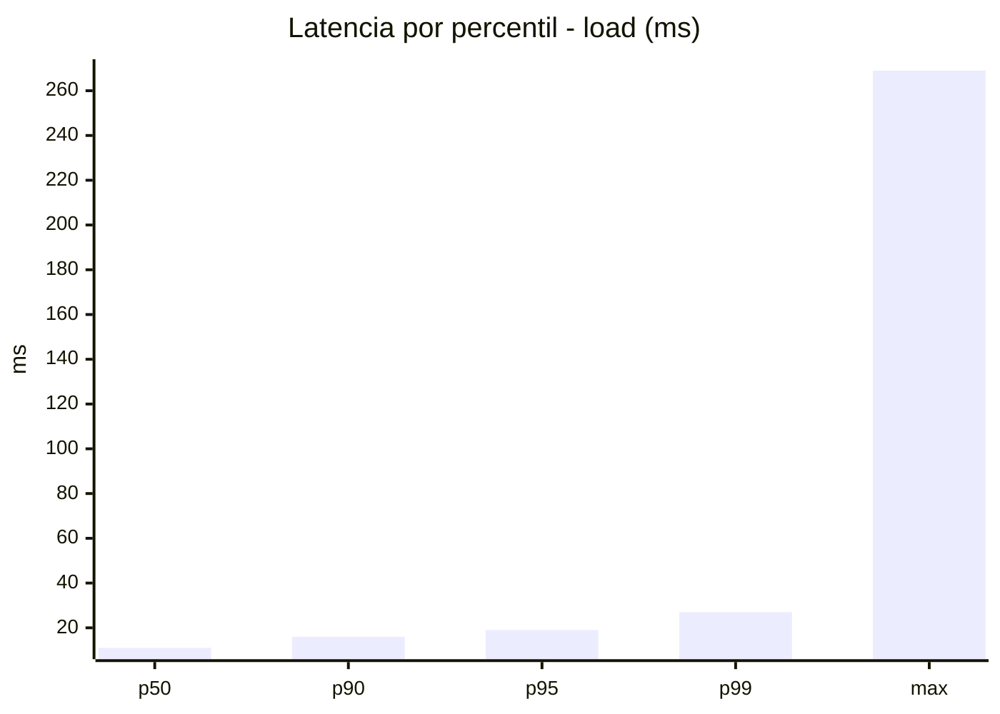
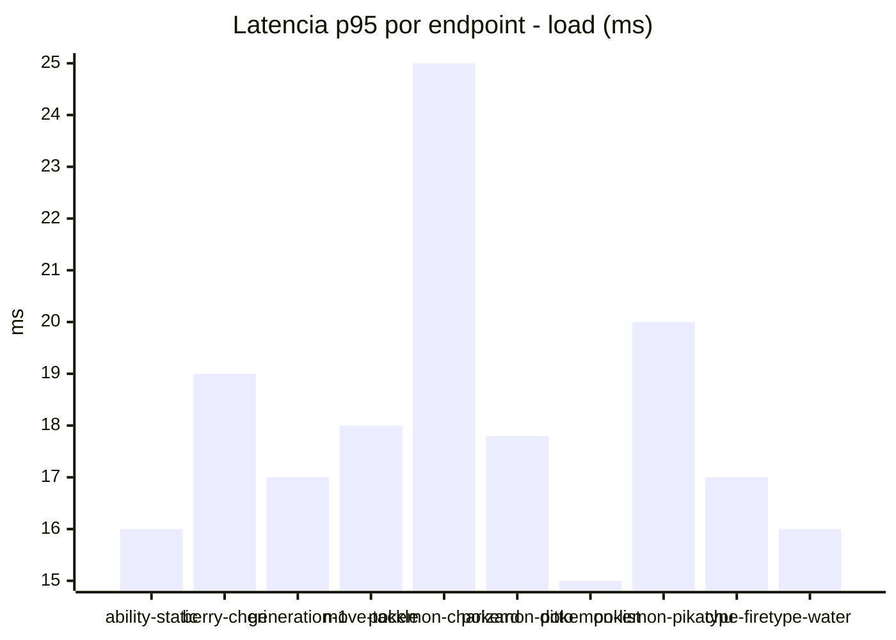
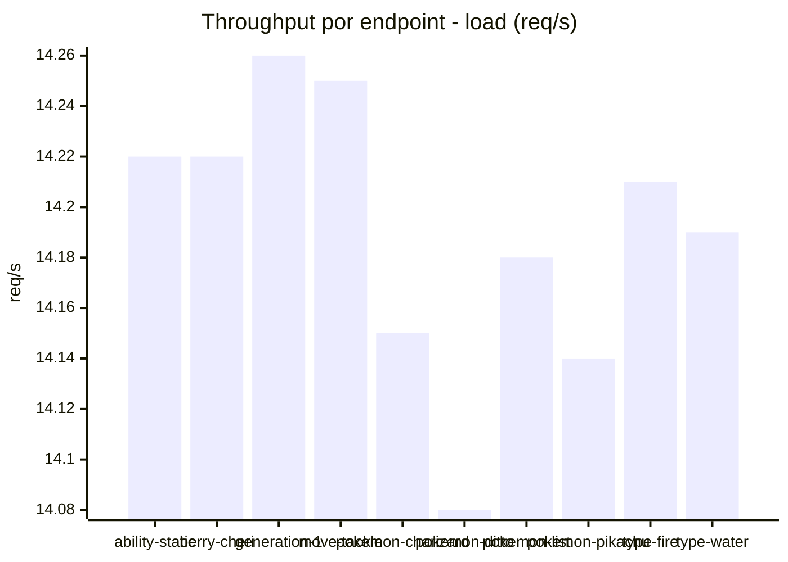
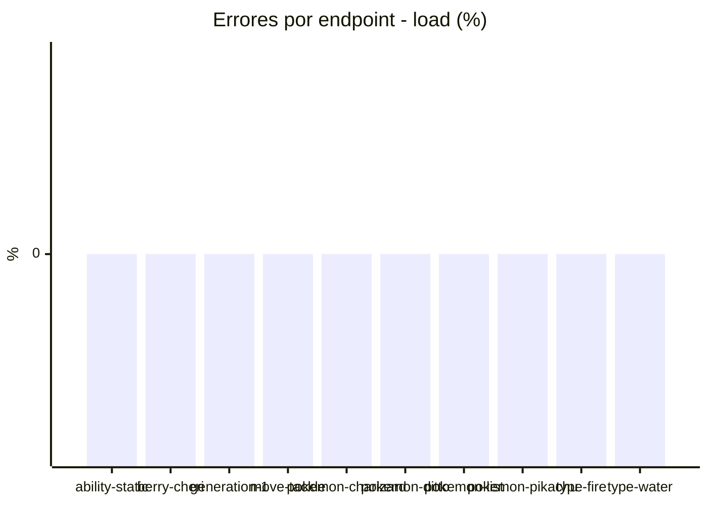
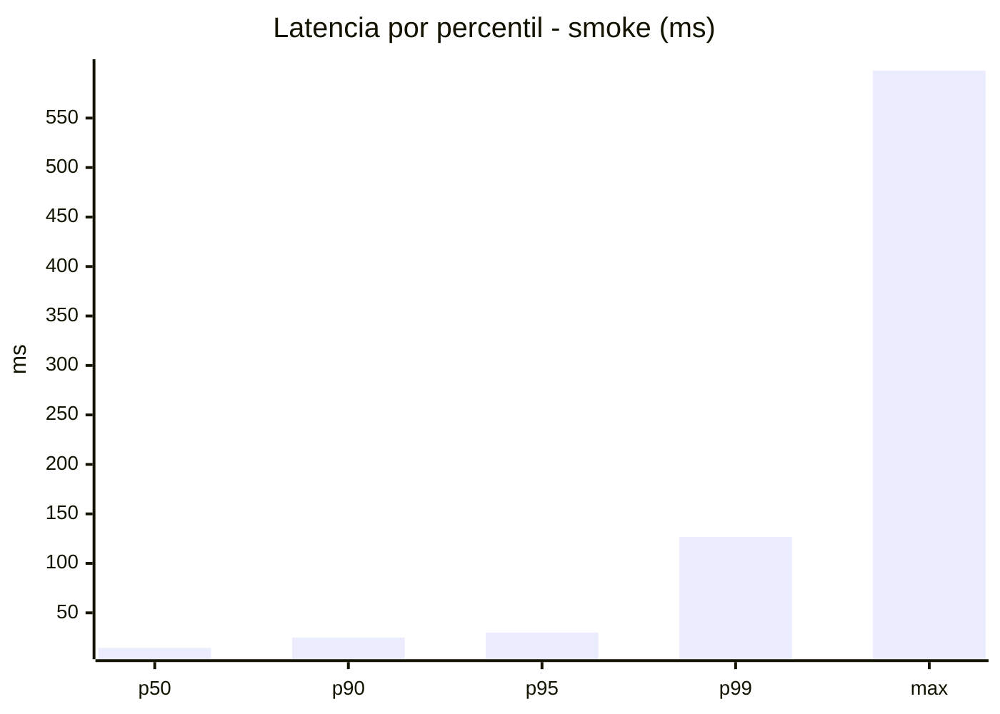
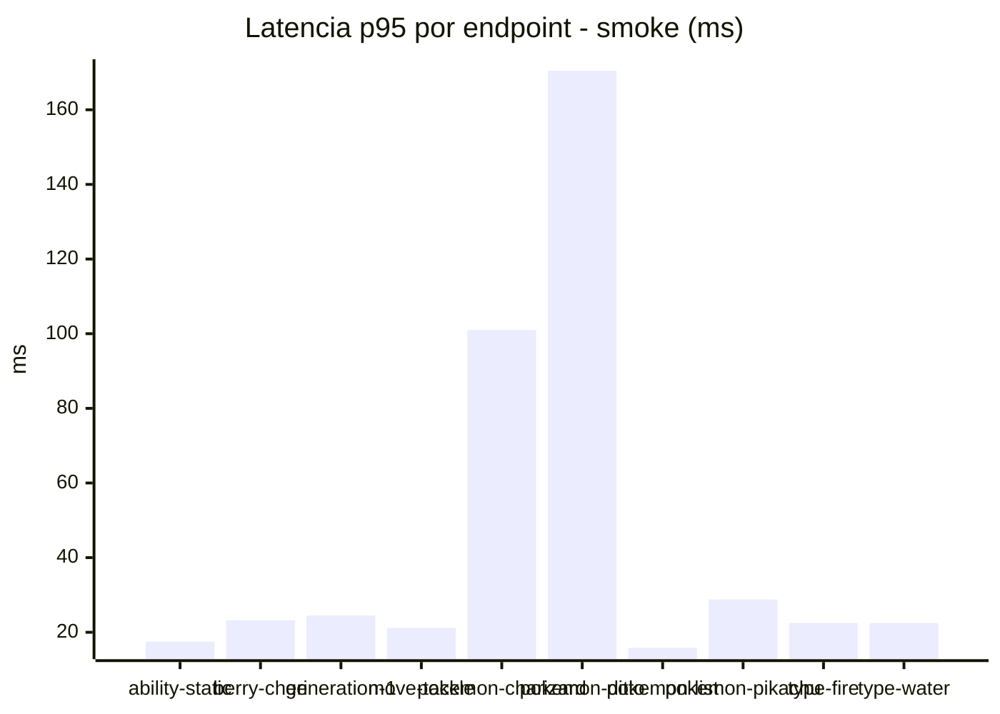
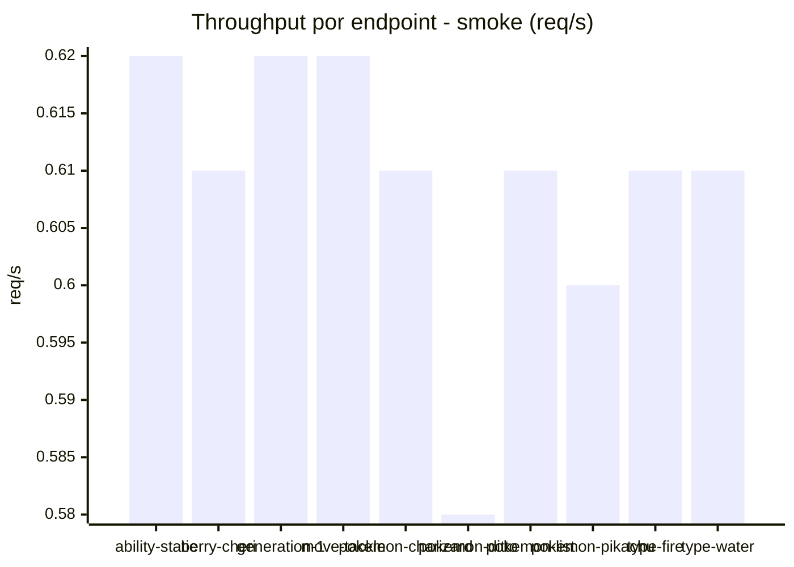

# Reporte de performance - PokeAPI

**Fecha:** 2026-10-18 16:22 UTC  
**Veredicto del agente:** `PASS`  
**Corrida:** [ver en GitHub Actions](https://github.com/lrbg/jmeter-pokeapi-lab/actions/runs/39144504441)  

## Validacion del agente de IA

PASS (fallback por umbrales)

- Error maximo: 0.0%
- p95 maximo: 30.0 ms

## Resultados

### Escenario: `load`

| Metrica | Valor |
| --- | --- |
| Muestras | 16829 |
| Errores | 0 (0.0%) |
| Latencia media | 12.2 ms |
| p50 / p90 / p95 / p99 | 11.0 / 16.0 / 19.0 / 27.0 ms |
| Min / Max | 6 / 269 ms |
| Throughput | 140.71 req/s |
| Duracion | 119.6 s |

Detalle por endpoint

| Endpoint | Muestras | Error % | avg | p95 | p99 | req/s |
| --- | --- | --- | --- | --- | --- | --- |
| ability-static | 1683 | 0.0% | 11.0 | 16.0 | 21.2 | 14.22 |
| berry-cheri | 1683 | 0.0% | 12.1 | 19.0 | 31.2 | 14.22 |
| generation-1 | 1682 | 0.0% | 11.5 | 17.0 | 23.0 | 14.26 |
| move-tackle | 1682 | 0.0% | 12.5 | 18.0 | 25.2 | 14.25 |
| pokemon-charizard | 1683 | 0.0% | 15.9 | 25.0 | 33.2 | 14.15 |
| pokemon-ditto | 1684 | 0.0% | 12.0 | 17.8 | 24.0 | 14.08 |
| pokemon-list | 1683 | 0.0% | 10.6 | 15.0 | 21.0 | 14.18 |
| pokemon-pikachu | 1683 | 0.0% | 13.8 | 20.0 | 28.0 | 14.14 |
| type-fire | 1683 | 0.0% | 11.5 | 17.0 | 24.0 | 14.21 |
| type-water | 1683 | 0.0% | 11.2 | 16.0 | 22.4 | 14.19 |

### Escenario: `smoke`

| Metrica | Valor |
| --- | --- |
| Muestras | 160 |
| Errores | 0 (0.0%) |
| Latencia media | 21.4 ms |
| p50 / p90 / p95 / p99 | 14.5 / 25.0 / 30.0 / 126.6 ms |
| Min / Max | 10 / 598 ms |
| Throughput | 5.5 req/s |
| Duracion | 29.1 s |

Detalle por endpoint

| Endpoint | Muestras | Error % | avg | p95 | p99 | req/s |
| --- | --- | --- | --- | --- | --- | --- |
| ability-static | 16 | 0.0% | 13.1 | 17.5 | 18.7 | 0.62 |
| berry-cheri | 16 | 0.0% | 15.8 | 23.2 | 26.2 | 0.61 |
| generation-1 | 16 | 0.0% | 15.1 | 24.5 | 30.5 | 0.62 |
| move-tackle | 16 | 0.0% | 15.7 | 21.2 | 21.9 | 0.62 |
| pokemon-charizard | 16 | 0.0% | 40.6 | 101.0 | 197.0 | 0.61 |
| pokemon-ditto | 16 | 0.0% | 52.1 | 170.5 | 512.5 | 0.58 |
| pokemon-list | 16 | 0.0% | 12.8 | 15.8 | 17.5 | 0.61 |
| pokemon-pikachu | 16 | 0.0% | 19.5 | 28.8 | 30.5 | 0.6 |
| type-fire | 16 | 0.0% | 14.4 | 22.5 | 26.1 | 0.61 |
| type-water | 16 | 0.0% | 14.9 | 22.5 | 28.5 | 0.61 |

