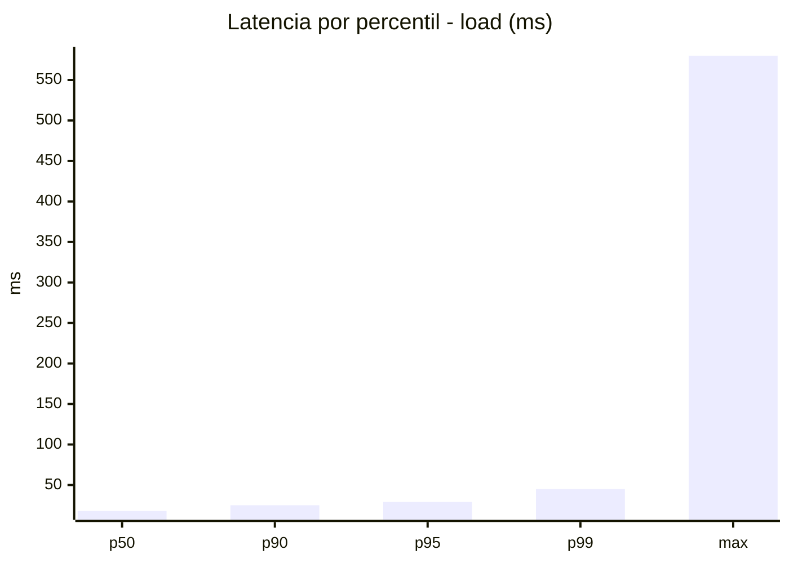
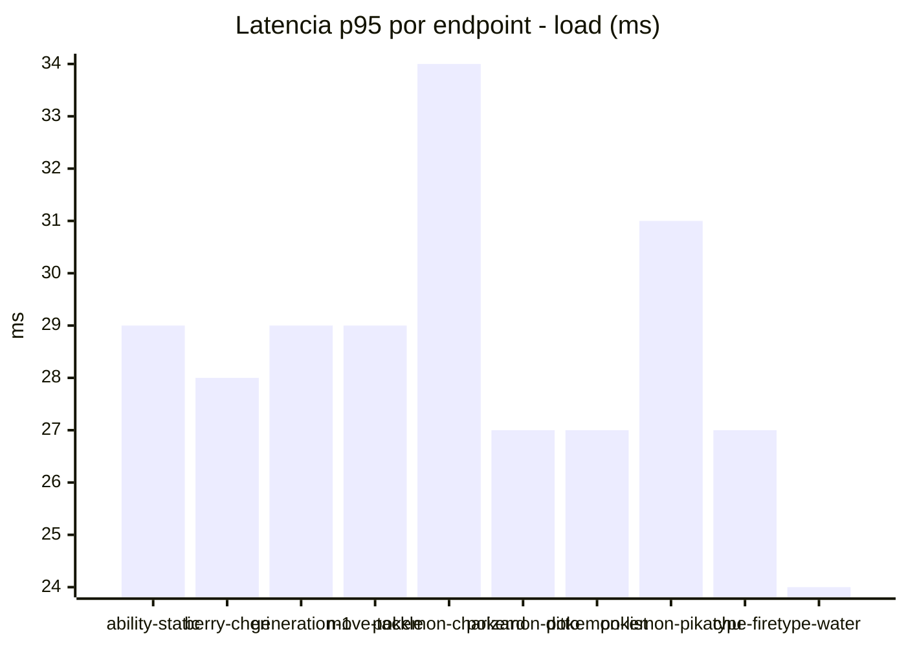
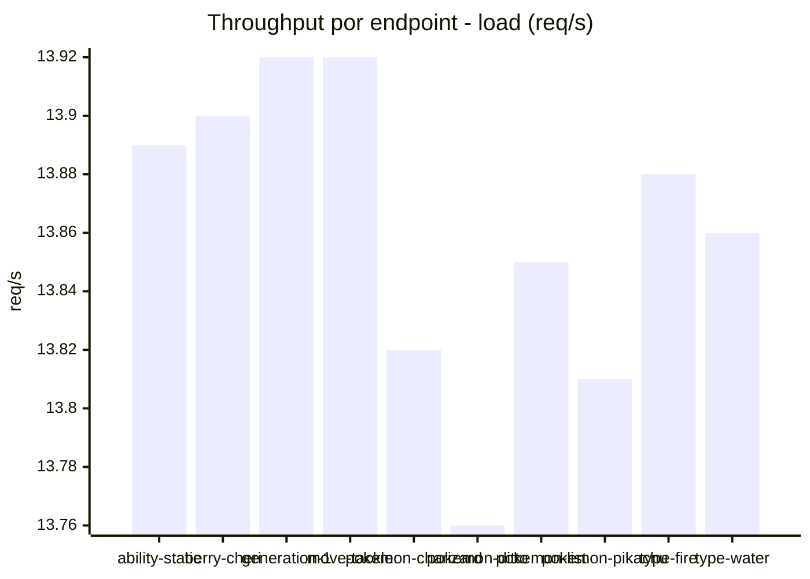
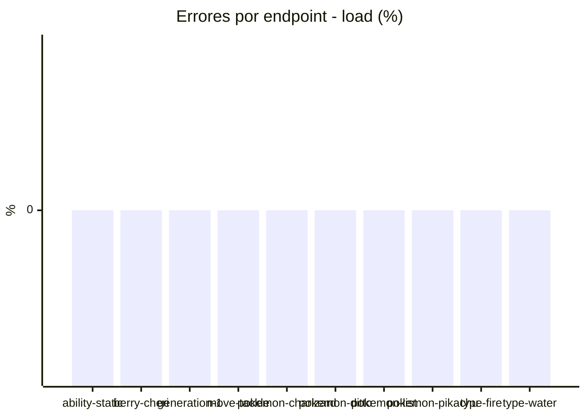
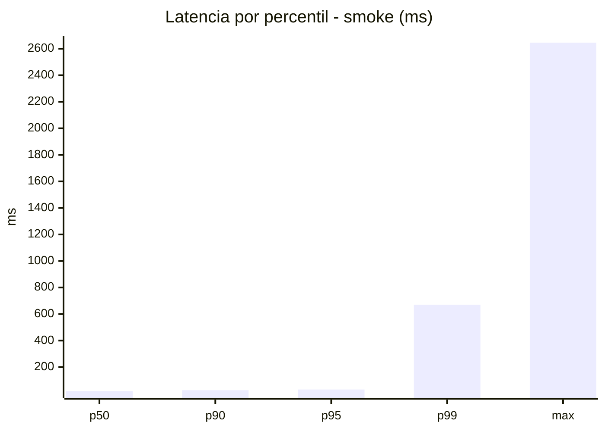
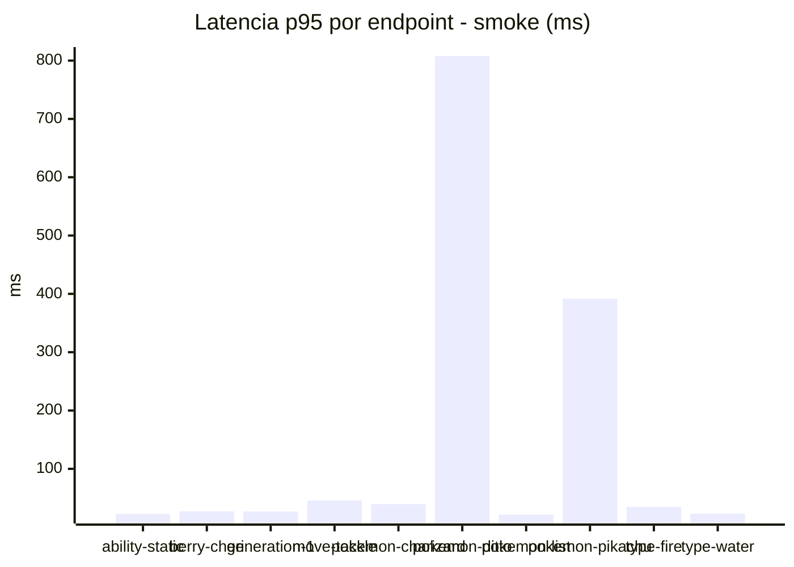
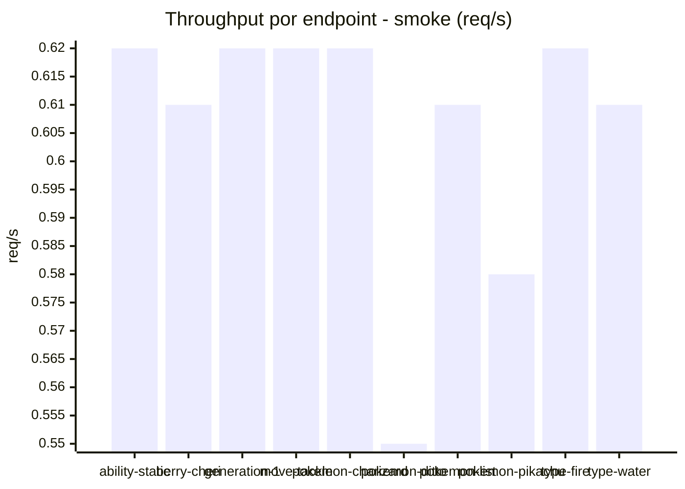

# Reporte de performance - PokeAPI

**Fecha:** 2026-10-19 19:00 UTC  
**Veredicto del agente:** `PASS`  
**Corrida:** [ver en GitHub Actions](https://github.com/lrbg/jmeter-pokeapi-lab/actions/runs/39306945377)  

## Validacion del agente de IA

PASS (fallback por umbrales)

- Error maximo: 0.0%
- p95 maximo: 31.2 ms

## Resultados

### Escenario: `load`

| Metrica | Valor |
| --- | --- |
| Muestras | 16456 |
| Errores | 0 (0.0%) |
| Latencia media | 19.4 ms |
| p50 / p90 / p95 / p99 | 18.0 / 25.0 / 29.0 / 45.0 ms |
| Min / Max | 9 / 580 ms |
| Throughput | 137.52 req/s |
| Duracion | 119.7 s |

Detalle por endpoint

| Endpoint | Muestras | Error % | avg | p95 | p99 | req/s |
| --- | --- | --- | --- | --- | --- | --- |
| ability-static | 1645 | 0.0% | 19.6 | 29.0 | 47.0 | 13.89 |
| berry-cheri | 1645 | 0.0% | 18.0 | 28.0 | 46.6 | 13.9 |
| generation-1 | 1645 | 0.0% | 19.1 | 29.0 | 50.0 | 13.92 |
| move-tackle | 1645 | 0.0% | 19.5 | 29.0 | 43.6 | 13.92 |
| pokemon-charizard | 1646 | 0.0% | 22.9 | 34.0 | 51.0 | 13.82 |
| pokemon-ditto | 1646 | 0.0% | 18.6 | 27.0 | 45.0 | 13.76 |
| pokemon-list | 1646 | 0.0% | 18.1 | 27.0 | 39.0 | 13.85 |
| pokemon-pikachu | 1646 | 0.0% | 22.1 | 31.0 | 49.1 | 13.81 |
| type-fire | 1646 | 0.0% | 18.6 | 27.0 | 38.5 | 13.88 |
| type-water | 1646 | 0.0% | 17.7 | 24.0 | 35.0 | 13.86 |

### Escenario: `smoke`

| Metrica | Valor |
| --- | --- |
| Muestras | 149 |
| Errores | 0 (0.0%) |
| Latencia media | 46.1 ms |
| p50 / p90 / p95 / p99 | 19.0 / 26.0 / 31.2 / 670.8 ms |
| Min / Max | 15 / 2646 ms |
| Throughput | 5.28 req/s |
| Duracion | 28.2 s |

Detalle por endpoint

| Endpoint | Muestras | Error % | avg | p95 | p99 | req/s |
| --- | --- | --- | --- | --- | --- | --- |
| ability-static | 15 | 0.0% | 17.9 | 22.6 | 23.7 | 0.62 |
| berry-cheri | 15 | 0.0% | 18.5 | 27.2 | 29.4 | 0.61 |
| generation-1 | 14 | 0.0% | 19.1 | 26.8 | 31.0 | 0.62 |
| move-tackle | 15 | 0.0% | 24.5 | 45.8 | 82.8 | 0.62 |
| pokemon-charizard | 15 | 0.0% | 25.9 | 39.5 | 53.5 | 0.62 |
| pokemon-ditto | 15 | 0.0% | 192.9 | 807.8 | 2278.4 | 0.55 |
| pokemon-list | 15 | 0.0% | 18 | 21.6 | 22.7 | 0.61 |
| pokemon-pikachu | 15 | 0.0% | 102.5 | 391.6 | 1042.3 | 0.58 |
| type-fire | 15 | 0.0% | 22.3 | 34.6 | 52.5 | 0.62 |
| type-water | 15 | 0.0% | 17.9 | 23.2 | 25.4 | 0.61 |

