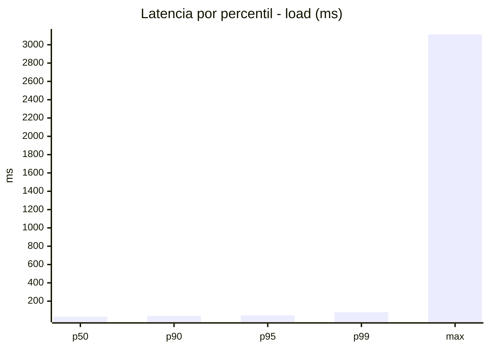
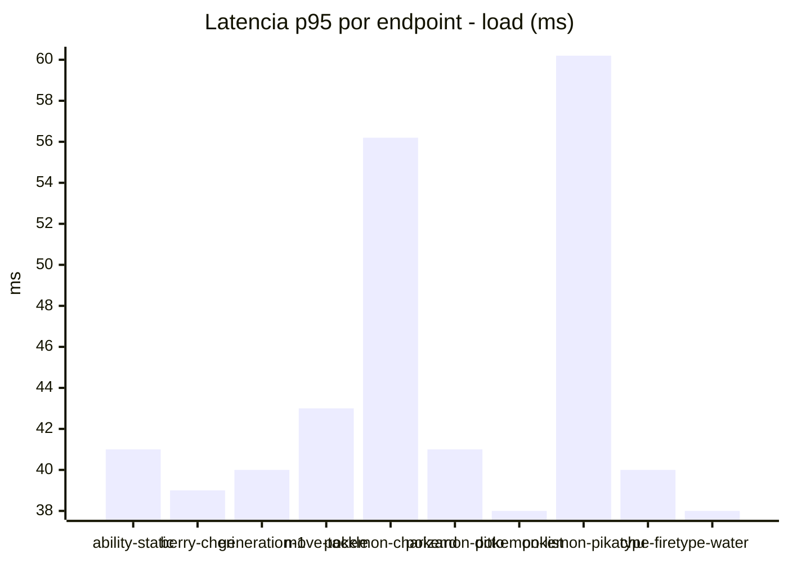
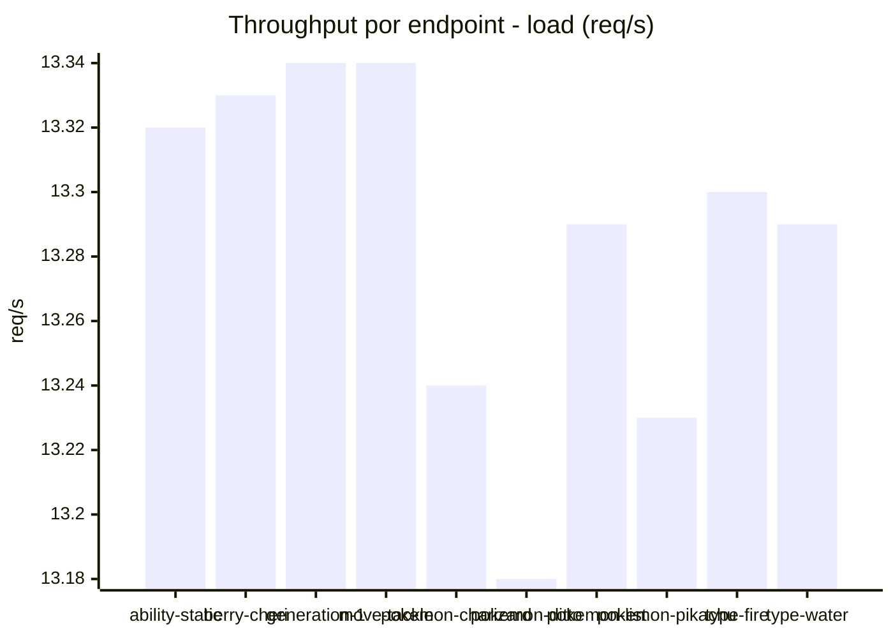
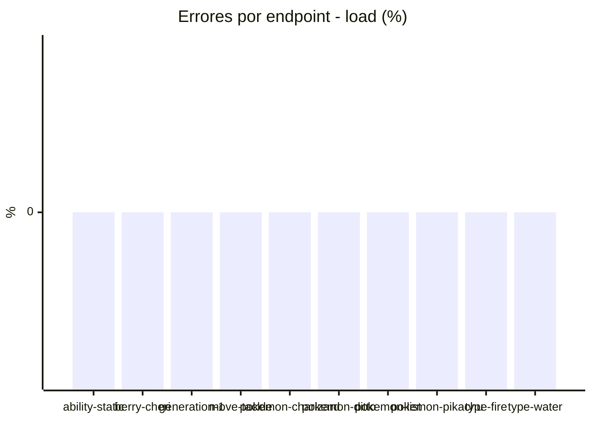
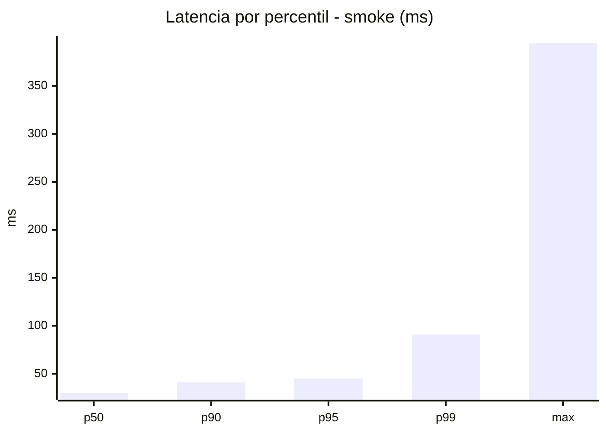
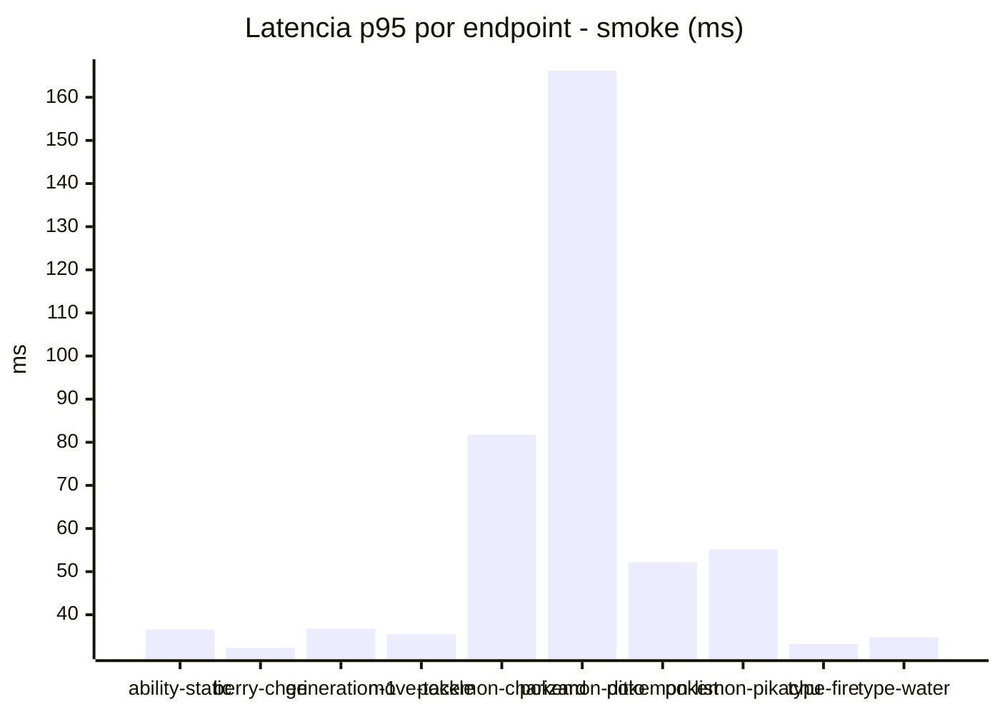
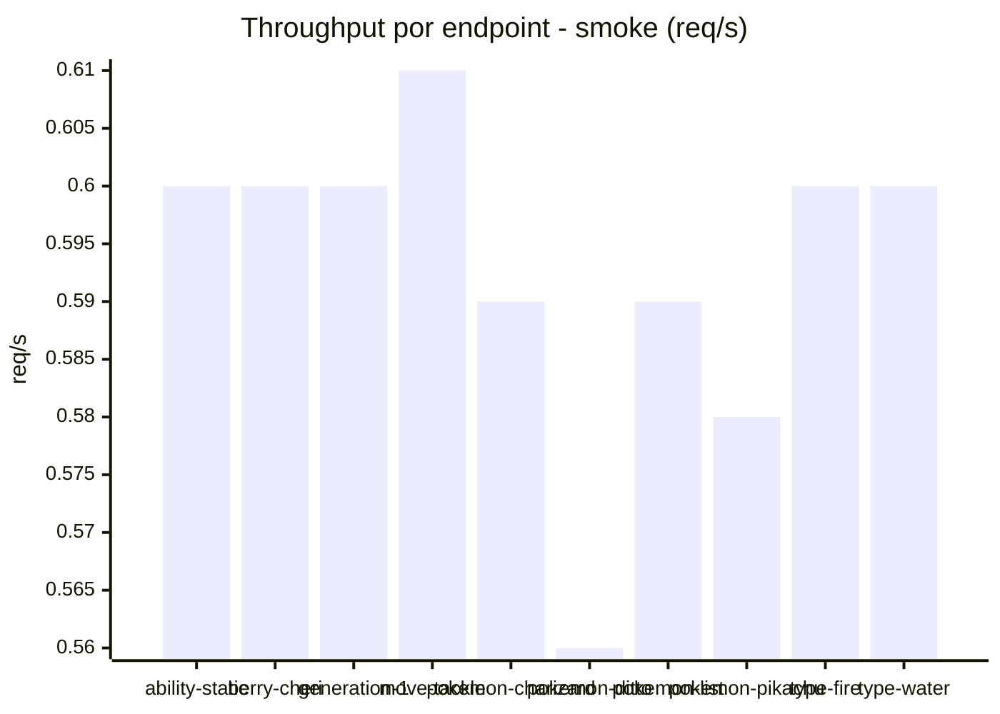

# Reporte de performance - PokeAPI

**Fecha:** 2026-10-20 17:47 UTC  
**Veredicto del agente:** `PASS`  
**Corrida:** [ver en GitHub Actions](https://github.com/lrbg/jmeter-pokeapi-lab/actions/runs/39468749803)  

## Validacion del agente de IA

PASS (fallback por umbrales)

- Error maximo: 0.0%
- p95 maximo: 46.0 ms

## Resultados

### Escenario: `load`

| Metrica | Valor |
| --- | --- |
| Muestras | 15758 |
| Errores | 0 (0.0%) |
| Latencia media | 33.5 ms |
| p50 / p90 / p95 / p99 | 30.0 / 40.0 / 46.0 / 78.0 ms |
| Min / Max | 22 / 3112 ms |
| Throughput | 131.69 req/s |
| Duracion | 119.7 s |

Detalle por endpoint

| Endpoint | Muestras | Error % | avg | p95 | p99 | req/s |
| --- | --- | --- | --- | --- | --- | --- |
| ability-static | 1576 | 0.0% | 32.0 | 41.0 | 74.2 | 13.32 |
| berry-cheri | 1576 | 0.0% | 32.7 | 39.0 | 63.2 | 13.33 |
| generation-1 | 1575 | 0.0% | 32.9 | 40.0 | 75.3 | 13.34 |
| move-tackle | 1575 | 0.0% | 33.4 | 43.0 | 76.3 | 13.34 |
| pokemon-charizard | 1576 | 0.0% | 41.4 | 56.2 | 129.0 | 13.24 |
| pokemon-ditto | 1576 | 0.0% | 32.4 | 41.0 | 76.0 | 13.18 |
| pokemon-list | 1576 | 0.0% | 29.4 | 38.0 | 64.2 | 13.29 |
| pokemon-pikachu | 1576 | 0.0% | 40.2 | 60.2 | 129.5 | 13.23 |
| type-fire | 1576 | 0.0% | 31.0 | 40.0 | 72.2 | 13.3 |
| type-water | 1576 | 0.0% | 29.8 | 38.0 | 61.5 | 13.29 |

### Escenario: `smoke`

| Metrica | Valor |
| --- | --- |
| Muestras | 155 |
| Errores | 0 (0.0%) |
| Latencia media | 35.8 ms |
| p50 / p90 / p95 / p99 | 30.0 / 41.0 / 45.0 / 90.9 ms |
| Min / Max | 24 / 395 ms |
| Throughput | 5.37 req/s |
| Duracion | 28.9 s |

Detalle por endpoint

| Endpoint | Muestras | Error % | avg | p95 | p99 | req/s |
| --- | --- | --- | --- | --- | --- | --- |
| ability-static | 15 | 0.0% | 30.3 | 36.6 | 37.7 | 0.6 |
| berry-cheri | 15 | 0.0% | 28.5 | 32.3 | 32.9 | 0.6 |
| generation-1 | 15 | 0.0% | 29.9 | 36.8 | 40.2 | 0.6 |
| move-tackle | 15 | 0.0% | 30.9 | 35.5 | 38.3 | 0.61 |
| pokemon-charizard | 16 | 0.0% | 45.8 | 81.8 | 83.5 | 0.59 |
| pokemon-ditto | 16 | 0.0% | 56.6 | 166.2 | 349.2 | 0.56 |
| pokemon-list | 16 | 0.0% | 33.8 | 52.2 | 84.0 | 0.59 |
| pokemon-pikachu | 16 | 0.0% | 41.9 | 55.2 | 79.8 | 0.58 |
| type-fire | 15 | 0.0% | 29.5 | 33.2 | 35.4 | 0.6 |
| type-water | 16 | 0.0% | 29.1 | 34.8 | 36.5 | 0.6 |

