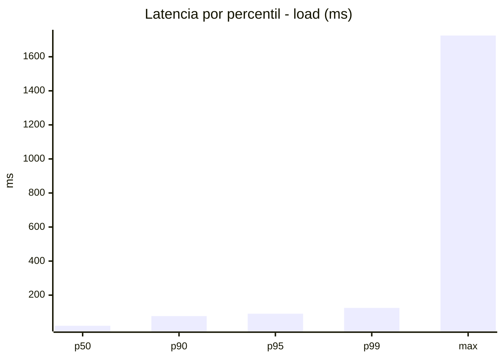
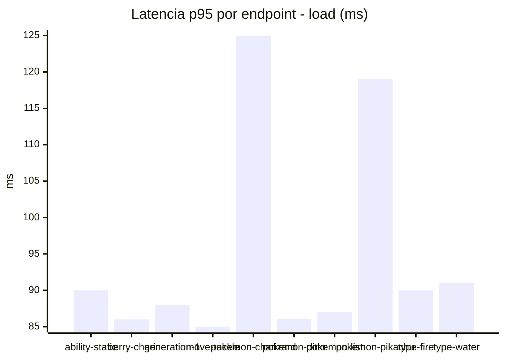
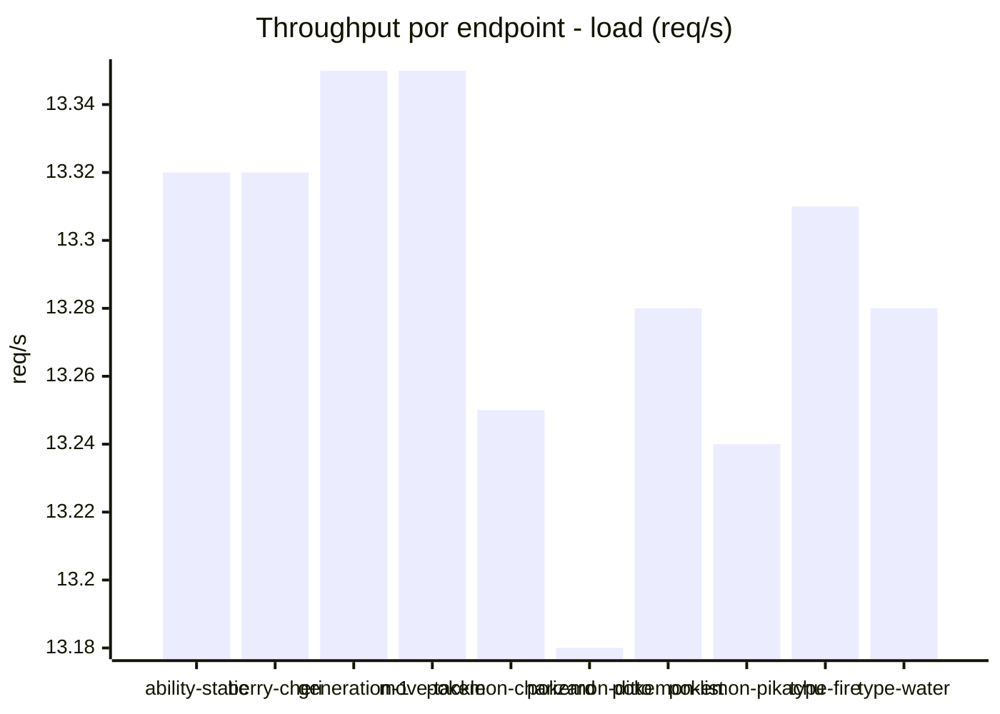
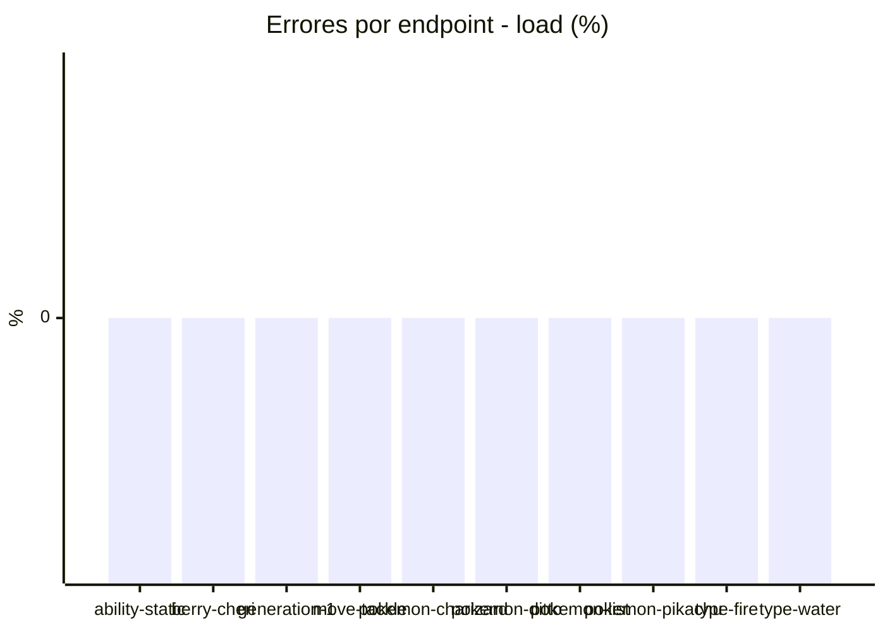
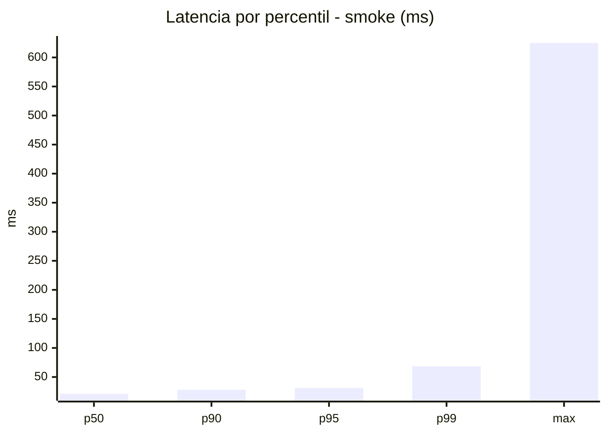
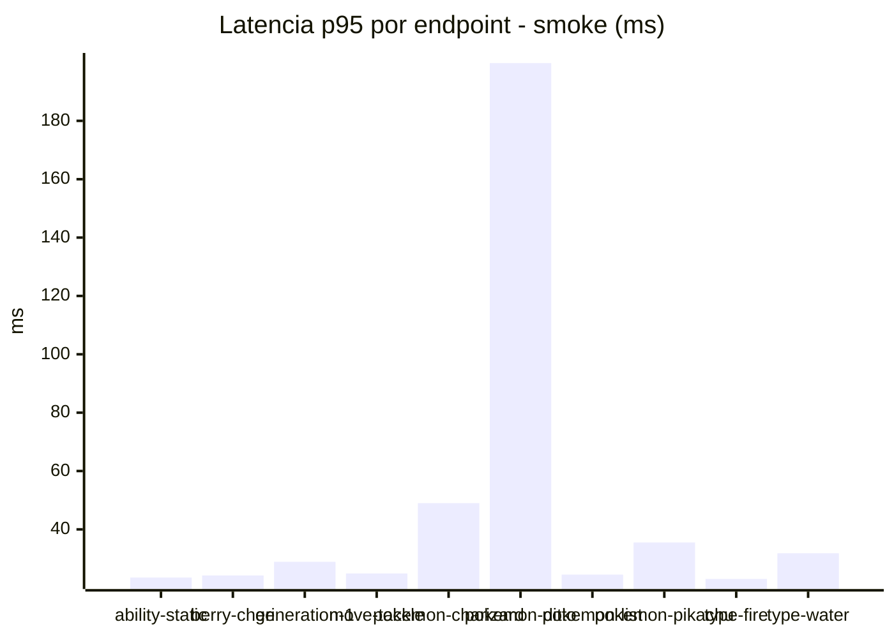
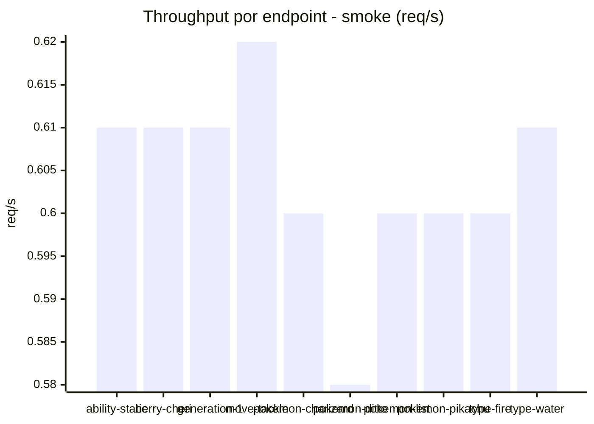

# Reporte de performance - PokeAPI

**Fecha:** 2026-10-21 17:55 UTC  
**Veredicto del agente:** `PASS`  
**Corrida:** [ver en GitHub Actions](https://github.com/lrbg/jmeter-pokeapi-lab/actions/runs/39647674503)  

## Validacion del agente de IA

PASS (fallback por umbrales)

- Error maximo: 0.0%
- p95 maximo: 91.0 ms

## Resultados

### Escenario: `load`

| Metrica | Valor |
| --- | --- |
| Muestras | 15765 |
| Errores | 0 (0.0%) |
| Latencia media | 33.3 ms |
| p50 / p90 / p95 / p99 | 20.0 / 77.0 / 91.0 / 125.0 ms |
| Min / Max | 9 / 1725 ms |
| Throughput | 131.69 req/s |
| Duracion | 119.7 s |

Detalle por endpoint

| Endpoint | Muestras | Error % | avg | p95 | p99 | req/s |
| --- | --- | --- | --- | --- | --- | --- |
| ability-static | 1576 | 0.0% | 31.7 | 90.0 | 100.2 | 13.32 |
| berry-cheri | 1576 | 0.0% | 29.4 | 86.0 | 96.0 | 13.32 |
| generation-1 | 1577 | 0.0% | 31.3 | 88.0 | 101.0 | 13.35 |
| move-tackle | 1576 | 0.0% | 31.1 | 85.0 | 107.2 | 13.35 |
| pokemon-charizard | 1576 | 0.0% | 43.4 | 125.0 | 201.0 | 13.25 |
| pokemon-ditto | 1578 | 0.0% | 31.0 | 86.1 | 107.2 | 13.18 |
| pokemon-list | 1576 | 0.0% | 30.2 | 87.0 | 93.0 | 13.28 |
| pokemon-pikachu | 1577 | 0.0% | 41.1 | 119.0 | 172.2 | 13.24 |
| type-fire | 1576 | 0.0% | 32.2 | 90.0 | 99.0 | 13.31 |
| type-water | 1577 | 0.0% | 32.1 | 91.0 | 106.0 | 13.28 |

### Escenario: `smoke`

| Metrica | Valor |
| --- | --- |
| Muestras | 158 |
| Errores | 0 (0.0%) |
| Latencia media | 26.0 ms |
| p50 / p90 / p95 / p99 | 21.0 / 28.0 / 31.3 / 68.3 ms |
| Min / Max | 15 / 625 ms |
| Throughput | 5.47 req/s |
| Duracion | 28.9 s |

Detalle por endpoint

| Endpoint | Muestras | Error % | avg | p95 | p99 | req/s |
| --- | --- | --- | --- | --- | --- | --- |
| ability-static | 16 | 0.0% | 19.6 | 23.5 | 24.7 | 0.61 |
| berry-cheri | 16 | 0.0% | 19.6 | 24.2 | 24.9 | 0.61 |
| generation-1 | 15 | 0.0% | 22.3 | 28.9 | 30.6 | 0.61 |
| move-tackle | 15 | 0.0% | 21.1 | 24.9 | 26.6 | 0.62 |
| pokemon-charizard | 16 | 0.0% | 31.4 | 49.0 | 75.4 | 0.6 |
| pokemon-ditto | 16 | 0.0% | 61.5 | 199.8 | 539.9 | 0.58 |
| pokemon-list | 16 | 0.0% | 19.2 | 24.5 | 25.7 | 0.6 |
| pokemon-pikachu | 16 | 0.0% | 24.6 | 35.5 | 41.5 | 0.6 |
| type-fire | 16 | 0.0% | 18.4 | 23.0 | 25.4 | 0.6 |
| type-water | 16 | 0.0% | 21.4 | 31.8 | 43.1 | 0.61 |

