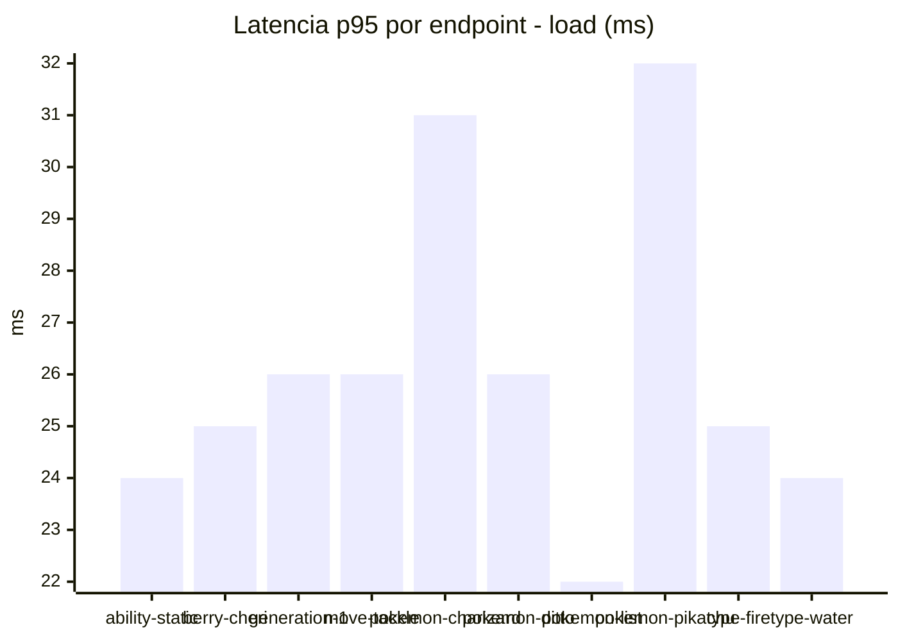
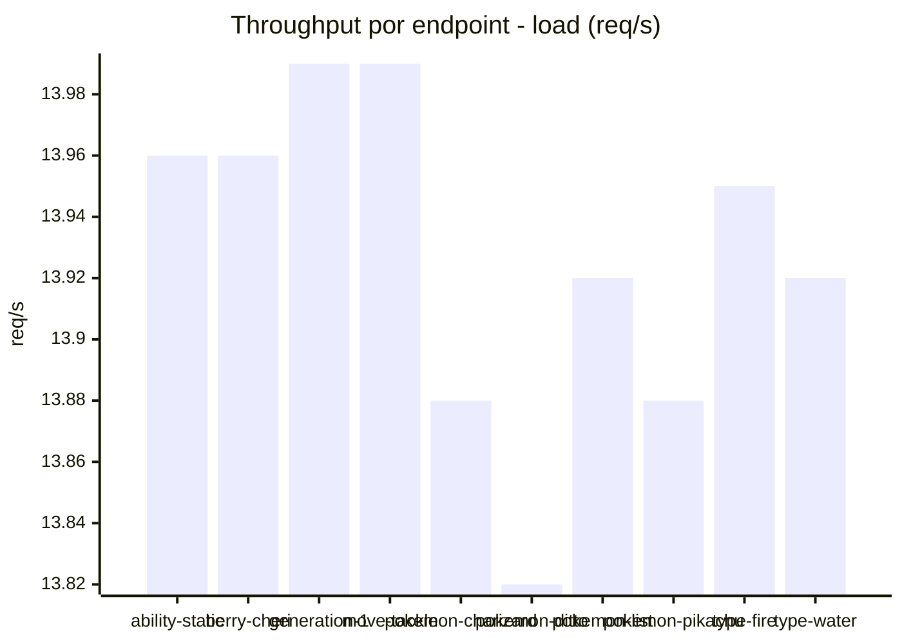
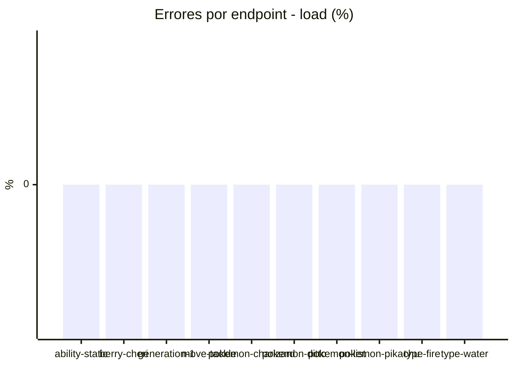
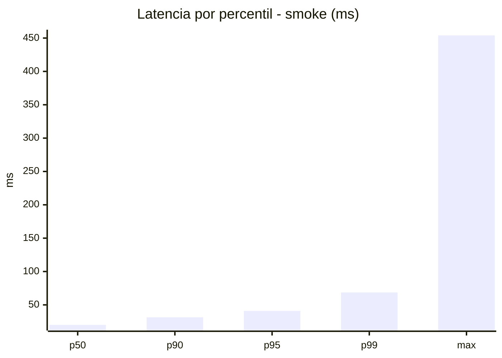
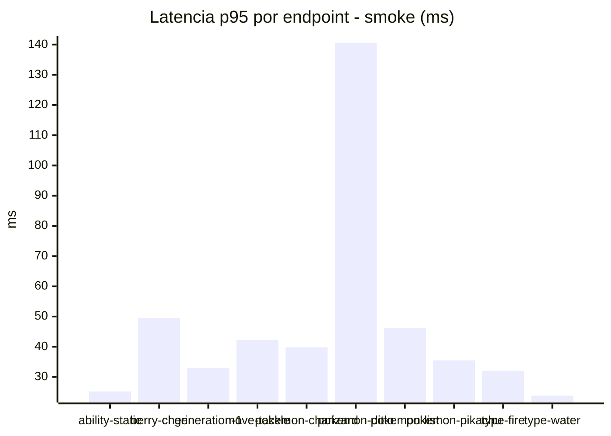
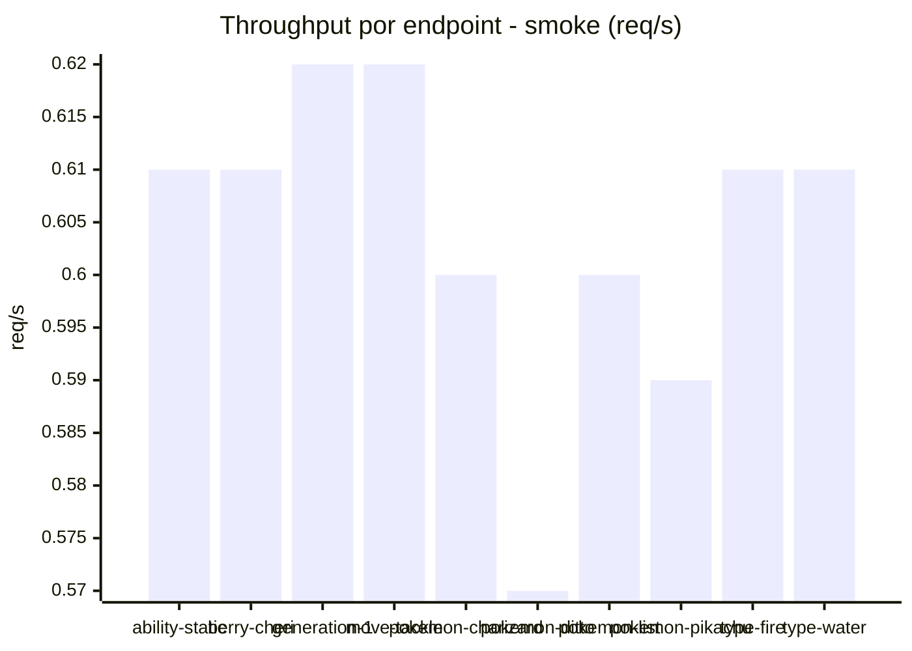

# Reporte de performance - PokeAPI

**Fecha:** 2026-10-22 17:52 UTC  
**Veredicto del agente:** `PASS`  
**Corrida:** [ver en GitHub Actions](https://github.com/lrbg/jmeter-pokeapi-lab/actions/runs/39826103295)  

## Validacion del agente de IA

PASS (fallback por umbrales)

- Error maximo: 0.0%
- p95 maximo: 41.0 ms

## Resultados

### Escenario: `load`

| Metrica | Valor |
| --- | --- |
| Muestras | 16528 |
| Errores | 0 (0.0%) |
| Latencia media | 18.0 ms |
| p50 / p90 / p95 / p99 | 17.0 / 23.0 / 26.0 / 39.0 ms |
| Min / Max | 8 / 204 ms |
| Throughput | 138.15 req/s |
| Duracion | 119.6 s |

Detalle por endpoint

| Endpoint | Muestras | Error % | avg | p95 | p99 | req/s |
| --- | --- | --- | --- | --- | --- | --- |
| ability-static | 1653 | 0.0% | 17.4 | 24.0 | 33.5 | 13.96 |
| berry-cheri | 1652 | 0.0% | 17.3 | 25.0 | 36.5 | 13.96 |
| generation-1 | 1653 | 0.0% | 17.6 | 26.0 | 41.0 | 13.99 |
| move-tackle | 1652 | 0.0% | 18.0 | 26.0 | 38.0 | 13.99 |
| pokemon-charizard | 1653 | 0.0% | 21.3 | 31.0 | 47.4 | 13.88 |
| pokemon-ditto | 1653 | 0.0% | 17.6 | 26.0 | 34.5 | 13.82 |
| pokemon-list | 1653 | 0.0% | 16.0 | 22.0 | 30.0 | 13.92 |
| pokemon-pikachu | 1653 | 0.0% | 20.4 | 32.0 | 50.5 | 13.88 |
| type-fire | 1653 | 0.0% | 17.6 | 25.0 | 39.4 | 13.95 |
| type-water | 1653 | 0.0% | 17.0 | 24.0 | 34.5 | 13.92 |

### Escenario: `smoke`

| Metrica | Valor |
| --- | --- |
| Muestras | 159 |
| Errores | 0 (0.0%) |
| Latencia media | 25.1 ms |
| p50 / p90 / p95 / p99 | 20.0 / 31.4 / 41.0 / 68.6 ms |
| Min / Max | 11 / 454 ms |
| Throughput | 5.48 req/s |
| Duracion | 29.0 s |

Detalle por endpoint

| Endpoint | Muestras | Error % | avg | p95 | p99 | req/s |
| --- | --- | --- | --- | --- | --- | --- |
| ability-static | 16 | 0.0% | 18.7 | 25.2 | 25.9 | 0.61 |
| berry-cheri | 16 | 0.0% | 24.1 | 49.5 | 69.9 | 0.61 |
| generation-1 | 15 | 0.0% | 22.3 | 33.0 | 44.2 | 0.62 |
| move-tackle | 16 | 0.0% | 23.4 | 42.2 | 59.6 | 0.62 |
| pokemon-charizard | 16 | 0.0% | 27.4 | 39.8 | 48.7 | 0.6 |
| pokemon-ditto | 16 | 0.0% | 46.4 | 140.5 | 391.3 | 0.57 |
| pokemon-list | 16 | 0.0% | 23.1 | 46.2 | 46.9 | 0.6 |
| pokemon-pikachu | 16 | 0.0% | 25.2 | 35.5 | 36.7 | 0.59 |
| type-fire | 16 | 0.0% | 21.8 | 32.0 | 36.8 | 0.61 |
| type-water | 16 | 0.0% | 18.4 | 23.8 | 27.9 | 0.61 |

