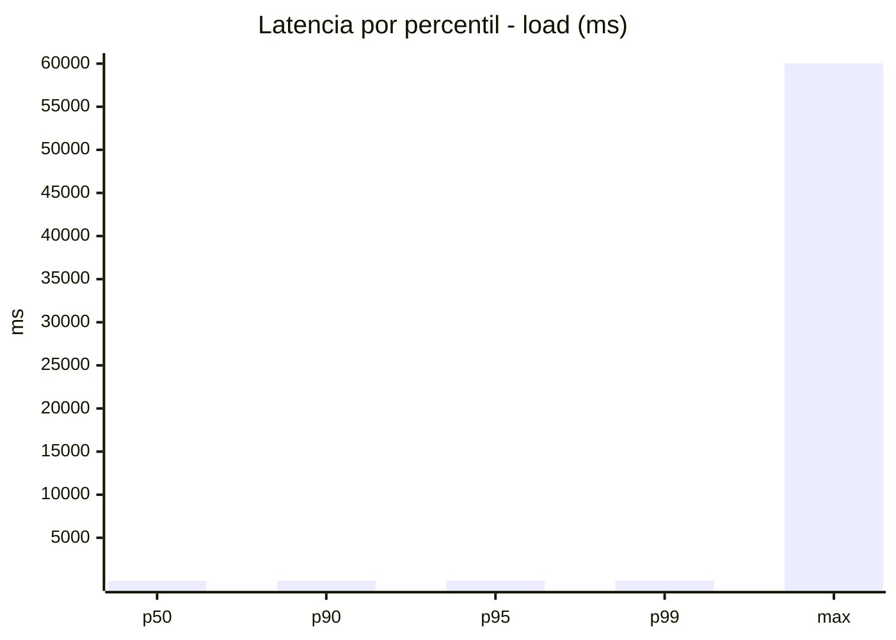
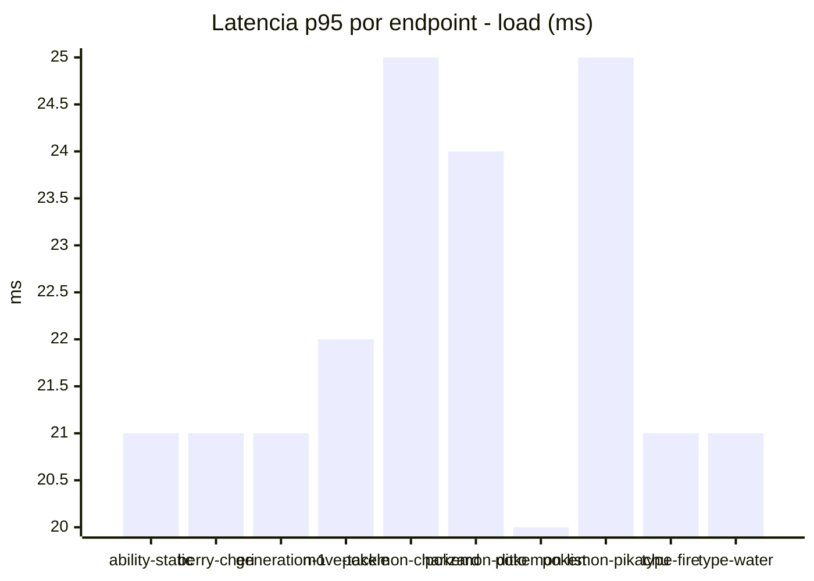
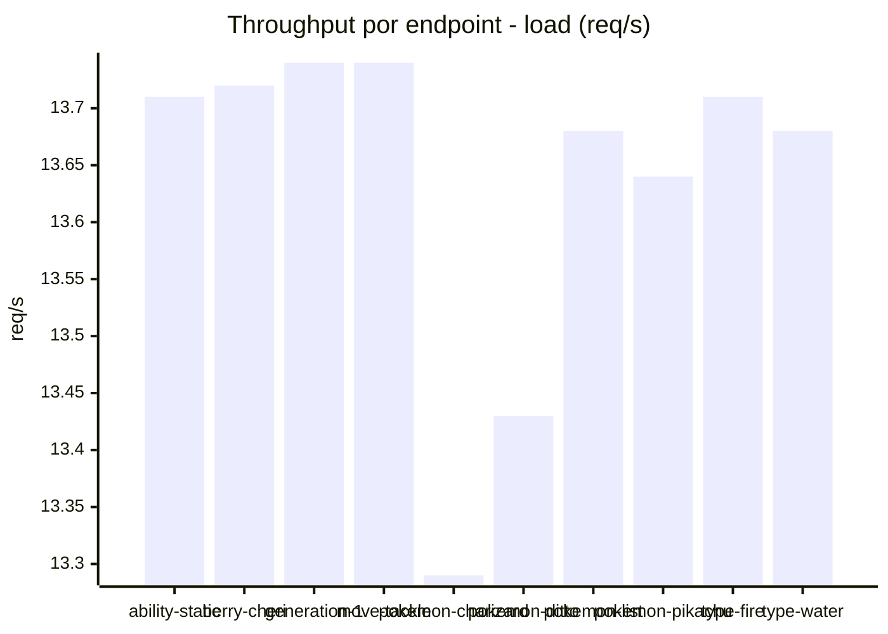
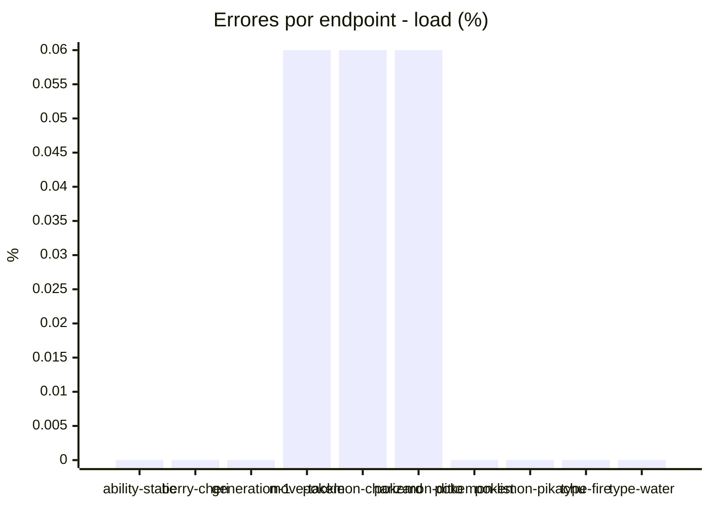
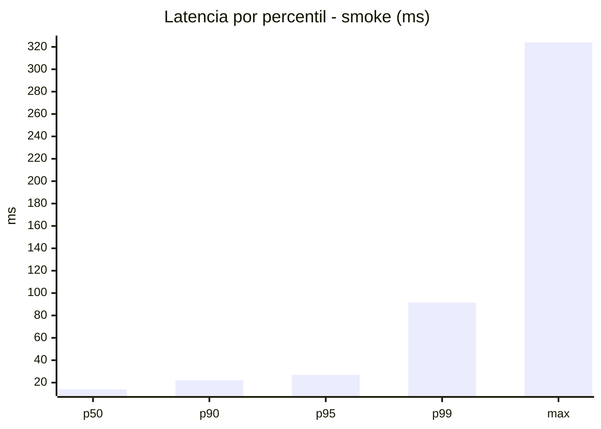
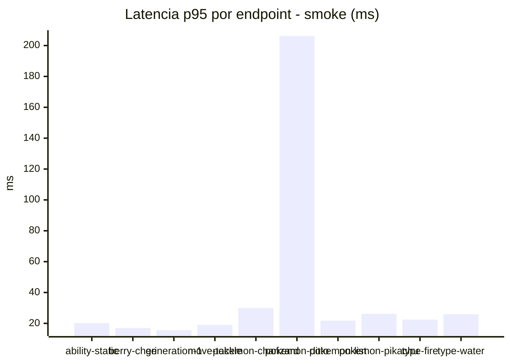
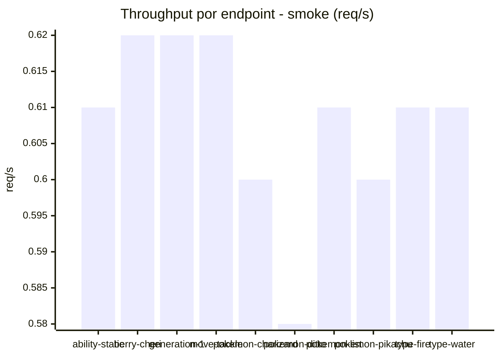
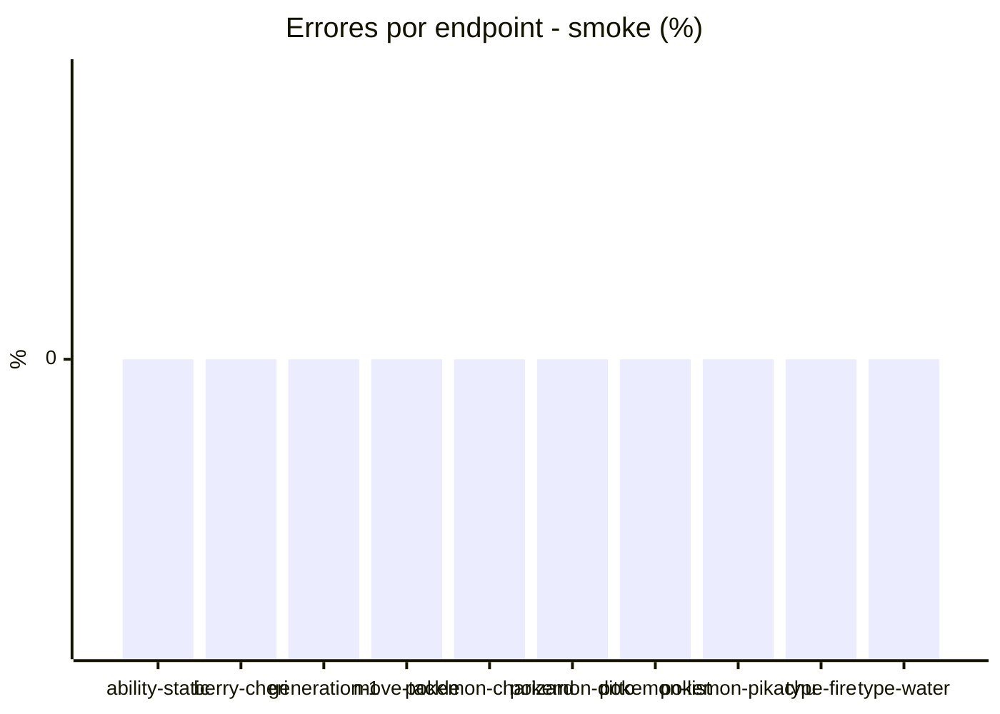

# Reporte de performance - PokeAPI

**Fecha:** 2026-10-23 17:43 UTC  
**Veredicto del agente:** `PASS`  
**Corrida:** [ver en GitHub Actions](https://github.com/lrbg/jmeter-pokeapi-lab/actions/runs/39996970255)  

## Validacion del agente de IA

PASS (fallback por umbrales)

- Error maximo: 0.02%
- p95 maximo: 27.0 ms

## Resultados

### Escenario: `load`

| Metrica | Valor |
| --- | --- |
| Muestras | 16239 |
| Errores | 3 (0.02%) |
| Latencia media | 23.8 ms |
| p50 / p90 / p95 / p99 | 12.0 / 19.0 / 22.0 / 34.0 ms |
| Min / Max | 6 / 60041 ms |
| Throughput | 132.27 req/s |
| Duracion | 122.8 s |

Detalle por endpoint

| Endpoint | Muestras | Error % | avg | p95 | p99 | req/s |
| --- | --- | --- | --- | --- | --- | --- |
| ability-static | 1624 | 0.0% | 16.9 | 21.0 | 32.0 | 13.71 |
| berry-cheri | 1623 | 0.0% | 12.8 | 21.0 | 31.0 | 13.72 |
| generation-1 | 1624 | 0.0% | 12.5 | 21.0 | 30.0 | 13.74 |
| move-tackle | 1623 | 0.06% | 37.8 | 22.0 | 34.8 | 13.74 |
| pokemon-charizard | 1625 | 0.06% | 53.4 | 25.0 | 45.8 | 13.29 |
| pokemon-ditto | 1624 | 0.06% | 51.3 | 24.0 | 41.0 | 13.43 |
| pokemon-list | 1624 | 0.0% | 12.7 | 20.0 | 28.0 | 13.68 |
| pokemon-pikachu | 1624 | 0.0% | 15.2 | 25.0 | 37.0 | 13.64 |
| type-fire | 1624 | 0.0% | 12.7 | 21.0 | 29.0 | 13.71 |
| type-water | 1624 | 0.0% | 13.1 | 21.0 | 31.8 | 13.68 |

### Escenario: `smoke`

| Metrica | Valor |
| --- | --- |
| Muestras | 160 |
| Errores | 0 (0.0%) |
| Latencia media | 18.5 ms |
| p50 / p90 / p95 / p99 | 14.0 / 22.1 / 27.0 / 91.5 ms |
| Min / Max | 10 / 324 ms |
| Throughput | 5.52 req/s |
| Duracion | 29.0 s |

Detalle por endpoint

| Endpoint | Muestras | Error % | avg | p95 | p99 | req/s |
| --- | --- | --- | --- | --- | --- | --- |
| ability-static | 16 | 0.0% | 14.6 | 20.2 | 20.9 | 0.61 |
| berry-cheri | 16 | 0.0% | 13.1 | 17.0 | 19.4 | 0.62 |
| generation-1 | 16 | 0.0% | 13.1 | 15.5 | 16.7 | 0.62 |
| move-tackle | 16 | 0.0% | 14.1 | 19.0 | 19.0 | 0.62 |
| pokemon-charizard | 16 | 0.0% | 20.7 | 30.0 | 34.8 | 0.6 |
| pokemon-ditto | 16 | 0.0% | 45.8 | 206.2 | 300.4 | 0.58 |
| pokemon-list | 16 | 0.0% | 13.8 | 21.8 | 28.3 | 0.61 |
| pokemon-pikachu | 16 | 0.0% | 18.8 | 26.2 | 26.9 | 0.6 |
| type-fire | 16 | 0.0% | 13.9 | 22.5 | 35.7 | 0.61 |
| type-water | 16 | 0.0% | 17 | 26.0 | 33.2 | 0.61 |

