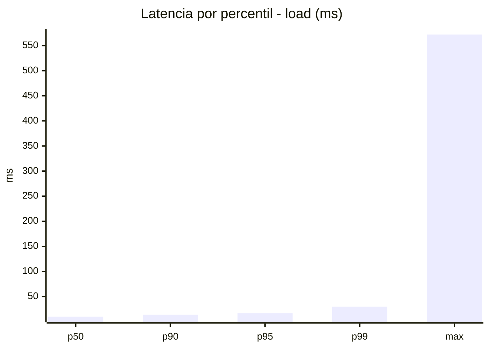
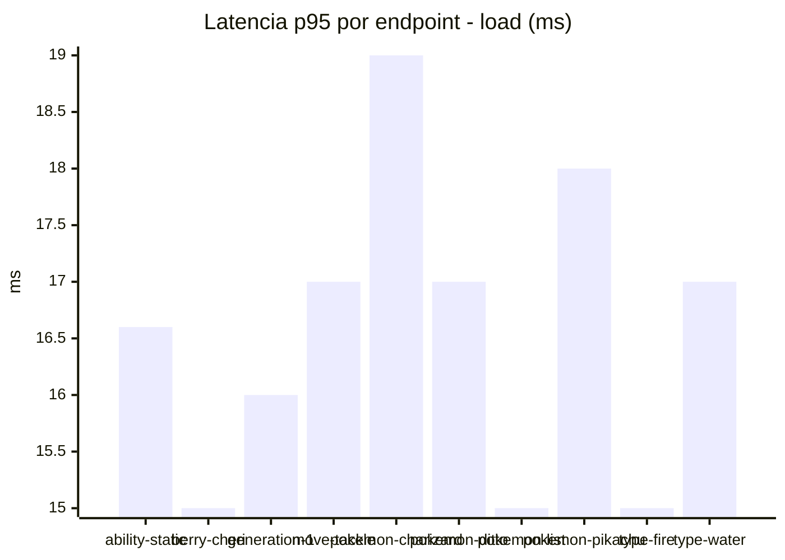
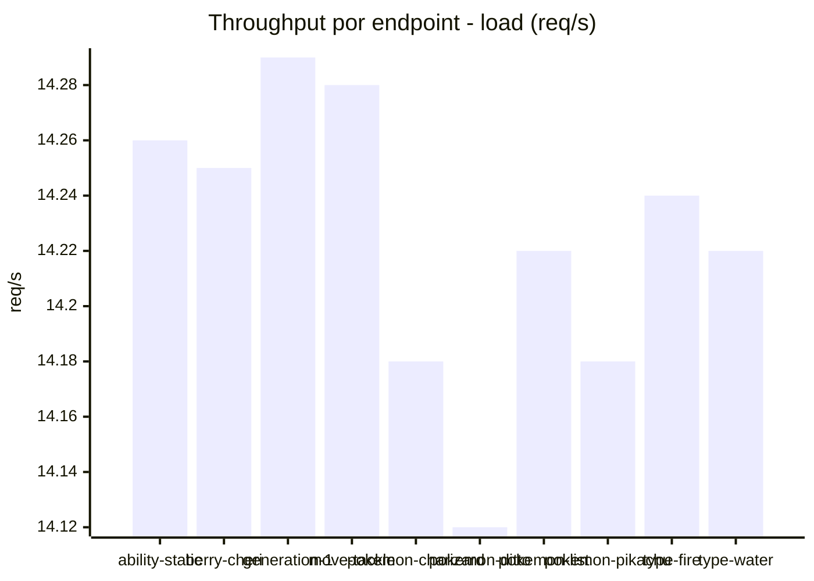
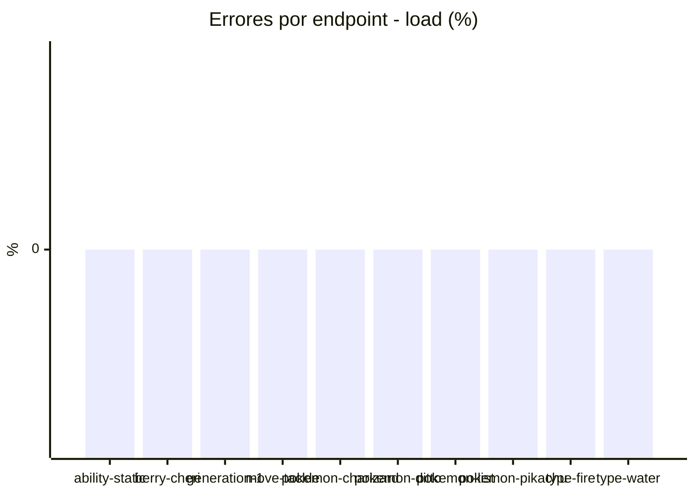
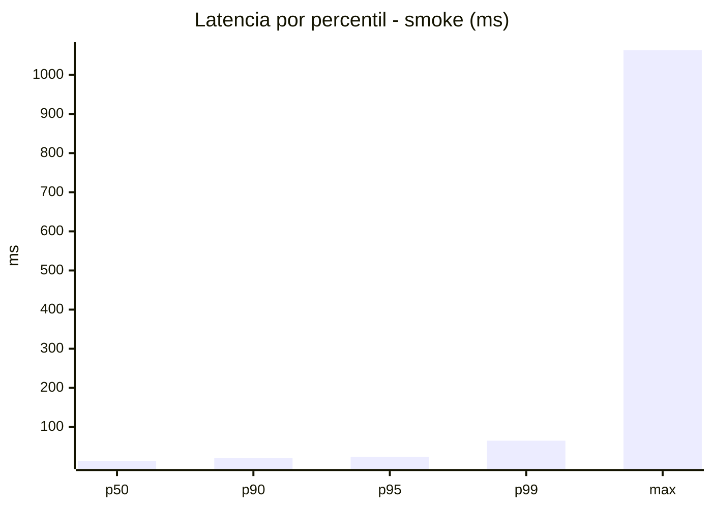
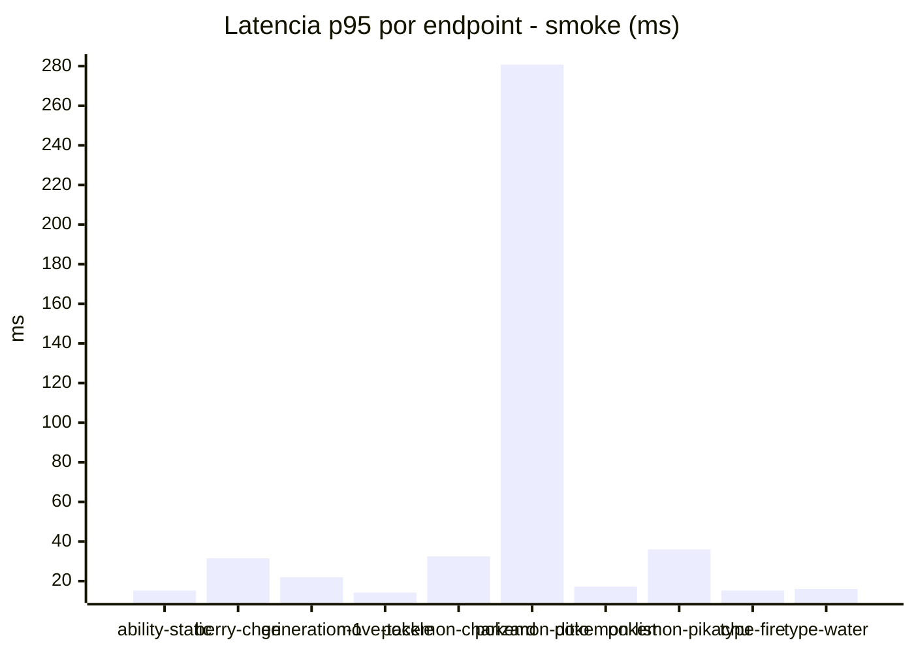
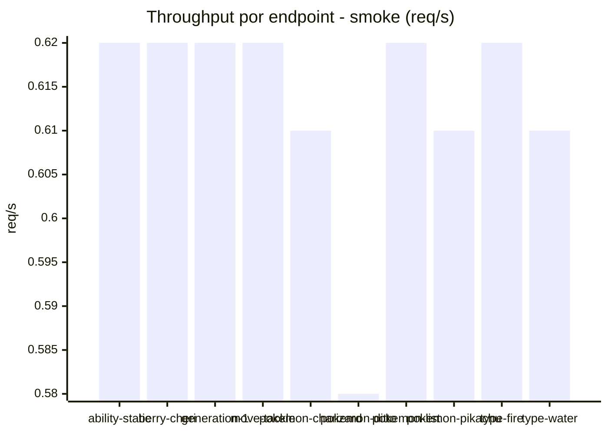

# Reporte de performance - PokeAPI

**Fecha:** 2026-10-24 16:28 UTC  
**Veredicto del agente:** `PASS`  
**Corrida:** [ver en GitHub Actions](https://github.com/lrbg/jmeter-pokeapi-lab/actions/runs/40111469737)  

## Validacion del agente de IA

PASS (fallback por umbrales)

- Error maximo: 0.0%
- p95 maximo: 23.1 ms

## Resultados

### Escenario: `load`

| Metrica | Valor |
| --- | --- |
| Muestras | 16882 |
| Errores | 0 (0.0%) |
| Latencia media | 11.4 ms |
| p50 / p90 / p95 / p99 | 10.0 / 14.0 / 17.0 / 30.0 ms |
| Min / Max | 6 / 572 ms |
| Throughput | 141.11 req/s |
| Duracion | 119.6 s |

Detalle por endpoint

| Endpoint | Muestras | Error % | avg | p95 | p99 | req/s |
| --- | --- | --- | --- | --- | --- | --- |
| ability-static | 1689 | 0.0% | 11.1 | 16.6 | 33.0 | 14.26 |
| berry-cheri | 1688 | 0.0% | 10.1 | 15.0 | 19.0 | 14.25 |
| generation-1 | 1688 | 0.0% | 10.6 | 16.0 | 30.3 | 14.29 |
| move-tackle | 1687 | 0.0% | 11.8 | 17.0 | 68.1 | 14.28 |
| pokemon-charizard | 1688 | 0.0% | 14.2 | 19.0 | 29.1 | 14.18 |
| pokemon-ditto | 1689 | 0.0% | 11.5 | 17.0 | 37.0 | 14.12 |
| pokemon-list | 1688 | 0.0% | 9.9 | 15.0 | 20.0 | 14.22 |
| pokemon-pikachu | 1689 | 0.0% | 13.8 | 18.0 | 31.7 | 14.18 |
| type-fire | 1688 | 0.0% | 10.3 | 15.0 | 27.1 | 14.24 |
| type-water | 1688 | 0.0% | 11.0 | 17.0 | 30.3 | 14.22 |

### Escenario: `smoke`

| Metrica | Valor |
| --- | --- |
| Muestras | 160 |
| Errores | 0 (0.0%) |
| Latencia media | 21.3 ms |
| p50 / p90 / p95 / p99 | 13.0 / 20.1 / 23.1 / 64.9 ms |
| Min / Max | 8 / 1063 ms |
| Throughput | 5.52 req/s |
| Duracion | 29.0 s |

Detalle por endpoint

| Endpoint | Muestras | Error % | avg | p95 | p99 | req/s |
| --- | --- | --- | --- | --- | --- | --- |
| ability-static | 16 | 0.0% | 12.2 | 15.2 | 15.8 | 0.62 |
| berry-cheri | 16 | 0.0% | 15.9 | 31.5 | 63.9 | 0.62 |
| generation-1 | 16 | 0.0% | 13.9 | 22.0 | 29.2 | 0.62 |
| move-tackle | 16 | 0.0% | 12.3 | 14.2 | 14.8 | 0.62 |
| pokemon-charizard | 16 | 0.0% | 20.5 | 32.5 | 33.7 | 0.61 |
| pokemon-ditto | 16 | 0.0% | 79.6 | 280.8 | 906.5 | 0.58 |
| pokemon-list | 16 | 0.0% | 12.2 | 17.2 | 17.9 | 0.62 |
| pokemon-pikachu | 16 | 0.0% | 21.1 | 36.0 | 55.2 | 0.61 |
| type-fire | 16 | 0.0% | 12.3 | 15.2 | 15.8 | 0.62 |
| type-water | 16 | 0.0% | 12.8 | 16.0 | 16.0 | 0.61 |

