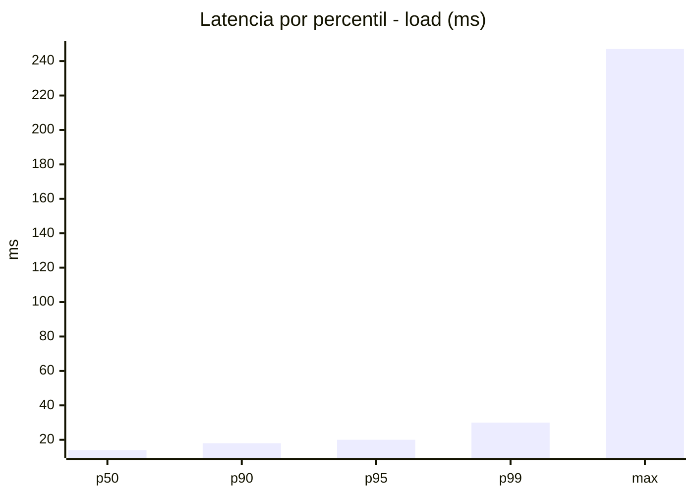
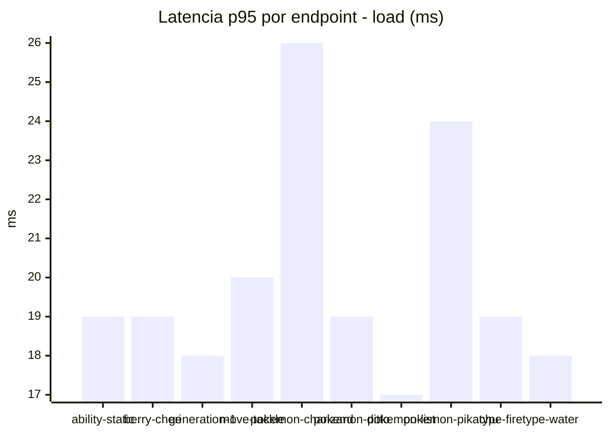
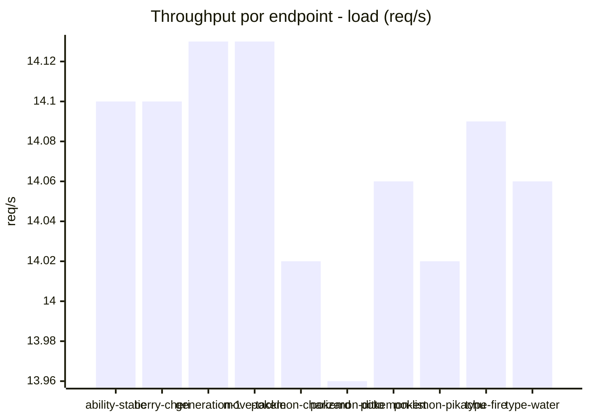
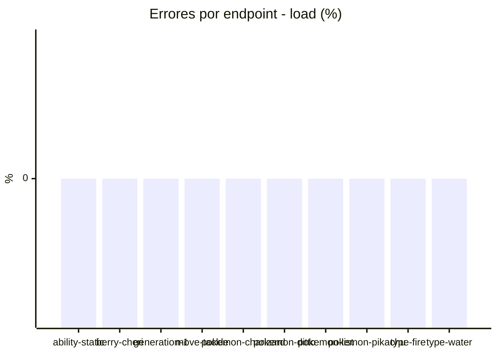
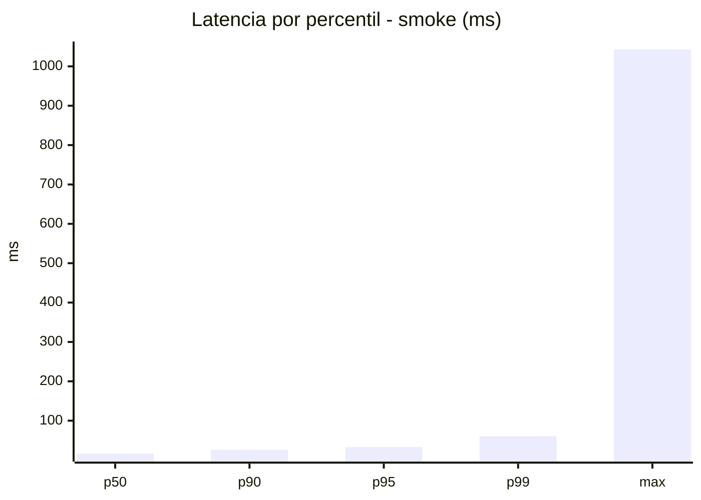
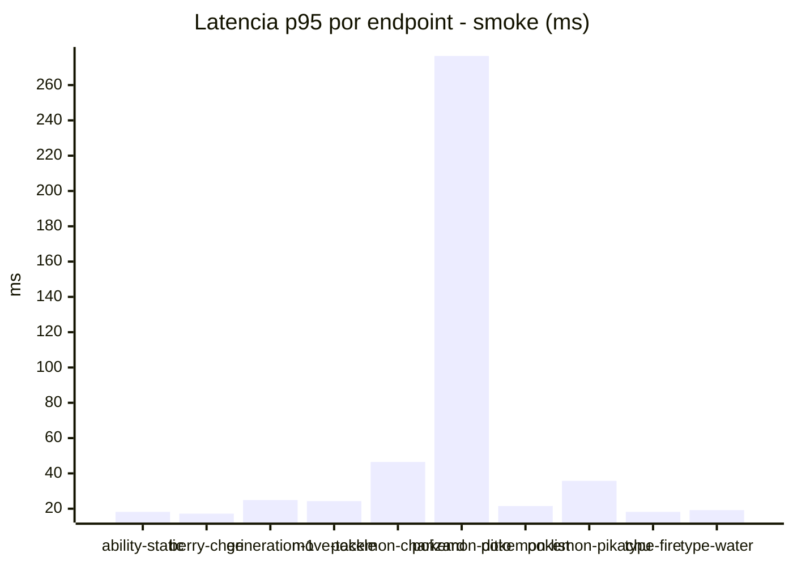
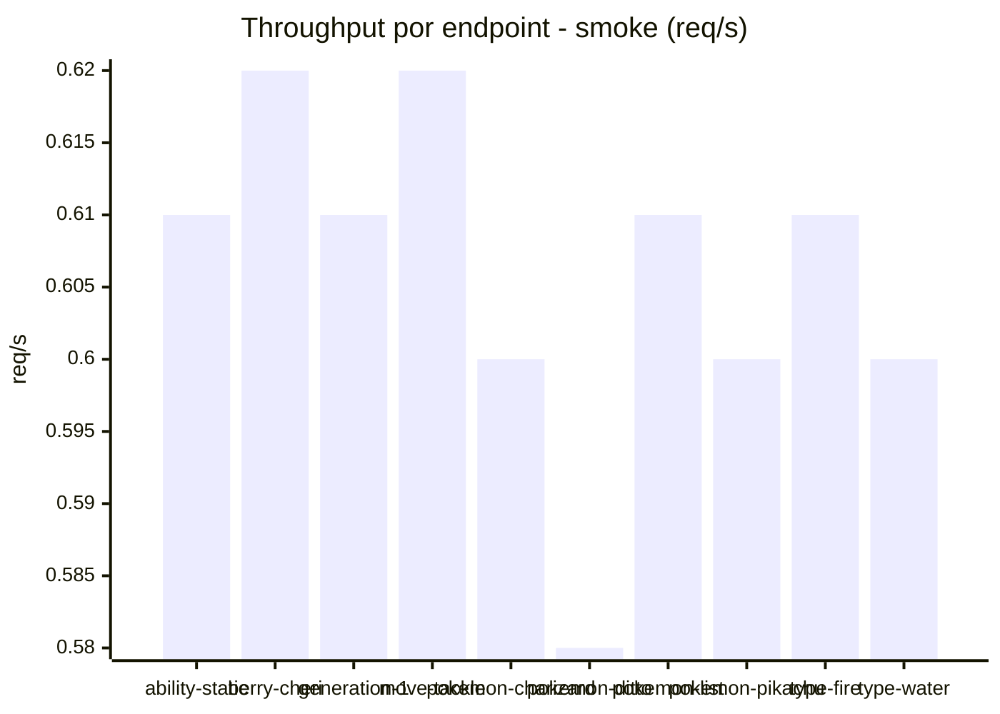

# Reporte de performance - PokeAPI

**Fecha:** 2026-10-25 16:59 UTC  
**Veredicto del agente:** `PASS`  
**Corrida:** [ver en GitHub Actions](https://github.com/lrbg/jmeter-pokeapi-lab/actions/runs/40214102740)  

## Validacion del agente de IA

PASS (fallback por umbrales)

- Error maximo: 0.0%
- p95 maximo: 33.0 ms

## Resultados

### Escenario: `load`

| Metrica | Valor |
| --- | --- |
| Muestras | 16691 |
| Errores | 0 (0.0%) |
| Latencia media | 14.9 ms |
| p50 / p90 / p95 / p99 | 14.0 / 18.0 / 20.0 / 30.0 ms |
| Min / Max | 10 / 247 ms |
| Throughput | 139.5 req/s |
| Duracion | 119.7 s |

Detalle por endpoint

| Endpoint | Muestras | Error % | avg | p95 | p99 | req/s |
| --- | --- | --- | --- | --- | --- | --- |
| ability-static | 1669 | 0.0% | 14.2 | 19.0 | 26.3 | 14.1 |
| berry-cheri | 1669 | 0.0% | 14.0 | 19.0 | 25.0 | 14.1 |
| generation-1 | 1669 | 0.0% | 14.2 | 18.0 | 23.0 | 14.13 |
| move-tackle | 1669 | 0.0% | 15.1 | 20.0 | 24.3 | 14.13 |
| pokemon-charizard | 1669 | 0.0% | 18.3 | 26.0 | 44.3 | 14.02 |
| pokemon-ditto | 1669 | 0.0% | 14.7 | 19.0 | 29.3 | 13.96 |
| pokemon-list | 1669 | 0.0% | 13.1 | 17.0 | 21.0 | 14.06 |
| pokemon-pikachu | 1669 | 0.0% | 17.1 | 24.0 | 47.0 | 14.02 |
| type-fire | 1669 | 0.0% | 14.2 | 19.0 | 28.3 | 14.09 |
| type-water | 1670 | 0.0% | 14.0 | 18.0 | 23.0 | 14.06 |

### Escenario: `smoke`

| Metrica | Valor |
| --- | --- |
| Muestras | 158 |
| Errores | 0 (0.0%) |
| Latencia media | 24.8 ms |
| p50 / p90 / p95 / p99 | 16.0 / 26.0 / 33.0 / 60.3 ms |
| Min / Max | 12 / 1043 ms |
| Throughput | 5.43 req/s |
| Duracion | 29.1 s |

Detalle por endpoint

| Endpoint | Muestras | Error % | avg | p95 | p99 | req/s |
| --- | --- | --- | --- | --- | --- | --- |
| ability-static | 16 | 0.0% | 14.8 | 18.2 | 18.9 | 0.61 |
| berry-cheri | 16 | 0.0% | 14.7 | 17.2 | 17.9 | 0.62 |
| generation-1 | 15 | 0.0% | 16.5 | 24.9 | 37.8 | 0.61 |
| move-tackle | 15 | 0.0% | 18.9 | 24.3 | 24.9 | 0.62 |
| pokemon-charizard | 16 | 0.0% | 30.6 | 46.5 | 71.7 | 0.6 |
| pokemon-ditto | 16 | 0.0% | 79.6 | 276.5 | 889.7 | 0.58 |
| pokemon-list | 16 | 0.0% | 15.2 | 21.5 | 22.7 | 0.61 |
| pokemon-pikachu | 16 | 0.0% | 25.2 | 35.8 | 44.7 | 0.6 |
| type-fire | 16 | 0.0% | 15.4 | 18.2 | 21.2 | 0.61 |
| type-water | 16 | 0.0% | 16 | 19.2 | 19.9 | 0.6 |

