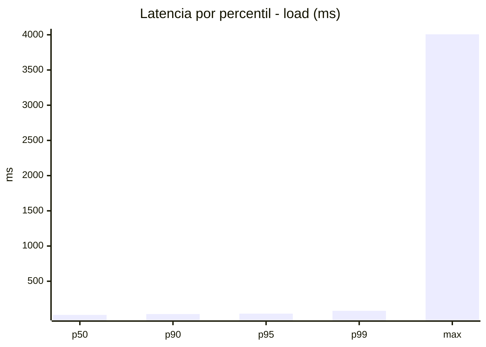
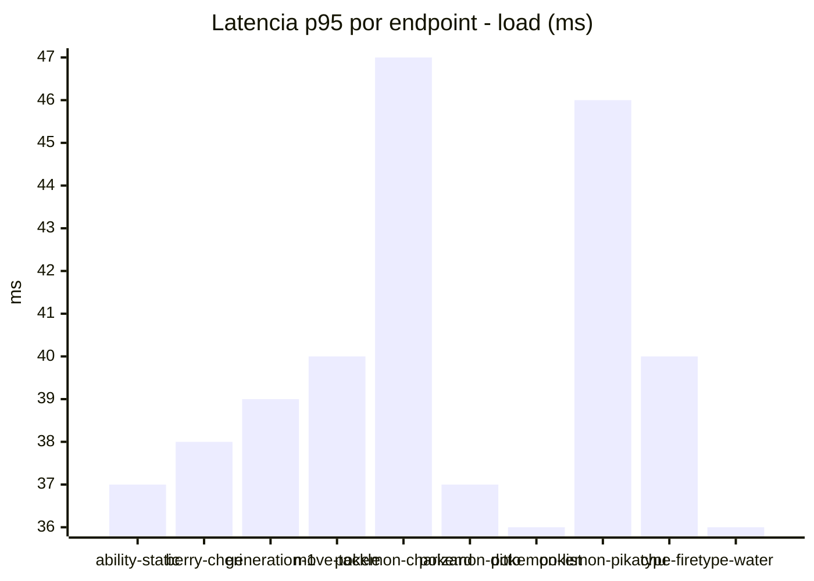
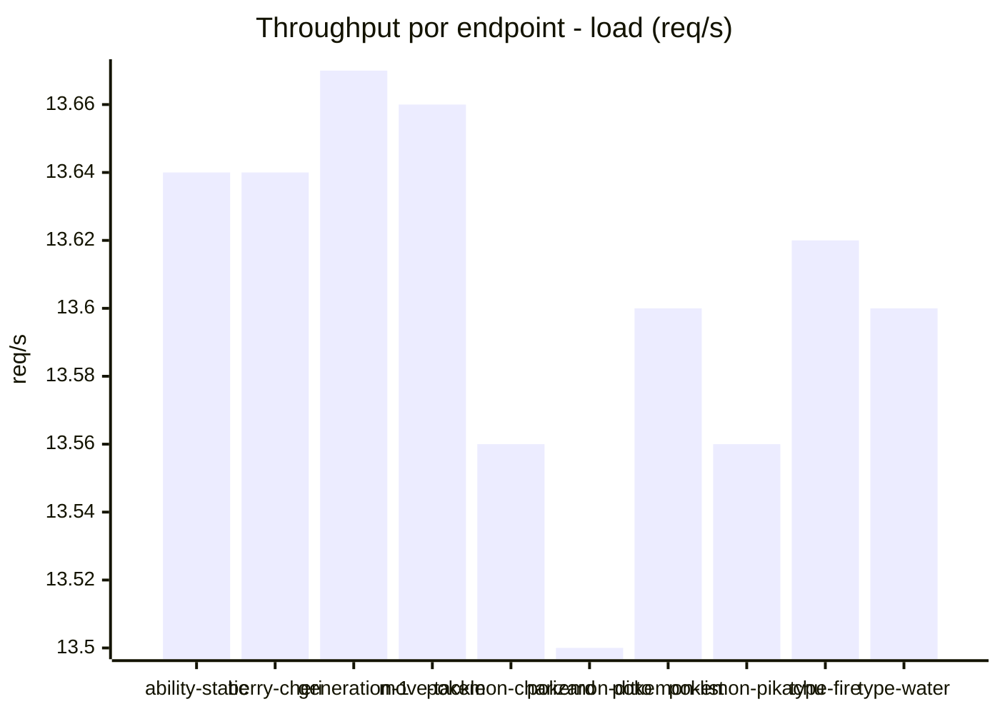
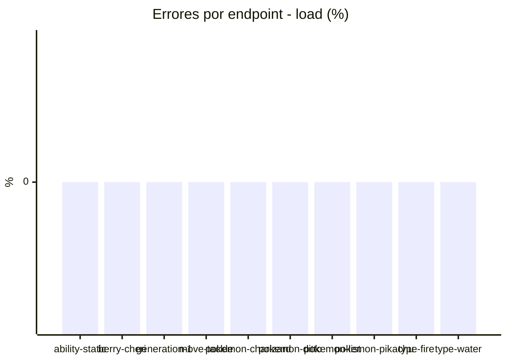
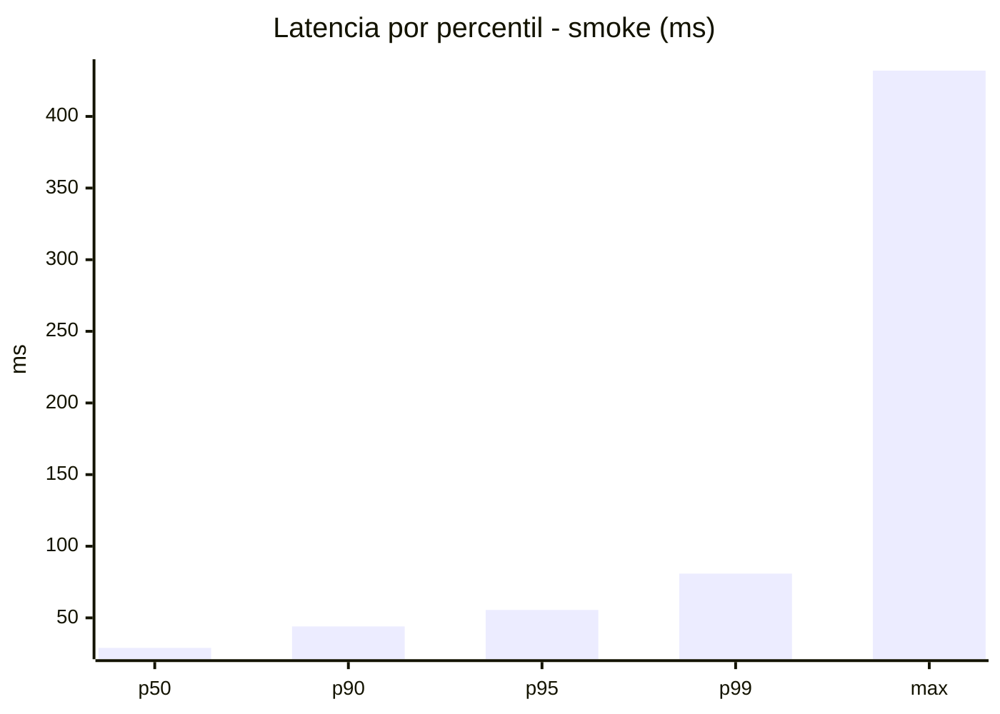
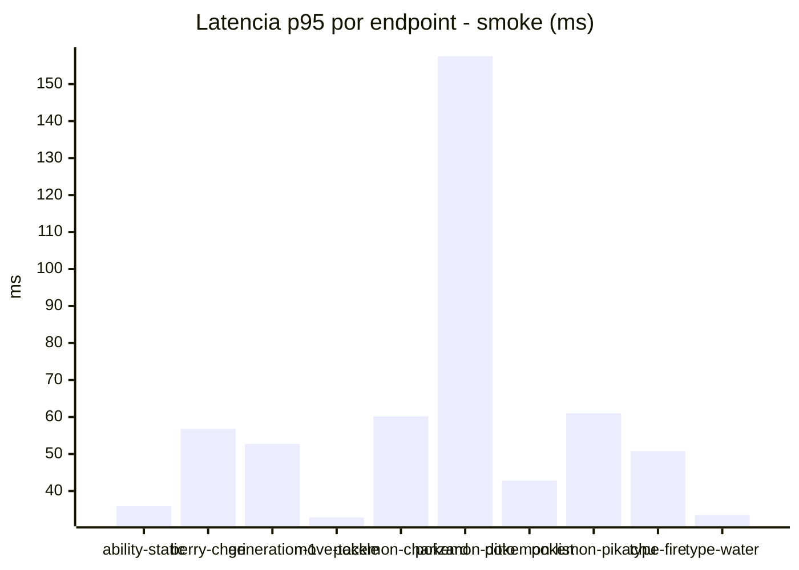
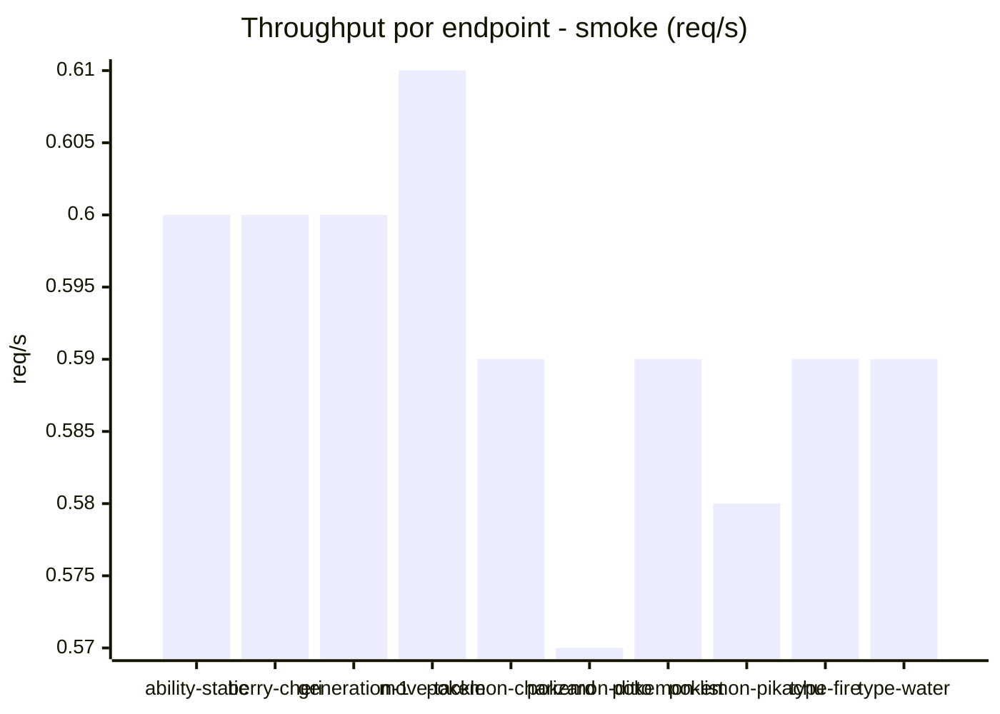

# Reporte de performance - PokeAPI

**Fecha:** 2026-10-26 19:02 UTC  
**Veredicto del agente:** `PASS`  
**Corrida:** [ver en GitHub Actions](https://github.com/lrbg/jmeter-pokeapi-lab/actions/runs/40382754801)  

## Validacion del agente de IA

PASS (fallback por umbrales)

- Error maximo: 0.0%
- p95 maximo: 55.5 ms

## Resultados

### Escenario: `load`

| Metrica | Valor |
| --- | --- |
| Muestras | 16141 |
| Errores | 0 (0.0%) |
| Latencia media | 25.5 ms |
| p50 / p90 / p95 / p99 | 22.0 / 34.0 / 40.0 / 80.0 ms |
| Min / Max | 13 / 4007 ms |
| Throughput | 134.9 req/s |
| Duracion | 119.7 s |

Detalle por endpoint

| Endpoint | Muestras | Error % | avg | p95 | p99 | req/s |
| --- | --- | --- | --- | --- | --- | --- |
| ability-static | 1614 | 0.0% | 23.7 | 37.0 | 65.5 | 13.64 |
| berry-cheri | 1614 | 0.0% | 26.2 | 38.0 | 76.6 | 13.64 |
| generation-1 | 1614 | 0.0% | 24.9 | 39.0 | 102.0 | 13.67 |
| move-tackle | 1614 | 0.0% | 24.9 | 40.0 | 66.9 | 13.66 |
| pokemon-charizard | 1615 | 0.0% | 30.6 | 47.0 | 89.4 | 13.56 |
| pokemon-ditto | 1614 | 0.0% | 24.5 | 37.0 | 75.5 | 13.5 |
| pokemon-list | 1614 | 0.0% | 24.0 | 36.0 | 69.9 | 13.6 |
| pokemon-pikachu | 1614 | 0.0% | 28.3 | 46.0 | 98.3 | 13.56 |
| type-fire | 1614 | 0.0% | 24.7 | 40.0 | 76.9 | 13.62 |
| type-water | 1614 | 0.0% | 23.4 | 36.0 | 62.7 | 13.6 |

### Escenario: `smoke`

| Metrica | Valor |
| --- | --- |
| Muestras | 156 |
| Errores | 0 (0.0%) |
| Latencia media | 34.0 ms |
| p50 / p90 / p95 / p99 | 29.0 / 44.0 / 55.5 / 80.9 ms |
| Min / Max | 18 / 432 ms |
| Throughput | 5.36 req/s |
| Duracion | 29.1 s |

Detalle por endpoint

| Endpoint | Muestras | Error % | avg | p95 | p99 | req/s |
| --- | --- | --- | --- | --- | --- | --- |
| ability-static | 15 | 0.0% | 26.5 | 35.9 | 37.6 | 0.6 |
| berry-cheri | 15 | 0.0% | 30 | 56.8 | 60.2 | 0.6 |
| generation-1 | 15 | 0.0% | 32.7 | 52.7 | 74.5 | 0.6 |
| move-tackle | 15 | 0.0% | 28.1 | 32.9 | 34.6 | 0.61 |
| pokemon-charizard | 16 | 0.0% | 38 | 60.2 | 68.0 | 0.59 |
| pokemon-ditto | 16 | 0.0% | 55.4 | 157.5 | 377.1 | 0.57 |
| pokemon-list | 16 | 0.0% | 29.3 | 42.8 | 63.7 | 0.59 |
| pokemon-pikachu | 16 | 0.0% | 39.6 | 61.0 | 77.8 | 0.58 |
| type-fire | 16 | 0.0% | 31.6 | 50.8 | 52.5 | 0.59 |
| type-water | 16 | 0.0% | 28 | 33.5 | 34.7 | 0.59 |

