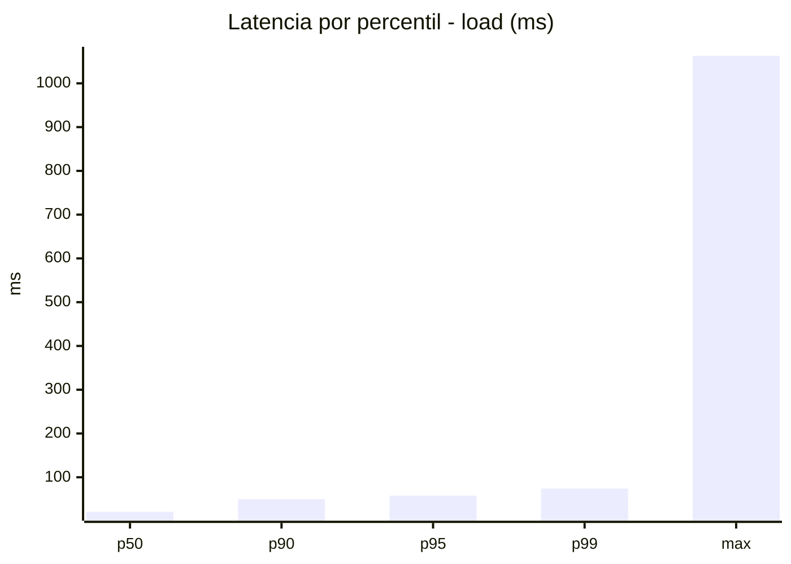
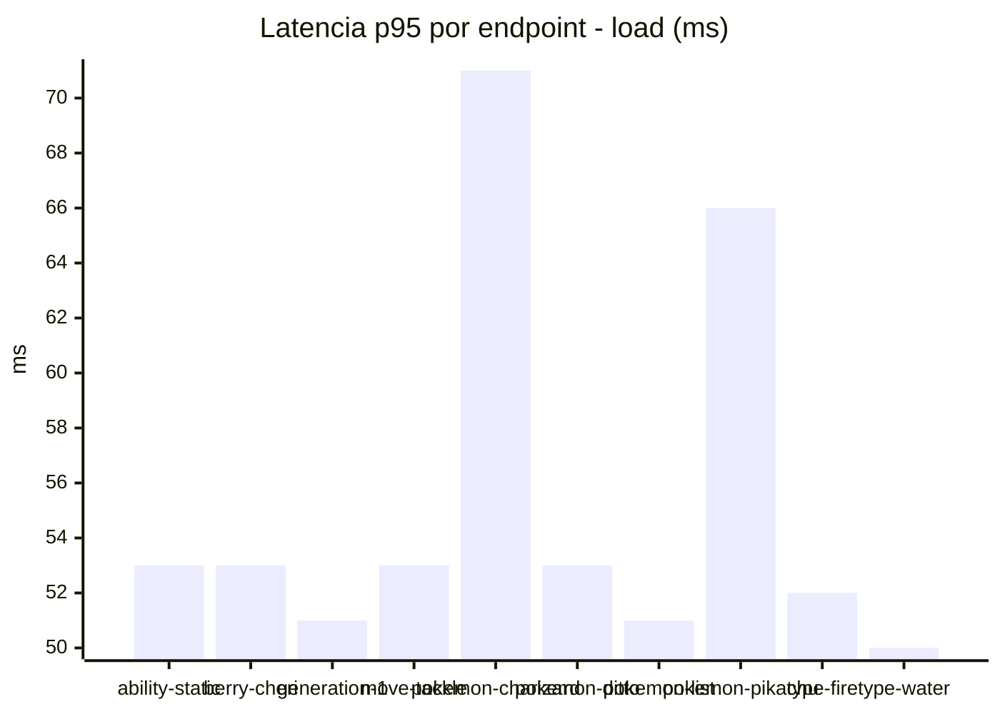
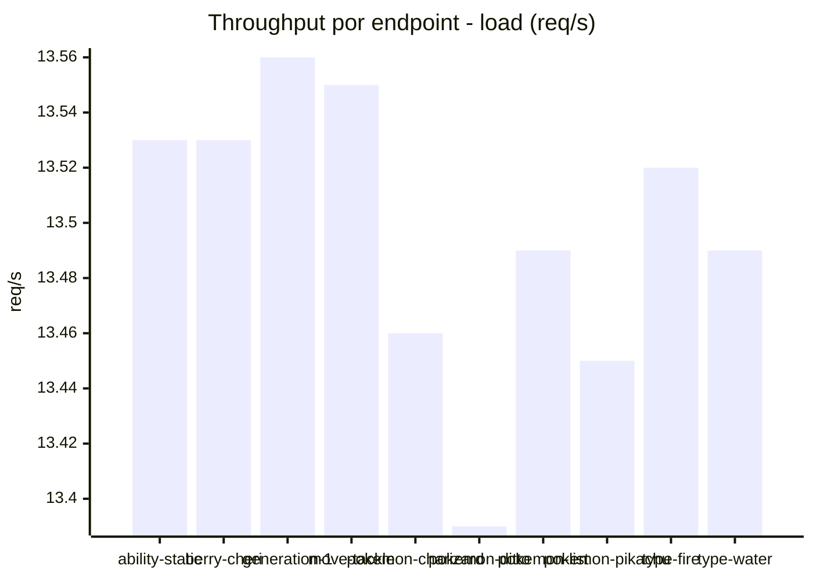
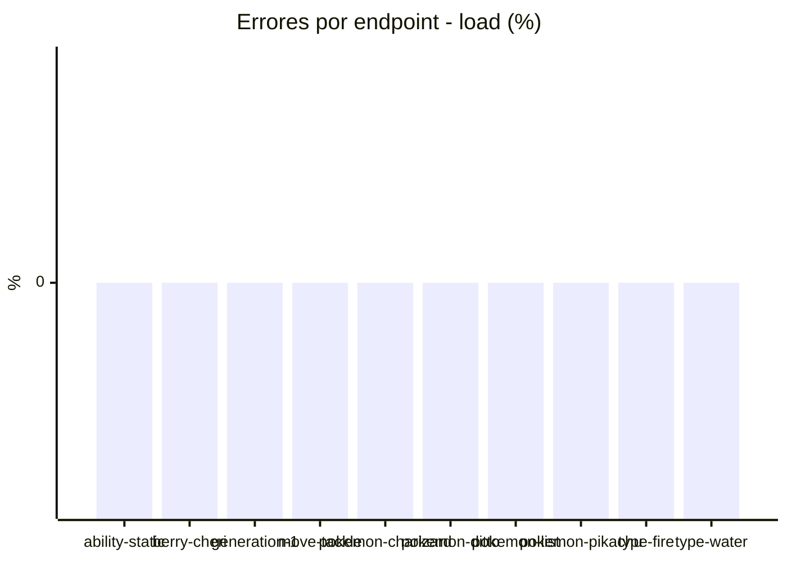
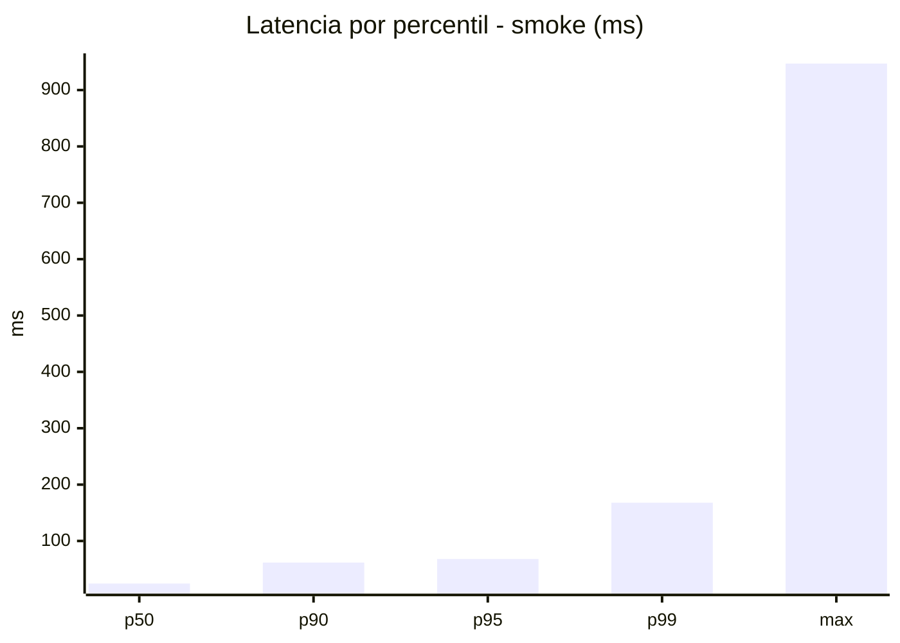
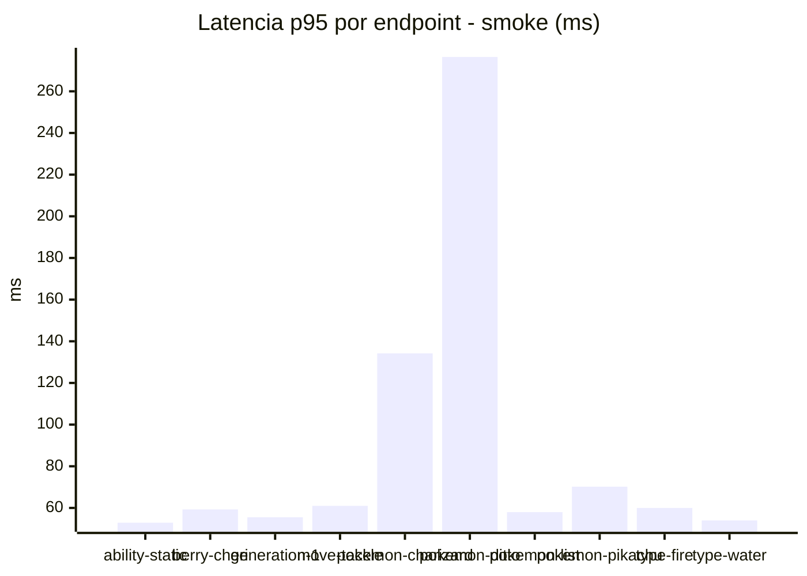
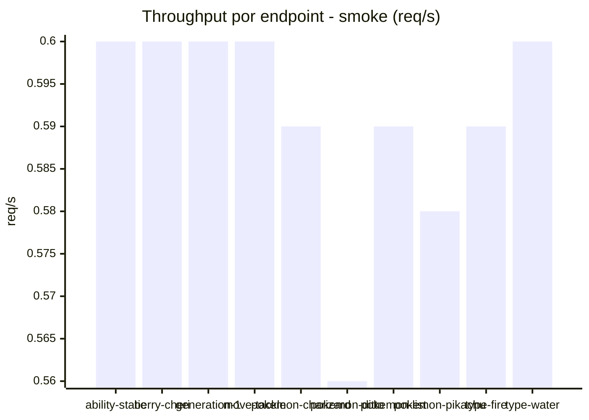

# Reporte de performance - PokeAPI

**Fecha:** 2026-10-27 18:34 UTC  
**Veredicto del agente:** `PASS`  
**Corrida:** [ver en GitHub Actions](https://github.com/lrbg/jmeter-pokeapi-lab/actions/runs/40560802579)  

## Validacion del agente de IA

PASS (fallback por umbrales)

- Error maximo: 0.0%
- p95 maximo: 68.0 ms

## Resultados

### Escenario: `load`

| Metrica | Valor |
| --- | --- |
| Muestras | 16012 |
| Errores | 0 (0.0%) |
| Latencia media | 28.2 ms |
| p50 / p90 / p95 / p99 | 21.0 / 50.0 / 58.0 / 74.0 ms |
| Min / Max | 11 / 1063 ms |
| Throughput | 133.84 req/s |
| Duracion | 119.6 s |

Detalle por endpoint

| Endpoint | Muestras | Error % | avg | p95 | p99 | req/s |
| --- | --- | --- | --- | --- | --- | --- |
| ability-static | 1601 | 0.0% | 26.9 | 53.0 | 62.0 | 13.53 |
| berry-cheri | 1601 | 0.0% | 26.7 | 53.0 | 64.0 | 13.53 |
| generation-1 | 1601 | 0.0% | 27.5 | 51.0 | 68.0 | 13.56 |
| move-tackle | 1601 | 0.0% | 28.1 | 53.0 | 63.0 | 13.55 |
| pokemon-charizard | 1601 | 0.0% | 34.6 | 71.0 | 132.0 | 13.46 |
| pokemon-ditto | 1602 | 0.0% | 27.7 | 53.0 | 69.0 | 13.39 |
| pokemon-list | 1602 | 0.0% | 25.6 | 51.0 | 61.0 | 13.49 |
| pokemon-pikachu | 1601 | 0.0% | 32.2 | 66.0 | 98.0 | 13.45 |
| type-fire | 1601 | 0.0% | 27.0 | 52.0 | 64.0 | 13.52 |
| type-water | 1601 | 0.0% | 26.2 | 50.0 | 60.0 | 13.49 |

### Escenario: `smoke`

| Metrica | Valor |
| --- | --- |
| Muestras | 154 |
| Errores | 0 (0.0%) |
| Latencia media | 41.8 ms |
| p50 / p90 / p95 / p99 | 24.5 / 61.7 / 68.0 / 167.9 ms |
| Min / Max | 16 / 947 ms |
| Throughput | 5.28 req/s |
| Duracion | 29.2 s |

Detalle por endpoint

| Endpoint | Muestras | Error % | avg | p95 | p99 | req/s |
| --- | --- | --- | --- | --- | --- | --- |
| ability-static | 15 | 0.0% | 27.4 | 52.9 | 54.6 | 0.6 |
| berry-cheri | 15 | 0.0% | 31.7 | 59.3 | 65.5 | 0.6 |
| generation-1 | 15 | 0.0% | 27.9 | 55.5 | 63.9 | 0.6 |
| move-tackle | 15 | 0.0% | 41.2 | 61.0 | 66.6 | 0.6 |
| pokemon-charizard | 16 | 0.0% | 55.6 | 134.2 | 226.0 | 0.59 |
| pokemon-ditto | 16 | 0.0% | 85.5 | 276.5 | 812.9 | 0.56 |
| pokemon-list | 16 | 0.0% | 27.7 | 58.0 | 60.4 | 0.59 |
| pokemon-pikachu | 16 | 0.0% | 47.6 | 70.2 | 75.6 | 0.58 |
| type-fire | 15 | 0.0% | 34.9 | 60.0 | 65.6 | 0.59 |
| type-water | 15 | 0.0% | 35.4 | 54.0 | 54.0 | 0.6 |

