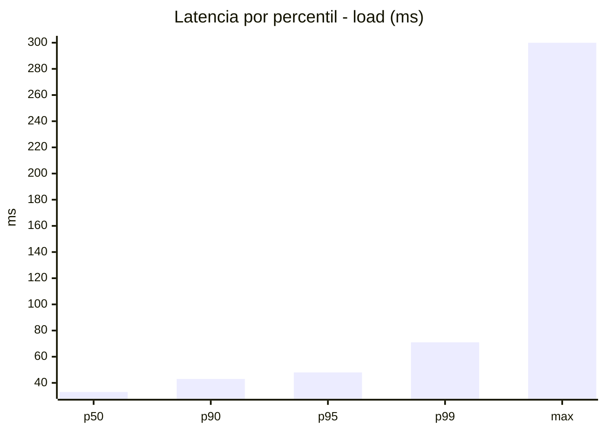
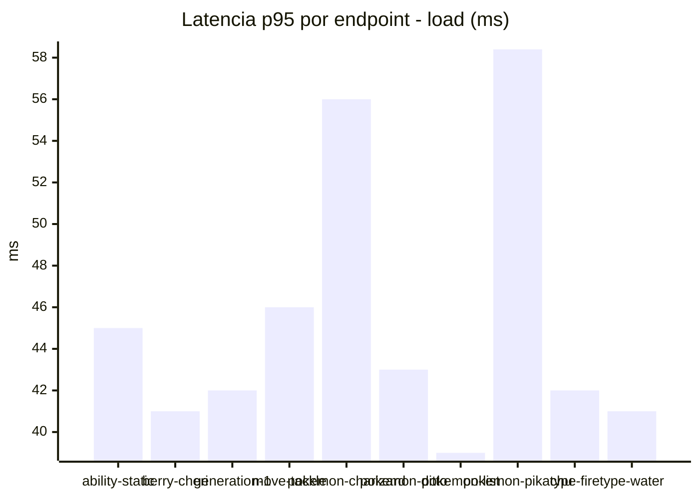
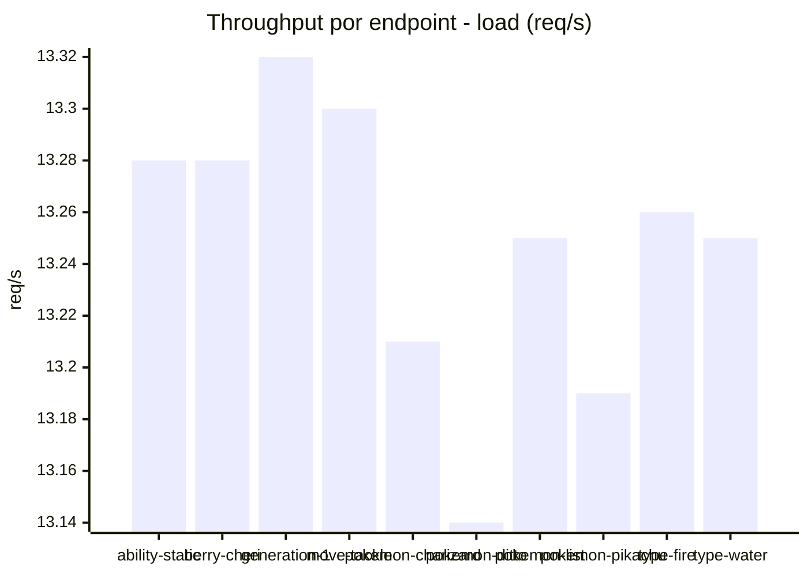
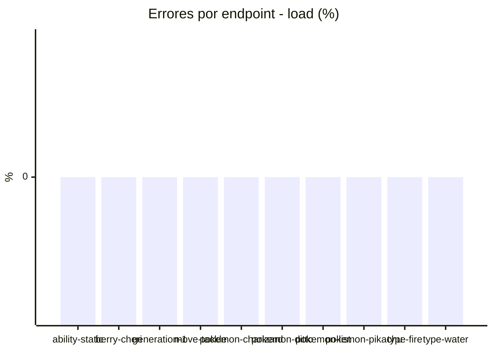
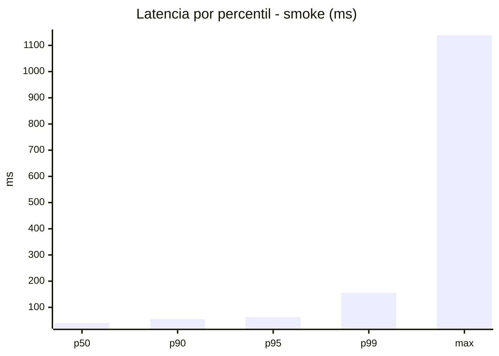
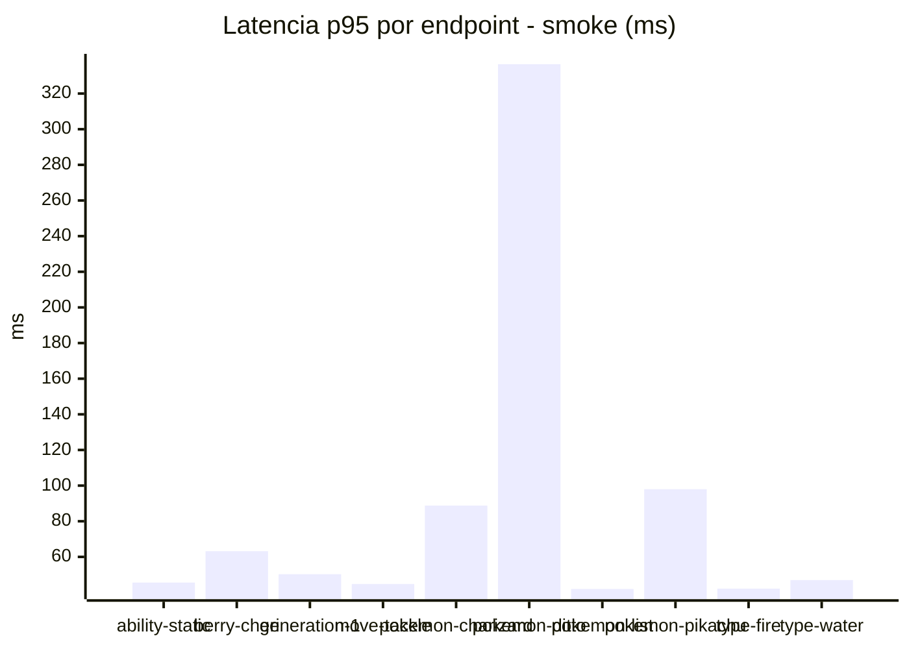
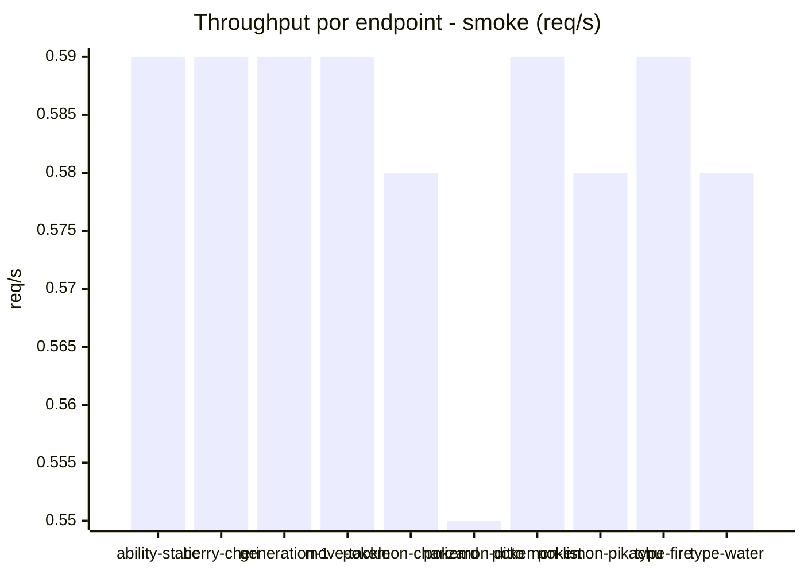

# Reporte de performance - PokeAPI

**Fecha:** 2026-10-28 18:40 UTC  
**Veredicto del agente:** `PASS`  
**Corrida:** [ver en GitHub Actions](https://github.com/lrbg/jmeter-pokeapi-lab/actions/runs/40746924203)  

## Validacion del agente de IA

PASS (fallback por umbrales)

- Error maximo: 0.0%
- p95 maximo: 63.0 ms

## Resultados

### Escenario: `load`

| Metrica | Valor |
| --- | --- |
| Muestras | 15712 |
| Errores | 0 (0.0%) |
| Latencia media | 34.5 ms |
| p50 / p90 / p95 / p99 | 33.0 / 43.0 / 48.0 / 71.0 ms |
| Min / Max | 20 / 300 ms |
| Throughput | 131.31 req/s |
| Duracion | 119.7 s |

Detalle por endpoint

| Endpoint | Muestras | Error % | avg | p95 | p99 | req/s |
| --- | --- | --- | --- | --- | --- | --- |
| ability-static | 1571 | 0.0% | 34.0 | 45.0 | 59.3 | 13.28 |
| berry-cheri | 1571 | 0.0% | 32.2 | 41.0 | 70.0 | 13.28 |
| generation-1 | 1571 | 0.0% | 32.7 | 42.0 | 54.3 | 13.32 |
| move-tackle | 1571 | 0.0% | 35.6 | 46.0 | 81.8 | 13.3 |
| pokemon-charizard | 1572 | 0.0% | 41.4 | 56.0 | 80.0 | 13.21 |
| pokemon-ditto | 1571 | 0.0% | 33.5 | 43.0 | 59.0 | 13.14 |
| pokemon-list | 1571 | 0.0% | 30.5 | 39.0 | 54.5 | 13.25 |
| pokemon-pikachu | 1572 | 0.0% | 40.4 | 58.4 | 98.7 | 13.19 |
| type-fire | 1571 | 0.0% | 32.7 | 42.0 | 56.0 | 13.26 |
| type-water | 1571 | 0.0% | 31.9 | 41.0 | 68.5 | 13.25 |

### Escenario: `smoke`

| Metrica | Valor |
| --- | --- |
| Muestras | 151 |
| Errores | 0 (0.0%) |
| Latencia media | 50.8 ms |
| p50 / p90 / p95 / p99 | 40.0 / 55.0 / 63.0 / 155.5 ms |
| Min / Max | 28 / 1139 ms |
| Throughput | 5.2 req/s |
| Duracion | 29.0 s |

Detalle por endpoint

| Endpoint | Muestras | Error % | avg | p95 | p99 | req/s |
| --- | --- | --- | --- | --- | --- | --- |
| ability-static | 15 | 0.0% | 40.7 | 45.6 | 46.7 | 0.59 |
| berry-cheri | 15 | 0.0% | 41.1 | 63.2 | 104.6 | 0.59 |
| generation-1 | 15 | 0.0% | 40.3 | 50.3 | 56.5 | 0.59 |
| move-tackle | 15 | 0.0% | 39 | 44.8 | 48.2 | 0.59 |
| pokemon-charizard | 15 | 0.0% | 59.7 | 88.8 | 97.8 | 0.58 |
| pokemon-ditto | 16 | 0.0% | 110.6 | 336.5 | 978.5 | 0.55 |
| pokemon-list | 15 | 0.0% | 37.2 | 42.0 | 42.0 | 0.59 |
| pokemon-pikachu | 15 | 0.0% | 59.1 | 98.0 | 176.4 | 0.58 |
| type-fire | 15 | 0.0% | 38.3 | 42.2 | 44.4 | 0.59 |
| type-water | 15 | 0.0% | 38.1 | 47.0 | 52.6 | 0.58 |

