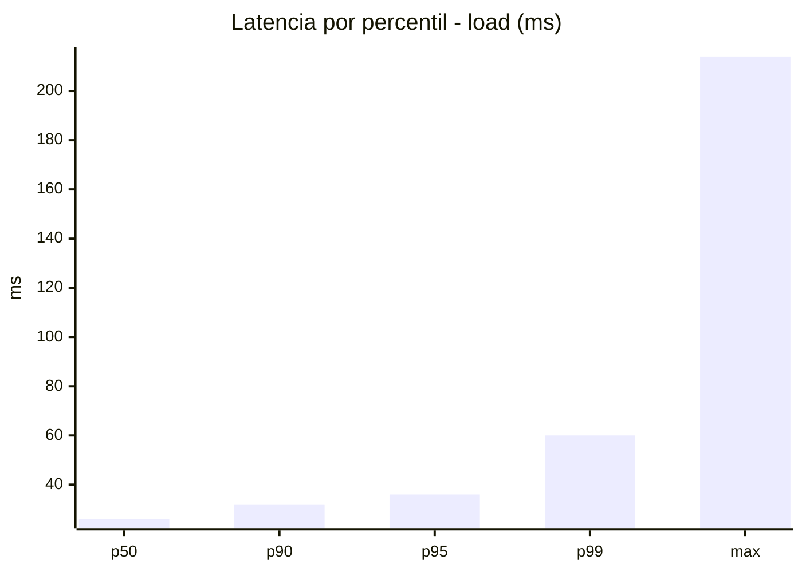
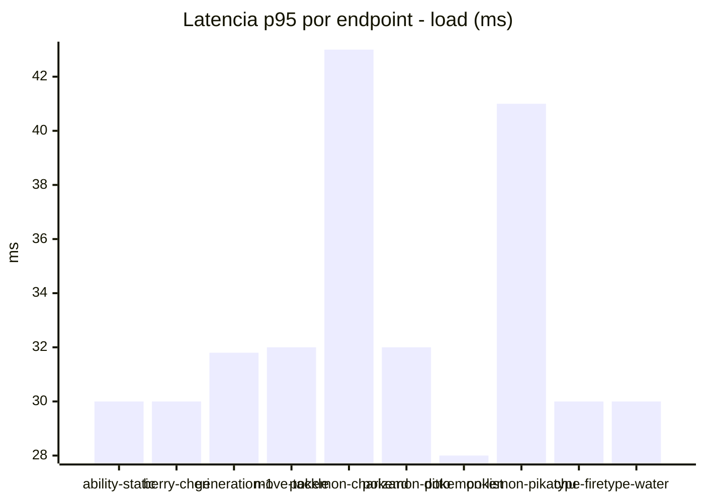
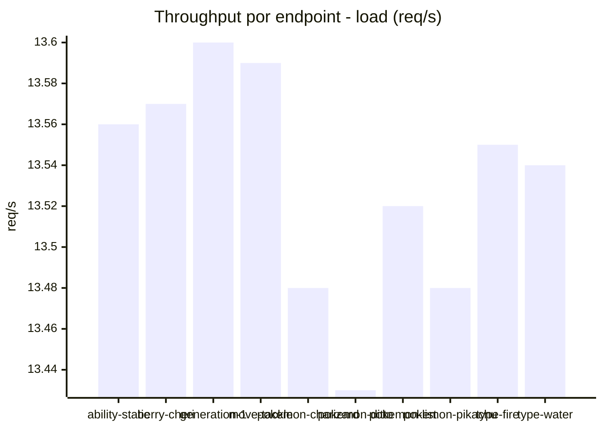
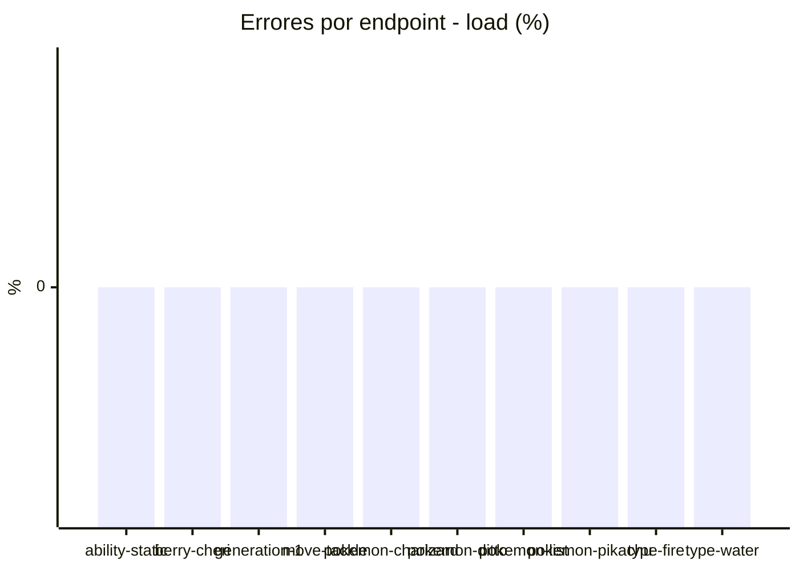
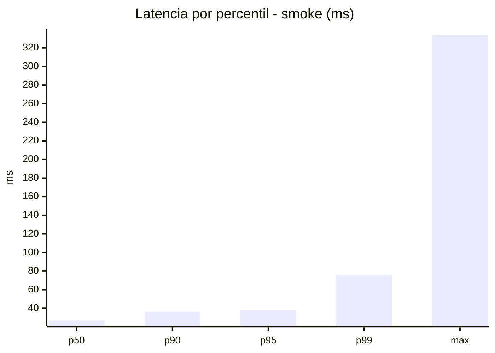
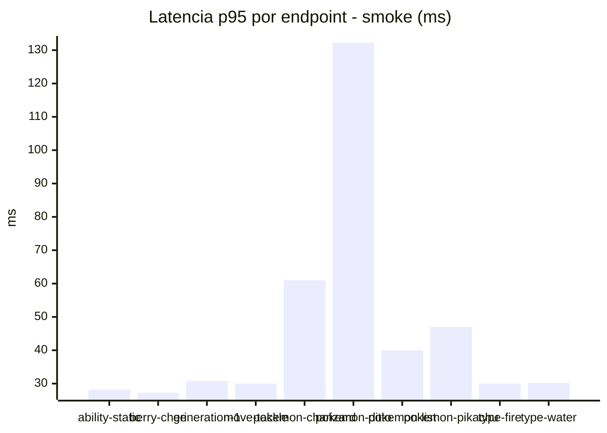
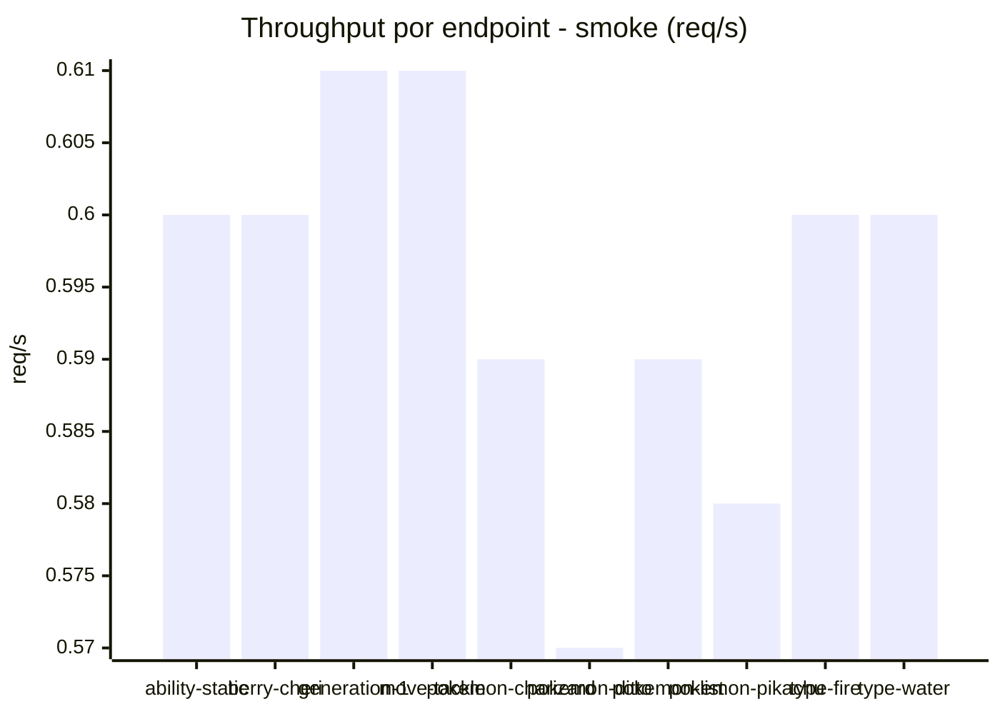

# Reporte de performance - PokeAPI

**Fecha:** 2026-10-29 18:48 UTC  
**Veredicto del agente:** `PASS`  
**Corrida:** [ver en GitHub Actions](https://github.com/lrbg/jmeter-pokeapi-lab/actions/runs/40933884520)  

## Validacion del agente de IA

PASS (fallback por umbrales)

- Error maximo: 0.0%
- p95 maximo: 38.2 ms

## Resultados

### Escenario: `load`

| Metrica | Valor |
| --- | --- |
| Muestras | 16055 |
| Errores | 0 (0.0%) |
| Latencia media | 27.4 ms |
| p50 / p90 / p95 / p99 | 26.0 / 32.0 / 36.0 / 60.0 ms |
| Min / Max | 20 / 214 ms |
| Throughput | 134.18 req/s |
| Duracion | 119.7 s |

Detalle por endpoint

| Endpoint | Muestras | Error % | avg | p95 | p99 | req/s |
| --- | --- | --- | --- | --- | --- | --- |
| ability-static | 1605 | 0.0% | 26.4 | 30.0 | 35.0 | 13.56 |
| berry-cheri | 1606 | 0.0% | 25.8 | 30.0 | 36.9 | 13.57 |
| generation-1 | 1605 | 0.0% | 26.3 | 31.8 | 37.0 | 13.6 |
| move-tackle | 1606 | 0.0% | 27.3 | 32.0 | 44.8 | 13.59 |
| pokemon-charizard | 1605 | 0.0% | 34.5 | 43.0 | 80.0 | 13.48 |
| pokemon-ditto | 1606 | 0.0% | 26.3 | 32.0 | 37.0 | 13.43 |
| pokemon-list | 1606 | 0.0% | 24.0 | 28.0 | 57.8 | 13.52 |
| pokemon-pikachu | 1605 | 0.0% | 31.8 | 41.0 | 77.0 | 13.48 |
| type-fire | 1605 | 0.0% | 25.8 | 30.0 | 37.0 | 13.55 |
| type-water | 1606 | 0.0% | 25.5 | 30.0 | 40.9 | 13.54 |

### Escenario: `smoke`

| Metrica | Valor |
| --- | --- |
| Muestras | 158 |
| Errores | 0 (0.0%) |
| Latencia media | 30.8 ms |
| p50 / p90 / p95 / p99 | 27.0 / 36.3 / 38.2 / 76.0 ms |
| Min / Max | 22 / 334 ms |
| Throughput | 5.4 req/s |
| Duracion | 29.3 s |

Detalle por endpoint

| Endpoint | Muestras | Error % | avg | p95 | p99 | req/s |
| --- | --- | --- | --- | --- | --- | --- |
| ability-static | 16 | 0.0% | 25.5 | 28.2 | 28.9 | 0.6 |
| berry-cheri | 16 | 0.0% | 24.9 | 27.2 | 27.9 | 0.6 |
| generation-1 | 15 | 0.0% | 26.5 | 30.8 | 34.2 | 0.61 |
| move-tackle | 15 | 0.0% | 27.1 | 30.0 | 30.0 | 0.61 |
| pokemon-charizard | 16 | 0.0% | 39.4 | 61.0 | 73.0 | 0.59 |
| pokemon-ditto | 16 | 0.0% | 47.6 | 132.2 | 293.6 | 0.57 |
| pokemon-list | 16 | 0.0% | 28.3 | 40.0 | 68.8 | 0.59 |
| pokemon-pikachu | 16 | 0.0% | 36.3 | 47.0 | 68.6 | 0.58 |
| type-fire | 16 | 0.0% | 26.2 | 30.0 | 30.0 | 0.6 |
| type-water | 16 | 0.0% | 25.9 | 30.2 | 33.2 | 0.6 |

