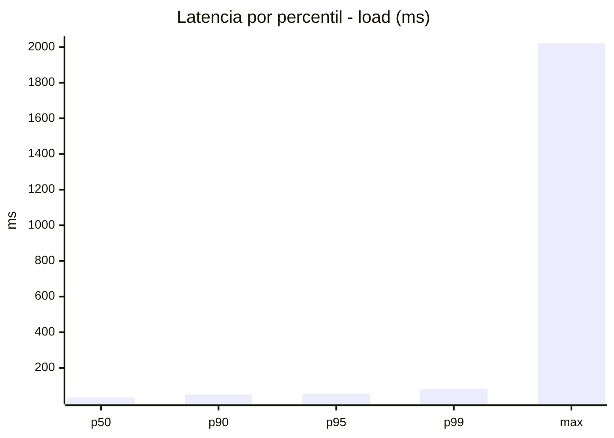
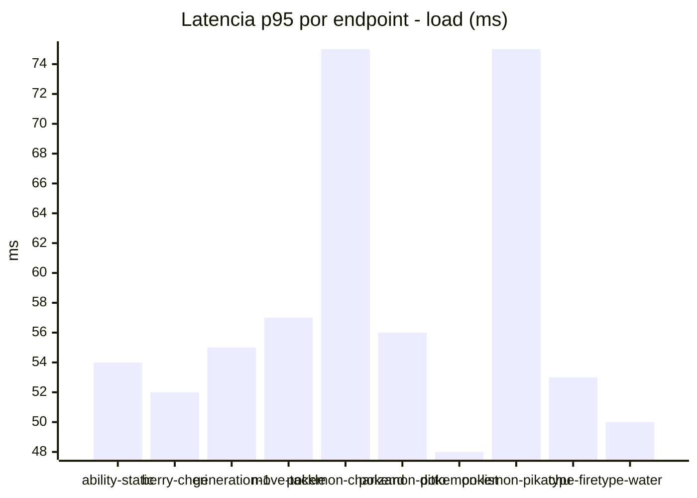
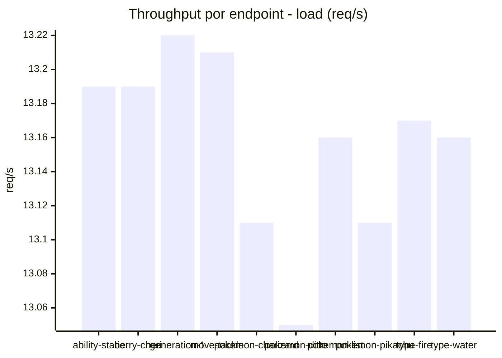
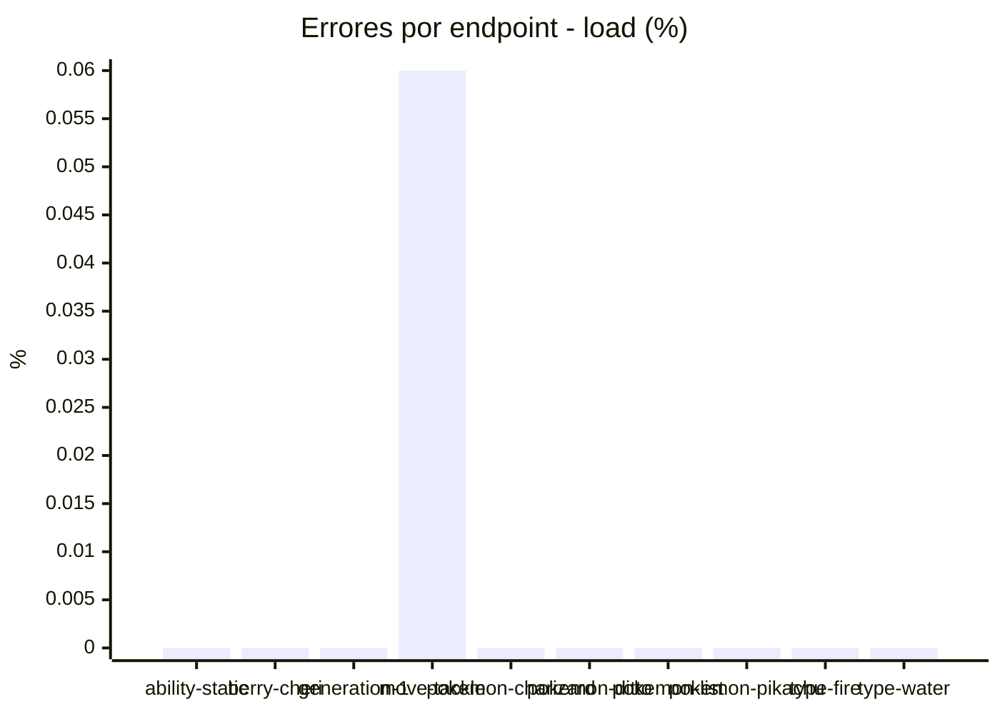
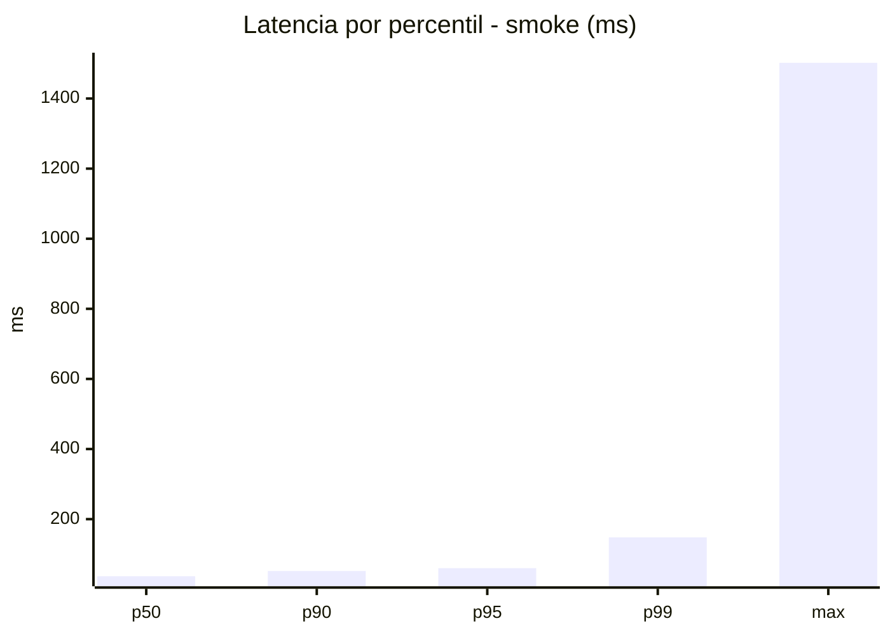
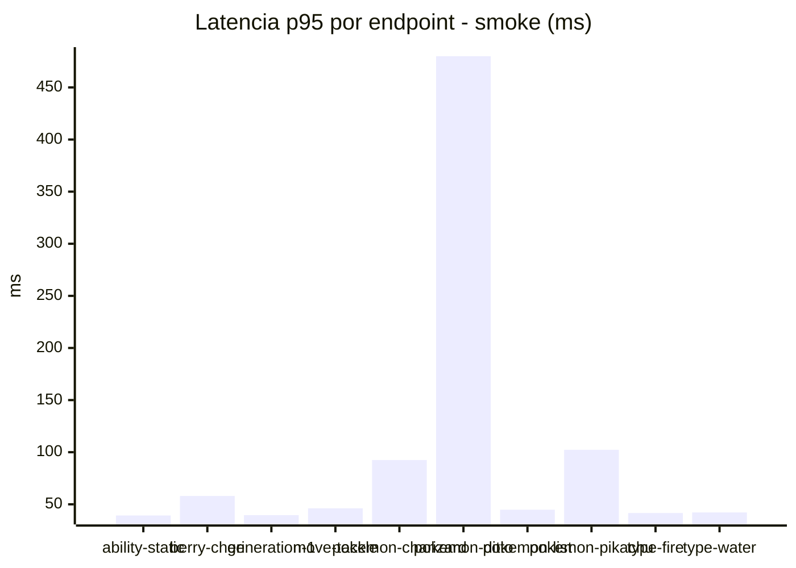
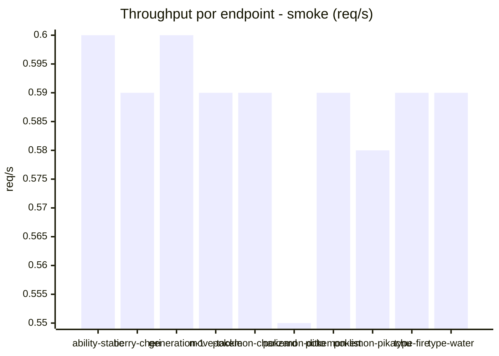
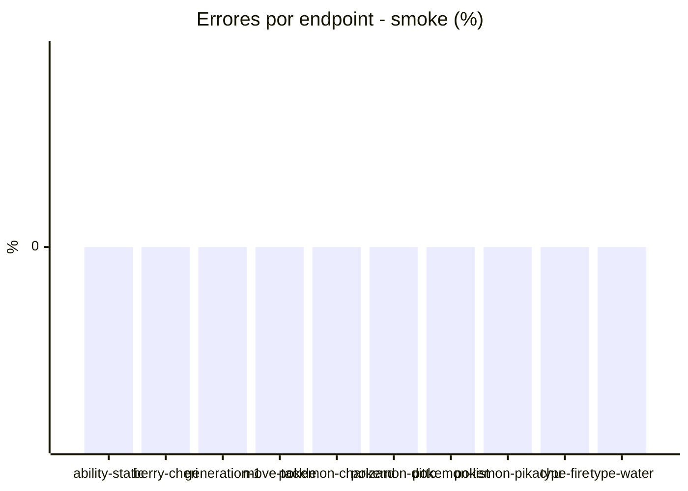

# Reporte de performance - PokeAPI

**Fecha:** 2026-10-30 18:26 UTC  
**Veredicto del agente:** `PASS`  
**Corrida:** [ver en GitHub Actions](https://github.com/lrbg/jmeter-pokeapi-lab/actions/runs/41106597459)  

## Validacion del agente de IA

PASS (fallback por umbrales)

- Error maximo: 0.01%
- p95 maximo: 60.1 ms

## Resultados

### Escenario: `load`

| Metrica | Valor |
| --- | --- |
| Muestras | 15604 |
| Errores | 1 (0.01%) |
| Latencia media | 36.9 ms |
| p50 / p90 / p95 / p99 | 34.0 / 51.0 / 56.0 / 83.0 ms |
| Min / Max | 20 / 2021 ms |
| Throughput | 130.43 req/s |
| Duracion | 119.6 s |

Detalle por endpoint

| Endpoint | Muestras | Error % | avg | p95 | p99 | req/s |
| --- | --- | --- | --- | --- | --- | --- |
| ability-static | 1560 | 0.0% | 35.3 | 54.0 | 60.0 | 13.19 |
| berry-cheri | 1560 | 0.0% | 34.0 | 52.0 | 58.0 | 13.19 |
| generation-1 | 1560 | 0.0% | 35.2 | 55.0 | 60.0 | 13.22 |
| move-tackle | 1560 | 0.06% | 36.6 | 57.0 | 64.4 | 13.21 |
| pokemon-charizard | 1560 | 0.0% | 46.7 | 75.0 | 110.8 | 13.11 |
| pokemon-ditto | 1560 | 0.0% | 36.9 | 56.0 | 71.4 | 13.05 |
| pokemon-list | 1561 | 0.0% | 32.2 | 48.0 | 57.0 | 13.16 |
| pokemon-pikachu | 1561 | 0.0% | 43.7 | 75.0 | 150.2 | 13.11 |
| type-fire | 1561 | 0.0% | 34.6 | 53.0 | 69.0 | 13.17 |
| type-water | 1561 | 0.0% | 33.6 | 50.0 | 58.4 | 13.16 |

### Escenario: `smoke`

| Metrica | Valor |
| --- | --- |
| Muestras | 150 |
| Errores | 0 (0.0%) |
| Latencia media | 51.2 ms |
| p50 / p90 / p95 / p99 | 37.0 / 52.0 / 60.1 / 147.9 ms |
| Min / Max | 32 / 1502 ms |
| Throughput | 5.2 req/s |
| Duracion | 28.9 s |

Detalle por endpoint

| Endpoint | Muestras | Error % | avg | p95 | p99 | req/s |
| --- | --- | --- | --- | --- | --- | --- |
| ability-static | 15 | 0.0% | 35.9 | 39.3 | 39.9 | 0.6 |
| berry-cheri | 15 | 0.0% | 39.3 | 58.0 | 91.6 | 0.59 |
| generation-1 | 15 | 0.0% | 37.1 | 39.6 | 40.7 | 0.6 |
| move-tackle | 15 | 0.0% | 37.9 | 46.2 | 59.6 | 0.59 |
| pokemon-charizard | 15 | 0.0% | 55.8 | 92.5 | 95.3 | 0.59 |
| pokemon-ditto | 15 | 0.0% | 135.1 | 480.0 | 1297.6 | 0.55 |
| pokemon-list | 15 | 0.0% | 37.9 | 44.8 | 48.2 | 0.59 |
| pokemon-pikachu | 15 | 0.0% | 59.2 | 102.3 | 175.7 | 0.58 |
| type-fire | 15 | 0.0% | 37.1 | 41.6 | 42.7 | 0.59 |
| type-water | 15 | 0.0% | 36.7 | 42.2 | 50.0 | 0.59 |

