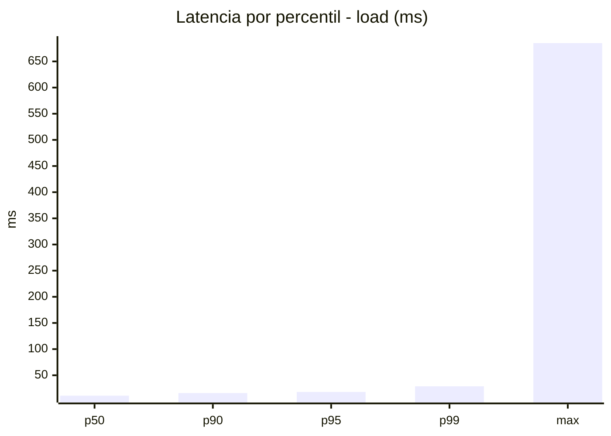
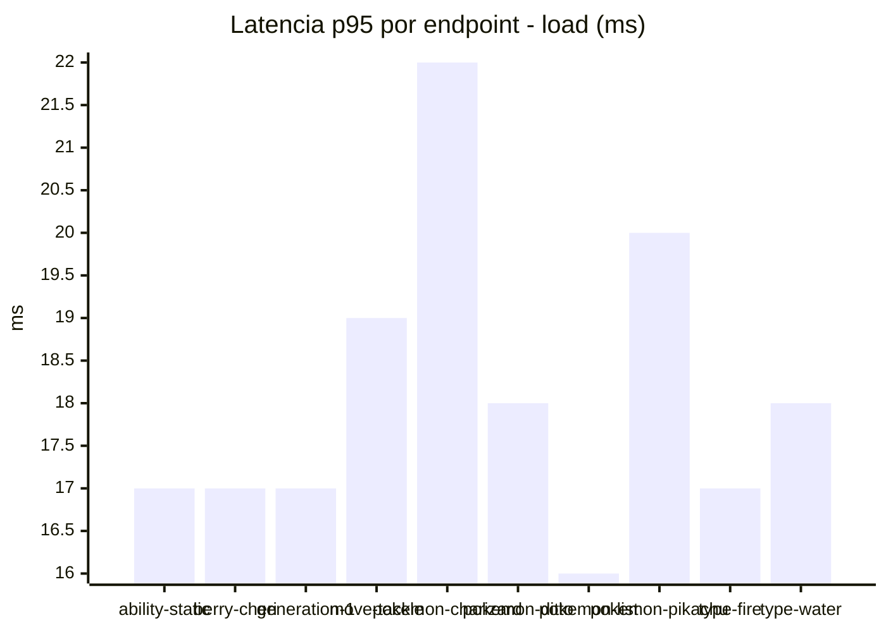
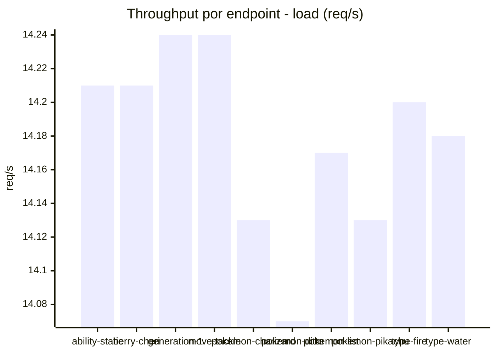
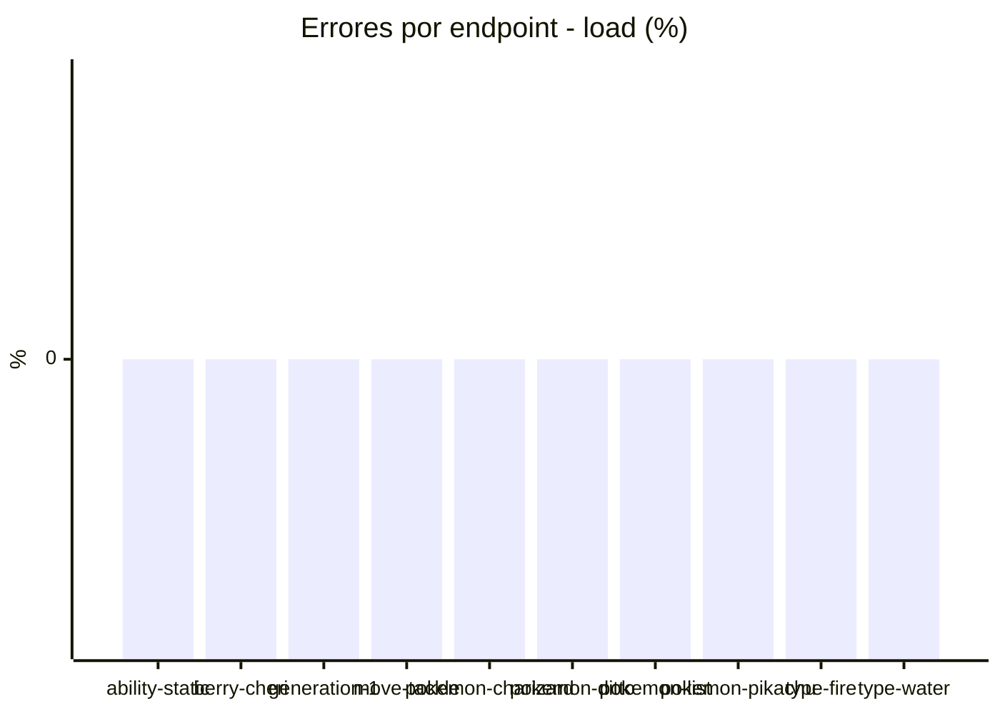
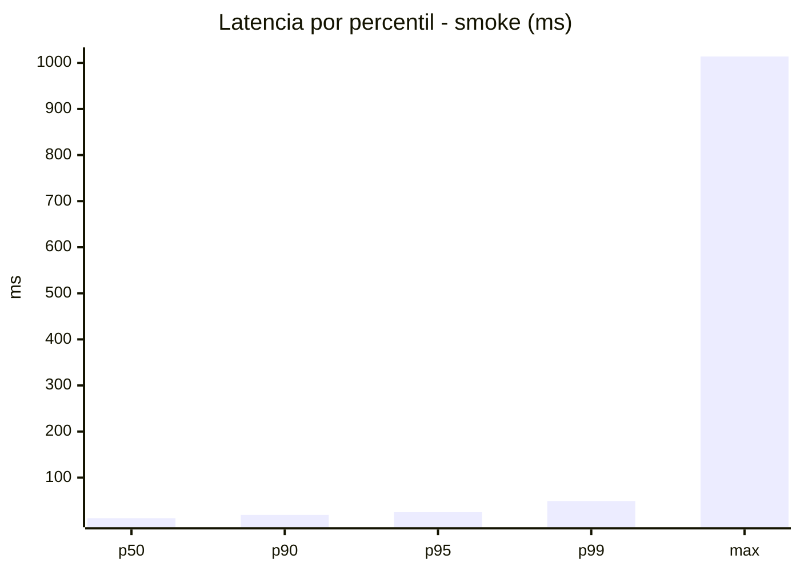
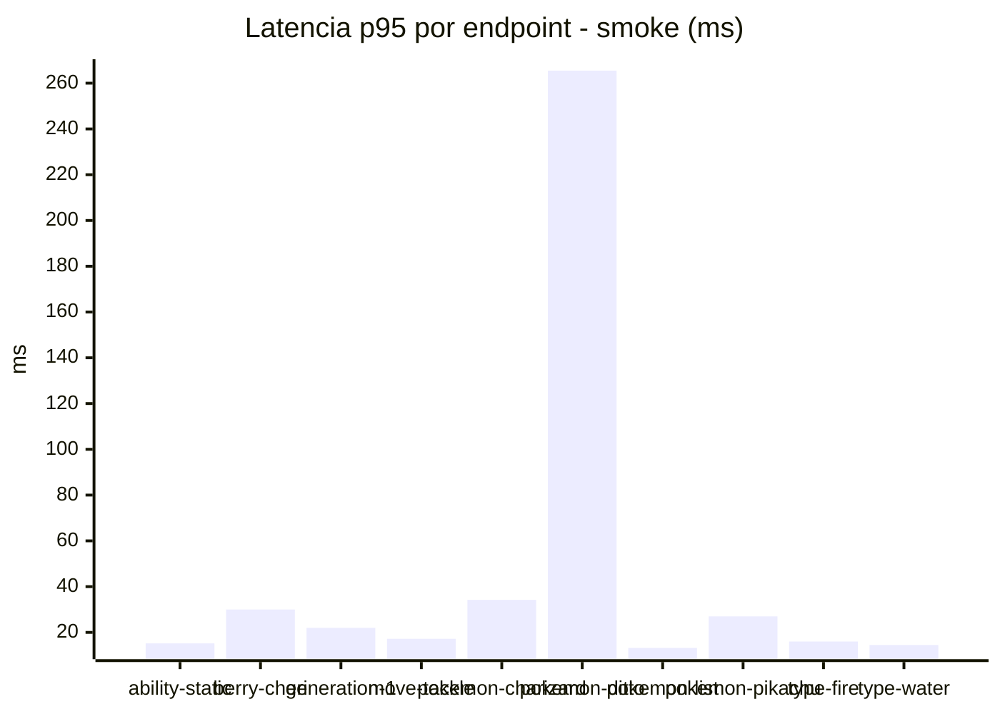
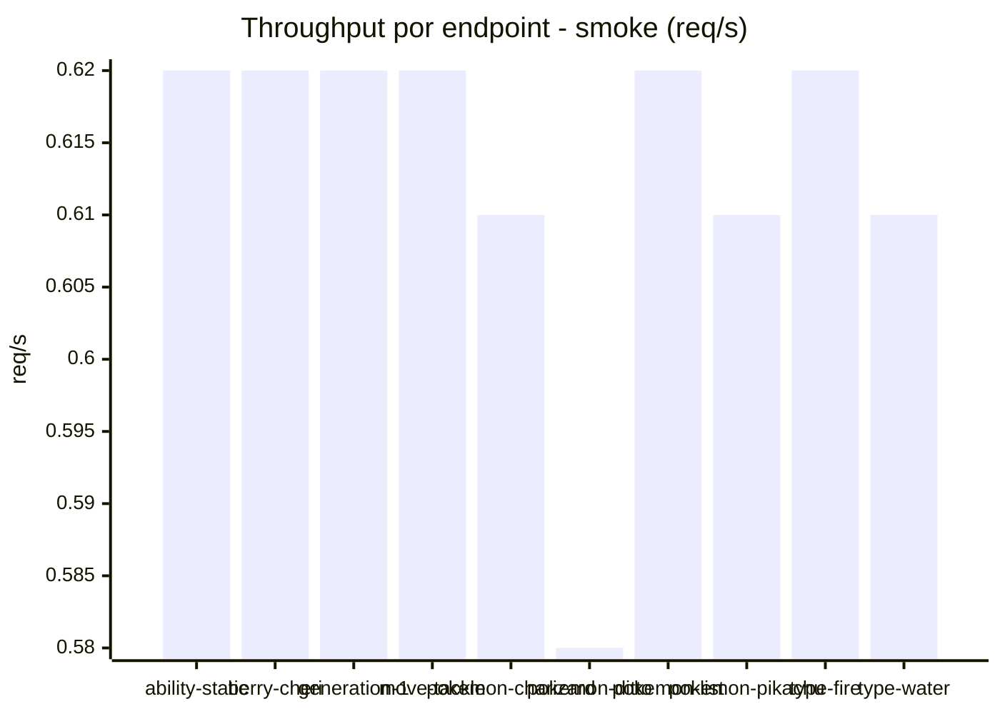

# Reporte de performance - PokeAPI

**Fecha:** 2026-10-31 17:32 UTC  
**Veredicto del agente:** `PASS`  
**Corrida:** [ver en GitHub Actions](https://github.com/lrbg/jmeter-pokeapi-lab/actions/runs/41224757682)  

## Validacion del agente de IA

PASS (fallback por umbrales)

- Error maximo: 0.0%
- p95 maximo: 25.0 ms

## Resultados

### Escenario: `load`

| Metrica | Valor |
| --- | --- |
| Muestras | 16823 |
| Errores | 0 (0.0%) |
| Latencia media | 12.3 ms |
| p50 / p90 / p95 / p99 | 11.0 / 16.0 / 18.0 / 29.0 ms |
| Min / Max | 5 / 685 ms |
| Throughput | 140.63 req/s |
| Duracion | 119.6 s |

Detalle por endpoint

| Endpoint | Muestras | Error % | avg | p95 | p99 | req/s |
| --- | --- | --- | --- | --- | --- | --- |
| ability-static | 1683 | 0.0% | 11.6 | 17.0 | 27.0 | 14.21 |
| berry-cheri | 1682 | 0.0% | 11.7 | 17.0 | 29.0 | 14.21 |
| generation-1 | 1681 | 0.0% | 12.0 | 17.0 | 26.2 | 14.24 |
| move-tackle | 1681 | 0.0% | 13.0 | 19.0 | 35.0 | 14.24 |
| pokemon-charizard | 1683 | 0.0% | 15.0 | 22.0 | 35.2 | 14.13 |
| pokemon-ditto | 1683 | 0.0% | 12.2 | 18.0 | 27.0 | 14.07 |
| pokemon-list | 1682 | 0.0% | 10.8 | 16.0 | 23.0 | 14.17 |
| pokemon-pikachu | 1683 | 0.0% | 13.9 | 20.0 | 30.0 | 14.13 |
| type-fire | 1683 | 0.0% | 11.4 | 17.0 | 26.2 | 14.2 |
| type-water | 1682 | 0.0% | 11.8 | 18.0 | 26.0 | 14.18 |

### Escenario: `smoke`

| Metrica | Valor |
| --- | --- |
| Muestras | 160 |
| Errores | 0 (0.0%) |
| Latencia media | 20.1 ms |
| p50 / p90 / p95 / p99 | 12.0 / 19.1 / 25.0 / 49.3 ms |
| Min / Max | 7 / 1014 ms |
| Throughput | 5.53 req/s |
| Duracion | 28.9 s |

Detalle por endpoint

| Endpoint | Muestras | Error % | avg | p95 | p99 | req/s |
| --- | --- | --- | --- | --- | --- | --- |
| ability-static | 16 | 0.0% | 11.4 | 15.2 | 15.8 | 0.62 |
| berry-cheri | 16 | 0.0% | 14.8 | 30.0 | 51.6 | 0.62 |
| generation-1 | 16 | 0.0% | 13.4 | 22.0 | 31.6 | 0.62 |
| move-tackle | 16 | 0.0% | 13.3 | 17.2 | 17.9 | 0.62 |
| pokemon-charizard | 16 | 0.0% | 21.5 | 34.2 | 42.0 | 0.61 |
| pokemon-ditto | 16 | 0.0% | 74.4 | 265.5 | 864.3 | 0.58 |
| pokemon-list | 16 | 0.0% | 10.8 | 13.2 | 13.8 | 0.62 |
| pokemon-pikachu | 16 | 0.0% | 18.4 | 27.0 | 29.4 | 0.61 |
| type-fire | 16 | 0.0% | 11.8 | 16.0 | 18.4 | 0.62 |
| type-water | 16 | 0.0% | 11.4 | 14.5 | 15.7 | 0.61 |

