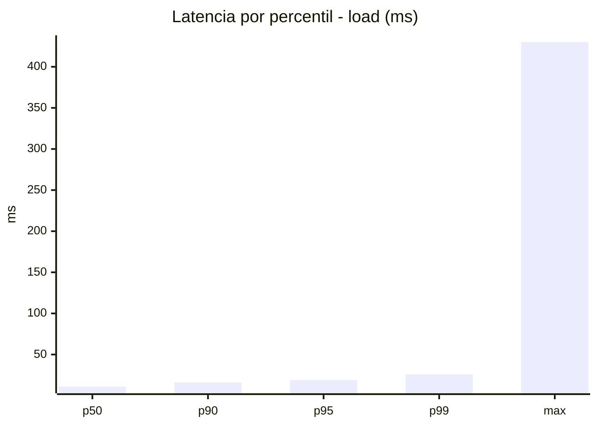
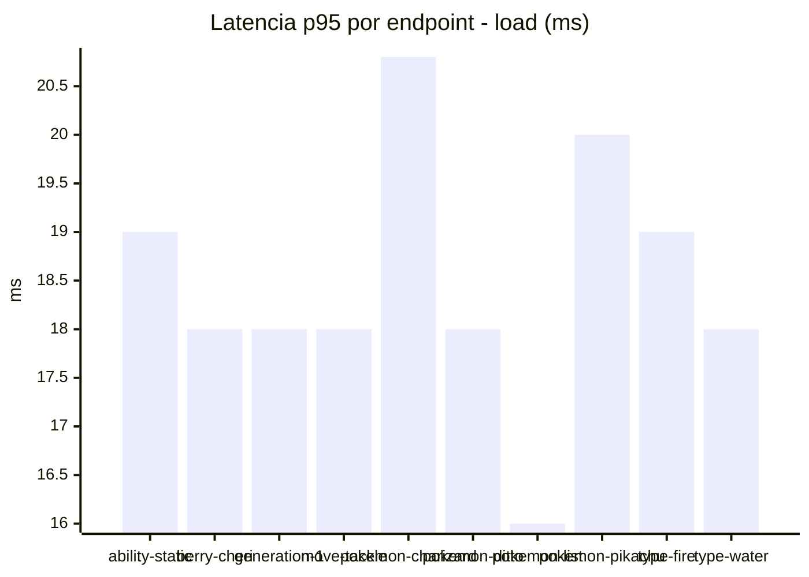
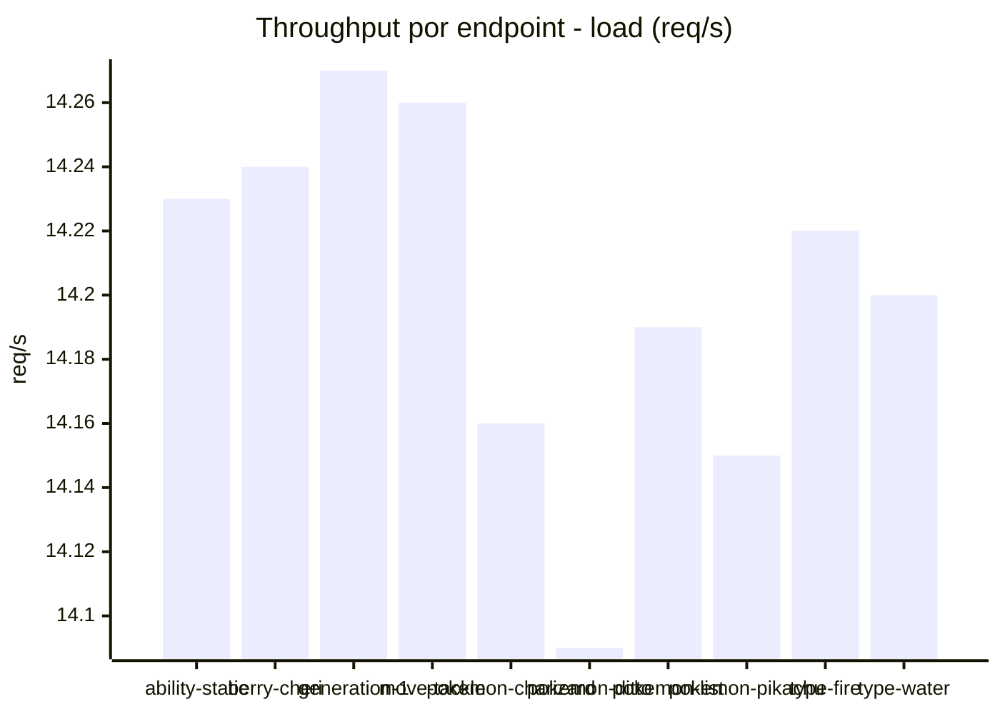
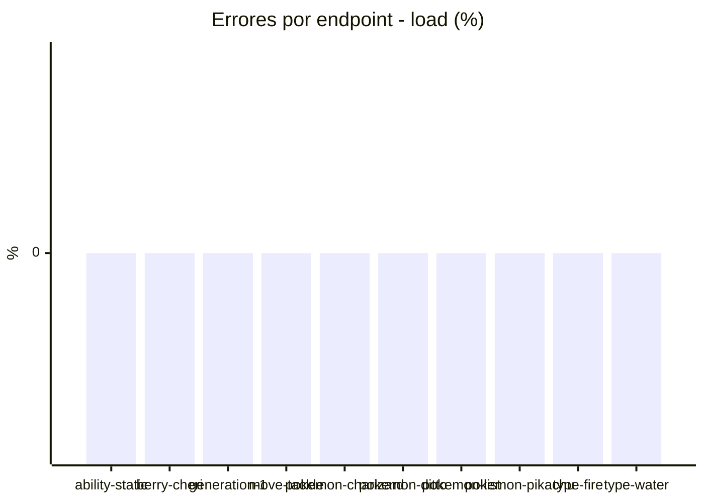
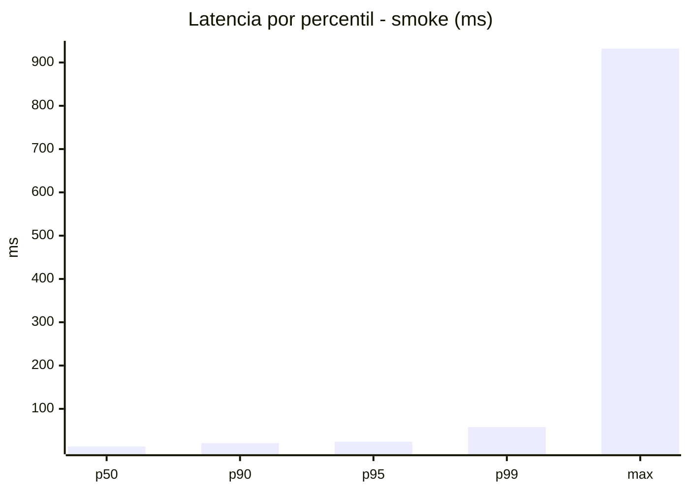
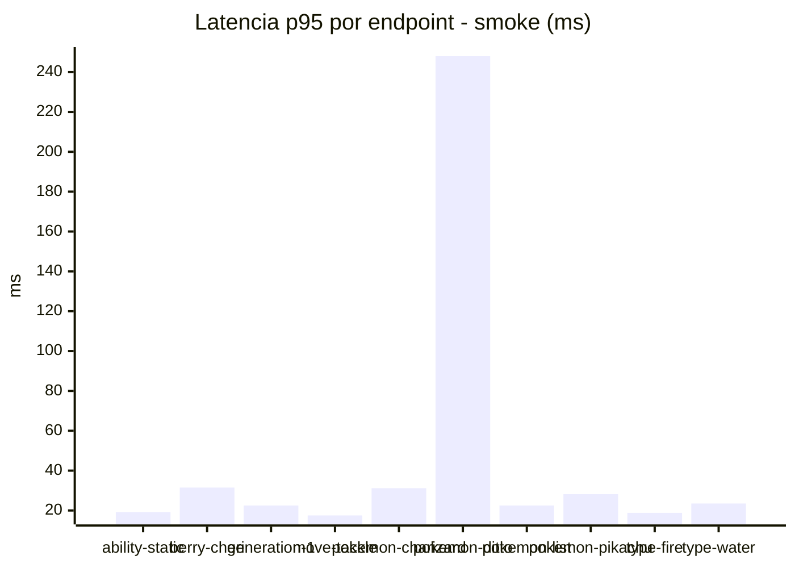
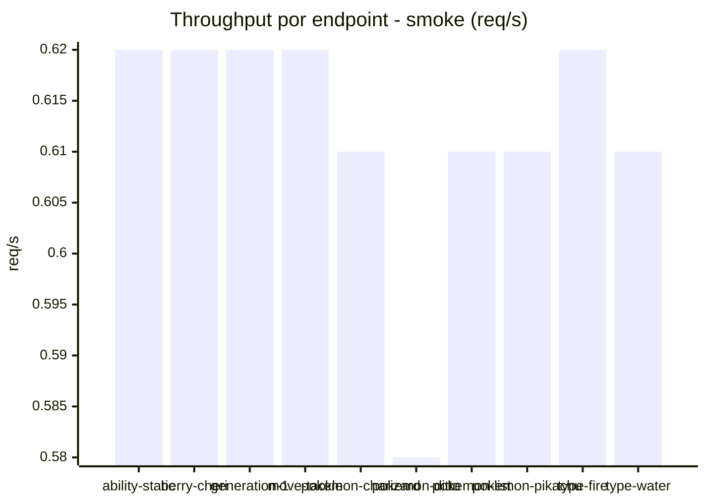

# Reporte de performance - PokeAPI

**Fecha:** 2026-11-01 18:16 UTC  
**Veredicto del agente:** `PASS`  
**Corrida:** [ver en GitHub Actions](https://github.com/lrbg/jmeter-pokeapi-lab/actions/runs/41335537380)  

## Validacion del agente de IA

PASS (fallback por umbrales)

- Error maximo: 0.0%
- p95 maximo: 24.0 ms

## Resultados

### Escenario: `load`

| Metrica | Valor |
| --- | --- |
| Muestras | 16848 |
| Errores | 0 (0.0%) |
| Latencia media | 11.8 ms |
| p50 / p90 / p95 / p99 | 11.0 / 16.0 / 19.0 / 26.0 ms |
| Min / Max | 6 / 430 ms |
| Throughput | 140.86 req/s |
| Duracion | 119.6 s |

Detalle por endpoint

| Endpoint | Muestras | Error % | avg | p95 | p99 | req/s |
| --- | --- | --- | --- | --- | --- | --- |
| ability-static | 1684 | 0.0% | 12.1 | 19.0 | 25.0 | 14.23 |
| berry-cheri | 1684 | 0.0% | 11.0 | 18.0 | 25.0 | 14.24 |
| generation-1 | 1685 | 0.0% | 11.6 | 18.0 | 27.0 | 14.27 |
| move-tackle | 1685 | 0.0% | 12.1 | 18.0 | 27.2 | 14.26 |
| pokemon-charizard | 1685 | 0.0% | 13.8 | 20.8 | 31.0 | 14.16 |
| pokemon-ditto | 1685 | 0.0% | 11.3 | 18.0 | 24.2 | 14.09 |
| pokemon-list | 1685 | 0.0% | 10.3 | 16.0 | 22.2 | 14.19 |
| pokemon-pikachu | 1685 | 0.0% | 13.1 | 20.0 | 29.0 | 14.15 |
| type-fire | 1685 | 0.0% | 11.4 | 19.0 | 25.0 | 14.22 |
| type-water | 1685 | 0.0% | 11.6 | 18.0 | 25.0 | 14.2 |

### Escenario: `smoke`

| Metrica | Valor |
| --- | --- |
| Muestras | 160 |
| Errores | 0 (0.0%) |
| Latencia media | 21.0 ms |
| p50 / p90 / p95 / p99 | 13.0 / 21.0 / 24.0 / 57.8 ms |
| Min / Max | 8 / 932 ms |
| Throughput | 5.51 req/s |
| Duracion | 29.1 s |

Detalle por endpoint

| Endpoint | Muestras | Error % | avg | p95 | p99 | req/s |
| --- | --- | --- | --- | --- | --- | --- |
| ability-static | 16 | 0.0% | 14.6 | 19.2 | 19.9 | 0.62 |
| berry-cheri | 16 | 0.0% | 15.9 | 31.5 | 61.5 | 0.62 |
| generation-1 | 16 | 0.0% | 13.7 | 22.5 | 30.9 | 0.62 |
| move-tackle | 16 | 0.0% | 13.6 | 17.5 | 18.7 | 0.62 |
| pokemon-charizard | 16 | 0.0% | 21.3 | 31.2 | 46.2 | 0.61 |
| pokemon-ditto | 16 | 0.0% | 70.3 | 248.0 | 795.2 | 0.58 |
| pokemon-list | 16 | 0.0% | 13.4 | 22.5 | 26.1 | 0.61 |
| pokemon-pikachu | 16 | 0.0% | 20.1 | 28.2 | 43.2 | 0.61 |
| type-fire | 16 | 0.0% | 12.9 | 18.8 | 22.9 | 0.62 |
| type-water | 16 | 0.0% | 13.9 | 23.5 | 24.7 | 0.61 |

