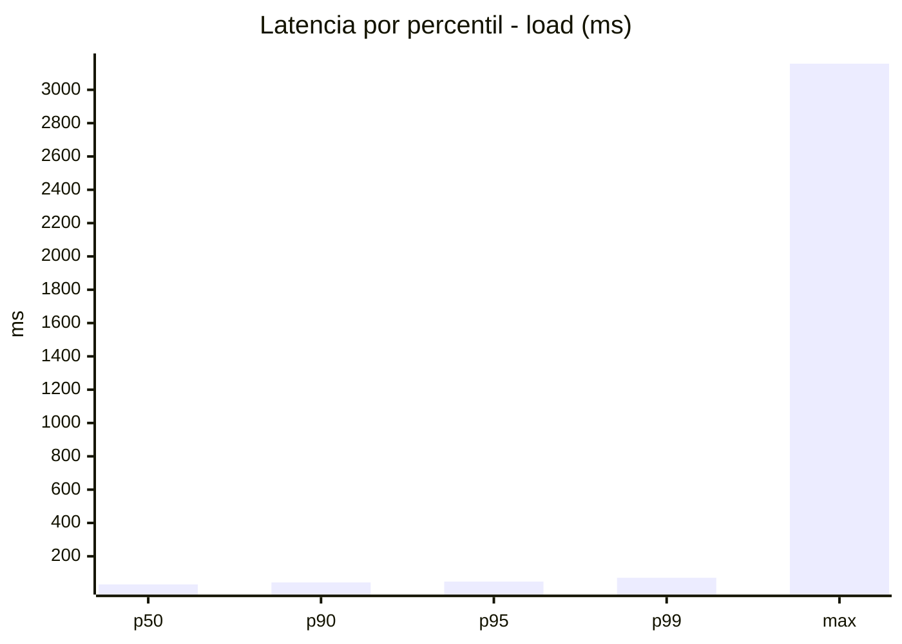
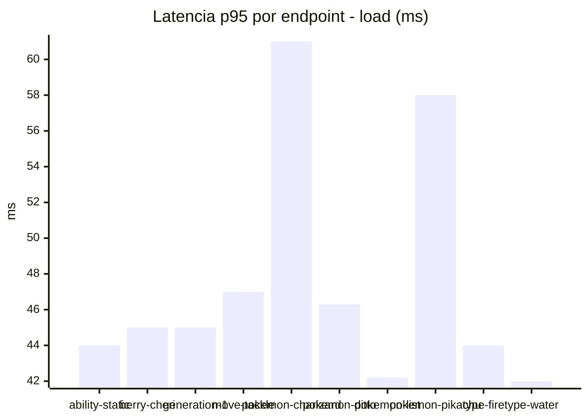
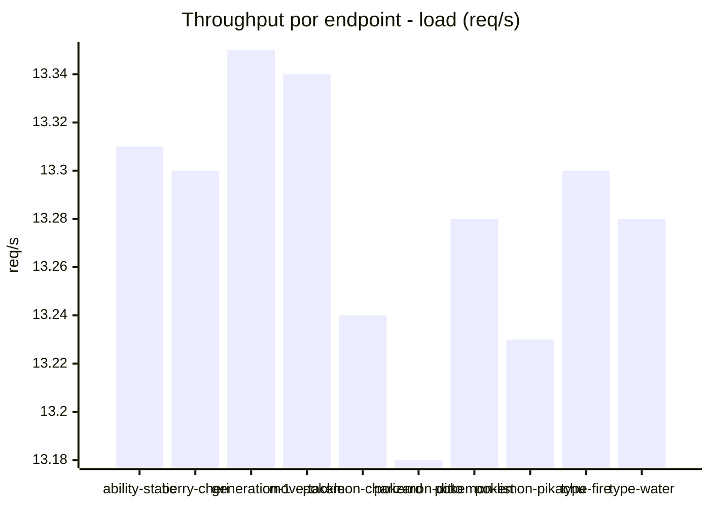
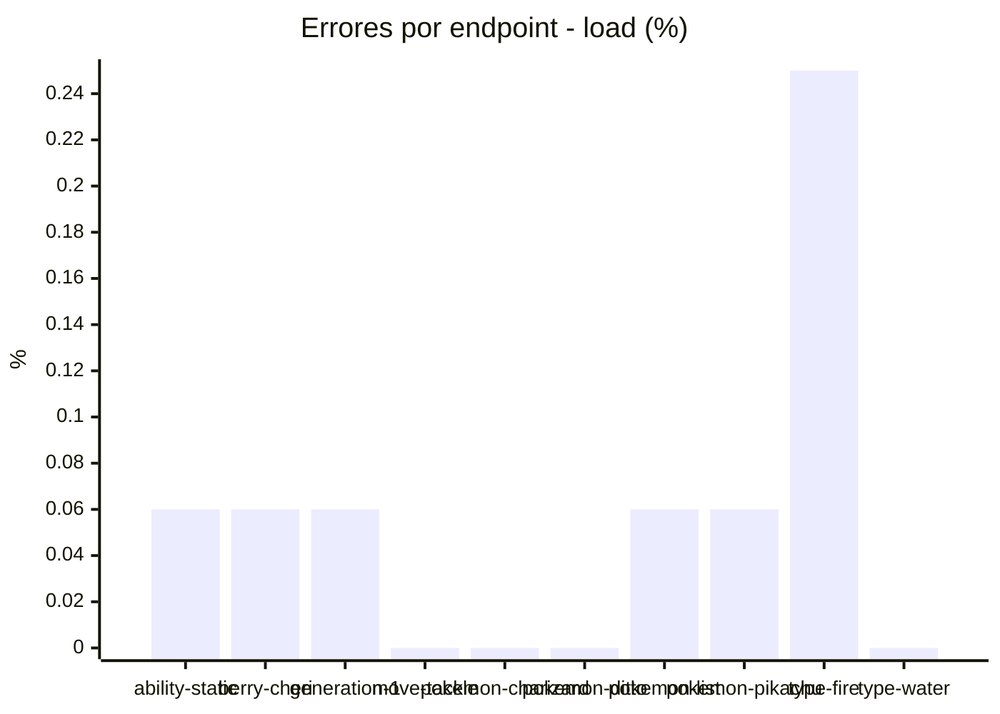
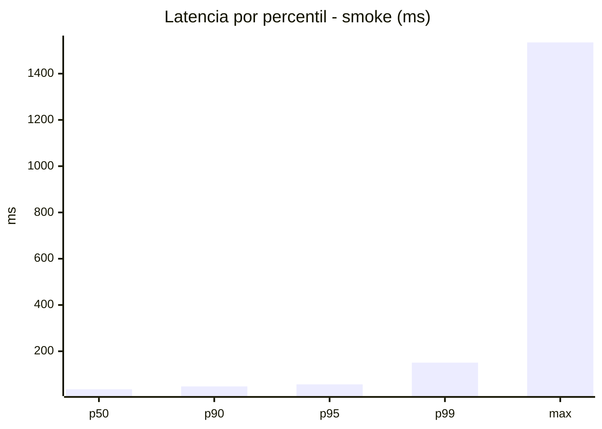
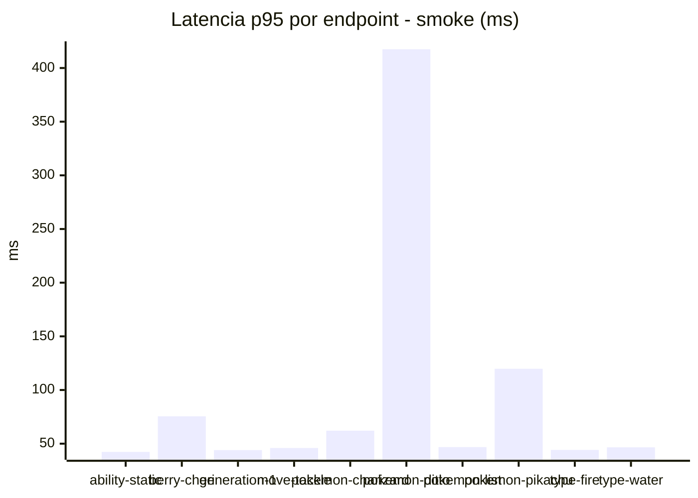
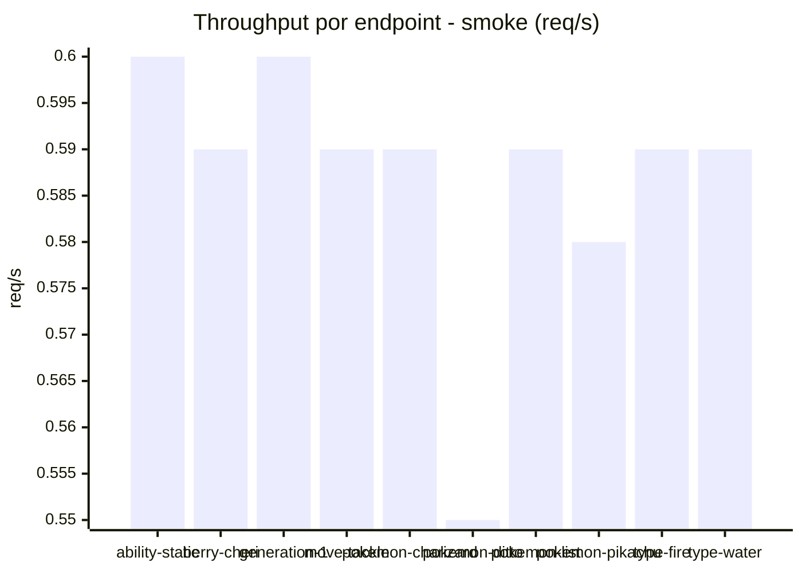
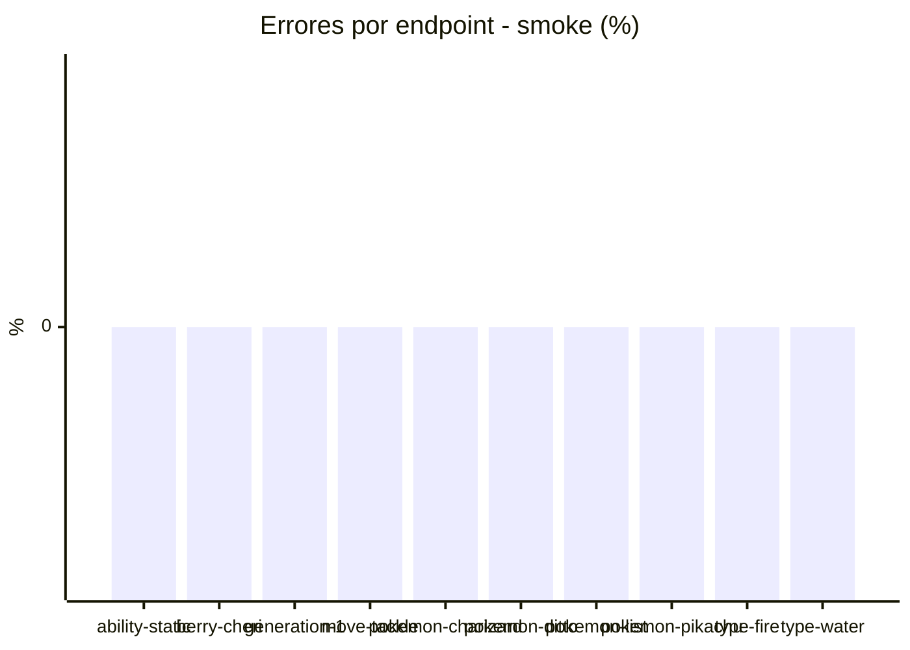

# Reporte de performance - PokeAPI

**Fecha:** 2026-11-02 22:08 UTC  
**Veredicto del agente:** `PASS`  
**Corrida:** [ver en GitHub Actions](https://github.com/lrbg/jmeter-pokeapi-lab/actions/runs/41534264635)  

## Validacion del agente de IA

PASS (fallback por umbrales)

- Error maximo: 0.06%
- p95 maximo: 56.9 ms

## Resultados

### Escenario: `load`

| Metrica | Valor |
| --- | --- |
| Muestras | 15752 |
| Errores | 9 (0.06%) |
| Latencia media | 33.6 ms |
| p50 / p90 / p95 / p99 | 31.0 / 43.0 / 48.0 / 71.0 ms |
| Min / Max | 0 / 3157 ms |
| Throughput | 131.58 req/s |
| Duracion | 119.7 s |

Detalle por endpoint

| Endpoint | Muestras | Error % | avg | p95 | p99 | req/s |
| --- | --- | --- | --- | --- | --- | --- |
| ability-static | 1575 | 0.06% | 32.3 | 44.0 | 58.5 | 13.31 |
| berry-cheri | 1575 | 0.06% | 31.4 | 45.0 | 59.5 | 13.3 |
| generation-1 | 1574 | 0.06% | 32.6 | 45.0 | 55.5 | 13.35 |
| move-tackle | 1575 | 0.0% | 33.2 | 47.0 | 67.0 | 13.34 |
| pokemon-charizard | 1575 | 0.0% | 40.1 | 61.0 | 99.0 | 13.24 |
| pokemon-ditto | 1575 | 0.0% | 32.6 | 46.3 | 72.8 | 13.18 |
| pokemon-list | 1576 | 0.06% | 30.0 | 42.2 | 58.0 | 13.28 |
| pokemon-pikachu | 1575 | 0.06% | 40.6 | 58.0 | 111.1 | 13.23 |
| type-fire | 1576 | 0.25% | 32.0 | 44.0 | 59.5 | 13.3 |
| type-water | 1576 | 0.0% | 30.7 | 42.0 | 49.2 | 13.28 |

### Escenario: `smoke`

| Metrica | Valor |
| --- | --- |
| Muestras | 152 |
| Errores | 0 (0.0%) |
| Latencia media | 48.1 ms |
| p50 / p90 / p95 / p99 | 35.5 / 48.0 / 56.9 / 150.9 ms |
| Min / Max | 22 / 1535 ms |
| Throughput | 5.23 req/s |
| Duracion | 29.0 s |

Detalle por endpoint

| Endpoint | Muestras | Error % | avg | p95 | p99 | req/s |
| --- | --- | --- | --- | --- | --- | --- |
| ability-static | 15 | 0.0% | 31.9 | 42.3 | 42.9 | 0.6 |
| berry-cheri | 15 | 0.0% | 40.9 | 75.5 | 139.9 | 0.59 |
| generation-1 | 15 | 0.0% | 35.5 | 44.0 | 44.0 | 0.6 |
| move-tackle | 15 | 0.0% | 34.7 | 46.0 | 46.0 | 0.59 |
| pokemon-charizard | 15 | 0.0% | 46 | 62.1 | 66.0 | 0.59 |
| pokemon-ditto | 16 | 0.0% | 127.5 | 417.5 | 1311.5 | 0.55 |
| pokemon-list | 15 | 0.0% | 33.6 | 46.8 | 50.2 | 0.59 |
| pokemon-pikachu | 16 | 0.0% | 54.2 | 119.8 | 140.8 | 0.58 |
| type-fire | 15 | 0.0% | 35.3 | 44.2 | 46.4 | 0.59 |
| type-water | 15 | 0.0% | 35.1 | 46.6 | 47.7 | 0.59 |

