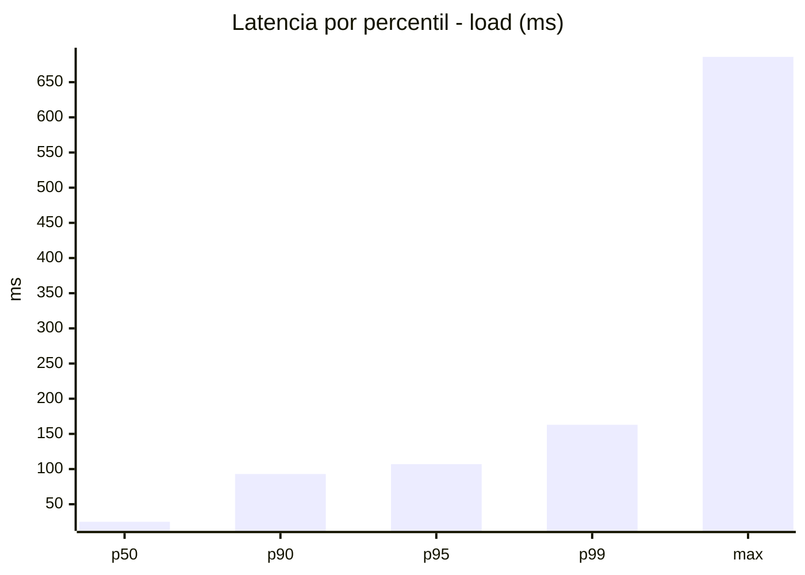
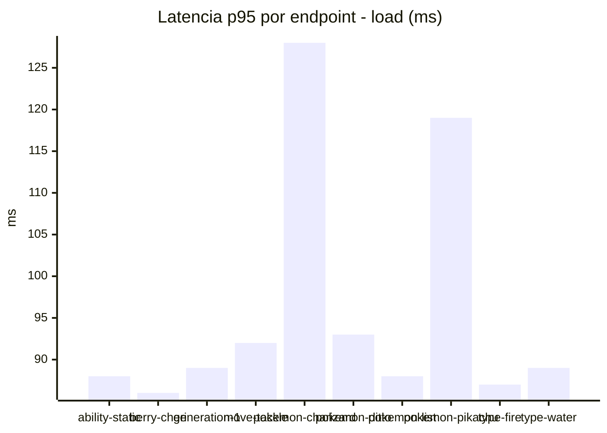
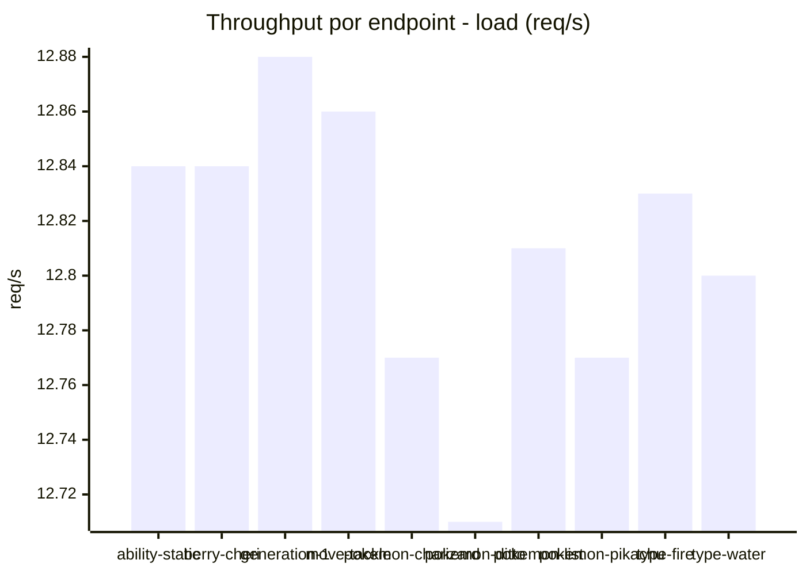
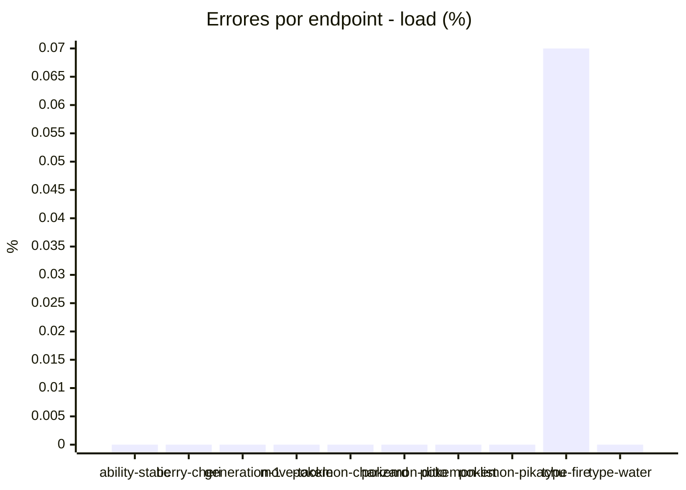
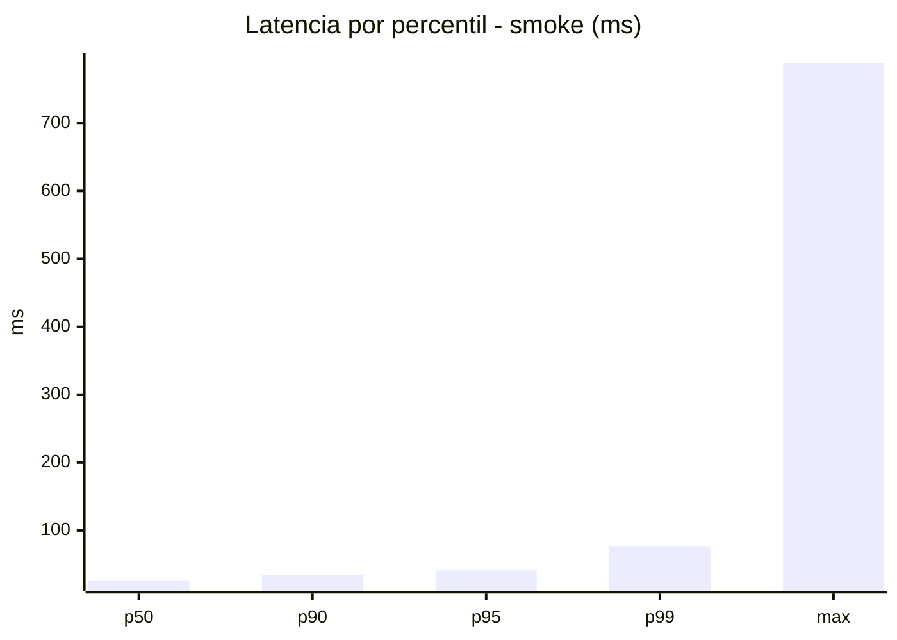
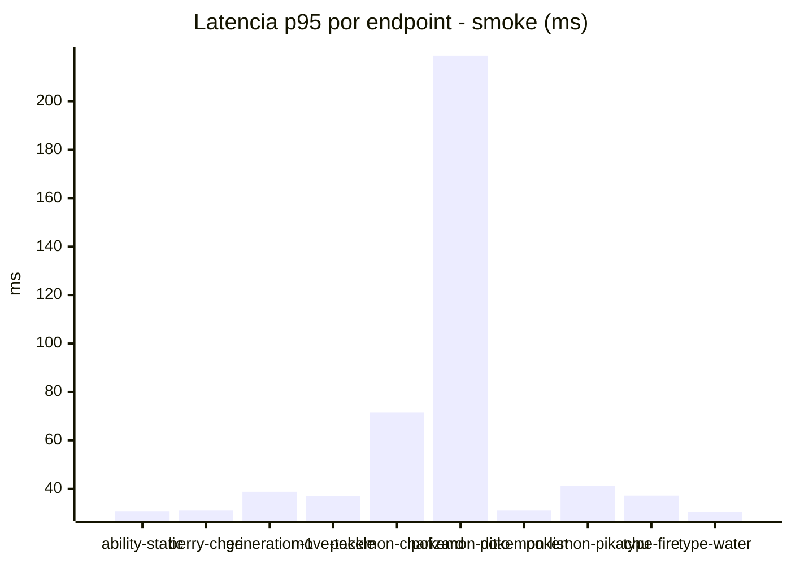
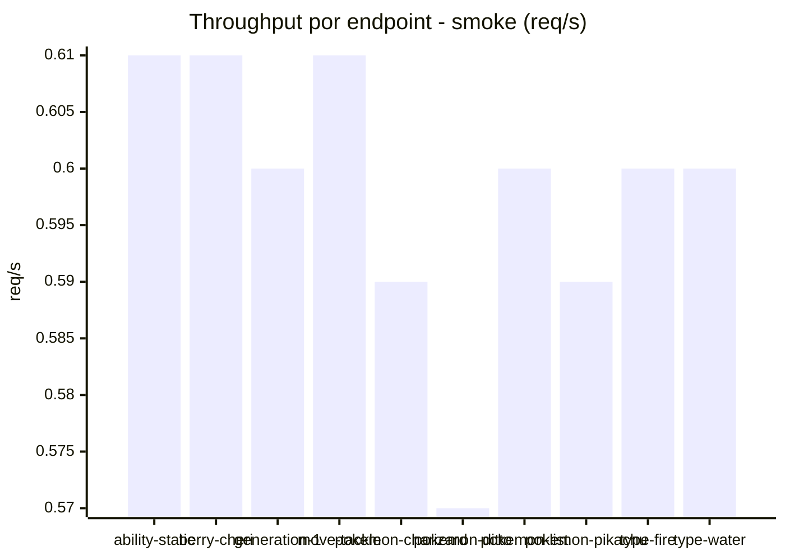
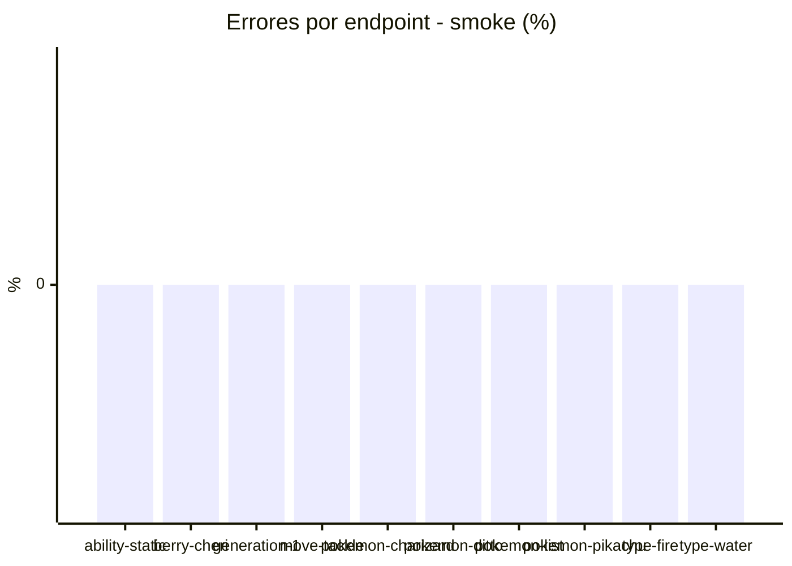

# Reporte de performance - PokeAPI

**Fecha:** 2026-11-03 19:59 UTC  
**Veredicto del agente:** `PASS`  
**Corrida:** [ver en GitHub Actions](https://github.com/lrbg/jmeter-pokeapi-lab/actions/runs/41707896869)  

## Validacion del agente de IA

PASS (fallback por umbrales)

- Error maximo: 0.01%
- p95 maximo: 107.0 ms

## Resultados

### Escenario: `load`

| Metrica | Valor |
| --- | --- |
| Muestras | 15202 |
| Errores | 1 (0.01%) |
| Latencia media | 45.8 ms |
| p50 / p90 / p95 / p99 | 25.0 / 93.0 / 107.0 / 163.0 ms |
| Min / Max | 10 / 686 ms |
| Throughput | 127.02 req/s |
| Duracion | 119.7 s |

Detalle por endpoint

| Endpoint | Muestras | Error % | avg | p95 | p99 | req/s |
| --- | --- | --- | --- | --- | --- | --- |
| ability-static | 1520 | 0.0% | 41.9 | 88.0 | 156.8 | 12.84 |
| berry-cheri | 1520 | 0.0% | 40.6 | 86.0 | 119.9 | 12.84 |
| generation-1 | 1520 | 0.0% | 43.4 | 89.0 | 146.3 | 12.88 |
| move-tackle | 1520 | 0.0% | 45.1 | 92.0 | 135.7 | 12.86 |
| pokemon-charizard | 1520 | 0.0% | 61.6 | 128.0 | 239.6 | 12.77 |
| pokemon-ditto | 1521 | 0.0% | 44.4 | 93.0 | 150.0 | 12.71 |
| pokemon-list | 1520 | 0.0% | 42.7 | 88.0 | 111.0 | 12.81 |
| pokemon-pikachu | 1521 | 0.0% | 54.8 | 119.0 | 214.6 | 12.77 |
| type-fire | 1520 | 0.07% | 40.7 | 87.0 | 134.5 | 12.83 |
| type-water | 1520 | 0.0% | 42.6 | 89.0 | 141.2 | 12.8 |

### Escenario: `smoke`

| Metrica | Valor |
| --- | --- |
| Muestras | 157 |
| Errores | 0 (0.0%) |
| Latencia media | 32.1 ms |
| p50 / p90 / p95 / p99 | 26.0 / 35.0 / 41.2 / 77.2 ms |
| Min / Max | 18 / 788 ms |
| Throughput | 5.39 req/s |
| Duracion | 29.1 s |

Detalle por endpoint

| Endpoint | Muestras | Error % | avg | p95 | p99 | req/s |
| --- | --- | --- | --- | --- | --- | --- |
| ability-static | 16 | 0.0% | 23.1 | 30.8 | 32.5 | 0.61 |
| berry-cheri | 15 | 0.0% | 24.9 | 31.0 | 31.0 | 0.61 |
| generation-1 | 15 | 0.0% | 26.7 | 38.8 | 53.4 | 0.6 |
| move-tackle | 15 | 0.0% | 30.6 | 36.9 | 38.6 | 0.61 |
| pokemon-charizard | 16 | 0.0% | 39.9 | 71.5 | 89.5 | 0.59 |
| pokemon-ditto | 16 | 0.0% | 71.2 | 218.8 | 674.1 | 0.57 |
| pokemon-list | 16 | 0.0% | 23.4 | 31.0 | 31.0 | 0.6 |
| pokemon-pikachu | 16 | 0.0% | 30.8 | 41.2 | 41.9 | 0.59 |
| type-fire | 16 | 0.0% | 25.4 | 37.2 | 40.2 | 0.6 |
| type-water | 16 | 0.0% | 24.4 | 30.5 | 31.7 | 0.6 |

