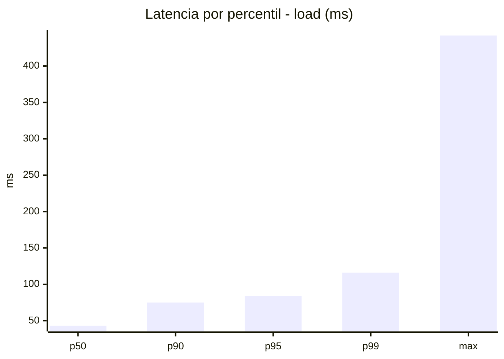
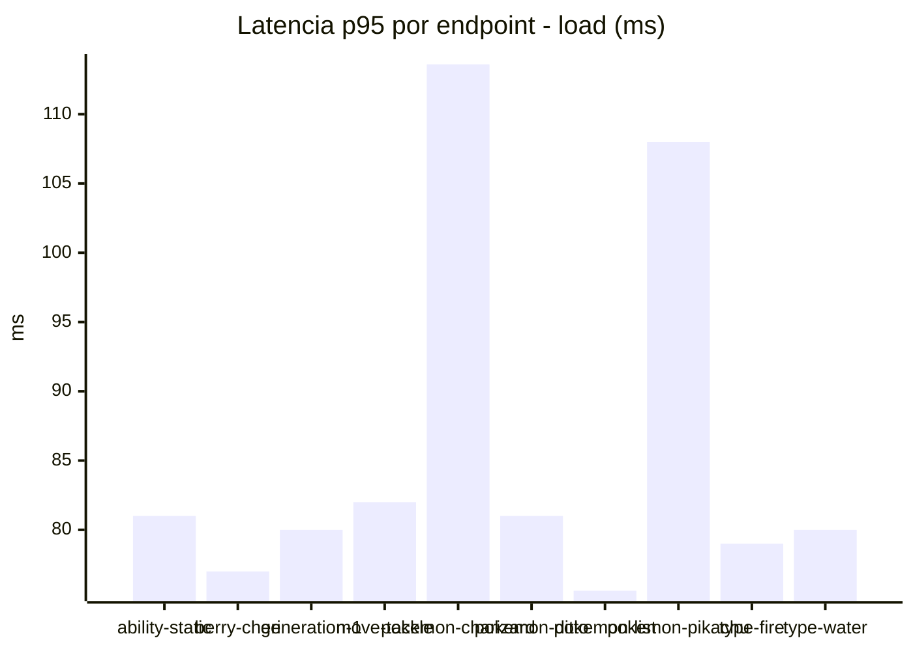
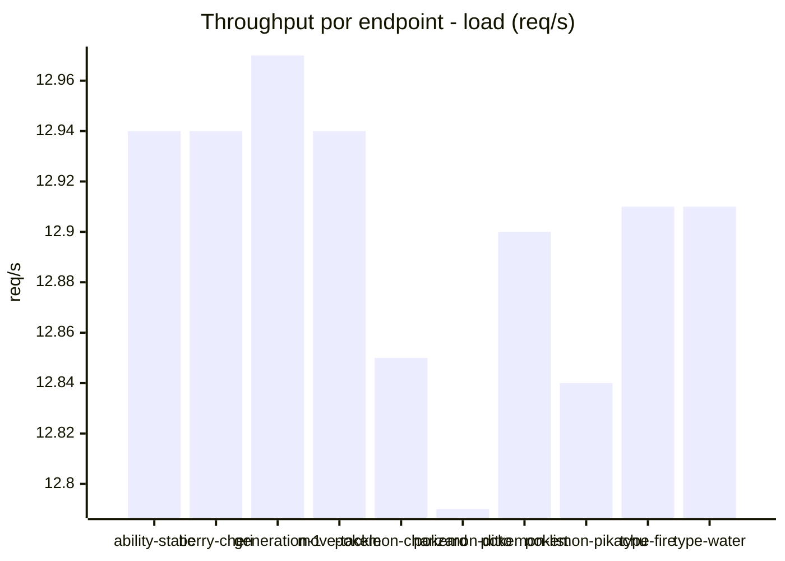
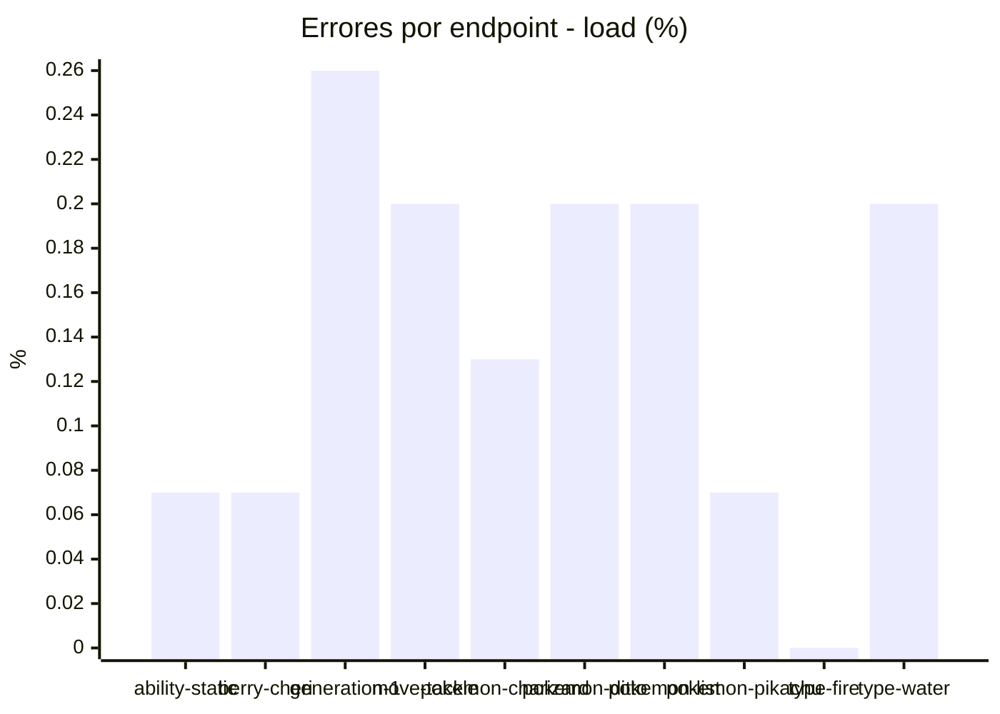
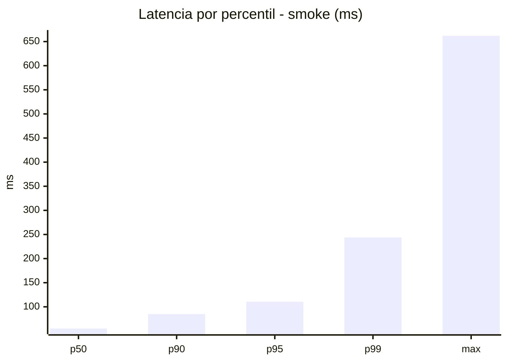
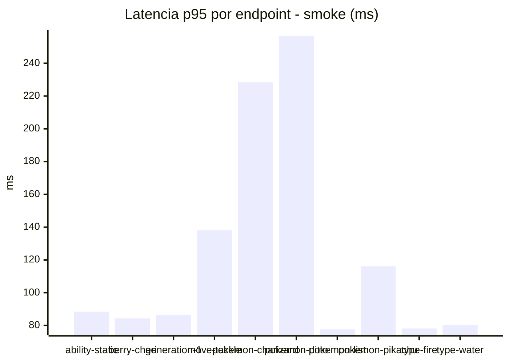
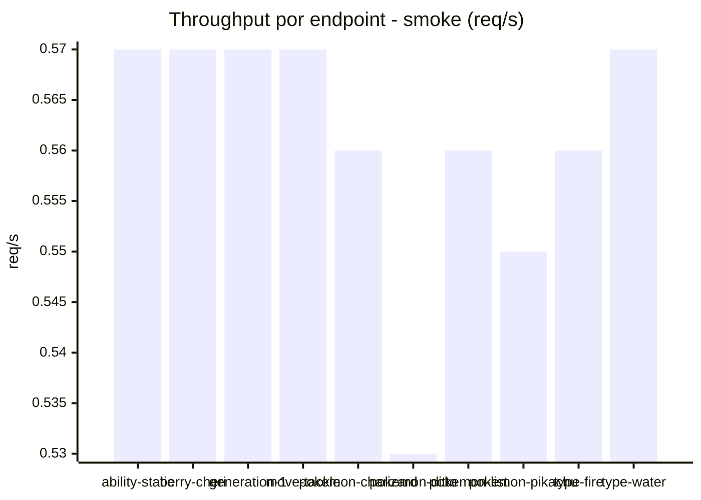
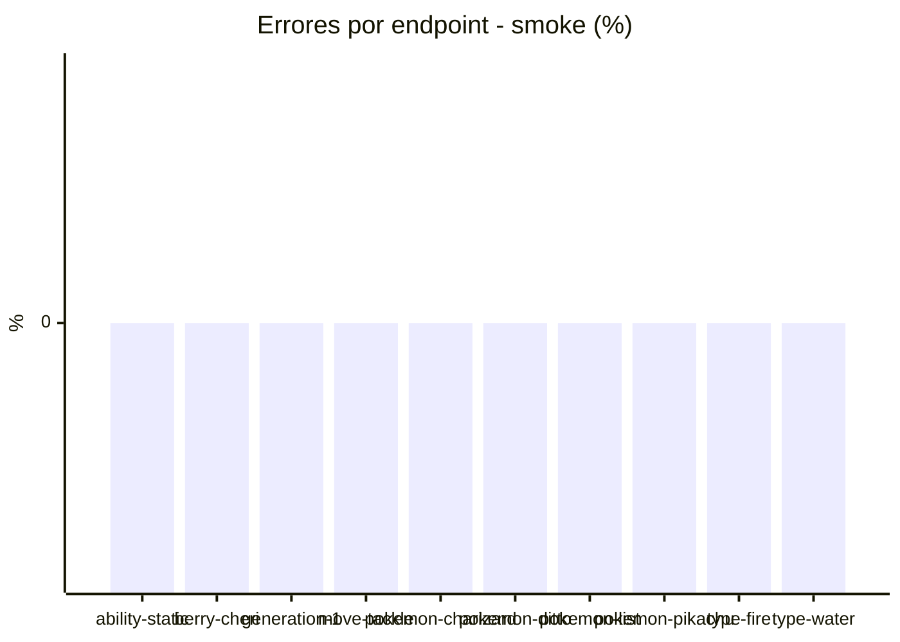

# Reporte de performance - PokeAPI

**Fecha:** 2026-11-04 20:17 UTC  
**Veredicto del agente:** `WARN`  
**Corrida:** [ver en GitHub Actions](https://github.com/lrbg/jmeter-pokeapi-lab/actions/runs/41904707138)  

## Validacion del agente de IA

WARN (fallback por umbrales)

- Error maximo: 0.14%
- p95 maximo: 110.5 ms

## Resultados

### Escenario: `load`

| Metrica | Valor |
| --- | --- |
| Muestras | 15293 |
| Errores | 21 (0.14%) |
| Latencia media | 43.7 ms |
| p50 / p90 / p95 / p99 | 43.0 / 75.0 / 84.0 / 116.0 ms |
| Min / Max | 0 / 442 ms |
| Throughput | 127.79 req/s |
| Duracion | 119.7 s |

Detalle por endpoint

| Endpoint | Muestras | Error % | avg | p95 | p99 | req/s |
| --- | --- | --- | --- | --- | --- | --- |
| ability-static | 1530 | 0.07% | 41.3 | 81.0 | 92.0 | 12.94 |
| berry-cheri | 1529 | 0.07% | 40.8 | 77.0 | 91.7 | 12.94 |
| generation-1 | 1528 | 0.26% | 41.2 | 80.0 | 93.0 | 12.97 |
| move-tackle | 1529 | 0.2% | 43.6 | 82.0 | 100.2 | 12.94 |
| pokemon-charizard | 1529 | 0.13% | 55.8 | 113.6 | 159.0 | 12.85 |
| pokemon-ditto | 1529 | 0.2% | 41.0 | 81.0 | 92.0 | 12.79 |
| pokemon-list | 1529 | 0.2% | 39.3 | 75.6 | 87.7 | 12.9 |
| pokemon-pikachu | 1530 | 0.07% | 52.7 | 108.0 | 166.2 | 12.84 |
| type-fire | 1530 | 0.0% | 40.8 | 79.0 | 89.7 | 12.91 |
| type-water | 1530 | 0.2% | 40.2 | 80.0 | 93.0 | 12.91 |

### Escenario: `smoke`

| Metrica | Valor |
| --- | --- |
| Muestras | 146 |
| Errores | 0 (0.0%) |
| Latencia media | 69.8 ms |
| p50 / p90 / p95 / p99 | 55.0 / 85.0 / 110.5 / 243.8 ms |
| Min / Max | 44 / 662 ms |
| Throughput | 5.03 req/s |
| Duracion | 29.0 s |

Detalle por endpoint

| Endpoint | Muestras | Error % | avg | p95 | p99 | req/s |
| --- | --- | --- | --- | --- | --- | --- |
| ability-static | 14 | 0.0% | 63.6 | 88.4 | 90.5 | 0.57 |
| berry-cheri | 14 | 0.0% | 58.3 | 84.3 | 93.7 | 0.57 |
| generation-1 | 14 | 0.0% | 58.9 | 86.5 | 91.7 | 0.57 |
| move-tackle | 14 | 0.0% | 70.8 | 138.1 | 224.4 | 0.57 |
| pokemon-charizard | 15 | 0.0% | 97.9 | 228.4 | 238.5 | 0.56 |
| pokemon-ditto | 15 | 0.0% | 101.9 | 256.7 | 580.9 | 0.53 |
| pokemon-list | 15 | 0.0% | 59.3 | 77.6 | 78.7 | 0.56 |
| pokemon-pikachu | 15 | 0.0% | 76.4 | 116.1 | 125.6 | 0.55 |
| type-fire | 15 | 0.0% | 53.5 | 78.2 | 80.4 | 0.56 |
| type-water | 15 | 0.0% | 56 | 80.3 | 80.9 | 0.57 |

