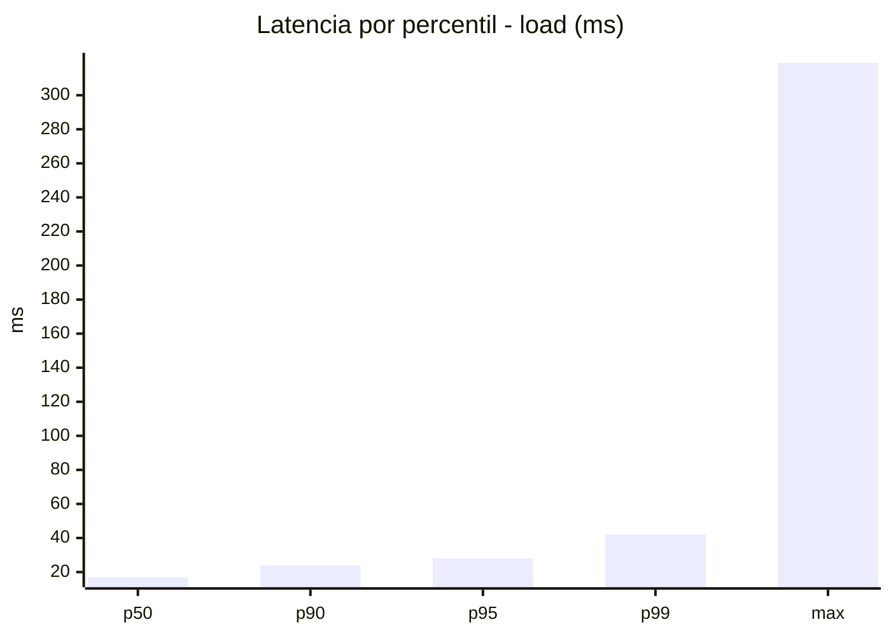
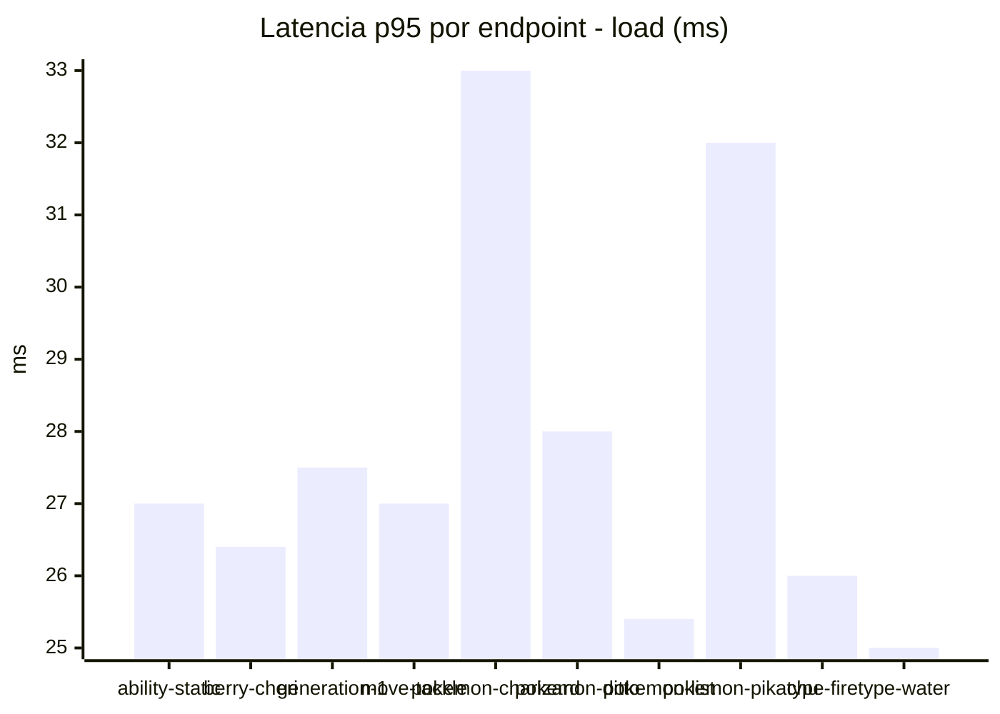
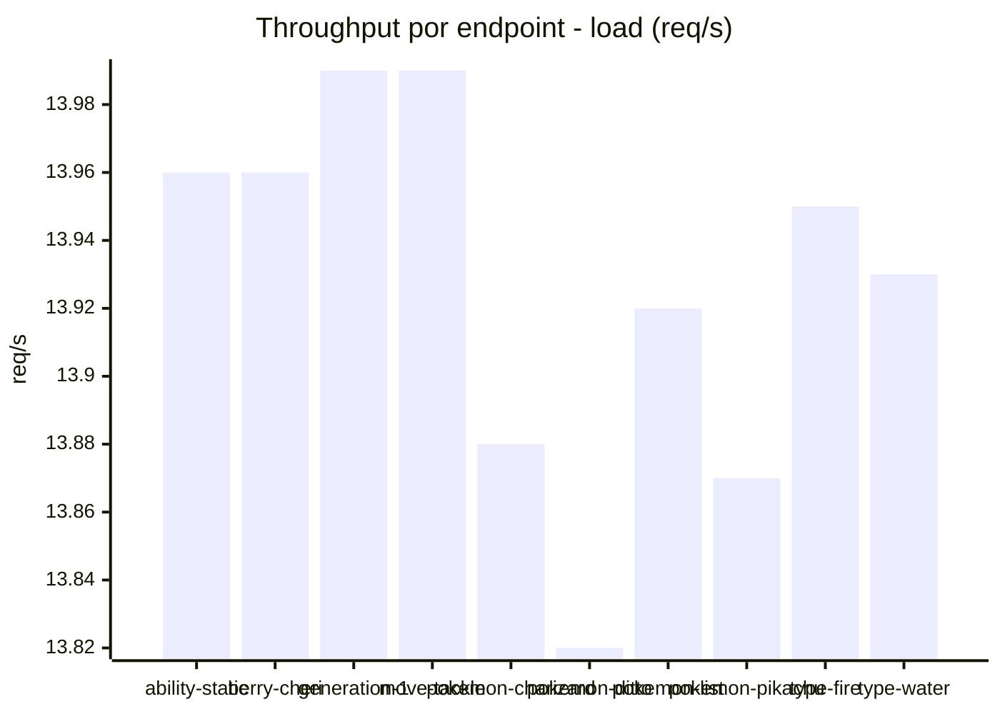
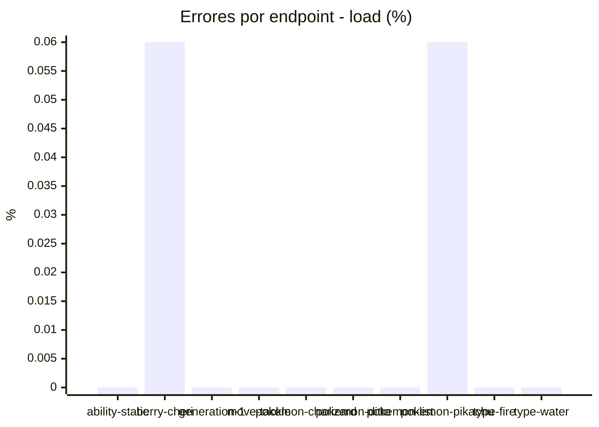
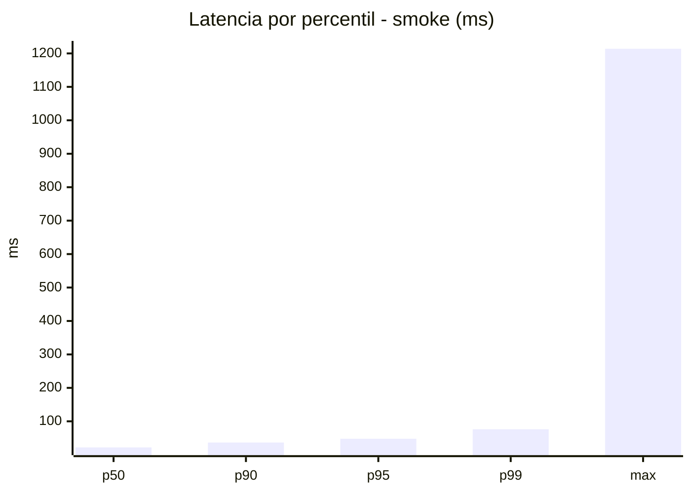
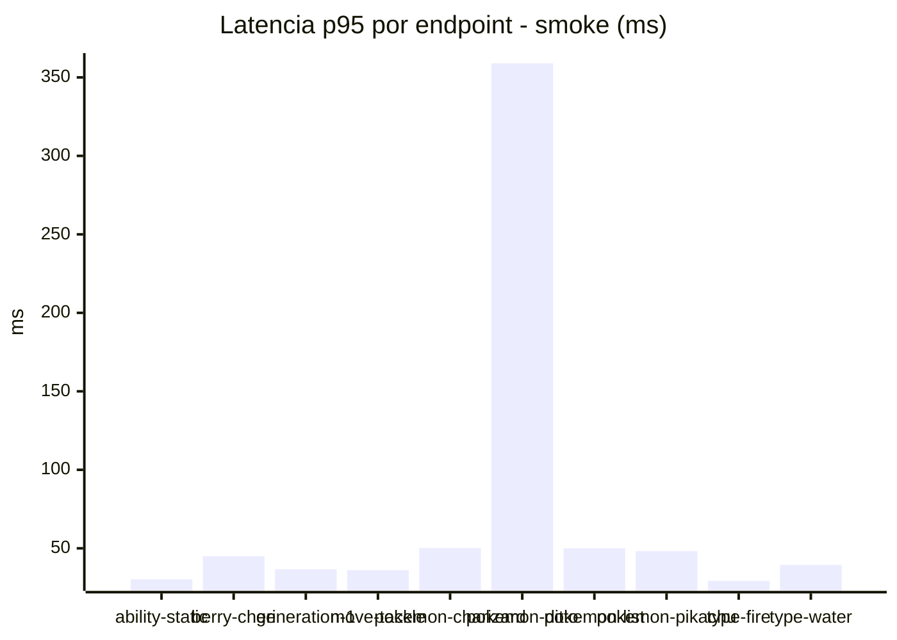
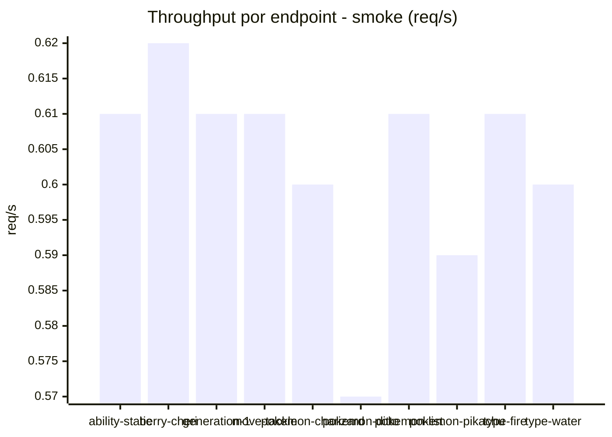
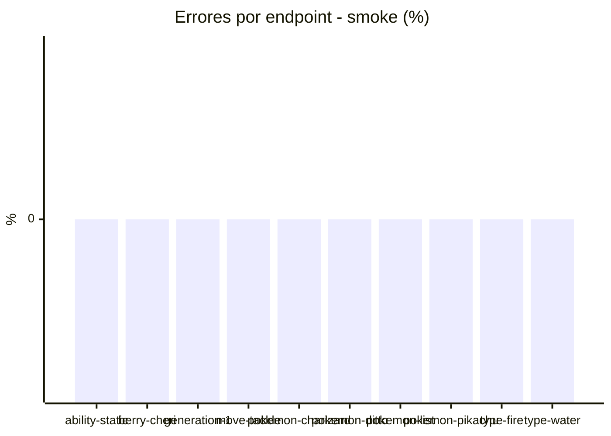

# Reporte de performance - PokeAPI

**Fecha:** 2026-11-05 20:29 UTC  
**Veredicto del agente:** `PASS`  
**Corrida:** [ver en GitHub Actions](https://github.com/lrbg/jmeter-pokeapi-lab/actions/runs/42103494816)  

## Validacion del agente de IA

PASS (fallback por umbrales)

- Error maximo: 0.01%
- p95 maximo: 48.0 ms

## Resultados

### Escenario: `load`

| Metrica | Valor |
| --- | --- |
| Muestras | 16523 |
| Errores | 2 (0.01%) |
| Latencia media | 18.0 ms |
| p50 / p90 / p95 / p99 | 17.0 / 24.0 / 28.0 / 42.0 ms |
| Min / Max | 7 / 319 ms |
| Throughput | 138.11 req/s |
| Duracion | 119.6 s |

Detalle por endpoint

| Endpoint | Muestras | Error % | avg | p95 | p99 | req/s |
| --- | --- | --- | --- | --- | --- | --- |
| ability-static | 1652 | 0.0% | 17.5 | 27.0 | 39.0 | 13.96 |
| berry-cheri | 1652 | 0.06% | 17.3 | 26.4 | 39.5 | 13.96 |
| generation-1 | 1651 | 0.0% | 17.6 | 27.5 | 43.0 | 13.99 |
| move-tackle | 1653 | 0.0% | 18.1 | 27.0 | 42.0 | 13.99 |
| pokemon-charizard | 1652 | 0.0% | 21.2 | 33.0 | 46.0 | 13.88 |
| pokemon-ditto | 1652 | 0.0% | 17.7 | 28.0 | 45.0 | 13.82 |
| pokemon-list | 1653 | 0.0% | 16.6 | 25.4 | 40.5 | 13.92 |
| pokemon-pikachu | 1652 | 0.06% | 20.1 | 32.0 | 48.5 | 13.87 |
| type-fire | 1653 | 0.0% | 17.3 | 26.0 | 36.5 | 13.95 |
| type-water | 1653 | 0.0% | 17.0 | 25.0 | 37.0 | 13.93 |

### Escenario: `smoke`

| Metrica | Valor |
| --- | --- |
| Muestras | 155 |
| Errores | 0 (0.0%) |
| Latencia media | 33.0 ms |
| p50 / p90 / p95 / p99 | 22.0 / 36.6 / 48.0 / 76.3 ms |
| Min / Max | 13 / 1214 ms |
| Throughput | 5.35 req/s |
| Duracion | 29.0 s |

Detalle por endpoint

| Endpoint | Muestras | Error % | avg | p95 | p99 | req/s |
| --- | --- | --- | --- | --- | --- | --- |
| ability-static | 15 | 0.0% | 21.1 | 30.2 | 32.4 | 0.61 |
| berry-cheri | 15 | 0.0% | 24.9 | 45.0 | 61.8 | 0.62 |
| generation-1 | 15 | 0.0% | 24.4 | 36.7 | 41.7 | 0.61 |
| move-tackle | 15 | 0.0% | 23 | 36.1 | 45.6 | 0.61 |
| pokemon-charizard | 16 | 0.0% | 31.2 | 50.2 | 60.4 | 0.6 |
| pokemon-ditto | 16 | 0.0% | 101.6 | 359.0 | 1043.0 | 0.57 |
| pokemon-list | 16 | 0.0% | 24.6 | 50.0 | 54.8 | 0.61 |
| pokemon-pikachu | 16 | 0.0% | 30.2 | 48.2 | 72.8 | 0.59 |
| type-fire | 15 | 0.0% | 21.7 | 29.3 | 35.5 | 0.61 |
| type-water | 16 | 0.0% | 24 | 39.5 | 47.9 | 0.6 |

