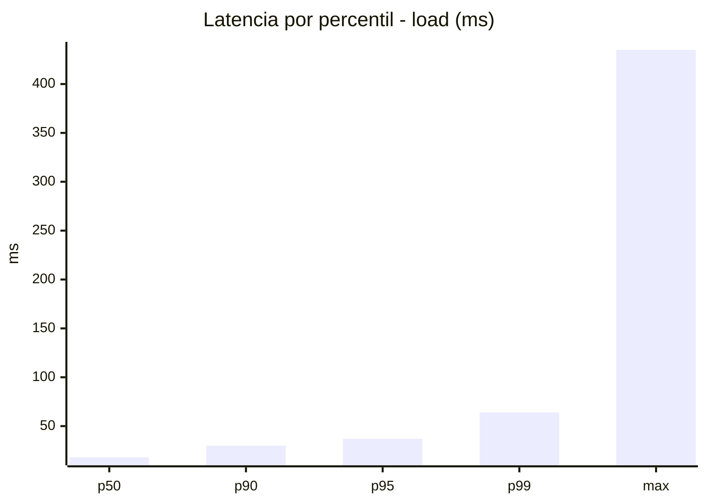
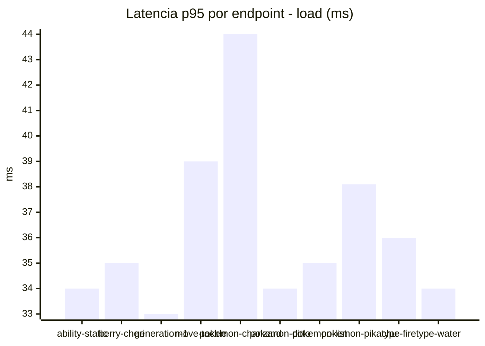
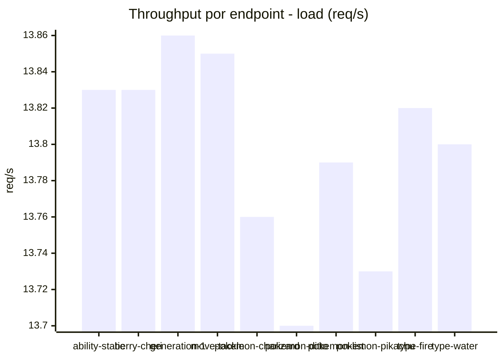
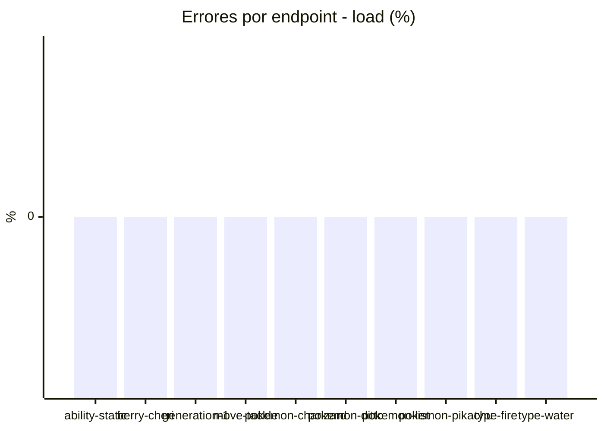
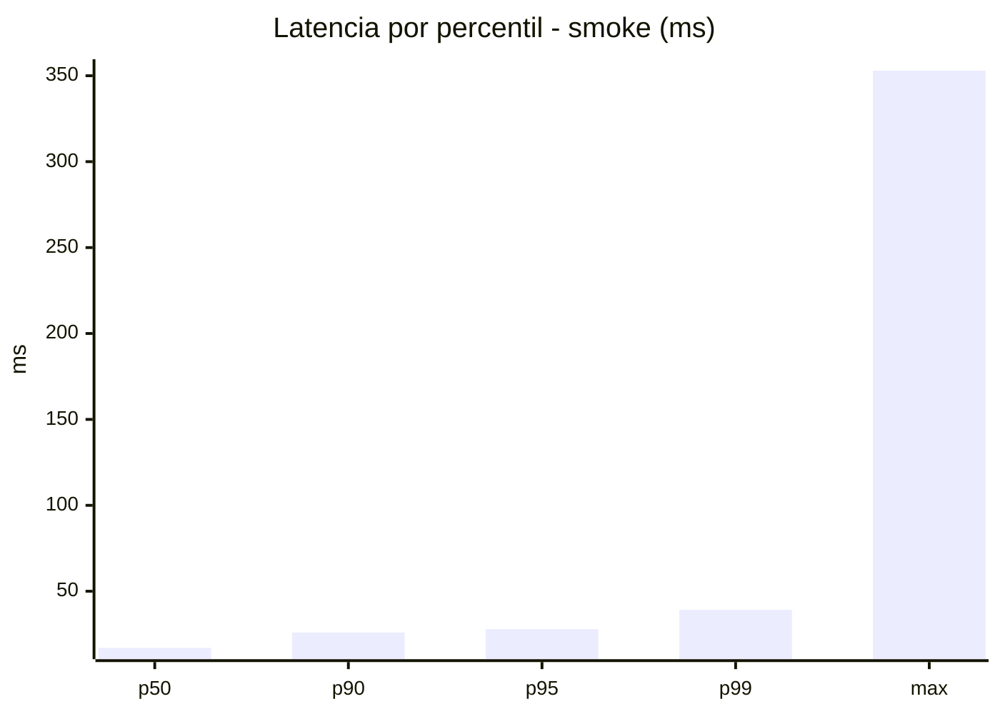
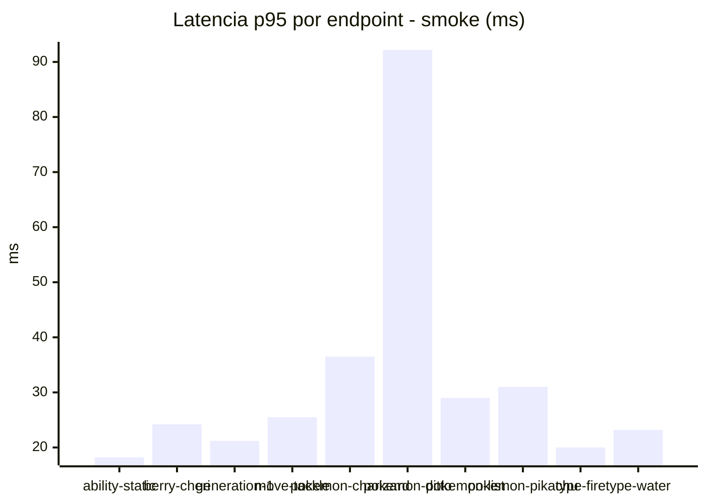
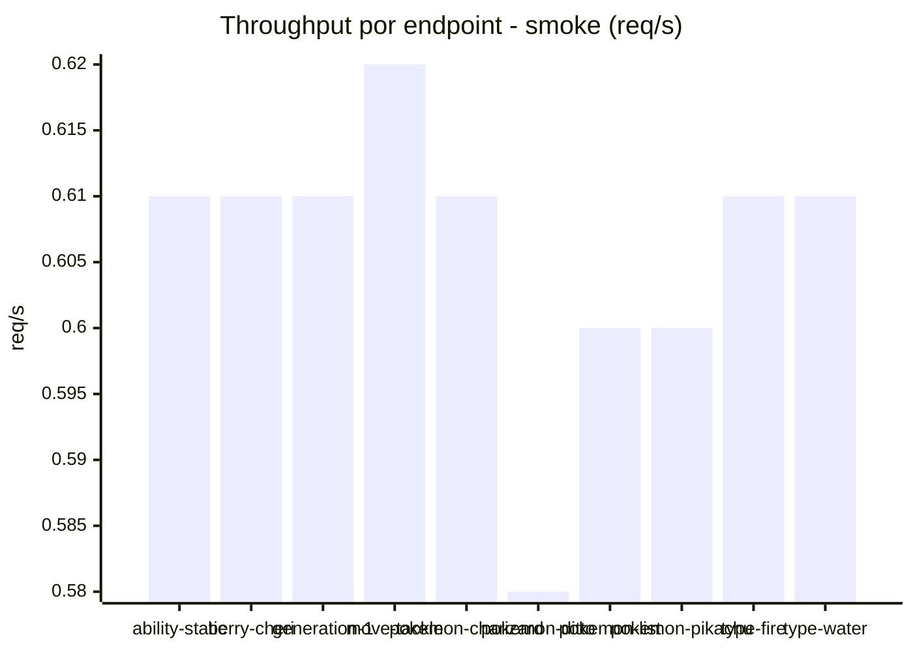

# Reporte de performance - PokeAPI

**Fecha:** 2026-11-06 19:52 UTC  
**Veredicto del agente:** `PASS`  
**Corrida:** [ver en GitHub Actions](https://github.com/lrbg/jmeter-pokeapi-lab/actions/runs/42283019504)  

## Validacion del agente de IA

PASS (fallback por umbrales)

- Error maximo: 0.0%
- p95 maximo: 37.0 ms

## Resultados

### Escenario: `load`

| Metrica | Valor |
| --- | --- |
| Muestras | 16371 |
| Errores | 0 (0.0%) |
| Latencia media | 21.0 ms |
| p50 / p90 / p95 / p99 | 18.0 / 30.0 / 37.0 / 64.0 ms |
| Min / Max | 7 / 435 ms |
| Throughput | 136.63 req/s |
| Duracion | 119.8 s |

Detalle por endpoint

| Endpoint | Muestras | Error % | avg | p95 | p99 | req/s |
| --- | --- | --- | --- | --- | --- | --- |
| ability-static | 1637 | 0.0% | 18.9 | 34.0 | 59.8 | 13.83 |
| berry-cheri | 1637 | 0.0% | 20.3 | 35.0 | 57.6 | 13.83 |
| generation-1 | 1636 | 0.0% | 19.2 | 33.0 | 47.7 | 13.86 |
| move-tackle | 1637 | 0.0% | 21.7 | 39.0 | 60.6 | 13.85 |
| pokemon-charizard | 1637 | 0.0% | 25.7 | 44.0 | 72.6 | 13.76 |
| pokemon-ditto | 1638 | 0.0% | 19.8 | 34.0 | 60.0 | 13.7 |
| pokemon-list | 1637 | 0.0% | 19.5 | 35.0 | 56.0 | 13.79 |
| pokemon-pikachu | 1638 | 0.0% | 24.0 | 38.1 | 86.9 | 13.73 |
| type-fire | 1637 | 0.0% | 20.3 | 36.0 | 77.8 | 13.82 |
| type-water | 1637 | 0.0% | 20.1 | 34.0 | 71.6 | 13.8 |

### Escenario: `smoke`

| Metrica | Valor |
| --- | --- |
| Muestras | 162 |
| Errores | 0 (0.0%) |
| Latencia media | 20.1 ms |
| p50 / p90 / p95 / p99 | 17.0 / 26.0 / 28.0 / 39.2 ms |
| Min / Max | 10 / 353 ms |
| Throughput | 5.52 req/s |
| Duracion | 29.3 s |

Detalle por endpoint

| Endpoint | Muestras | Error % | avg | p95 | p99 | req/s |
| --- | --- | --- | --- | --- | --- | --- |
| ability-static | 16 | 0.0% | 13.8 | 18.2 | 18.9 | 0.61 |
| berry-cheri | 16 | 0.0% | 16.9 | 24.2 | 27.2 | 0.61 |
| generation-1 | 16 | 0.0% | 16 | 21.2 | 21.9 | 0.61 |
| move-tackle | 16 | 0.0% | 17.4 | 25.5 | 26.7 | 0.62 |
| pokemon-charizard | 16 | 0.0% | 24.3 | 36.5 | 40.1 | 0.61 |
| pokemon-ditto | 17 | 0.0% | 37.1 | 92.2 | 300.8 | 0.58 |
| pokemon-list | 16 | 0.0% | 17.3 | 29.0 | 36.2 | 0.6 |
| pokemon-pikachu | 17 | 0.0% | 23.4 | 31.0 | 31.0 | 0.6 |
| type-fire | 16 | 0.0% | 16.1 | 20.0 | 20.0 | 0.61 |
| type-water | 16 | 0.0% | 17 | 23.2 | 23.9 | 0.61 |

