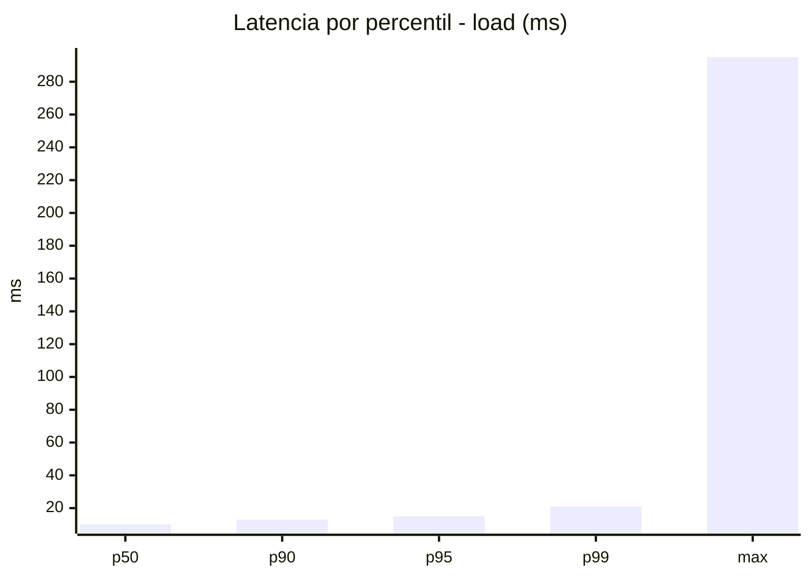
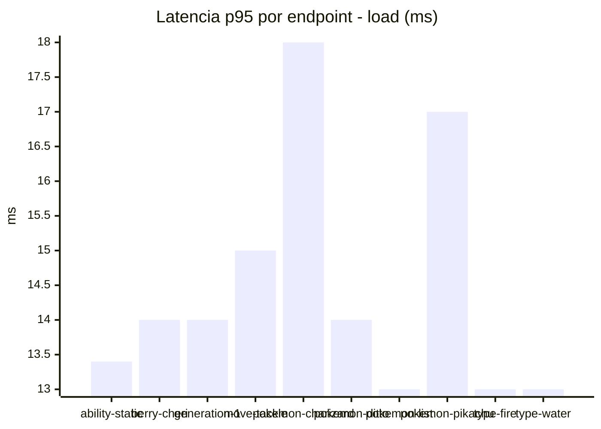
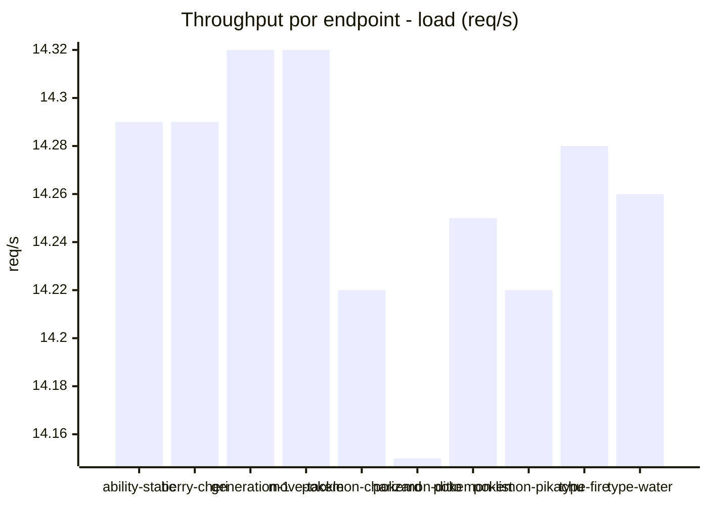
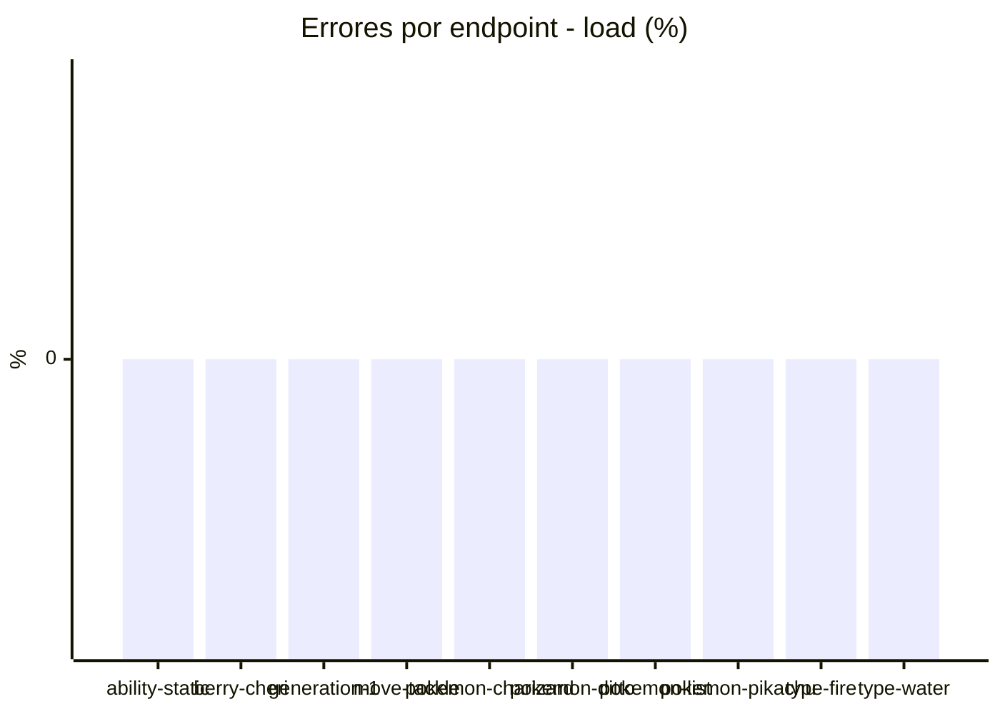
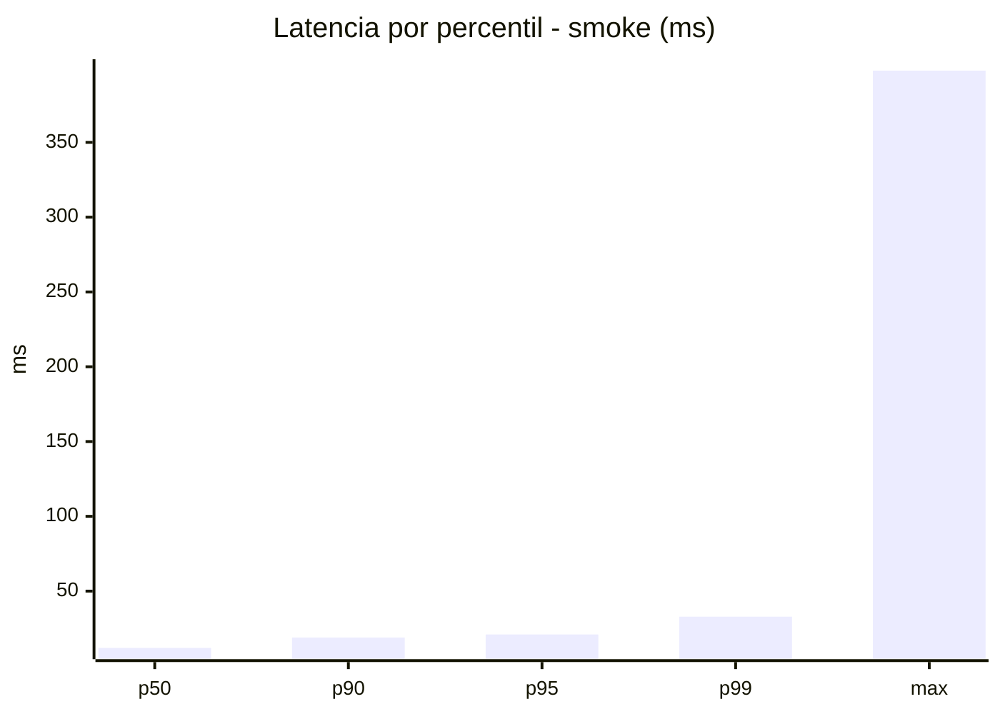
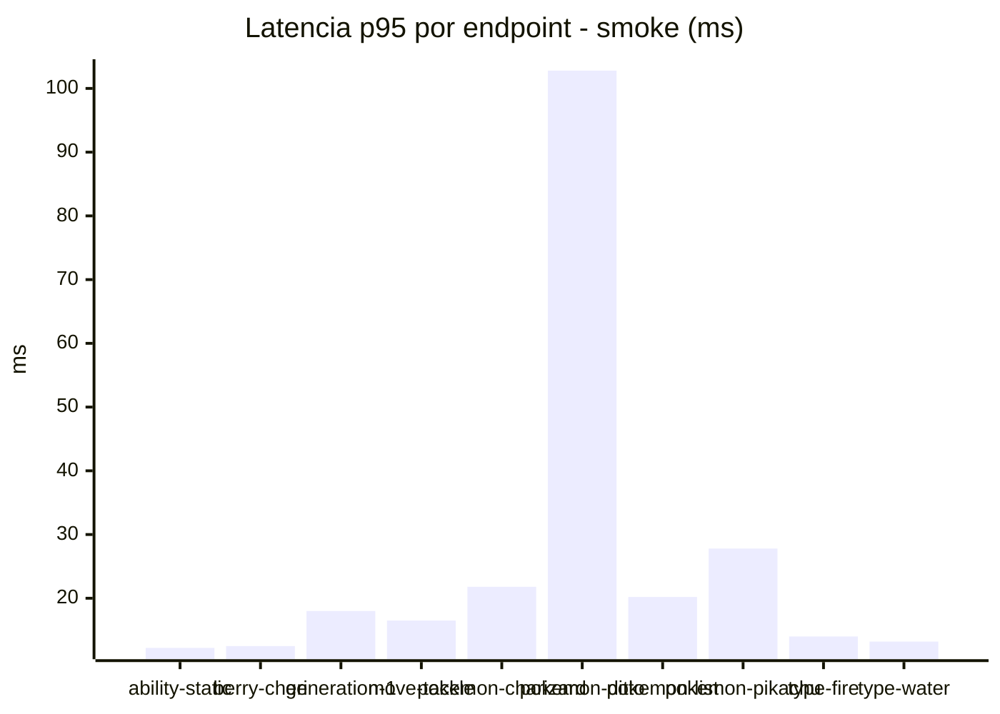
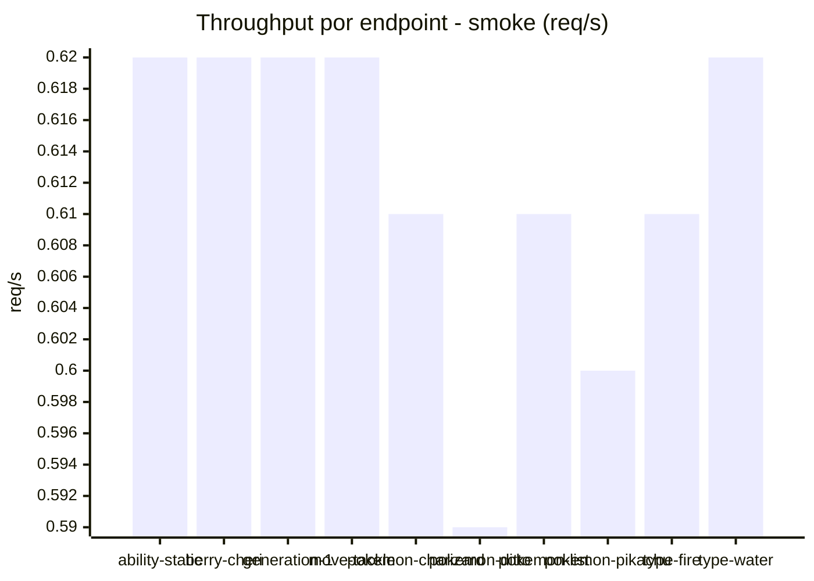

# Reporte de performance - PokeAPI

**Fecha:** 2026-11-07 17:58 UTC  
**Veredicto del agente:** `PASS`  
**Corrida:** [ver en GitHub Actions](https://github.com/lrbg/jmeter-pokeapi-lab/actions/runs/42398693923)  

## Validacion del agente de IA

PASS (fallback por umbrales)

- Error maximo: 0.0%
- p95 maximo: 21.0 ms

## Resultados

### Escenario: `load`

| Metrica | Valor |
| --- | --- |
| Muestras | 16922 |
| Errores | 0 (0.0%) |
| Latencia media | 10.5 ms |
| p50 / p90 / p95 / p99 | 10.0 / 13.0 / 15.0 / 21.0 ms |
| Min / Max | 6 / 295 ms |
| Throughput | 141.45 req/s |
| Duracion | 119.6 s |

Detalle por endpoint

| Endpoint | Muestras | Error % | avg | p95 | p99 | req/s |
| --- | --- | --- | --- | --- | --- | --- |
| ability-static | 1692 | 0.0% | 10.1 | 13.4 | 22.0 | 14.29 |
| berry-cheri | 1692 | 0.0% | 9.9 | 14.0 | 19.0 | 14.29 |
| generation-1 | 1691 | 0.0% | 10.1 | 14.0 | 21.0 | 14.32 |
| move-tackle | 1692 | 0.0% | 11.0 | 15.0 | 21.0 | 14.32 |
| pokemon-charizard | 1692 | 0.0% | 12.9 | 18.0 | 24.0 | 14.22 |
| pokemon-ditto | 1693 | 0.0% | 10.3 | 14.0 | 21.1 | 14.15 |
| pokemon-list | 1692 | 0.0% | 9.6 | 13.0 | 18.0 | 14.25 |
| pokemon-pikachu | 1694 | 0.0% | 12.1 | 17.0 | 25.1 | 14.22 |
| type-fire | 1692 | 0.0% | 9.7 | 13.0 | 19.0 | 14.28 |
| type-water | 1692 | 0.0% | 9.8 | 13.0 | 18.1 | 14.26 |

### Escenario: `smoke`

| Metrica | Valor |
| --- | --- |
| Muestras | 162 |
| Errores | 0 (0.0%) |
| Latencia media | 15.5 ms |
| p50 / p90 / p95 / p99 | 12.0 / 19.0 / 21.0 / 32.9 ms |
| Min / Max | 8 / 398 ms |
| Throughput | 5.55 req/s |
| Duracion | 29.2 s |

Detalle por endpoint

| Endpoint | Muestras | Error % | avg | p95 | p99 | req/s |
| --- | --- | --- | --- | --- | --- | --- |
| ability-static | 16 | 0.0% | 10.3 | 12.2 | 12.8 | 0.62 |
| berry-cheri | 16 | 0.0% | 10.4 | 12.5 | 13.7 | 0.62 |
| generation-1 | 16 | 0.0% | 12.8 | 18.0 | 22.8 | 0.62 |
| move-tackle | 16 | 0.0% | 13 | 16.5 | 20.1 | 0.62 |
| pokemon-charizard | 16 | 0.0% | 17.9 | 21.8 | 23.5 | 0.61 |
| pokemon-ditto | 17 | 0.0% | 35.6 | 102.8 | 339.0 | 0.59 |
| pokemon-list | 16 | 0.0% | 12.8 | 20.2 | 32.8 | 0.61 |
| pokemon-pikachu | 17 | 0.0% | 18.2 | 27.8 | 30.4 | 0.6 |
| type-fire | 16 | 0.0% | 11.1 | 14.0 | 14.0 | 0.61 |
| type-water | 16 | 0.0% | 11.6 | 13.2 | 13.8 | 0.62 |

