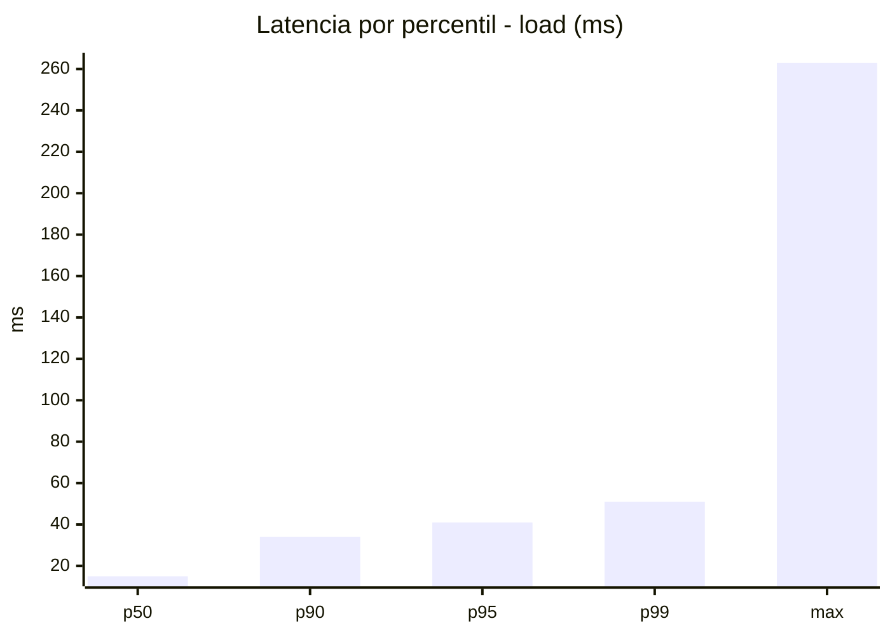
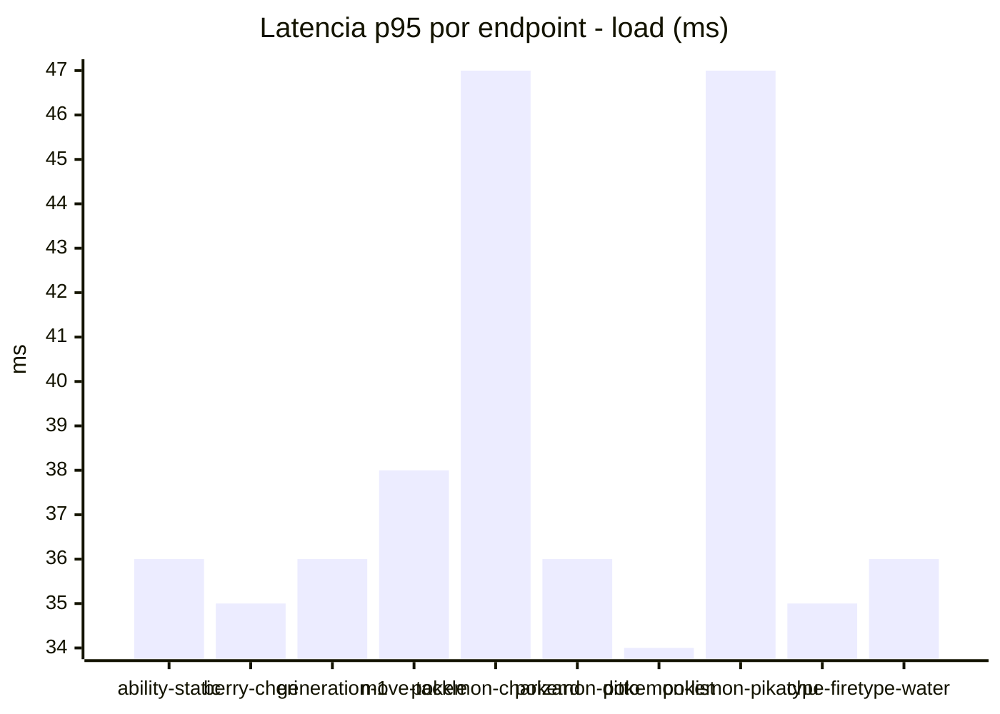
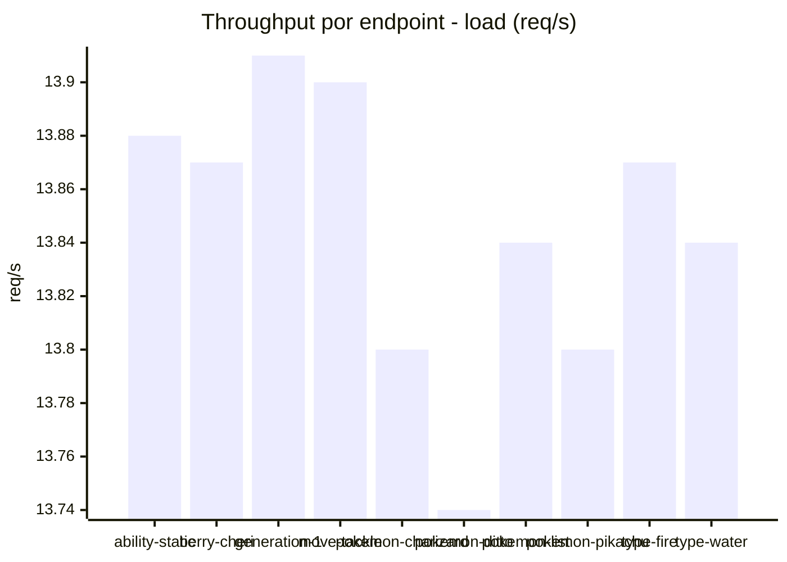
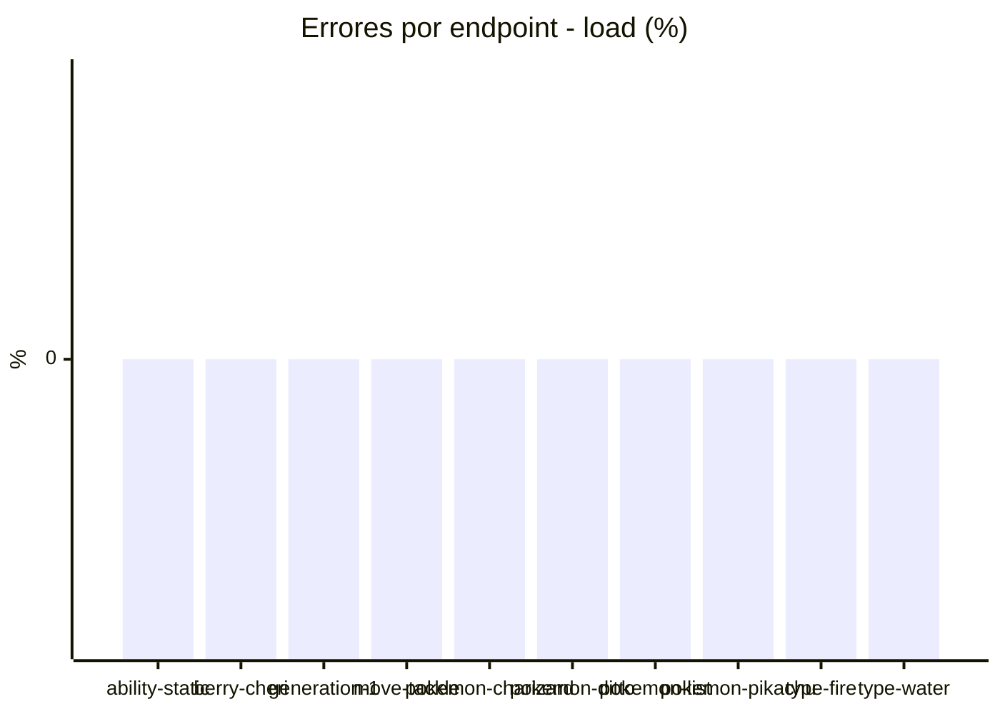
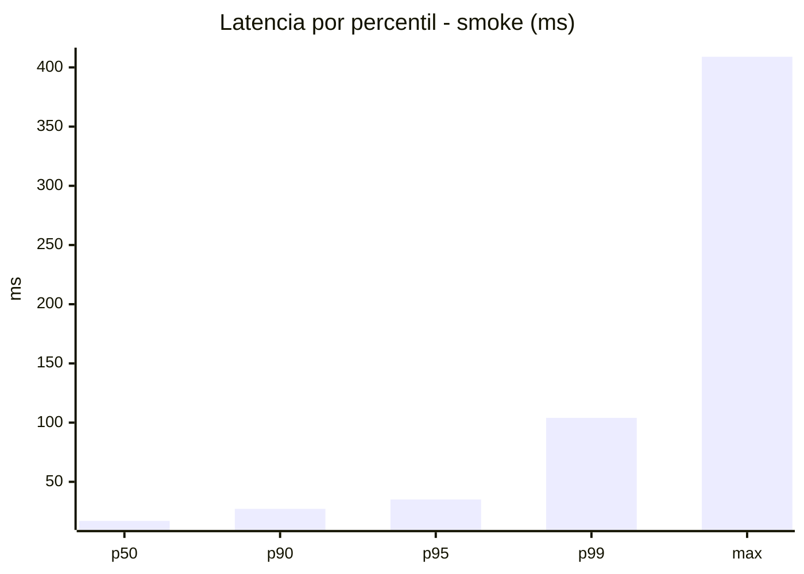
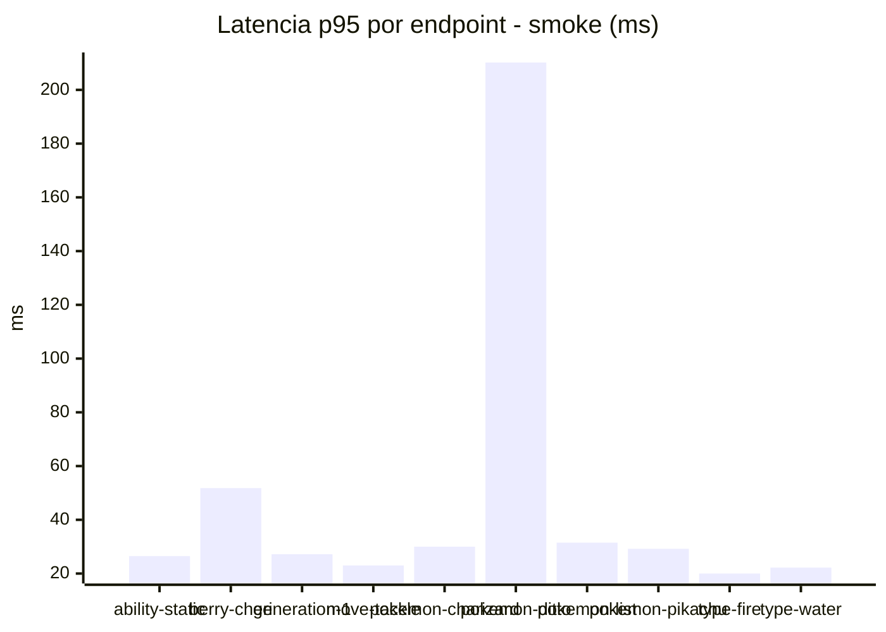
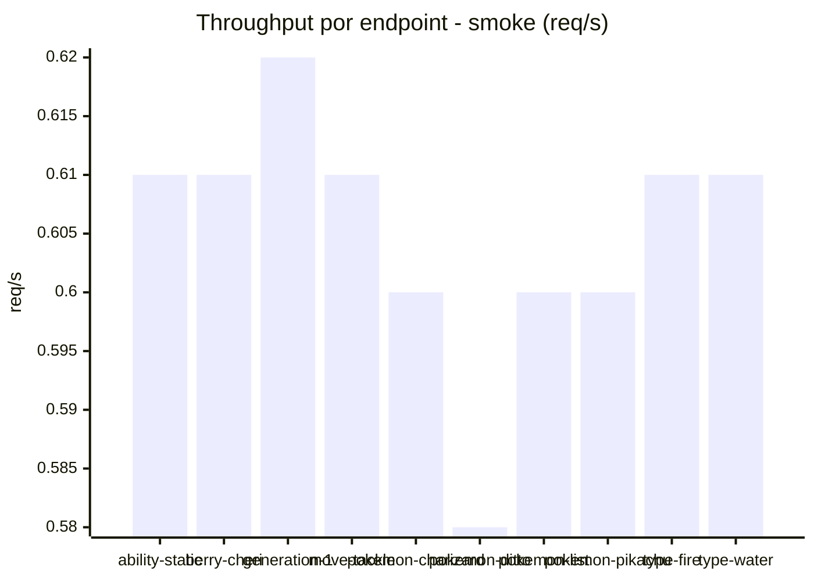

# Reporte de performance - PokeAPI

**Fecha:** 2026-11-08 18:14 UTC  
**Veredicto del agente:** `PASS`  
**Corrida:** [ver en GitHub Actions](https://github.com/lrbg/jmeter-pokeapi-lab/actions/runs/42508733695)  

## Validacion del agente de IA

PASS (fallback por umbrales)

- Error maximo: 0.0%
- p95 maximo: 41.0 ms

## Resultados

### Escenario: `load`

| Metrica | Valor |
| --- | --- |
| Muestras | 16428 |
| Errores | 0 (0.0%) |
| Latencia media | 19.9 ms |
| p50 / p90 / p95 / p99 | 15.0 / 34.0 / 41.0 / 51.0 ms |
| Min / Max | 9 / 263 ms |
| Throughput | 137.32 req/s |
| Duracion | 119.6 s |

Detalle por endpoint

| Endpoint | Muestras | Error % | avg | p95 | p99 | req/s |
| --- | --- | --- | --- | --- | --- | --- |
| ability-static | 1642 | 0.0% | 19.5 | 36.0 | 46.6 | 13.88 |
| berry-cheri | 1642 | 0.0% | 18.5 | 35.0 | 43.6 | 13.87 |
| generation-1 | 1643 | 0.0% | 18.9 | 36.0 | 46.0 | 13.91 |
| move-tackle | 1643 | 0.0% | 20.3 | 38.0 | 47.0 | 13.9 |
| pokemon-charizard | 1643 | 0.0% | 23.0 | 47.0 | 64.0 | 13.8 |
| pokemon-ditto | 1643 | 0.0% | 19.4 | 36.0 | 47.0 | 13.74 |
| pokemon-list | 1643 | 0.0% | 18.3 | 34.0 | 43.0 | 13.84 |
| pokemon-pikachu | 1643 | 0.0% | 23.3 | 47.0 | 73.7 | 13.8 |
| type-fire | 1643 | 0.0% | 19.1 | 35.0 | 44.0 | 13.87 |
| type-water | 1643 | 0.0% | 18.8 | 36.0 | 44.0 | 13.84 |

### Escenario: `smoke`

| Metrica | Valor |
| --- | --- |
| Muestras | 159 |
| Errores | 0 (0.0%) |
| Latencia media | 22.5 ms |
| p50 / p90 / p95 / p99 | 17.0 / 27.2 / 35.1 / 104.0 ms |
| Min / Max | 12 / 409 ms |
| Throughput | 5.47 req/s |
| Duracion | 29.1 s |

Detalle por endpoint

| Endpoint | Muestras | Error % | avg | p95 | p99 | req/s |
| --- | --- | --- | --- | --- | --- | --- |
| ability-static | 16 | 0.0% | 18.9 | 26.5 | 32.5 | 0.61 |
| berry-cheri | 16 | 0.0% | 20.4 | 51.8 | 70.3 | 0.61 |
| generation-1 | 15 | 0.0% | 18.1 | 27.2 | 40.6 | 0.62 |
| move-tackle | 16 | 0.0% | 18.1 | 23.0 | 25.4 | 0.61 |
| pokemon-charizard | 16 | 0.0% | 23.7 | 30.0 | 34.8 | 0.6 |
| pokemon-ditto | 16 | 0.0% | 50.6 | 210.2 | 369.2 | 0.58 |
| pokemon-list | 16 | 0.0% | 20.2 | 31.5 | 42.3 | 0.6 |
| pokemon-pikachu | 16 | 0.0% | 23.2 | 29.2 | 32.2 | 0.6 |
| type-fire | 16 | 0.0% | 15.8 | 20.0 | 20.0 | 0.61 |
| type-water | 16 | 0.0% | 16.3 | 22.2 | 32.4 | 0.61 |

