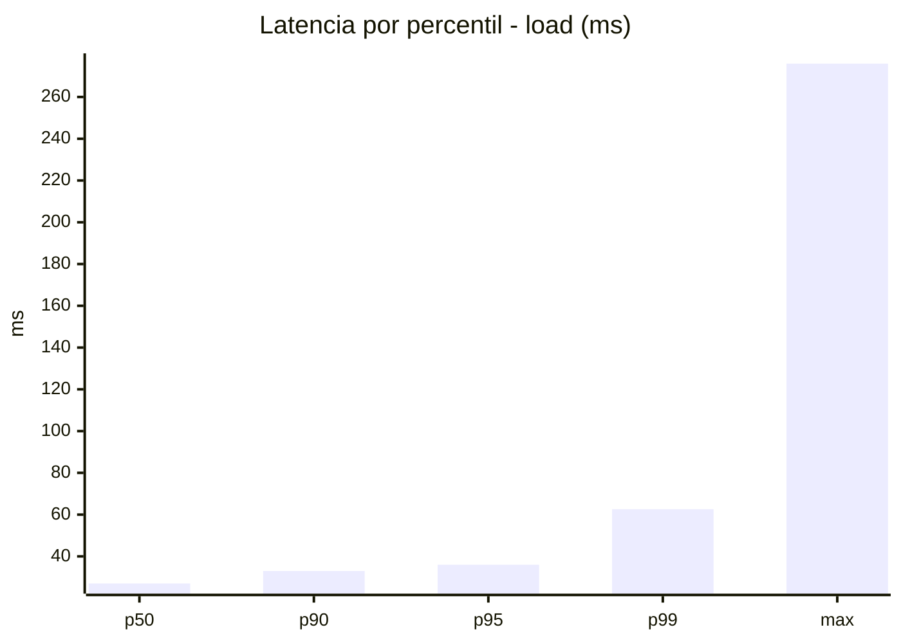
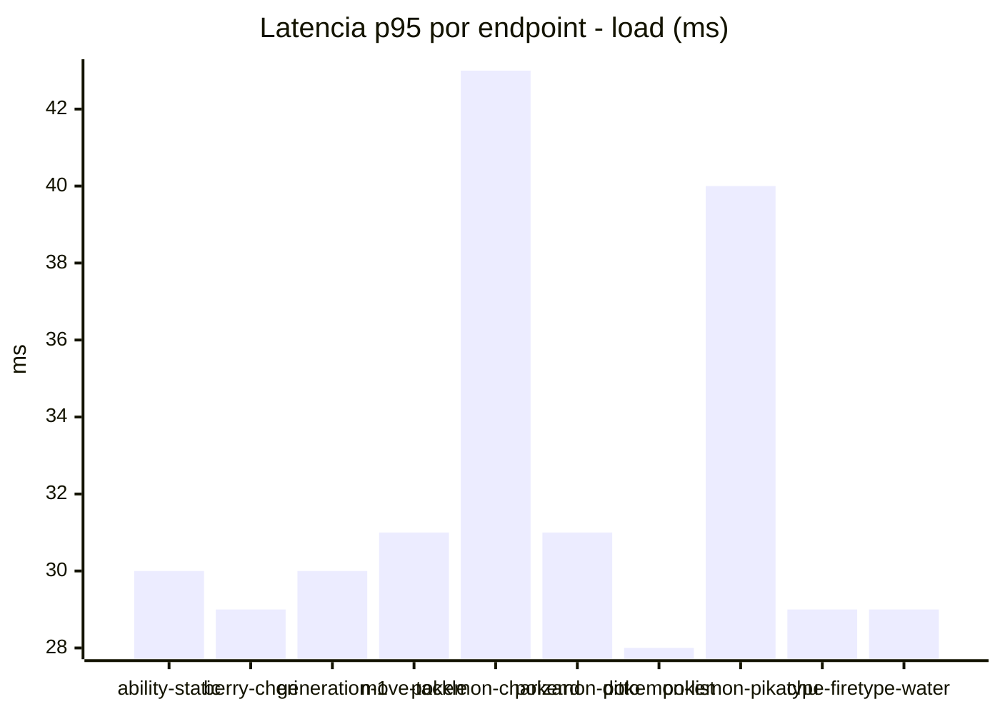
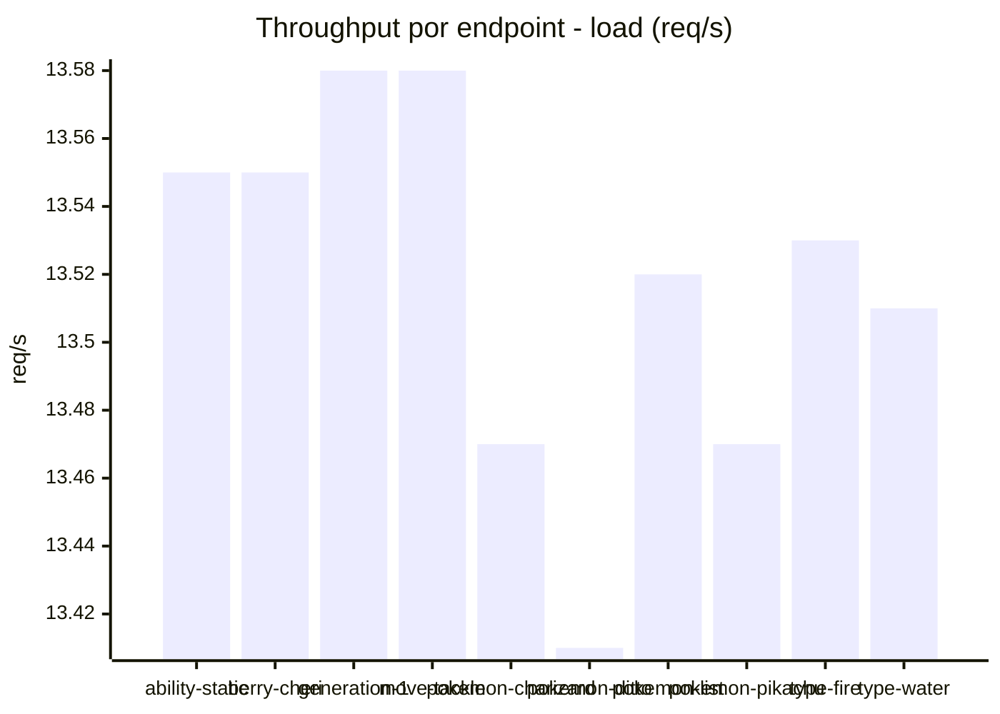
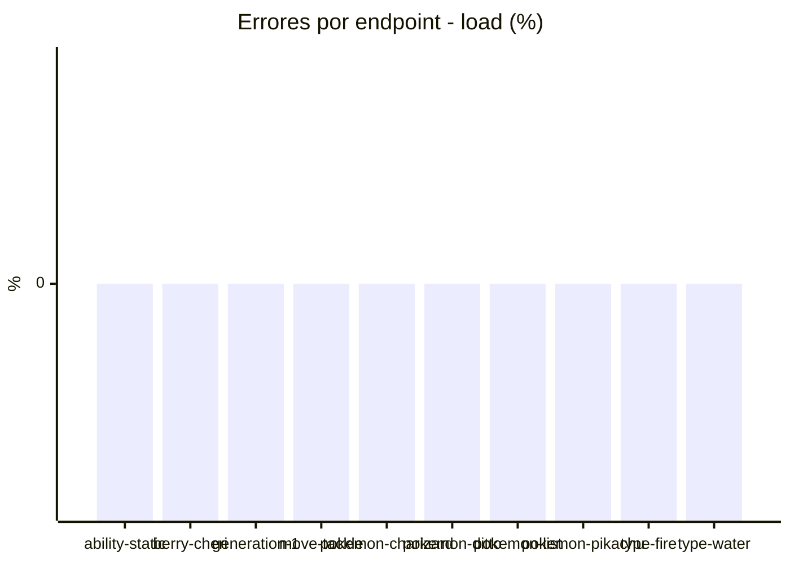
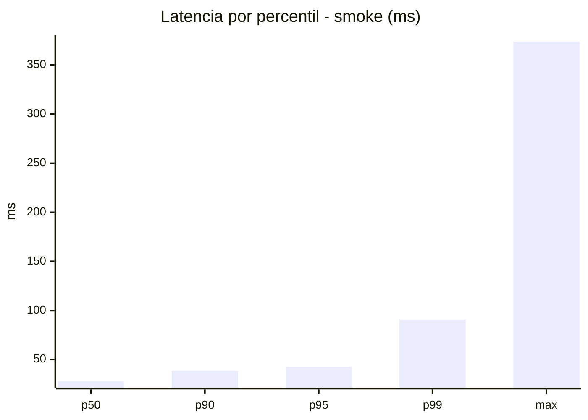
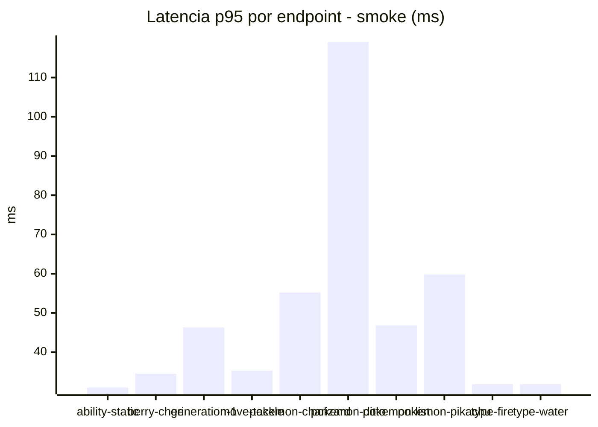
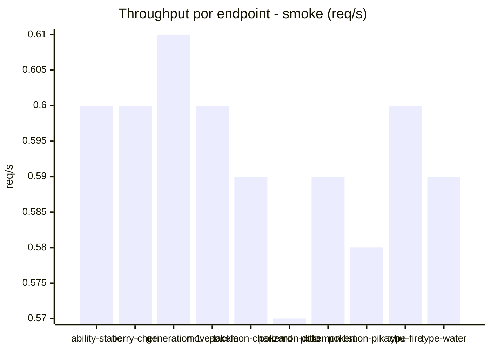

# Reporte de performance - PokeAPI

**Fecha:** 2026-11-09 22:53 UTC  
**Veredicto del agente:** `PASS`  
**Corrida:** [ver en GitHub Actions](https://github.com/lrbg/jmeter-pokeapi-lab/actions/runs/42715488596)  

## Validacion del agente de IA

PASS (fallback por umbrales)

- Error maximo: 0.0%
- p95 maximo: 42.6 ms

## Resultados

### Escenario: `load`

| Metrica | Valor |
| --- | --- |
| Muestras | 16038 |
| Errores | 0 (0.0%) |
| Latencia media | 27.7 ms |
| p50 / p90 / p95 / p99 | 27.0 / 33.0 / 36.0 / 62.6 ms |
| Min / Max | 19 / 276 ms |
| Throughput | 134.02 req/s |
| Duracion | 119.7 s |

Detalle por endpoint

| Endpoint | Muestras | Error % | avg | p95 | p99 | req/s |
| --- | --- | --- | --- | --- | --- | --- |
| ability-static | 1604 | 0.0% | 26.4 | 30.0 | 31.0 | 13.55 |
| berry-cheri | 1604 | 0.0% | 26.1 | 29.0 | 32.0 | 13.55 |
| generation-1 | 1603 | 0.0% | 26.8 | 30.0 | 33.0 | 13.58 |
| move-tackle | 1604 | 0.0% | 27.5 | 31.0 | 37.0 | 13.58 |
| pokemon-charizard | 1604 | 0.0% | 35.7 | 43.0 | 114.9 | 13.47 |
| pokemon-ditto | 1604 | 0.0% | 26.7 | 31.0 | 34.0 | 13.41 |
| pokemon-list | 1605 | 0.0% | 24.3 | 28.0 | 31.0 | 13.52 |
| pokemon-pikachu | 1604 | 0.0% | 32.4 | 40.0 | 77.0 | 13.47 |
| type-fire | 1603 | 0.0% | 25.8 | 29.0 | 31.0 | 13.53 |
| type-water | 1603 | 0.0% | 25.5 | 29.0 | 31.0 | 13.51 |

### Escenario: `smoke`

| Metrica | Valor |
| --- | --- |
| Muestras | 157 |
| Errores | 0 (0.0%) |
| Latencia media | 32.2 ms |
| p50 / p90 / p95 / p99 | 28.0 / 38.4 / 42.6 / 90.8 ms |
| Min / Max | 21 / 374 ms |
| Throughput | 5.39 req/s |
| Duracion | 29.1 s |

Detalle por endpoint

| Endpoint | Muestras | Error % | avg | p95 | p99 | req/s |
| --- | --- | --- | --- | --- | --- | --- |
| ability-static | 16 | 0.0% | 26.3 | 31.0 | 33.4 | 0.6 |
| berry-cheri | 15 | 0.0% | 26.3 | 34.5 | 42.9 | 0.6 |
| generation-1 | 15 | 0.0% | 29.9 | 46.3 | 69.3 | 0.61 |
| move-tackle | 15 | 0.0% | 28.2 | 35.3 | 35.9 | 0.6 |
| pokemon-charizard | 16 | 0.0% | 40.3 | 55.2 | 79.8 | 0.59 |
| pokemon-ditto | 16 | 0.0% | 48.4 | 119.0 | 323.0 | 0.57 |
| pokemon-list | 16 | 0.0% | 29.9 | 46.8 | 86.9 | 0.59 |
| pokemon-pikachu | 16 | 0.0% | 38.3 | 59.8 | 66.3 | 0.58 |
| type-fire | 16 | 0.0% | 26.9 | 31.8 | 33.5 | 0.6 |
| type-water | 16 | 0.0% | 26.5 | 31.8 | 35.9 | 0.59 |

