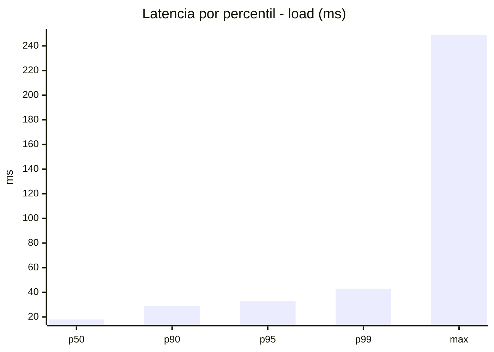
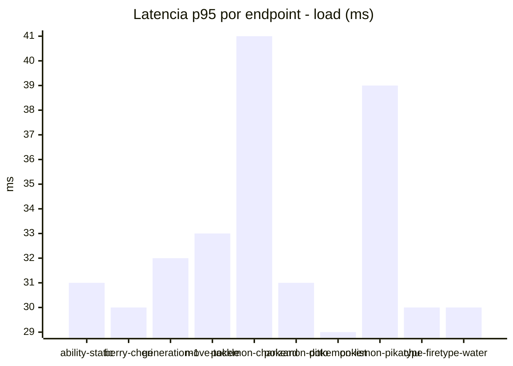
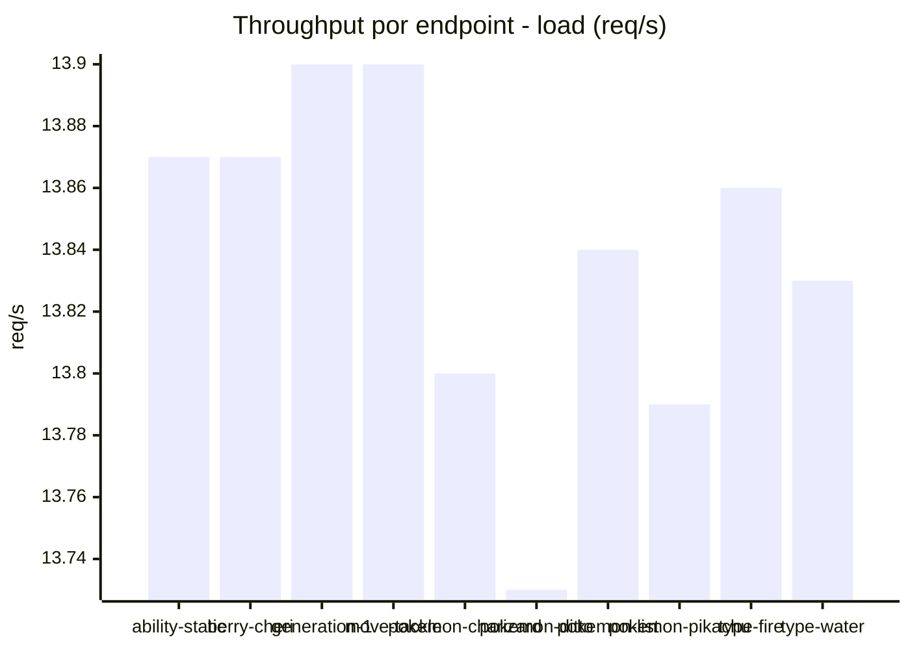
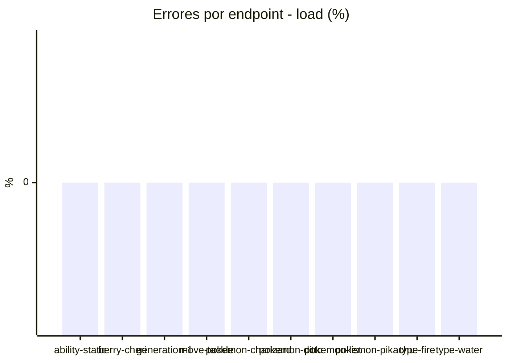
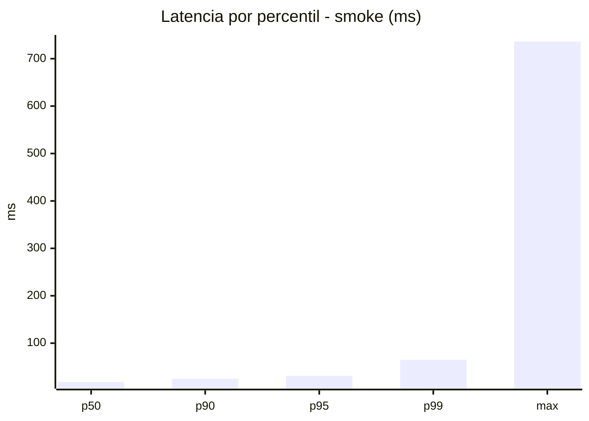
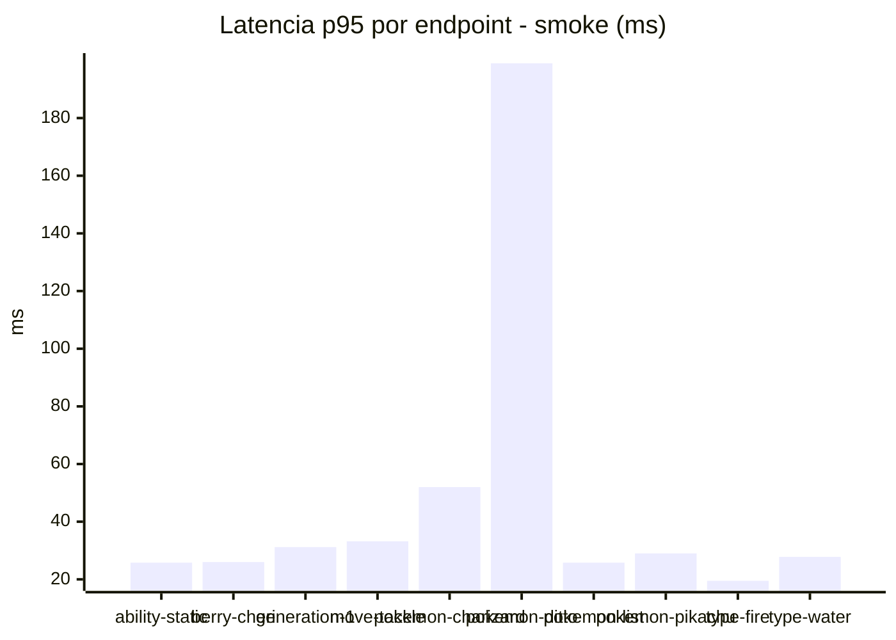
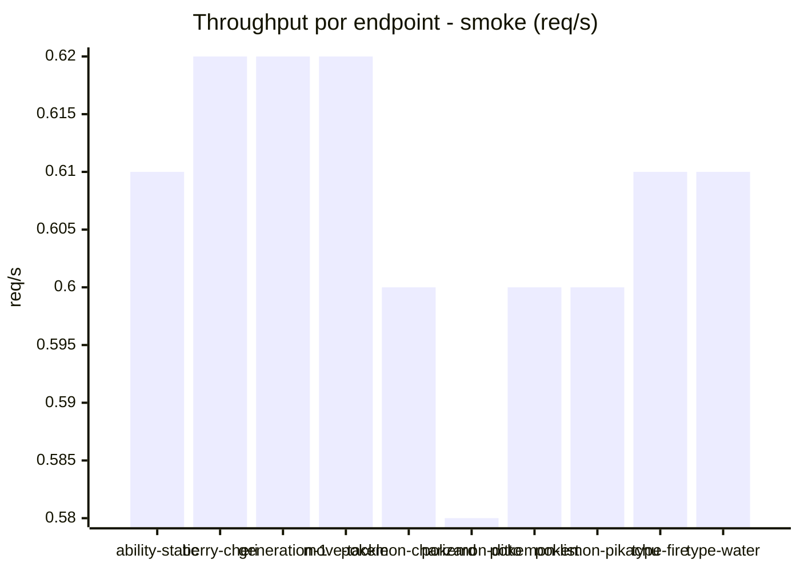

# Reporte de performance - PokeAPI

**Fecha:** 2026-11-10 20:14 UTC  
**Veredicto del agente:** `PASS`  
**Corrida:** [ver en GitHub Actions](https://github.com/lrbg/jmeter-pokeapi-lab/actions/runs/42892783381)  

## Validacion del agente de IA

PASS (fallback por umbrales)

- Error maximo: 0.0%
- p95 maximo: 33.0 ms

## Resultados

### Escenario: `load`

| Metrica | Valor |
| --- | --- |
| Muestras | 16420 |
| Errores | 0 (0.0%) |
| Latencia media | 20.1 ms |
| p50 / p90 / p95 / p99 | 18.0 / 29.0 / 33.0 / 43.0 ms |
| Min / Max | 7 / 249 ms |
| Throughput | 137.26 req/s |
| Duracion | 119.6 s |

Detalle por endpoint

| Endpoint | Muestras | Error % | avg | p95 | p99 | req/s |
| --- | --- | --- | --- | --- | --- | --- |
| ability-static | 1642 | 0.0% | 19.6 | 31.0 | 37.6 | 13.87 |
| berry-cheri | 1642 | 0.0% | 19.3 | 30.0 | 36.8 | 13.87 |
| generation-1 | 1642 | 0.0% | 19.7 | 32.0 | 38.0 | 13.9 |
| move-tackle | 1642 | 0.0% | 20.1 | 33.0 | 41.0 | 13.9 |
| pokemon-charizard | 1642 | 0.0% | 23.9 | 41.0 | 53.8 | 13.8 |
| pokemon-ditto | 1642 | 0.0% | 19.5 | 31.0 | 41.0 | 13.73 |
| pokemon-list | 1642 | 0.0% | 18.0 | 29.0 | 35.0 | 13.84 |
| pokemon-pikachu | 1642 | 0.0% | 22.7 | 39.0 | 63.6 | 13.79 |
| type-fire | 1642 | 0.0% | 19.2 | 30.0 | 39.6 | 13.86 |
| type-water | 1642 | 0.0% | 18.9 | 30.0 | 34.0 | 13.83 |

### Escenario: `smoke`

| Metrica | Valor |
| --- | --- |
| Muestras | 159 |
| Errores | 0 (0.0%) |
| Latencia media | 24 ms |
| p50 / p90 / p95 / p99 | 18.0 / 25.0 / 31.2 / 65.1 ms |
| Min / Max | 10 / 736 ms |
| Throughput | 5.46 req/s |
| Duracion | 29.1 s |

Detalle por endpoint

| Endpoint | Muestras | Error % | avg | p95 | p99 | req/s |
| --- | --- | --- | --- | --- | --- | --- |
| ability-static | 16 | 0.0% | 18.5 | 25.8 | 29.9 | 0.61 |
| berry-cheri | 16 | 0.0% | 19.2 | 26.0 | 28.4 | 0.62 |
| generation-1 | 15 | 0.0% | 19.5 | 31.2 | 50.2 | 0.62 |
| move-tackle | 16 | 0.0% | 19.4 | 33.2 | 33.9 | 0.62 |
| pokemon-charizard | 16 | 0.0% | 26.9 | 52.0 | 73.6 | 0.6 |
| pokemon-ditto | 16 | 0.0% | 61.6 | 199.0 | 628.6 | 0.58 |
| pokemon-list | 16 | 0.0% | 18.3 | 25.8 | 29.9 | 0.6 |
| pokemon-pikachu | 16 | 0.0% | 22.9 | 29.0 | 36.2 | 0.6 |
| type-fire | 16 | 0.0% | 15.8 | 19.5 | 20.7 | 0.61 |
| type-water | 16 | 0.0% | 17.5 | 27.8 | 39.1 | 0.61 |

