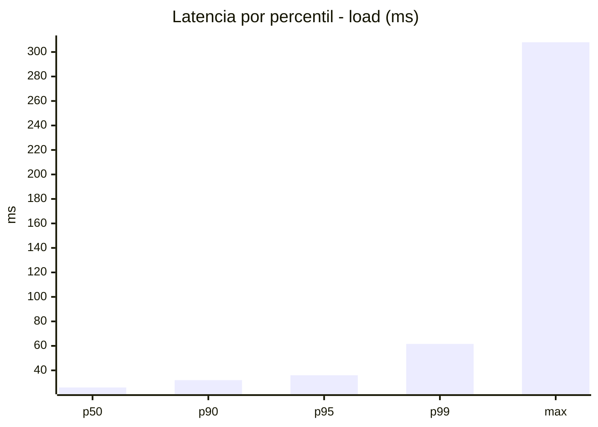
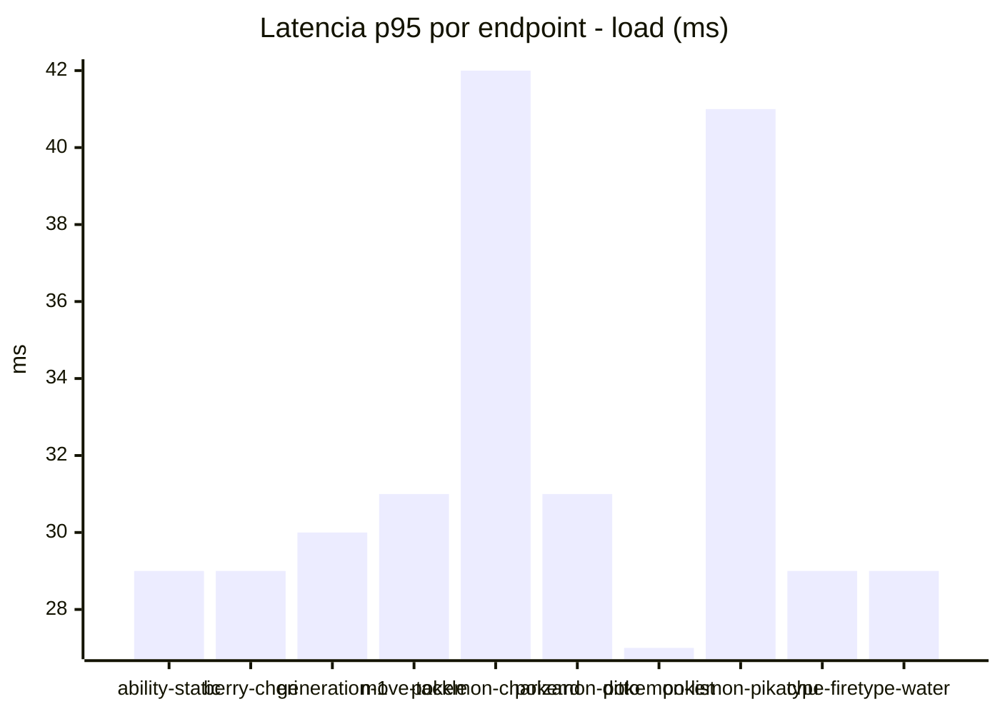
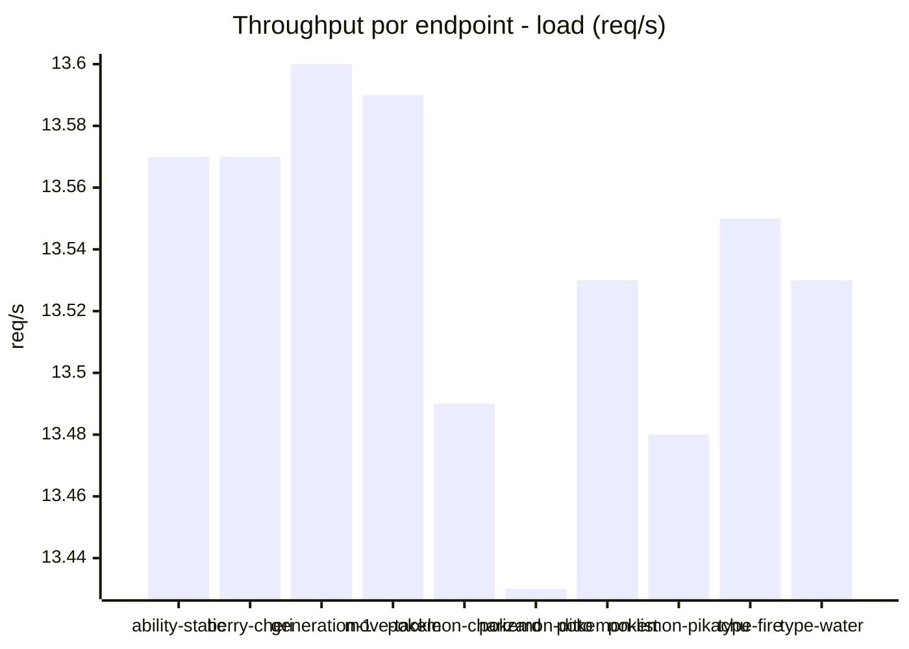
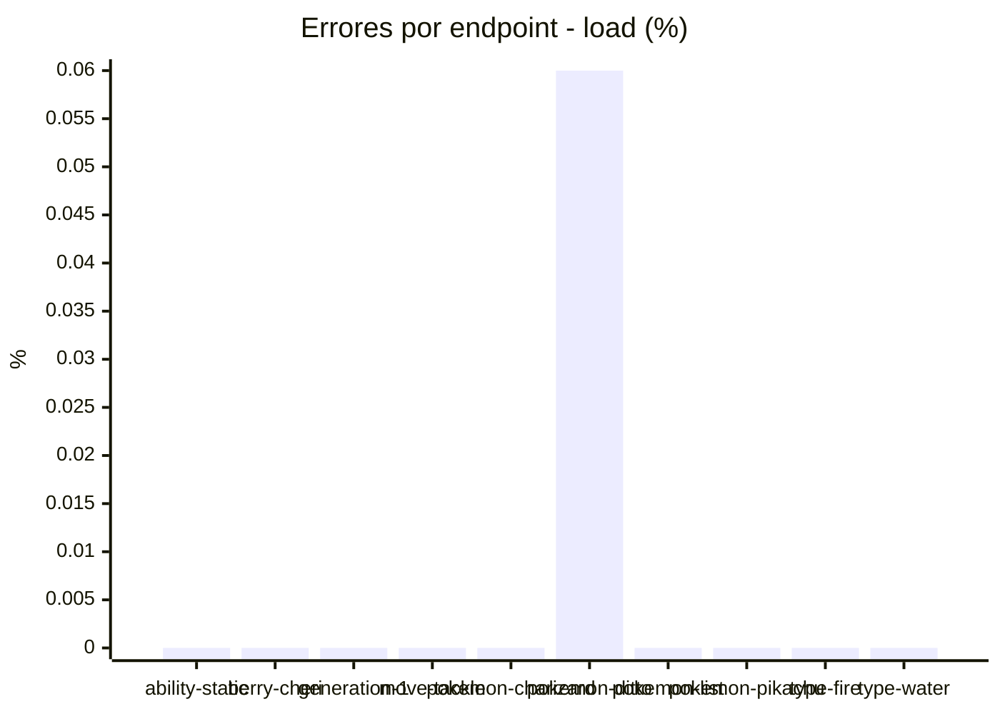
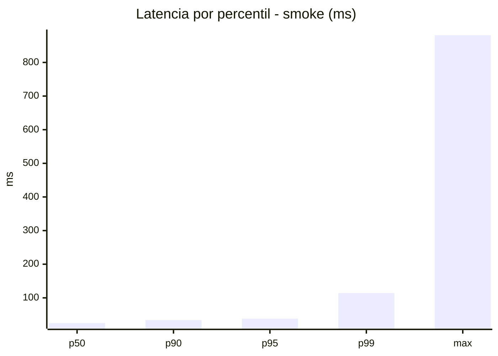
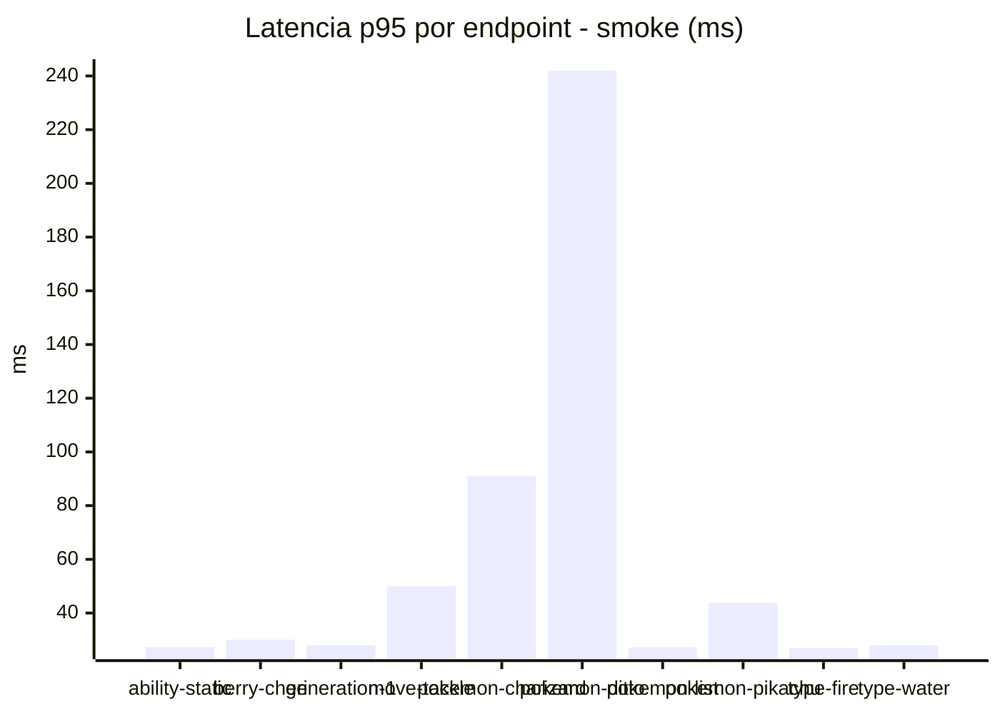
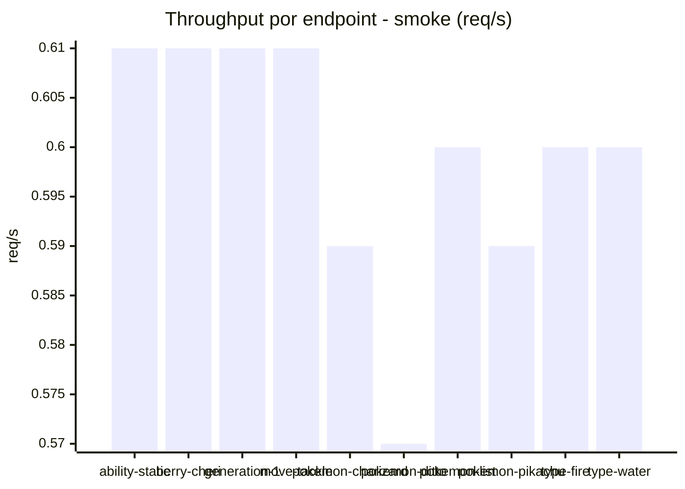
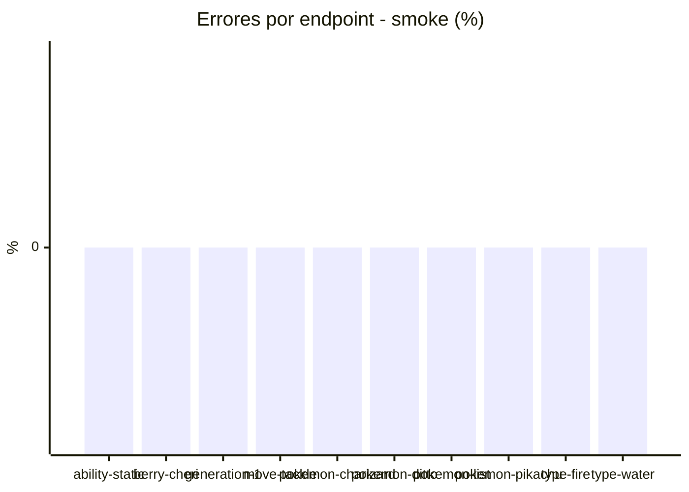

# Reporte de performance - PokeAPI

**Fecha:** 2026-11-11 20:01 UTC  
**Veredicto del agente:** `PASS`  
**Corrida:** [ver en GitHub Actions](https://github.com/lrbg/jmeter-pokeapi-lab/actions/runs/43092171239)  

## Validacion del agente de IA

PASS (fallback por umbrales)

- Error maximo: 0.01%
- p95 maximo: 38.2 ms

## Resultados

### Escenario: `load`

| Metrica | Valor |
| --- | --- |
| Muestras | 16041 |
| Errores | 1 (0.01%) |
| Latencia media | 27.5 ms |
| p50 / p90 / p95 / p99 | 26.0 / 32.0 / 36.0 / 61.6 ms |
| Min / Max | 2 / 308 ms |
| Throughput | 134.18 req/s |
| Duracion | 119.5 s |

Detalle por endpoint

| Endpoint | Muestras | Error % | avg | p95 | p99 | req/s |
| --- | --- | --- | --- | --- | --- | --- |
| ability-static | 1604 | 0.0% | 26.3 | 29.0 | 34.0 | 13.57 |
| berry-cheri | 1604 | 0.0% | 25.5 | 29.0 | 34.0 | 13.57 |
| generation-1 | 1604 | 0.0% | 26.4 | 30.0 | 35.0 | 13.6 |
| move-tackle | 1604 | 0.0% | 26.8 | 31.0 | 35.0 | 13.59 |
| pokemon-charizard | 1604 | 0.0% | 35.1 | 42.0 | 84.0 | 13.49 |
| pokemon-ditto | 1605 | 0.06% | 26.8 | 31.0 | 35.0 | 13.43 |
| pokemon-list | 1604 | 0.0% | 23.9 | 27.0 | 30.0 | 13.53 |
| pokemon-pikachu | 1604 | 0.0% | 32.6 | 41.0 | 80.9 | 13.48 |
| type-fire | 1604 | 0.0% | 25.8 | 29.0 | 33.0 | 13.55 |
| type-water | 1604 | 0.0% | 25.4 | 29.0 | 33.9 | 13.53 |

### Escenario: `smoke`

| Metrica | Valor |
| --- | --- |
| Muestras | 156 |
| Errores | 0 (0.0%) |
| Latencia media | 33.2 ms |
| p50 / p90 / p95 / p99 | 25.0 / 34.0 / 38.2 / 114.3 ms |
| Min / Max | 21 / 881 ms |
| Throughput | 5.37 req/s |
| Duracion | 29.0 s |

Detalle por endpoint

| Endpoint | Muestras | Error % | avg | p95 | p99 | req/s |
| --- | --- | --- | --- | --- | --- | --- |
| ability-static | 15 | 0.0% | 24.5 | 27.3 | 27.9 | 0.61 |
| berry-cheri | 15 | 0.0% | 24.1 | 30.1 | 34.0 | 0.61 |
| generation-1 | 15 | 0.0% | 24.3 | 28.0 | 28.0 | 0.61 |
| move-tackle | 15 | 0.0% | 30.4 | 50.0 | 89.2 | 0.61 |
| pokemon-charizard | 16 | 0.0% | 42.9 | 91.0 | 124.6 | 0.59 |
| pokemon-ditto | 16 | 0.0% | 78.4 | 242.0 | 753.2 | 0.57 |
| pokemon-list | 16 | 0.0% | 23.8 | 27.2 | 27.9 | 0.6 |
| pokemon-pikachu | 16 | 0.0% | 34 | 43.8 | 55.1 | 0.59 |
| type-fire | 16 | 0.0% | 23.9 | 27.0 | 27.0 | 0.6 |
| type-water | 16 | 0.0% | 24.3 | 28.0 | 28.0 | 0.6 |

