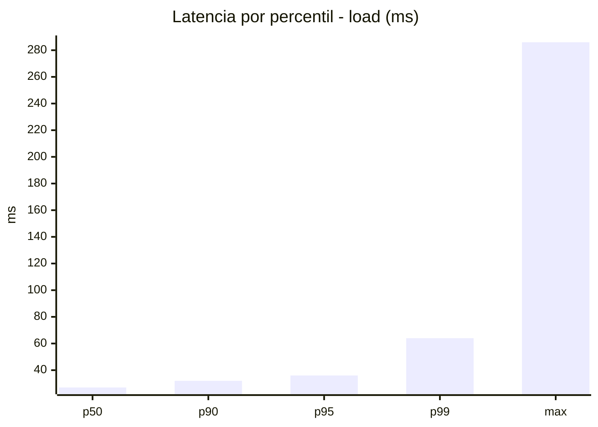
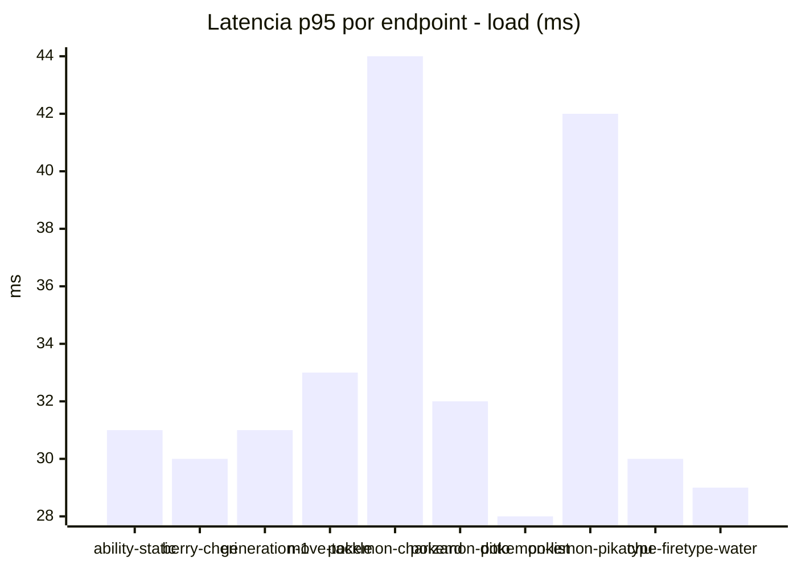
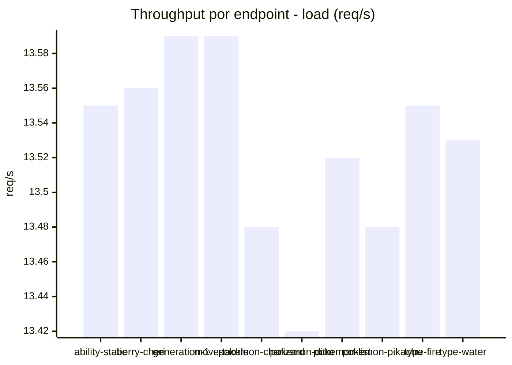
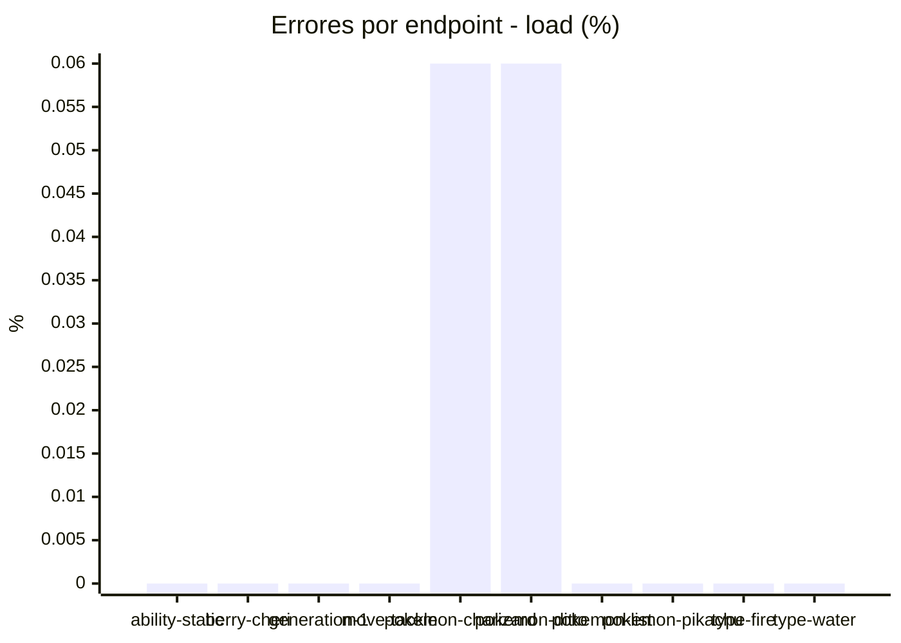
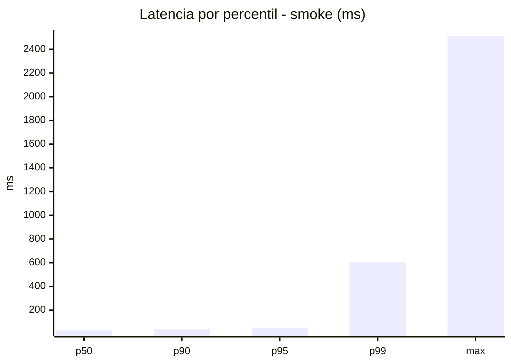
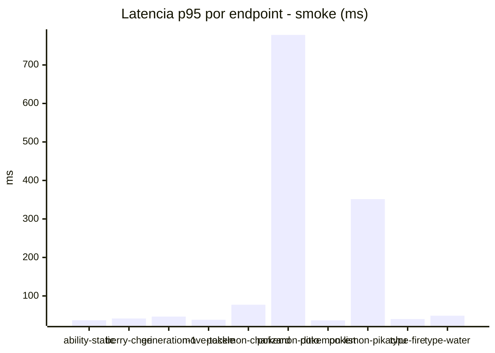
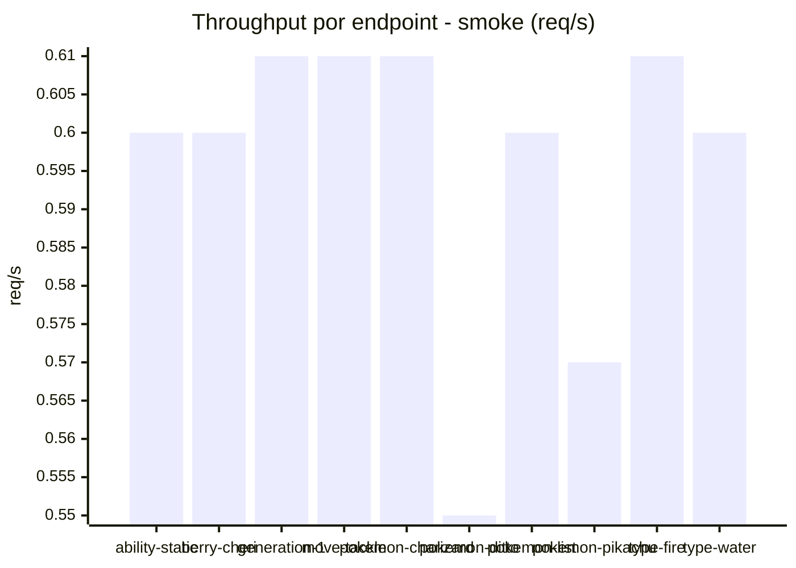
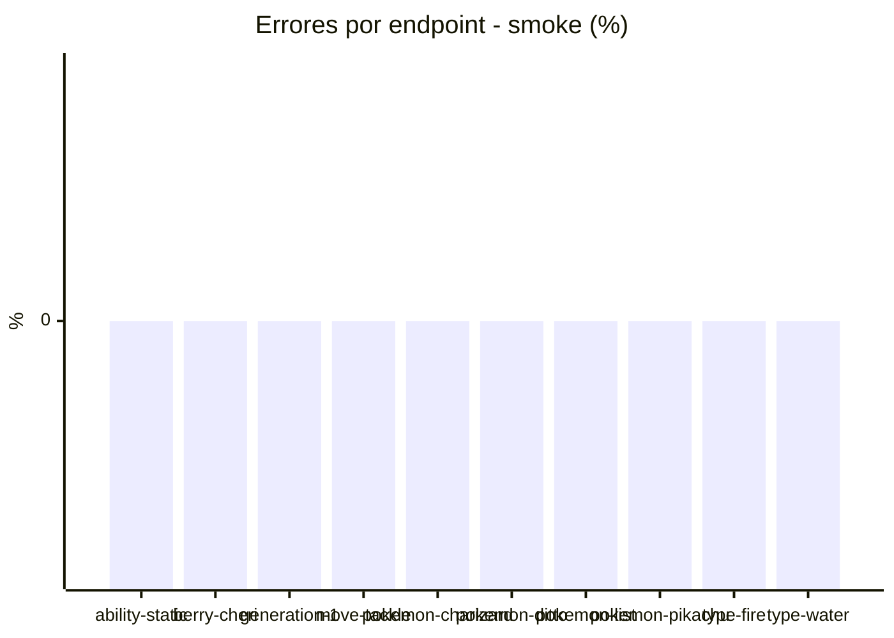

# Reporte de performance - PokeAPI

**Fecha:** 2026-11-12 20:40 UTC  
**Veredicto del agente:** `PASS`  
**Corrida:** [ver en GitHub Actions](https://github.com/lrbg/jmeter-pokeapi-lab/actions/runs/43302147912)  

## Validacion del agente de IA

PASS (fallback por umbrales)

- Error maximo: 0.01%
- p95 maximo: 53.0 ms

## Resultados

### Escenario: `load`

| Metrica | Valor |
| --- | --- |
| Muestras | 16053 |
| Errores | 2 (0.01%) |
| Latencia media | 27.4 ms |
| p50 / p90 / p95 / p99 | 27.0 / 32.0 / 36.0 / 64.0 ms |
| Min / Max | 19 / 286 ms |
| Throughput | 134.14 req/s |
| Duracion | 119.7 s |

Detalle por endpoint

| Endpoint | Muestras | Error % | avg | p95 | p99 | req/s |
| --- | --- | --- | --- | --- | --- | --- |
| ability-static | 1605 | 0.0% | 26.6 | 31.0 | 36.0 | 13.55 |
| berry-cheri | 1605 | 0.0% | 26.0 | 30.0 | 41.8 | 13.56 |
| generation-1 | 1605 | 0.0% | 26.6 | 31.0 | 38.0 | 13.59 |
| move-tackle | 1605 | 0.0% | 27.1 | 33.0 | 37.0 | 13.59 |
| pokemon-charizard | 1606 | 0.06% | 34.4 | 44.0 | 80.0 | 13.48 |
| pokemon-ditto | 1606 | 0.06% | 26.9 | 32.0 | 65.9 | 13.42 |
| pokemon-list | 1605 | 0.0% | 23.7 | 28.0 | 33.0 | 13.52 |
| pokemon-pikachu | 1606 | 0.0% | 32.0 | 42.0 | 78.0 | 13.48 |
| type-fire | 1605 | 0.0% | 25.8 | 30.0 | 35.0 | 13.55 |
| type-water | 1605 | 0.0% | 25.1 | 29.0 | 36.0 | 13.53 |

### Escenario: `smoke`

| Metrica | Valor |
| --- | --- |
| Muestras | 148 |
| Errores | 0 (0.0%) |
| Latencia media | 55.2 ms |
| p50 / p90 / p95 / p99 | 30.0 / 44.0 / 53.0 / 606.6 ms |
| Min / Max | 21 / 2512 ms |
| Throughput | 5.14 req/s |
| Duracion | 28.8 s |

Detalle por endpoint

| Endpoint | Muestras | Error % | avg | p95 | p99 | req/s |
| --- | --- | --- | --- | --- | --- | --- |
| ability-static | 15 | 0.0% | 29.1 | 36.9 | 44.2 | 0.6 |
| berry-cheri | 15 | 0.0% | 28 | 41.5 | 55.5 | 0.6 |
| generation-1 | 14 | 0.0% | 30.9 | 46.4 | 50.1 | 0.61 |
| move-tackle | 14 | 0.0% | 29.1 | 38.2 | 46.0 | 0.61 |
| pokemon-charizard | 15 | 0.0% | 45.3 | 77.2 | 79.4 | 0.61 |
| pokemon-ditto | 15 | 0.0% | 193 | 778.1 | 2165.2 | 0.55 |
| pokemon-list | 15 | 0.0% | 28.6 | 36.6 | 43.3 | 0.6 |
| pokemon-pikachu | 15 | 0.0% | 105.1 | 351.4 | 927.1 | 0.57 |
| type-fire | 15 | 0.0% | 28.6 | 40.0 | 51.2 | 0.61 |
| type-water | 15 | 0.0% | 30.8 | 48.7 | 76.1 | 0.6 |

