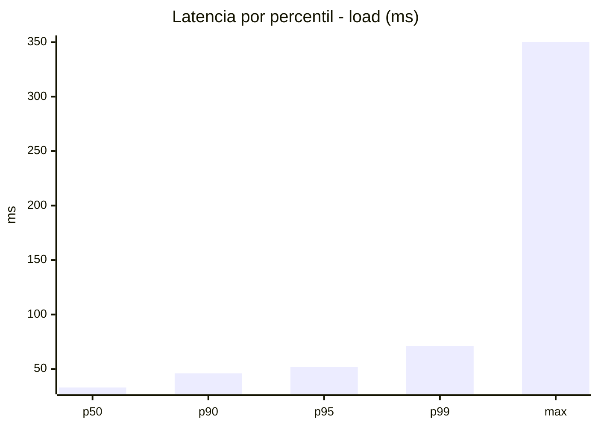
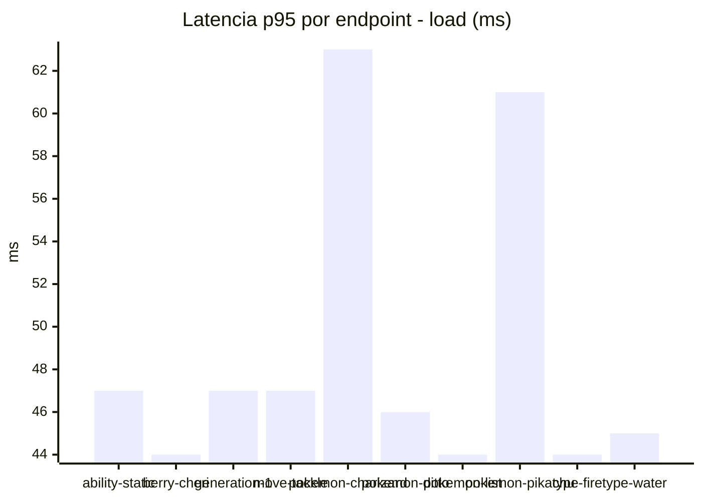
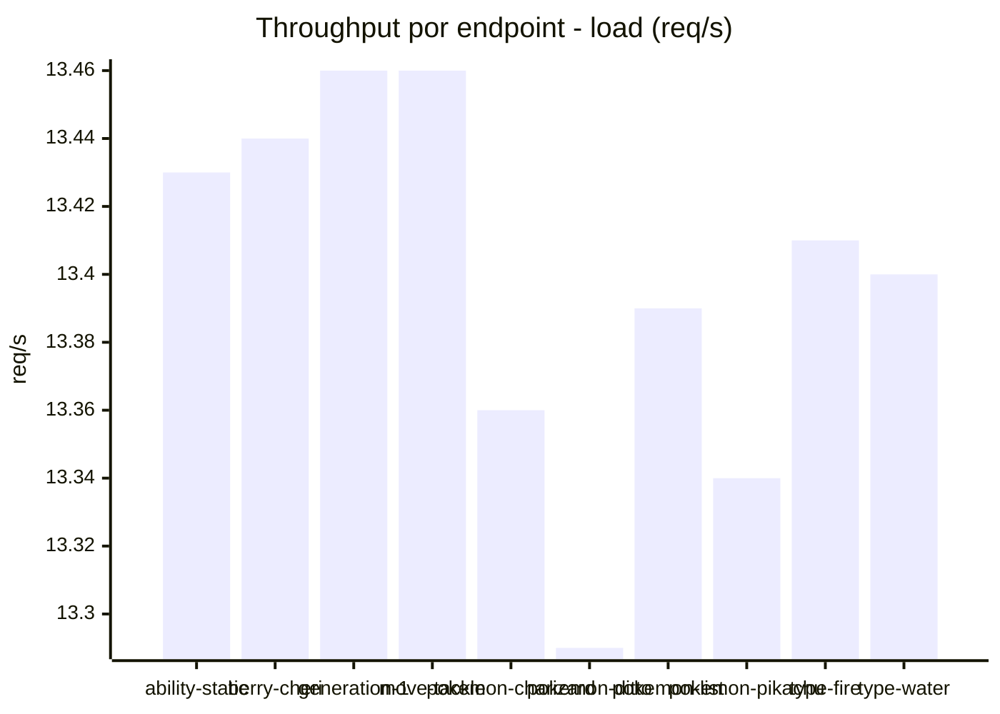
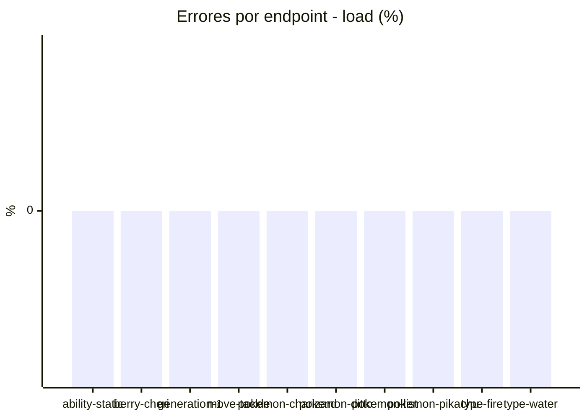
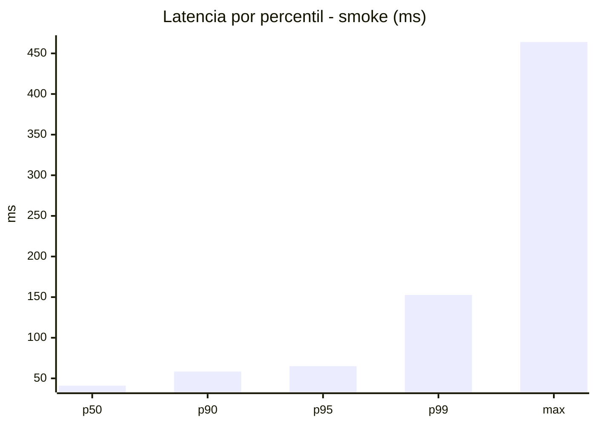
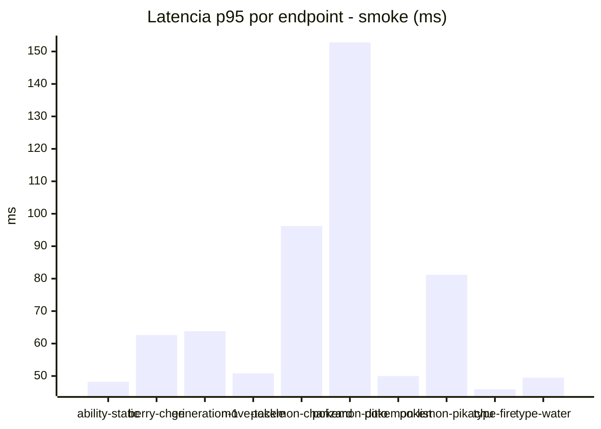
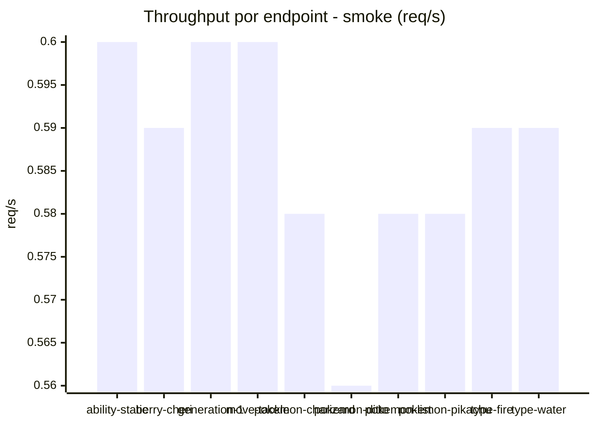

# Reporte de performance - PokeAPI

**Fecha:** 2026-11-13 20:19 UTC  
**Veredicto del agente:** `PASS`  
**Corrida:** [ver en GitHub Actions](https://github.com/lrbg/jmeter-pokeapi-lab/actions/runs/43500122554)  

## Validacion del agente de IA

PASS (fallback por umbrales)

- Error maximo: 0.0%
- p95 maximo: 65.0 ms

## Resultados

### Escenario: `load`

| Metrica | Valor |
| --- | --- |
| Muestras | 15883 |
| Errores | 0 (0.0%) |
| Latencia media | 30.9 ms |
| p50 / p90 / p95 / p99 | 33.0 / 46.0 / 52.0 / 71.2 ms |
| Min / Max | 9 / 350 ms |
| Throughput | 132.76 req/s |
| Duracion | 119.6 s |

Detalle por endpoint

| Endpoint | Muestras | Error % | avg | p95 | p99 | req/s |
| --- | --- | --- | --- | --- | --- | --- |
| ability-static | 1588 | 0.0% | 30.7 | 47.0 | 59.1 | 13.43 |
| berry-cheri | 1589 | 0.0% | 29.0 | 44.0 | 49.0 | 13.44 |
| generation-1 | 1588 | 0.0% | 30.9 | 47.0 | 70.7 | 13.46 |
| move-tackle | 1589 | 0.0% | 30.8 | 47.0 | 56.1 | 13.46 |
| pokemon-charizard | 1588 | 0.0% | 36.9 | 63.0 | 94.1 | 13.36 |
| pokemon-ditto | 1589 | 0.0% | 28.9 | 46.0 | 53.7 | 13.29 |
| pokemon-list | 1588 | 0.0% | 28.0 | 44.0 | 66.3 | 13.39 |
| pokemon-pikachu | 1588 | 0.0% | 36.1 | 61.0 | 93.3 | 13.34 |
| type-fire | 1588 | 0.0% | 29.1 | 44.0 | 53.0 | 13.41 |
| type-water | 1588 | 0.0% | 28.2 | 45.0 | 52.0 | 13.4 |

### Escenario: `smoke`

| Metrica | Valor |
| --- | --- |
| Muestras | 155 |
| Errores | 0 (0.0%) |
| Latencia media | 41.2 ms |
| p50 / p90 / p95 / p99 | 41.0 / 58.4 / 65.0 / 152.7 ms |
| Min / Max | 12 / 464 ms |
| Throughput | 5.3 req/s |
| Duracion | 29.2 s |

Detalle por endpoint

| Endpoint | Muestras | Error % | avg | p95 | p99 | req/s |
| --- | --- | --- | --- | --- | --- | --- |
| ability-static | 15 | 0.0% | 31.7 | 48.2 | 50.4 | 0.6 |
| berry-cheri | 15 | 0.0% | 38.5 | 62.6 | 91.7 | 0.59 |
| generation-1 | 15 | 0.0% | 35.9 | 63.8 | 89.6 | 0.6 |
| move-tackle | 15 | 0.0% | 36.6 | 50.8 | 54.2 | 0.6 |
| pokemon-charizard | 16 | 0.0% | 49.6 | 96.2 | 171.2 | 0.58 |
| pokemon-ditto | 16 | 0.0% | 62.2 | 152.8 | 401.7 | 0.56 |
| pokemon-list | 16 | 0.0% | 34.8 | 50.0 | 50.0 | 0.58 |
| pokemon-pikachu | 16 | 0.0% | 53.5 | 81.2 | 113.0 | 0.58 |
| type-fire | 15 | 0.0% | 30.7 | 45.9 | 47.6 | 0.59 |
| type-water | 16 | 0.0% | 36.1 | 49.5 | 50.7 | 0.59 |

