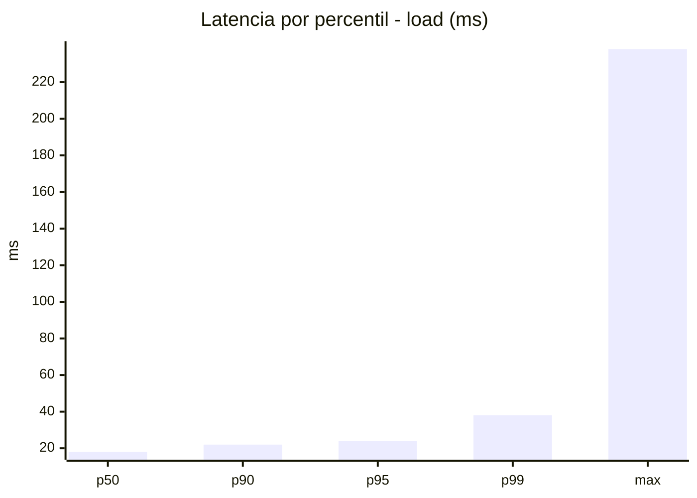
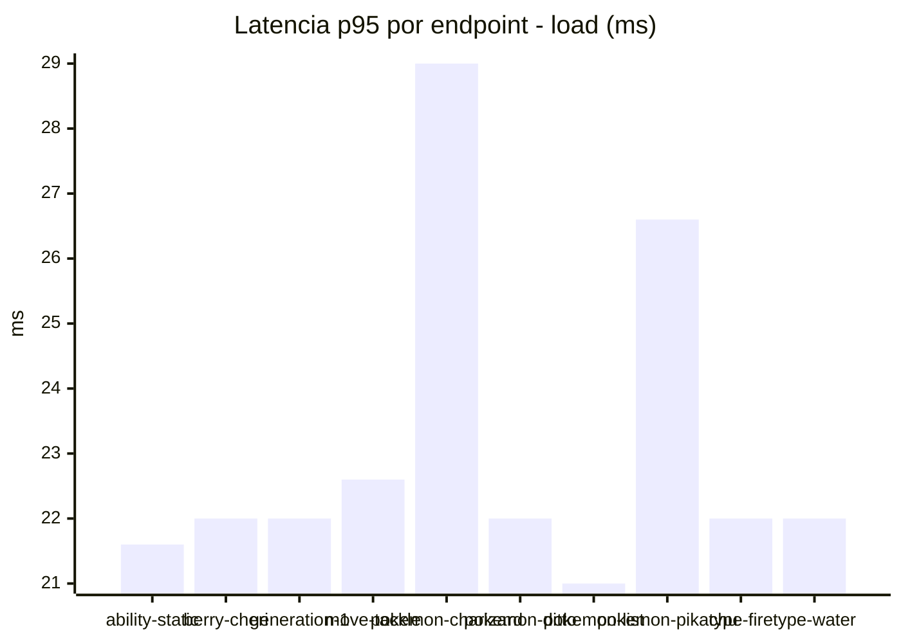
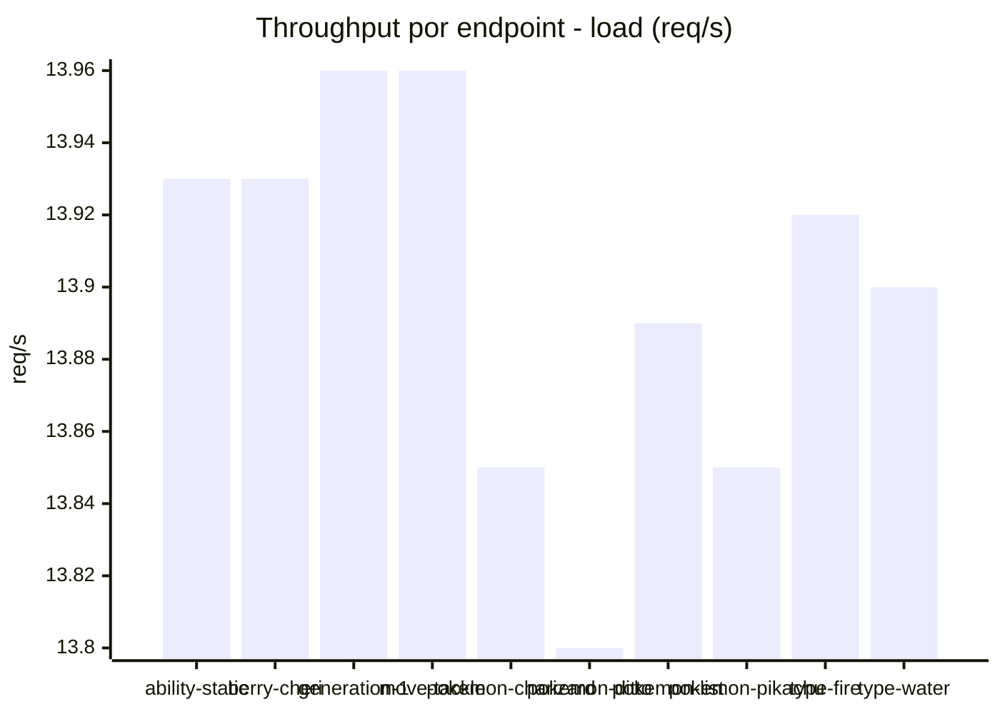
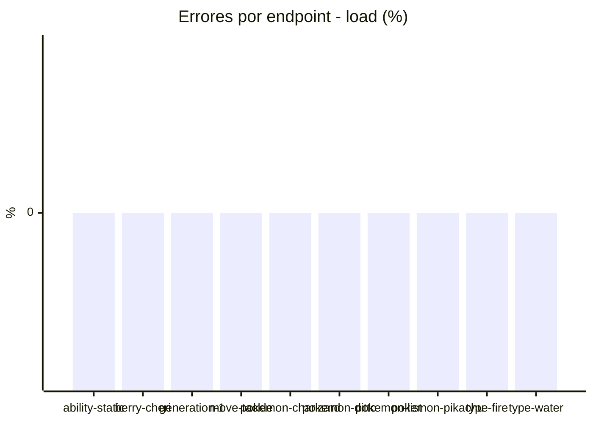
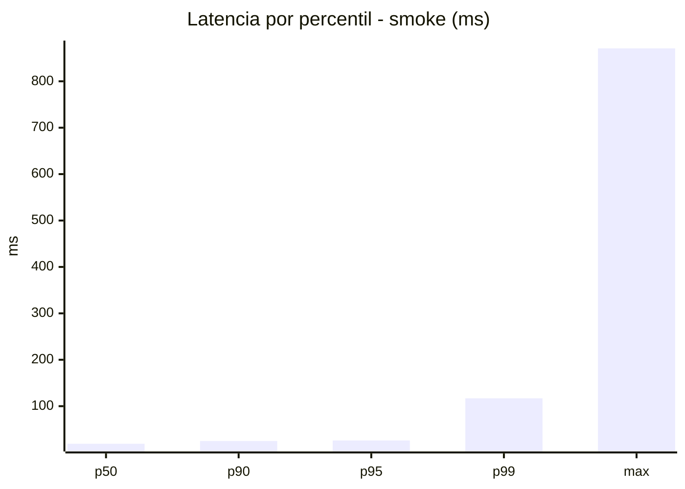
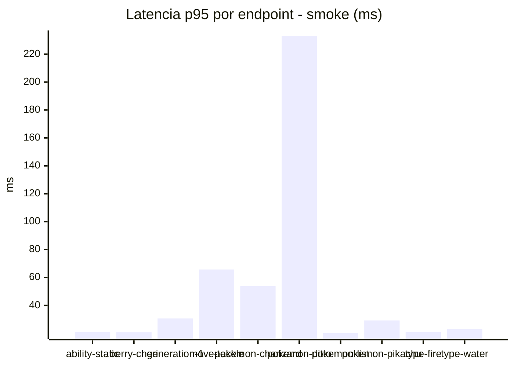
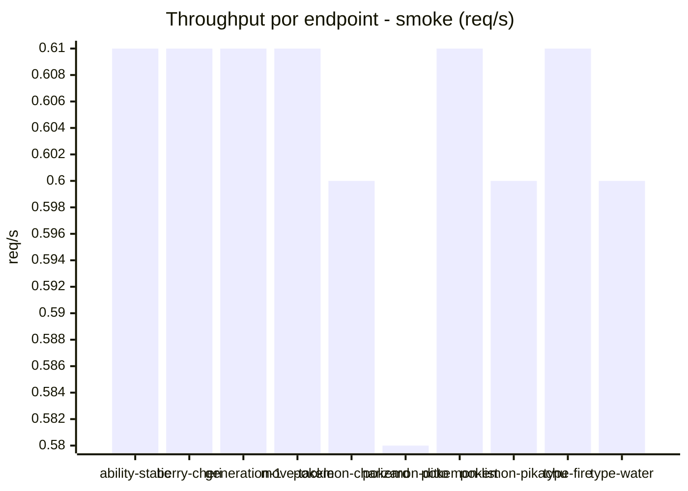

# Reporte de performance - PokeAPI

**Fecha:** 2026-11-14 18:40 UTC  
**Veredicto del agente:** `PASS`  
**Corrida:** [ver en GitHub Actions](https://github.com/lrbg/jmeter-pokeapi-lab/actions/runs/43627662030)  

## Validacion del agente de IA

PASS (fallback por umbrales)

- Error maximo: 0.0%
- p95 maximo: 26.2 ms

## Resultados

### Escenario: `load`

| Metrica | Valor |
| --- | --- |
| Muestras | 16493 |
| Errores | 0 (0.0%) |
| Latencia media | 18.6 ms |
| p50 / p90 / p95 / p99 | 18.0 / 22.0 / 24.0 / 38.0 ms |
| Min / Max | 13 / 238 ms |
| Throughput | 137.86 req/s |
| Duracion | 119.6 s |

Detalle por endpoint

| Endpoint | Muestras | Error % | avg | p95 | p99 | req/s |
| --- | --- | --- | --- | --- | --- | --- |
| ability-static | 1649 | 0.0% | 17.5 | 21.6 | 27.5 | 13.93 |
| berry-cheri | 1649 | 0.0% | 17.4 | 22.0 | 29.0 | 13.93 |
| generation-1 | 1649 | 0.0% | 18.0 | 22.0 | 33.0 | 13.96 |
| move-tackle | 1649 | 0.0% | 18.4 | 22.6 | 30.0 | 13.96 |
| pokemon-charizard | 1649 | 0.0% | 22.7 | 29.0 | 60.0 | 13.85 |
| pokemon-ditto | 1651 | 0.0% | 18.2 | 22.0 | 39.0 | 13.8 |
| pokemon-list | 1650 | 0.0% | 17.1 | 21.0 | 31.1 | 13.89 |
| pokemon-pikachu | 1649 | 0.0% | 21.2 | 26.6 | 40.0 | 13.85 |
| type-fire | 1649 | 0.0% | 17.9 | 22.0 | 37.0 | 13.92 |
| type-water | 1649 | 0.0% | 17.7 | 22.0 | 37.0 | 13.9 |

### Escenario: `smoke`

| Metrica | Valor |
| --- | --- |
| Muestras | 158 |
| Errores | 0 (0.0%) |
| Latencia media | 27.1 ms |
| p50 / p90 / p95 / p99 | 19.0 / 25.0 / 26.2 / 117.0 ms |
| Min / Max | 16 / 871 ms |
| Throughput | 5.42 req/s |
| Duracion | 29.2 s |

Detalle por endpoint

| Endpoint | Muestras | Error % | avg | p95 | p99 | req/s |
| --- | --- | --- | --- | --- | --- | --- |
| ability-static | 16 | 0.0% | 18.4 | 21.0 | 21.0 | 0.61 |
| berry-cheri | 16 | 0.0% | 18.5 | 20.8 | 22.5 | 0.61 |
| generation-1 | 15 | 0.0% | 21.2 | 30.7 | 46.9 | 0.61 |
| move-tackle | 15 | 0.0% | 29.3 | 65.7 | 149.1 | 0.61 |
| pokemon-charizard | 16 | 0.0% | 29.1 | 53.8 | 72.3 | 0.6 |
| pokemon-ditto | 16 | 0.0% | 71.6 | 232.8 | 743.3 | 0.58 |
| pokemon-list | 16 | 0.0% | 18.8 | 20.2 | 20.9 | 0.61 |
| pokemon-pikachu | 16 | 0.0% | 25.1 | 29.2 | 37.0 | 0.6 |
| type-fire | 16 | 0.0% | 19.1 | 21.0 | 21.0 | 0.61 |
| type-water | 16 | 0.0% | 19.8 | 23.0 | 23.0 | 0.6 |

