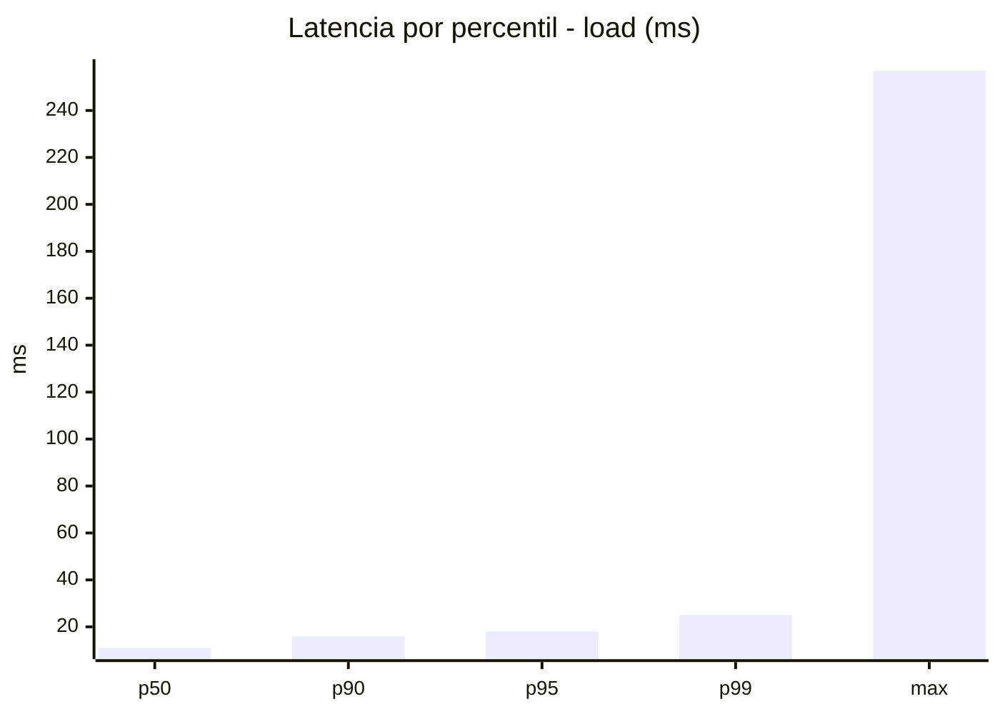
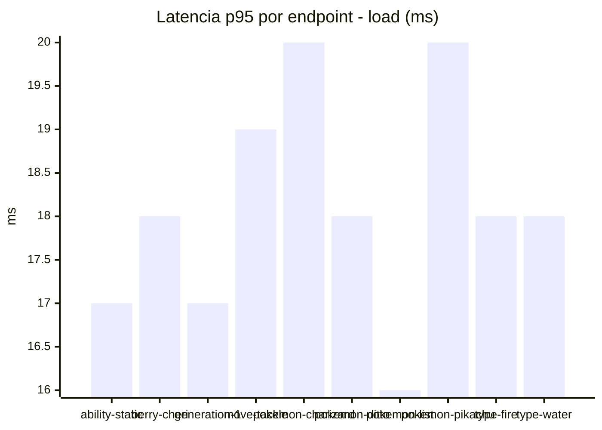
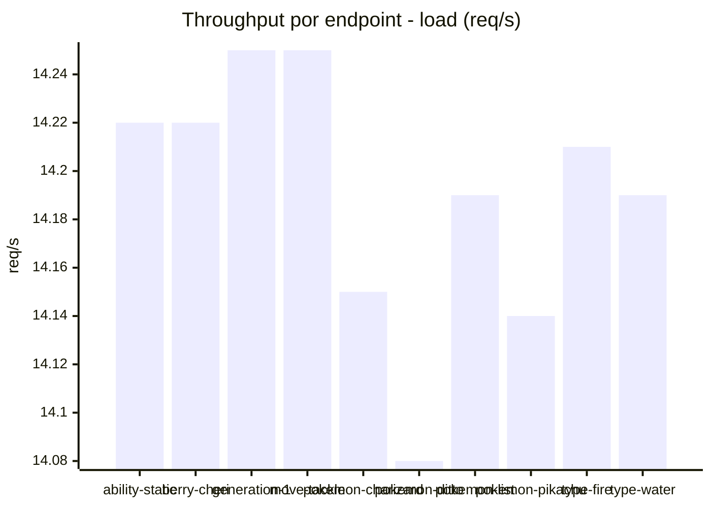
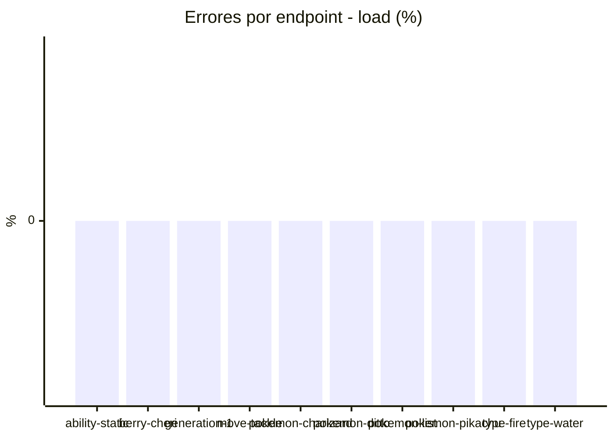
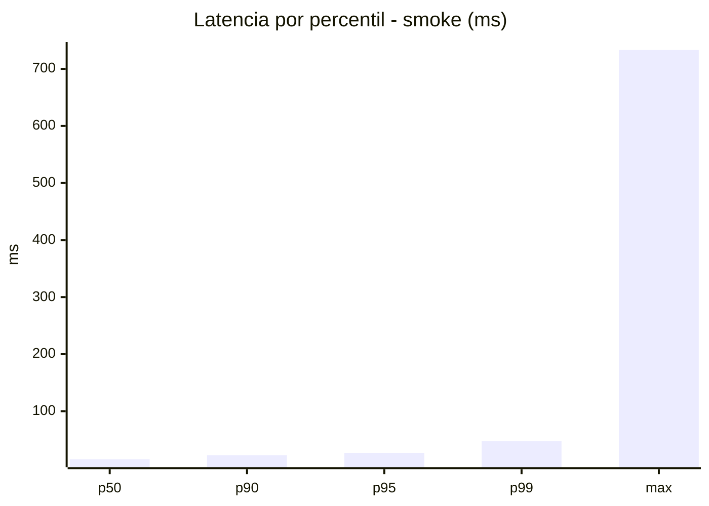
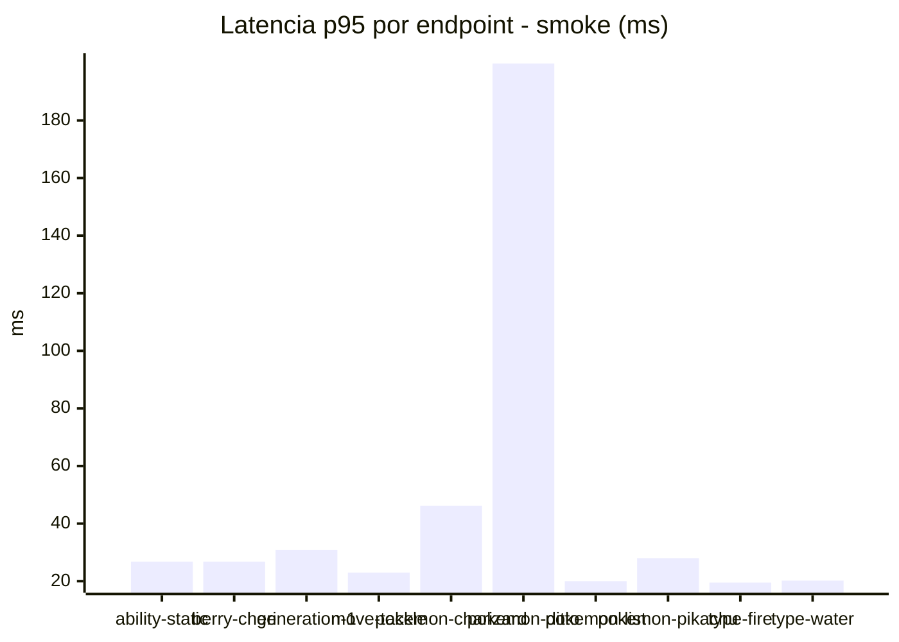
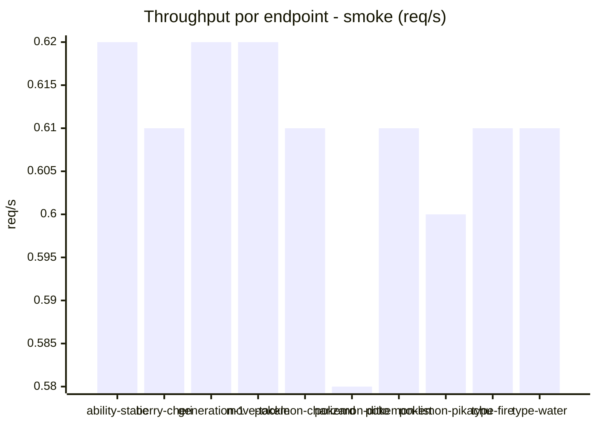

# Reporte de performance - PokeAPI

**Fecha:** 2026-11-15 19:16 UTC  
**Veredicto del agente:** `PASS`  
**Corrida:** [ver en GitHub Actions](https://github.com/lrbg/jmeter-pokeapi-lab/actions/runs/43751208061)  

## Validacion del agente de IA

PASS (fallback por umbrales)

- Error maximo: 0.0%
- p95 maximo: 27.0 ms

## Resultados

### Escenario: `load`

| Metrica | Valor |
| --- | --- |
| Muestras | 16836 |
| Errores | 0 (0.0%) |
| Latencia media | 12.1 ms |
| p50 / p90 / p95 / p99 | 11.0 / 16.0 / 18.0 / 25.0 ms |
| Min / Max | 6 / 257 ms |
| Throughput | 140.74 req/s |
| Duracion | 119.6 s |

Detalle por endpoint

| Endpoint | Muestras | Error % | avg | p95 | p99 | req/s |
| --- | --- | --- | --- | --- | --- | --- |
| ability-static | 1683 | 0.0% | 11.4 | 17.0 | 24.0 | 14.22 |
| berry-cheri | 1683 | 0.0% | 11.7 | 18.0 | 24.0 | 14.22 |
| generation-1 | 1683 | 0.0% | 11.6 | 17.0 | 24.0 | 14.25 |
| move-tackle | 1684 | 0.0% | 12.5 | 19.0 | 25.2 | 14.25 |
| pokemon-charizard | 1683 | 0.0% | 13.7 | 20.0 | 28.0 | 14.15 |
| pokemon-ditto | 1684 | 0.0% | 12.2 | 18.0 | 27.0 | 14.08 |
| pokemon-list | 1685 | 0.0% | 10.6 | 16.0 | 21.0 | 14.19 |
| pokemon-pikachu | 1683 | 0.0% | 13.5 | 20.0 | 29.2 | 14.14 |
| type-fire | 1684 | 0.0% | 11.9 | 18.0 | 25.0 | 14.21 |
| type-water | 1684 | 0.0% | 11.6 | 18.0 | 25.0 | 14.19 |

### Escenario: `smoke`

| Metrica | Valor |
| --- | --- |
| Muestras | 160 |
| Errores | 0 (0.0%) |
| Latencia media | 21.0 ms |
| p50 / p90 / p95 / p99 | 16.0 / 23.1 / 27.0 / 47.4 ms |
| Min / Max | 8 / 733 ms |
| Throughput | 5.5 req/s |
| Duracion | 29.1 s |

Detalle por endpoint

| Endpoint | Muestras | Error % | avg | p95 | p99 | req/s |
| --- | --- | --- | --- | --- | --- | --- |
| ability-static | 16 | 0.0% | 14.1 | 26.8 | 28.5 | 0.62 |
| berry-cheri | 16 | 0.0% | 15.1 | 26.8 | 40.5 | 0.61 |
| generation-1 | 16 | 0.0% | 16.9 | 30.8 | 44.5 | 0.62 |
| move-tackle | 16 | 0.0% | 16.4 | 23.0 | 23.0 | 0.62 |
| pokemon-charizard | 16 | 0.0% | 23.9 | 46.2 | 46.9 | 0.61 |
| pokemon-ditto | 16 | 0.0% | 60.9 | 199.8 | 626.3 | 0.58 |
| pokemon-list | 16 | 0.0% | 13.6 | 20.0 | 22.4 | 0.61 |
| pokemon-pikachu | 16 | 0.0% | 19.6 | 28.0 | 30.4 | 0.6 |
| type-fire | 16 | 0.0% | 14.7 | 19.5 | 20.7 | 0.61 |
| type-water | 16 | 0.0% | 14.6 | 20.2 | 20.9 | 0.61 |

