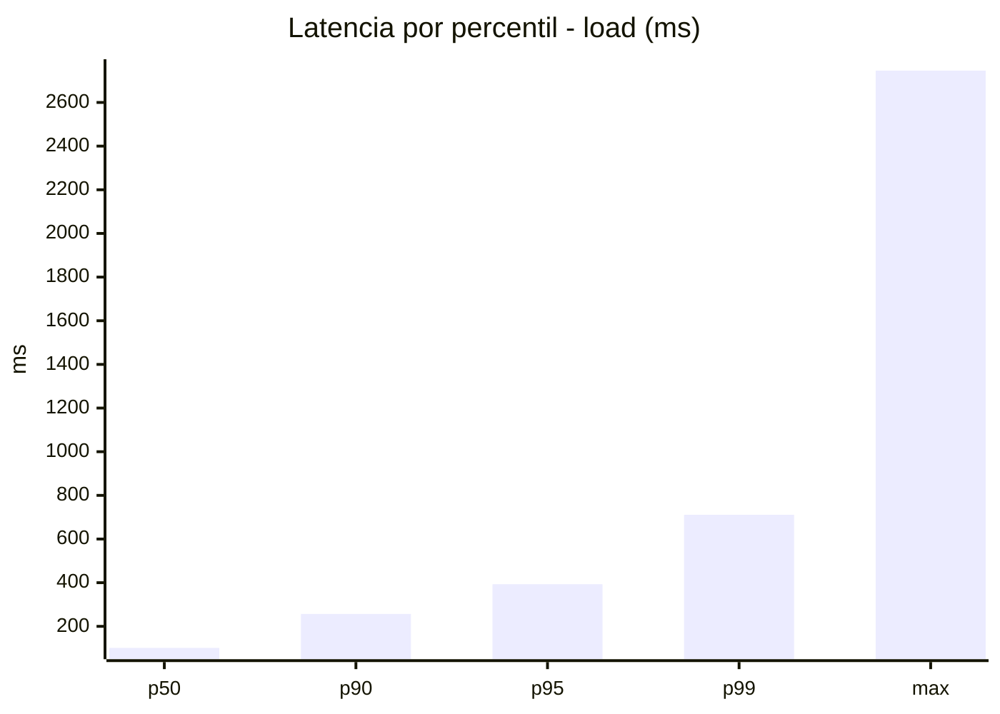
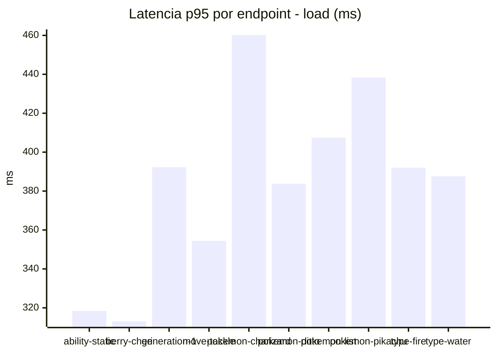
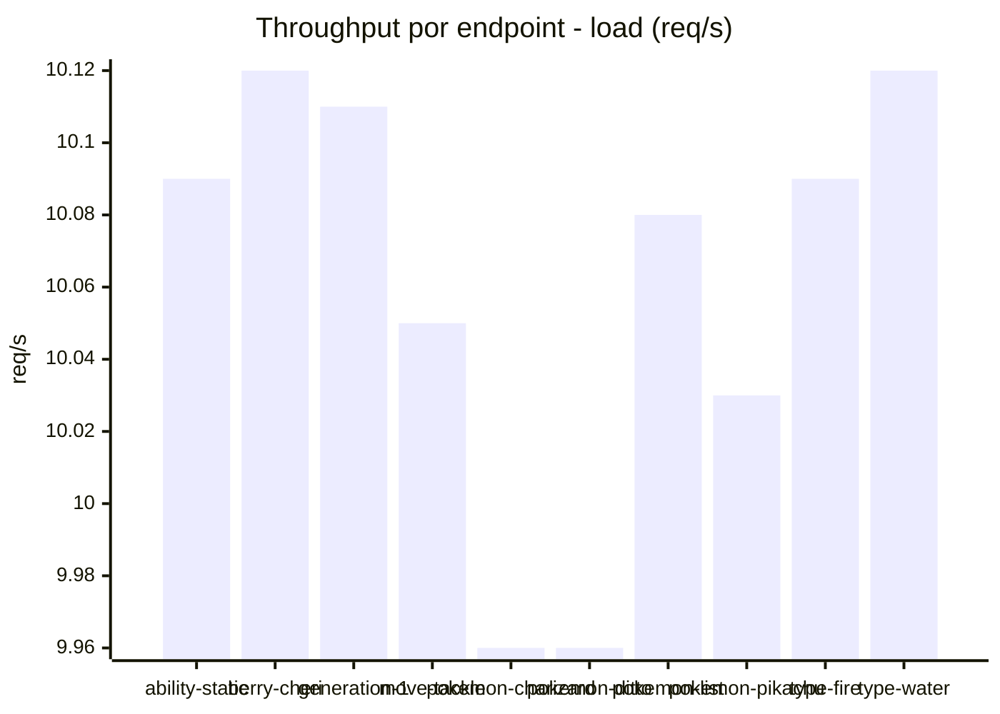
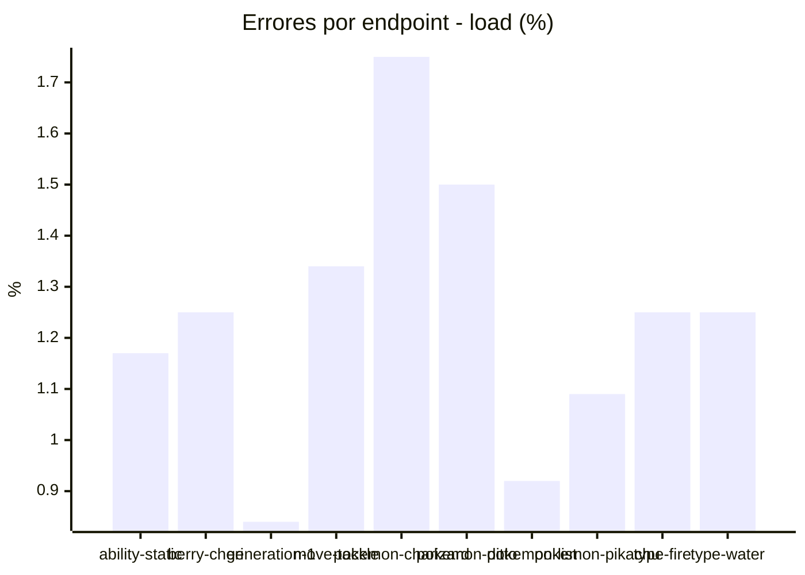
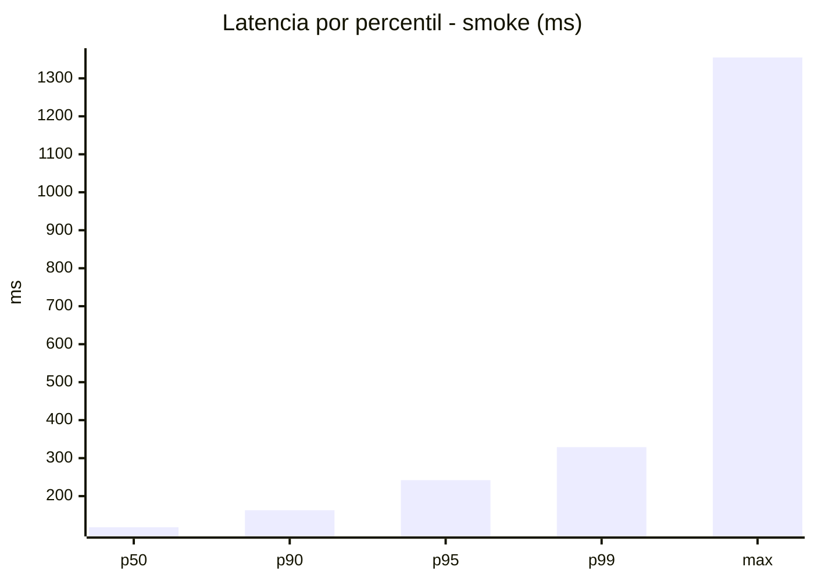
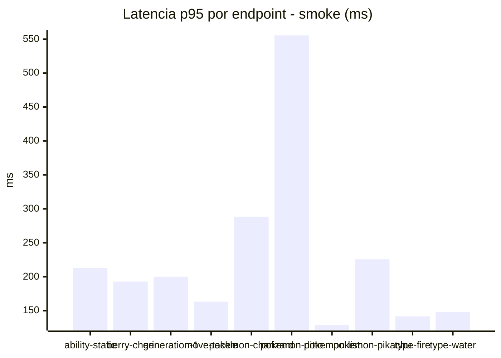
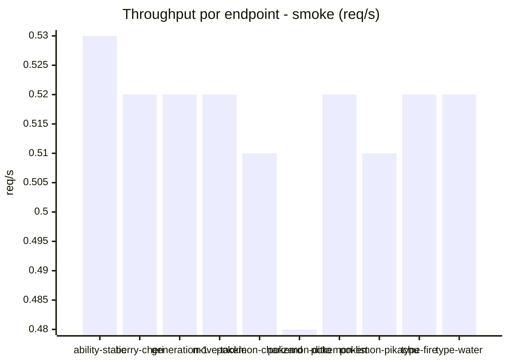
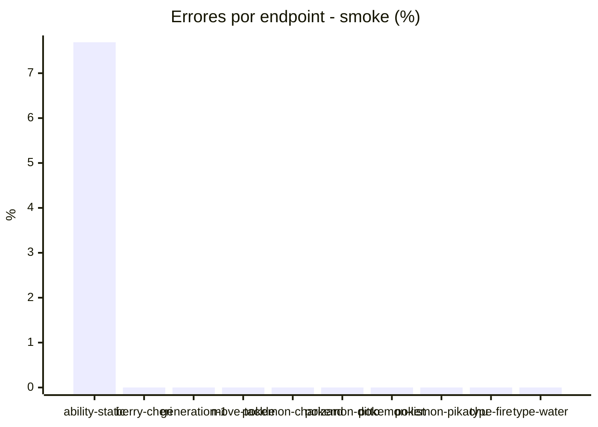

# Reporte de performance - PokeAPI

**Fecha:** 2026-11-16 22:45 UTC  
**Veredicto del agente:** `FAIL`  
**Corrida:** [ver en GitHub Actions](https://github.com/lrbg/jmeter-pokeapi-lab/actions/runs/43972648101)  

## Validacion del agente de IA

FAIL (fallback por umbrales)

- Error maximo: 1.24%
- p95 maximo: 393.0 ms

## Resultados

### Escenario: `load`

| Metrica | Valor |
| --- | --- |
| Muestras | 11974 |
| Errores | 148 (1.24%) |
| Latencia media | 140.0 ms |
| p50 / p90 / p95 / p99 | 101.0 / 257.0 / 393.0 / 711.1 ms |
| Min / Max | 0 / 2746 ms |
| Throughput | 98.93 req/s |
| Duracion | 121.0 s |

Detalle por endpoint

| Endpoint | Muestras | Error % | avg | p95 | p99 | req/s |
| --- | --- | --- | --- | --- | --- | --- |
| ability-static | 1197 | 1.17% | 127.1 | 318.4 | 545.9 | 10.09 |
| berry-cheri | 1198 | 1.25% | 123.7 | 313.1 | 621.4 | 10.12 |
| generation-1 | 1197 | 0.84% | 130.0 | 392.2 | 690.0 | 10.11 |
| move-tackle | 1197 | 1.34% | 136.7 | 354.4 | 709.8 | 10.05 |
| pokemon-charizard | 1198 | 1.75% | 176.8 | 460.2 | 868.6 | 9.96 |
| pokemon-ditto | 1198 | 1.5% | 136.0 | 383.7 | 742.8 | 9.96 |
| pokemon-list | 1197 | 0.92% | 134.9 | 407.4 | 747.7 | 10.08 |
| pokemon-pikachu | 1198 | 1.09% | 170.1 | 438.3 | 725.0 | 10.03 |
| type-fire | 1197 | 1.25% | 128.8 | 392.0 | 672.8 | 10.09 |
| type-water | 1197 | 1.25% | 135.8 | 387.6 | 681.4 | 10.12 |

### Escenario: `smoke`

| Metrica | Valor |
| --- | --- |
| Muestras | 133 |
| Errores | 1 (0.75%) |
| Latencia media | 131.5 ms |
| p50 / p90 / p95 / p99 | 118.0 / 162.8 / 242.0 / 329.0 ms |
| Min / Max | 21 / 1355 ms |
| Throughput | 4.56 req/s |
| Duracion | 29.2 s |

Detalle por endpoint

| Endpoint | Muestras | Error % | avg | p95 | p99 | req/s |
| --- | --- | --- | --- | --- | --- | --- |
| ability-static | 13 | 7.69% | 130.6 | 213.0 | 304.2 | 0.53 |
| berry-cheri | 13 | 0.0% | 113.9 | 193.0 | 260.2 | 0.52 |
| generation-1 | 13 | 0.0% | 121.3 | 200.2 | 259.2 | 0.52 |
| move-tackle | 13 | 0.0% | 121.4 | 163.4 | 171.1 | 0.52 |
| pokemon-charizard | 14 | 0.0% | 160.2 | 288.4 | 321.7 | 0.51 |
| pokemon-ditto | 14 | 0.0% | 193.4 | 555.5 | 1195.1 | 0.48 |
| pokemon-list | 13 | 0.0% | 98.7 | 129.2 | 145.0 | 0.52 |
| pokemon-pikachu | 14 | 0.0% | 150.3 | 225.8 | 294.0 | 0.51 |
| type-fire | 13 | 0.0% | 103.9 | 141.8 | 152.4 | 0.52 |
| type-water | 13 | 0.0% | 112.9 | 148.2 | 159.2 | 0.52 |

