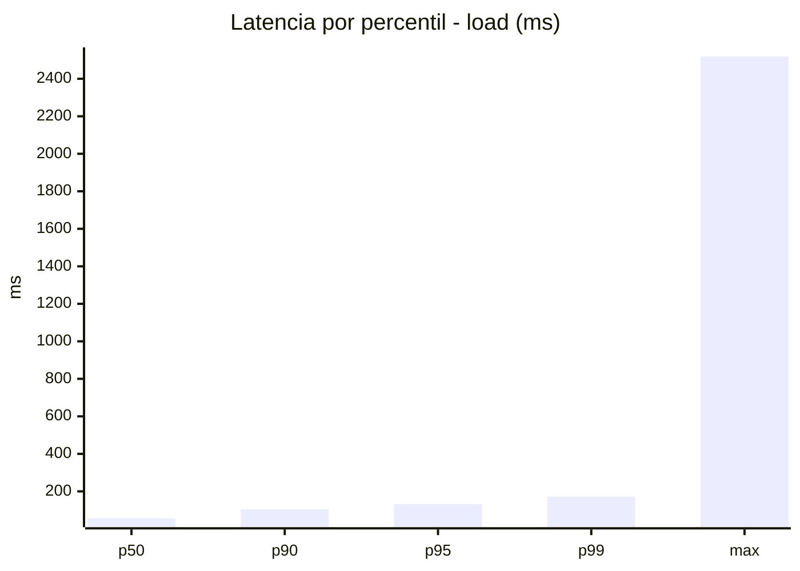
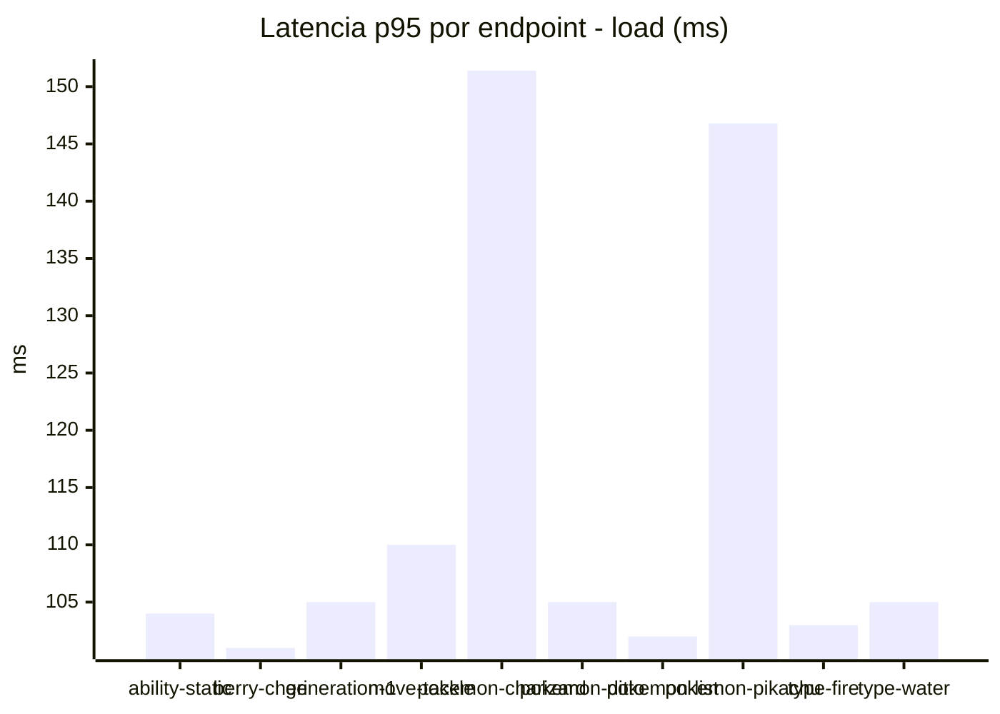
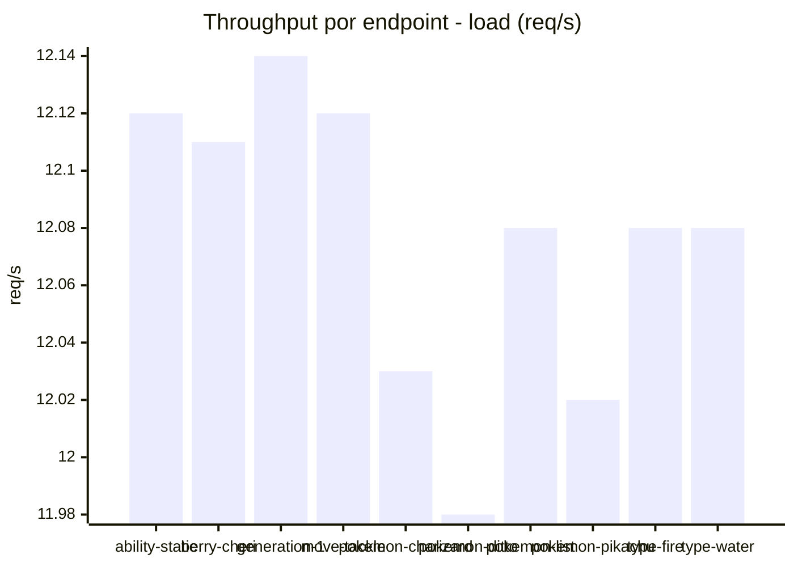
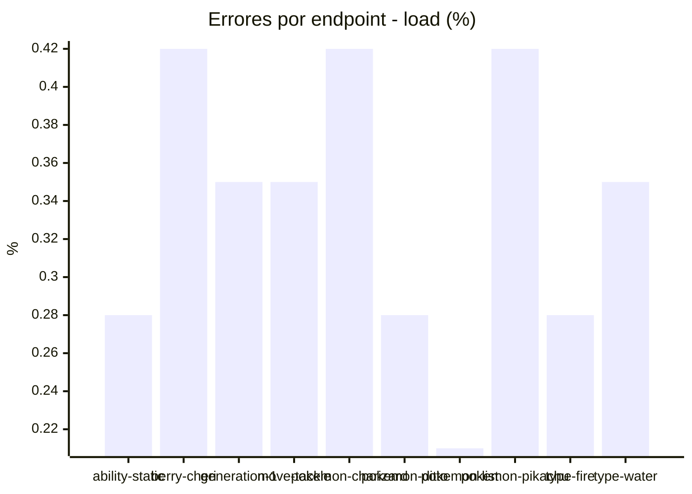
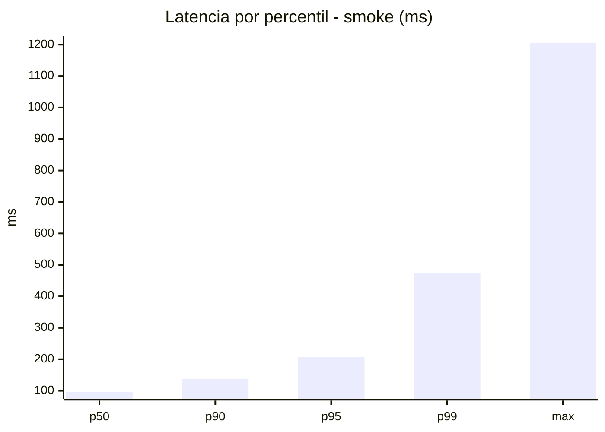
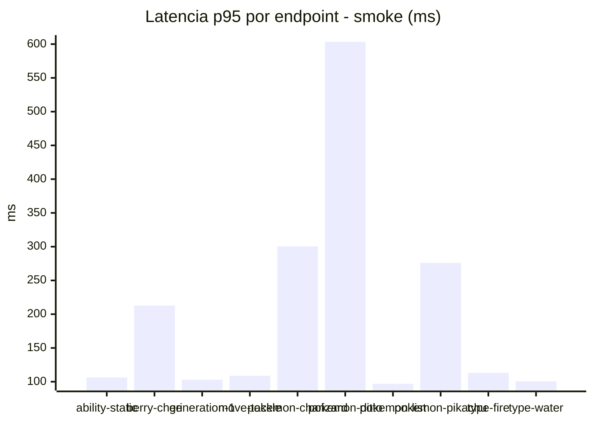
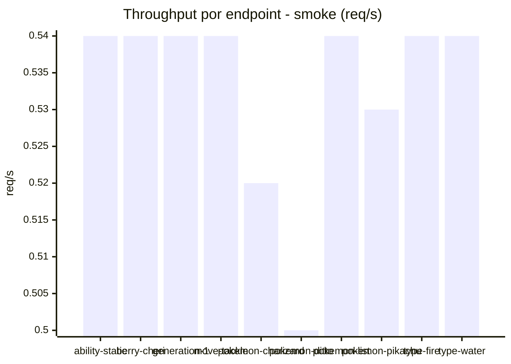
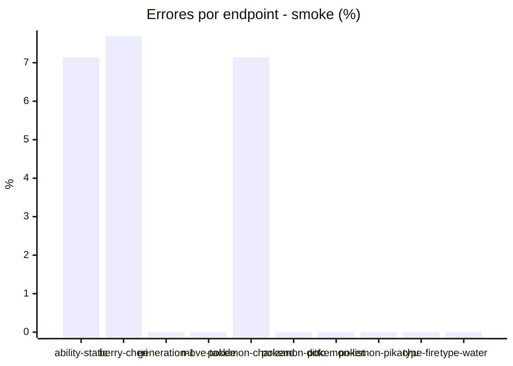

# Reporte de performance - PokeAPI

**Fecha:** 2026-11-17 21:32 UTC  
**Veredicto del agente:** `FAIL`  
**Corrida:** [ver en GitHub Actions](https://github.com/lrbg/jmeter-pokeapi-lab/actions/runs/44180307027)  

## Validacion del agente de IA

FAIL (fallback por umbrales)

- Error maximo: 2.19%
- p95 maximo: 207.8 ms

## Resultados

### Escenario: `load`

| Metrica | Valor |
| --- | --- |
| Muestras | 14327 |
| Errores | 48 (0.34%) |
| Latencia media | 67.0 ms |
| p50 / p90 / p95 / p99 | 57.0 / 105.0 / 132.0 / 172.0 ms |
| Min / Max | 0 / 2519 ms |
| Throughput | 119.64 req/s |
| Duracion | 119.8 s |

Detalle por endpoint

| Endpoint | Muestras | Error % | avg | p95 | p99 | req/s |
| --- | --- | --- | --- | --- | --- | --- |
| ability-static | 1432 | 0.28% | 61.7 | 104.0 | 122.1 | 12.12 |
| berry-cheri | 1432 | 0.42% | 62.4 | 101.0 | 128.8 | 12.11 |
| generation-1 | 1432 | 0.35% | 62.6 | 105.0 | 145.7 | 12.14 |
| move-tackle | 1433 | 0.35% | 66.0 | 110.0 | 131.4 | 12.12 |
| pokemon-charizard | 1433 | 0.42% | 84.5 | 151.4 | 266.7 | 12.03 |
| pokemon-ditto | 1433 | 0.28% | 64.0 | 105.0 | 126.4 | 11.98 |
| pokemon-list | 1433 | 0.21% | 64.0 | 102.0 | 182.8 | 12.08 |
| pokemon-pikachu | 1433 | 0.42% | 82.4 | 146.8 | 274.7 | 12.02 |
| type-fire | 1433 | 0.28% | 62.4 | 103.0 | 138.1 | 12.08 |
| type-water | 1433 | 0.35% | 60.2 | 105.0 | 124.7 | 12.08 |

### Escenario: `smoke`

| Metrica | Valor |
| --- | --- |
| Muestras | 137 |
| Errores | 3 (2.19%) |
| Latencia media | 107.9 ms |
| p50 / p90 / p95 / p99 | 96.0 / 137.4 / 207.8 / 473.3 ms |
| Min / Max | 0 / 1206 ms |
| Throughput | 4.73 req/s |
| Duracion | 29.0 s |

Detalle por endpoint

| Endpoint | Muestras | Error % | avg | p95 | p99 | req/s |
| --- | --- | --- | --- | --- | --- | --- |
| ability-static | 14 | 7.14% | 88.3 | 106.3 | 106.9 | 0.54 |
| berry-cheri | 13 | 7.69% | 101.9 | 212.8 | 350.6 | 0.54 |
| generation-1 | 13 | 0.0% | 89.8 | 103.0 | 103.0 | 0.54 |
| move-tackle | 13 | 0.0% | 81.6 | 108.8 | 114.6 | 0.54 |
| pokemon-charizard | 14 | 7.14% | 161.5 | 300.4 | 314.5 | 0.52 |
| pokemon-ditto | 14 | 0.0% | 180.1 | 603.4 | 1085.5 | 0.5 |
| pokemon-list | 14 | 0.0% | 83 | 96.8 | 99.3 | 0.54 |
| pokemon-pikachu | 14 | 0.0% | 132.4 | 276.0 | 473.6 | 0.53 |
| type-fire | 14 | 0.0% | 80.8 | 112.9 | 132.2 | 0.54 |
| type-water | 14 | 0.0% | 75.8 | 100.7 | 101.7 | 0.54 |

