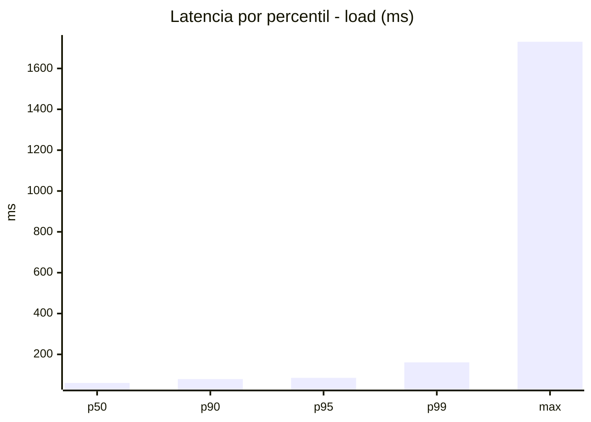
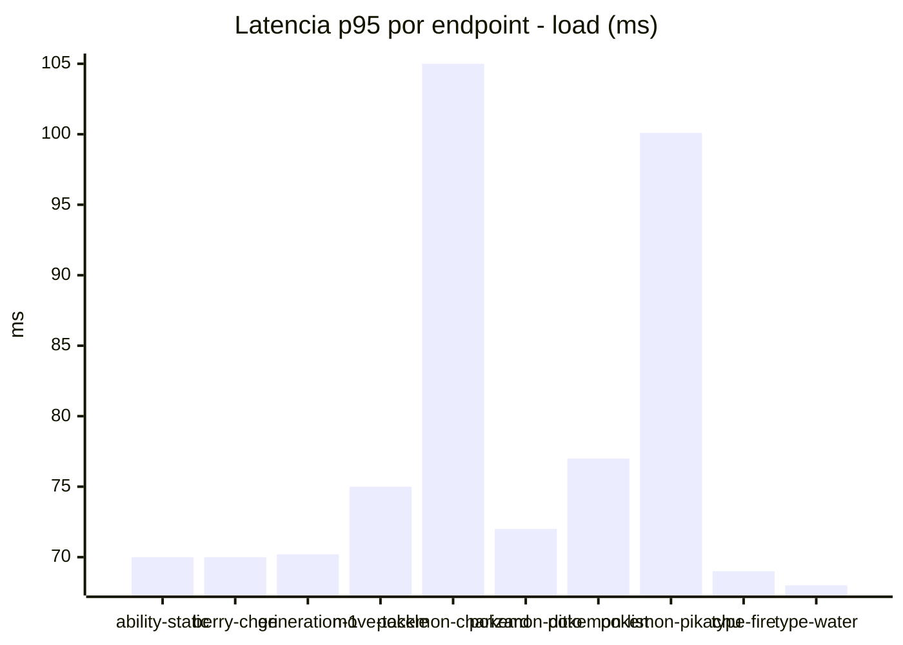
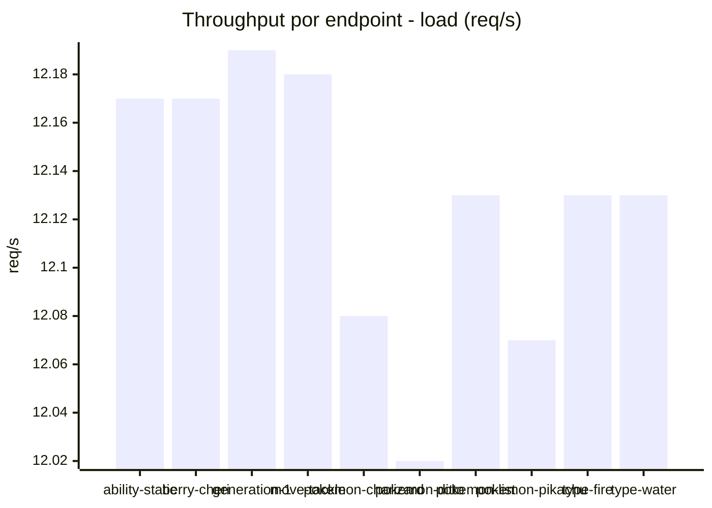
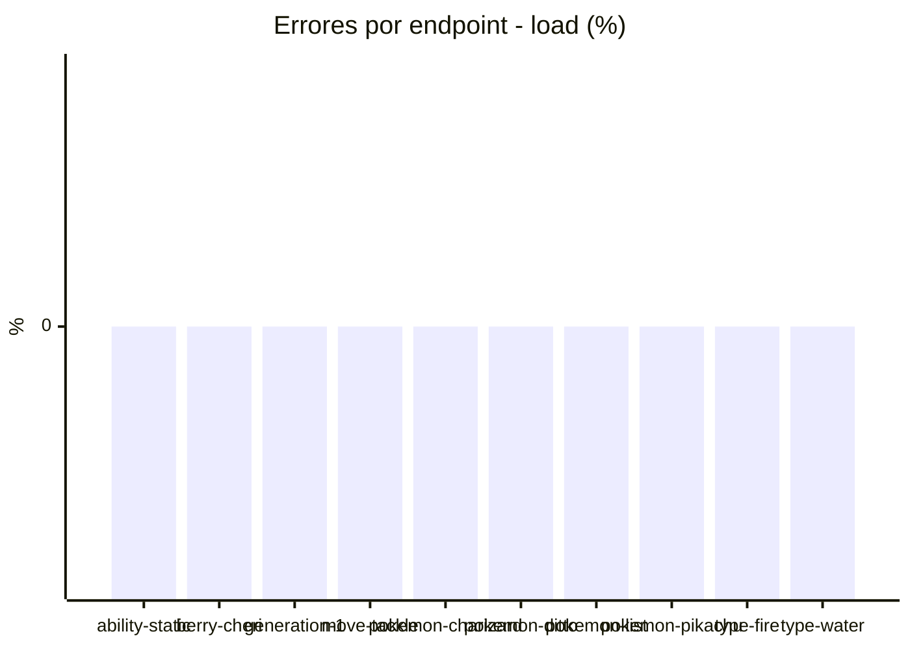
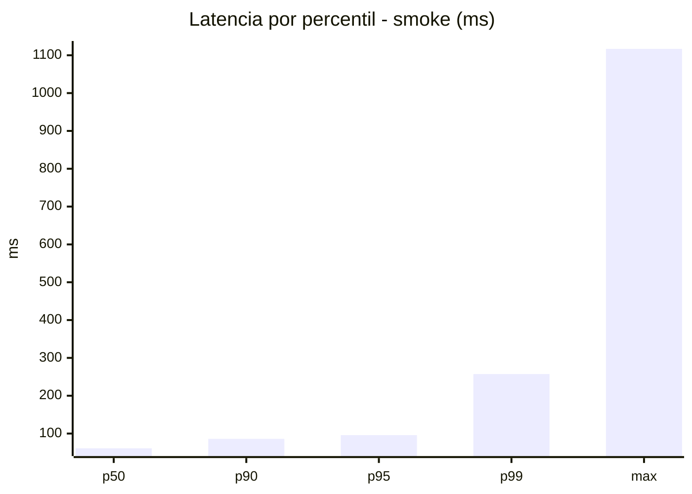
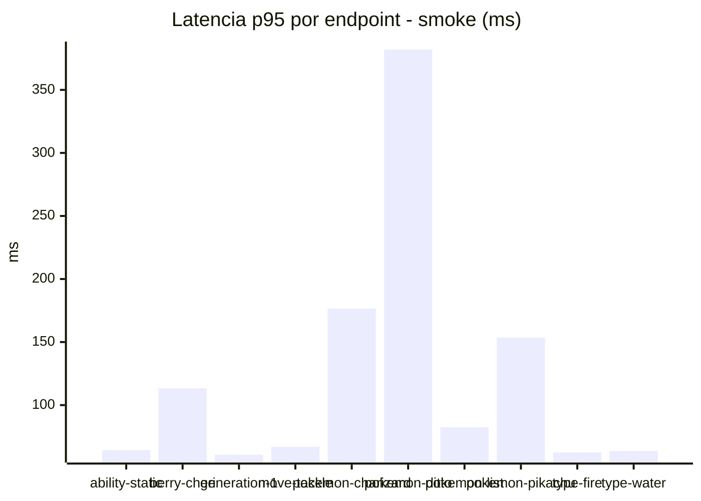
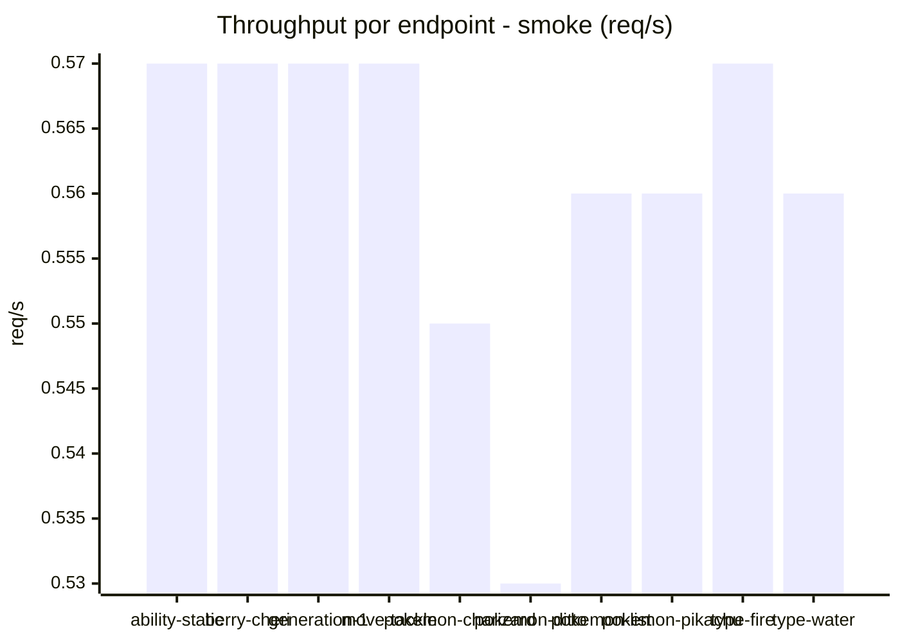

# Reporte de performance - PokeAPI

**Fecha:** 2026-11-18 21:06 UTC  
**Veredicto del agente:** `PASS`  
**Corrida:** [ver en GitHub Actions](https://github.com/lrbg/jmeter-pokeapi-lab/actions/runs/44397524498)  

## Validacion del agente de IA

PASS (fallback por umbrales)

- Error maximo: 0.0%
- p95 maximo: 95.8 ms

## Resultados

### Escenario: `load`

| Metrica | Valor |
| --- | --- |
| Muestras | 14376 |
| Errores | 0 (0.0%) |
| Latencia media | 65.6 ms |
| p50 / p90 / p95 / p99 | 60.0 / 79.0 / 85.0 / 161.0 ms |
| Min / Max | 47 / 1731 ms |
| Throughput | 120.13 req/s |
| Duracion | 119.7 s |

Detalle por endpoint

| Endpoint | Muestras | Error % | avg | p95 | p99 | req/s |
| --- | --- | --- | --- | --- | --- | --- |
| ability-static | 1437 | 0.0% | 60.1 | 70.0 | 75.6 | 12.17 |
| berry-cheri | 1438 | 0.0% | 59.8 | 70.0 | 88.3 | 12.17 |
| generation-1 | 1437 | 0.0% | 61.6 | 70.2 | 79.3 | 12.19 |
| move-tackle | 1437 | 0.0% | 64.2 | 75.0 | 88.6 | 12.18 |
| pokemon-charizard | 1438 | 0.0% | 87.3 | 105.0 | 200.6 | 12.08 |
| pokemon-ditto | 1438 | 0.0% | 62.3 | 72.0 | 83.1 | 12.02 |
| pokemon-list | 1438 | 0.0% | 61.8 | 77.0 | 148.9 | 12.13 |
| pokemon-pikachu | 1438 | 0.0% | 81.0 | 100.1 | 252.0 | 12.07 |
| type-fire | 1437 | 0.0% | 58.9 | 69.0 | 81.3 | 12.13 |
| type-water | 1438 | 0.0% | 58.9 | 68.0 | 82.9 | 12.13 |

### Escenario: `smoke`

| Metrica | Valor |
| --- | --- |
| Muestras | 145 |
| Errores | 0 (0.0%) |
| Latencia media | 75.6 ms |
| p50 / p90 / p95 / p99 | 61.0 / 86.0 / 95.8 / 257.4 ms |
| Min / Max | 54 / 1117 ms |
| Throughput | 4.98 req/s |
| Duracion | 29.1 s |

Detalle por endpoint

| Endpoint | Muestras | Error % | avg | p95 | p99 | req/s |
| --- | --- | --- | --- | --- | --- | --- |
| ability-static | 14 | 0.0% | 59.9 | 64.3 | 64.9 | 0.57 |
| berry-cheri | 14 | 0.0% | 68.5 | 113.4 | 188.3 | 0.57 |
| generation-1 | 14 | 0.0% | 57.9 | 60.7 | 61.7 | 0.57 |
| move-tackle | 14 | 0.0% | 61.1 | 67.0 | 67.0 | 0.57 |
| pokemon-charizard | 15 | 0.0% | 100.1 | 176.6 | 194.5 | 0.55 |
| pokemon-ditto | 15 | 0.0% | 129.9 | 382.0 | 970.0 | 0.53 |
| pokemon-list | 15 | 0.0% | 64.3 | 82.4 | 92.5 | 0.56 |
| pokemon-pikachu | 15 | 0.0% | 92.2 | 153.5 | 268.3 | 0.56 |
| type-fire | 14 | 0.0% | 59.1 | 62.4 | 62.9 | 0.57 |
| type-water | 15 | 0.0% | 58.1 | 63.6 | 64.7 | 0.56 |

