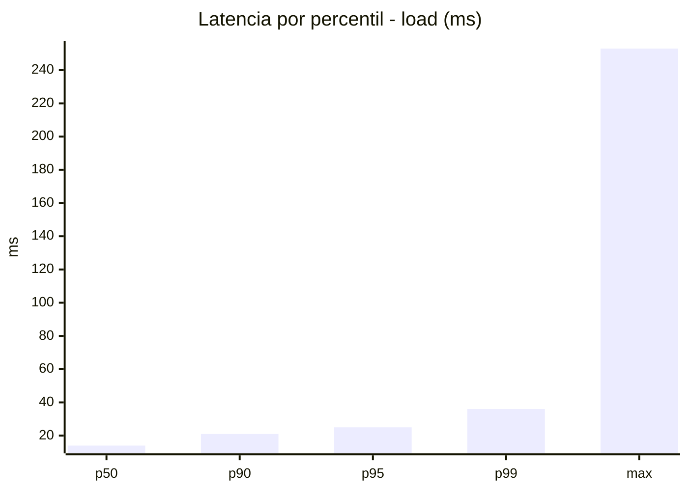
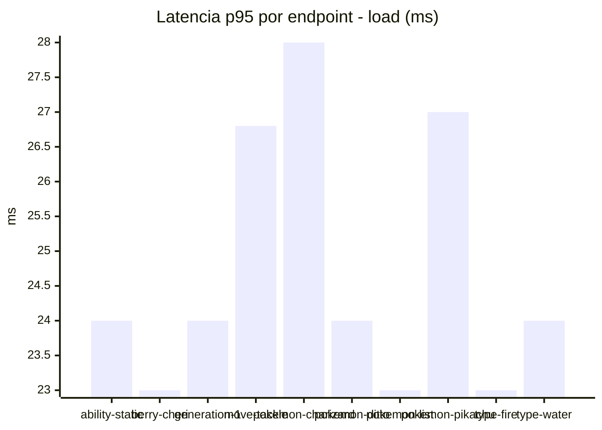
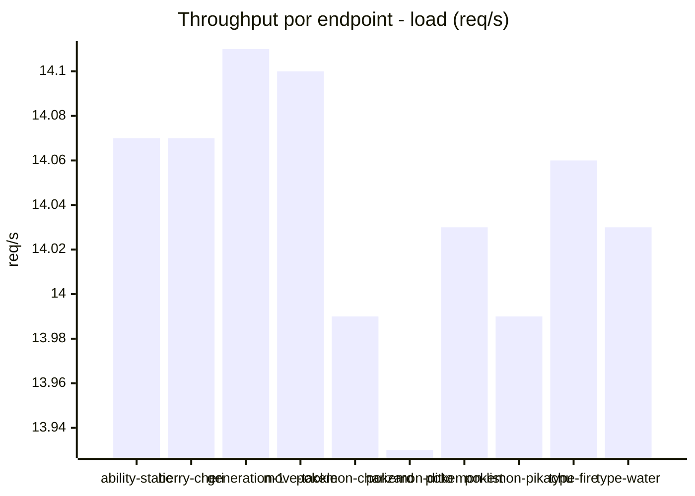
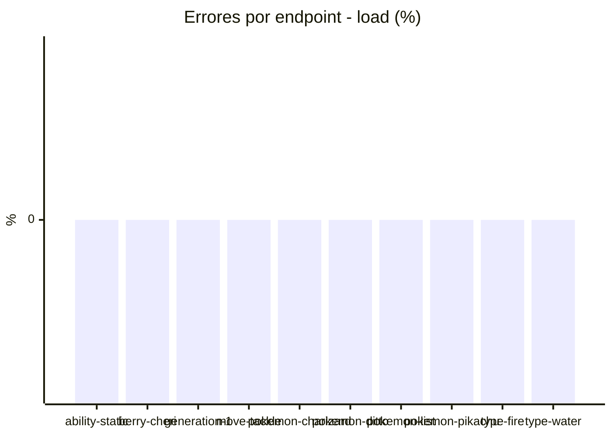
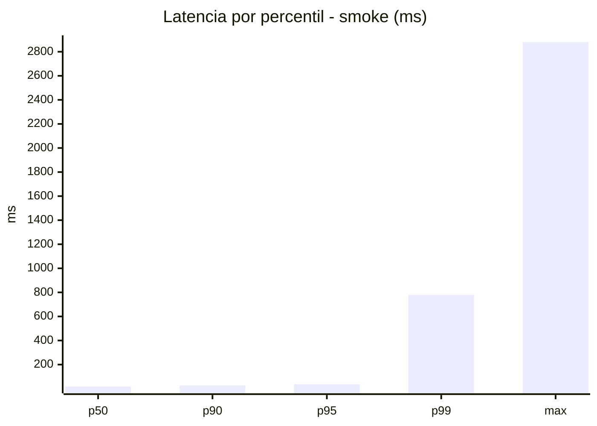
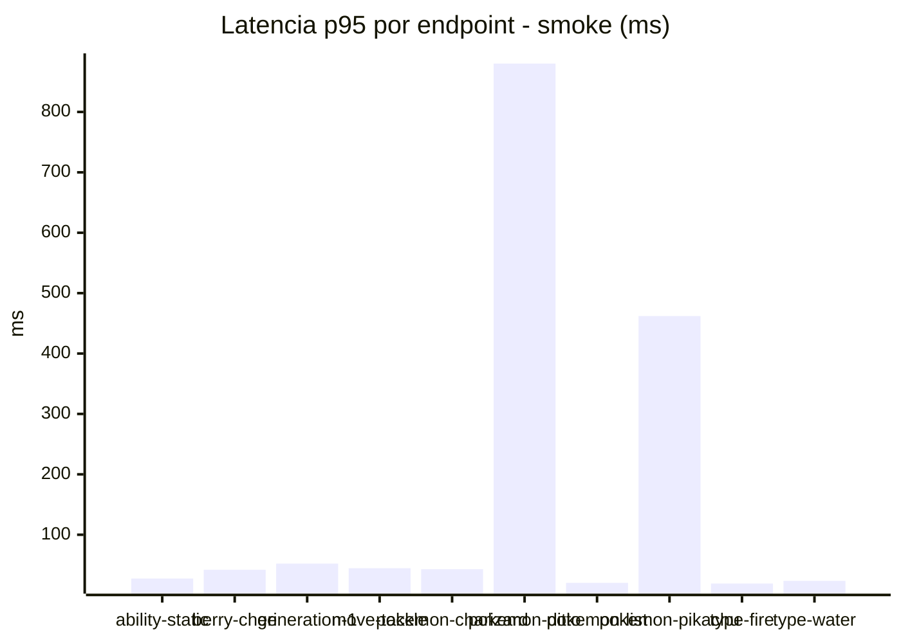
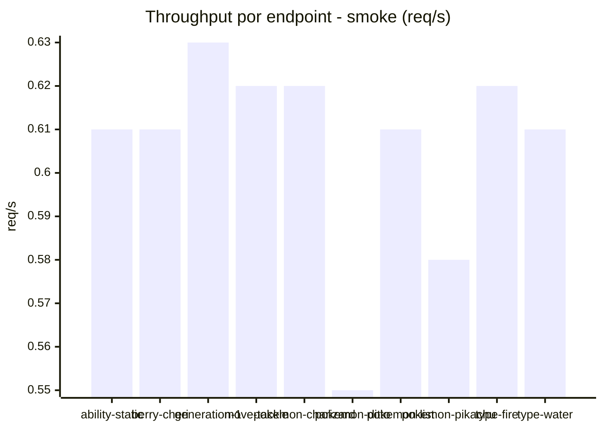

# Reporte de performance - PokeAPI

**Fecha:** 2026-11-19 21:12 UTC  
**Veredicto del agente:** `PASS`  
**Corrida:** [ver en GitHub Actions](https://github.com/lrbg/jmeter-pokeapi-lab/actions/runs/44615837864)  

## Validacion del agente de IA

PASS (fallback por umbrales)

- Error maximo: 0.0%
- p95 maximo: 36.6 ms

## Resultados

### Escenario: `load`

| Metrica | Valor |
| --- | --- |
| Muestras | 16651 |
| Errores | 0 (0.0%) |
| Latencia media | 15.5 ms |
| p50 / p90 / p95 / p99 | 14.0 / 21.0 / 25.0 / 36.0 ms |
| Min / Max | 7 / 253 ms |
| Throughput | 139.23 req/s |
| Duracion | 119.6 s |

Detalle por endpoint

| Endpoint | Muestras | Error % | avg | p95 | p99 | req/s |
| --- | --- | --- | --- | --- | --- | --- |
| ability-static | 1665 | 0.0% | 15.4 | 24.0 | 33.0 | 14.07 |
| berry-cheri | 1665 | 0.0% | 14.4 | 23.0 | 33.0 | 14.07 |
| generation-1 | 1665 | 0.0% | 15.2 | 24.0 | 35.0 | 14.11 |
| move-tackle | 1666 | 0.0% | 16.2 | 26.8 | 39.0 | 14.1 |
| pokemon-charizard | 1665 | 0.0% | 17.5 | 28.0 | 40.0 | 13.99 |
| pokemon-ditto | 1665 | 0.0% | 14.9 | 24.0 | 34.0 | 13.93 |
| pokemon-list | 1665 | 0.0% | 14.4 | 23.0 | 30.0 | 14.03 |
| pokemon-pikachu | 1665 | 0.0% | 16.9 | 27.0 | 40.0 | 13.99 |
| type-fire | 1665 | 0.0% | 14.6 | 23.0 | 35.4 | 14.06 |
| type-water | 1665 | 0.0% | 15.7 | 24.0 | 35.0 | 14.03 |

### Escenario: `smoke`

| Metrica | Valor |
| --- | --- |
| Muestras | 149 |
| Errores | 0 (0.0%) |
| Latencia media | 48.8 ms |
| p50 / p90 / p95 / p99 | 17.0 / 26.2 / 36.6 / 780.1 ms |
| Min / Max | 9 / 2880 ms |
| Throughput | 5.25 req/s |
| Duracion | 28.4 s |

Detalle por endpoint

| Endpoint | Muestras | Error % | avg | p95 | p99 | req/s |
| --- | --- | --- | --- | --- | --- | --- |
| ability-static | 15 | 0.0% | 20 | 27.5 | 30.3 | 0.61 |
| berry-cheri | 15 | 0.0% | 20.5 | 41.9 | 77.2 | 0.61 |
| generation-1 | 14 | 0.0% | 23.1 | 52.2 | 80.8 | 0.63 |
| move-tackle | 15 | 0.0% | 23.7 | 44.6 | 79.3 | 0.62 |
| pokemon-charizard | 15 | 0.0% | 25.7 | 42.9 | 50.2 | 0.62 |
| pokemon-ditto | 15 | 0.0% | 206.9 | 880.1 | 2480.0 | 0.55 |
| pokemon-list | 15 | 0.0% | 15.8 | 20.3 | 20.9 | 0.61 |
| pokemon-pikachu | 15 | 0.0% | 117.5 | 462.1 | 1227.6 | 0.58 |
| type-fire | 15 | 0.0% | 15.2 | 19.2 | 21.4 | 0.62 |
| type-water | 15 | 0.0% | 17.9 | 23.6 | 24.7 | 0.61 |

