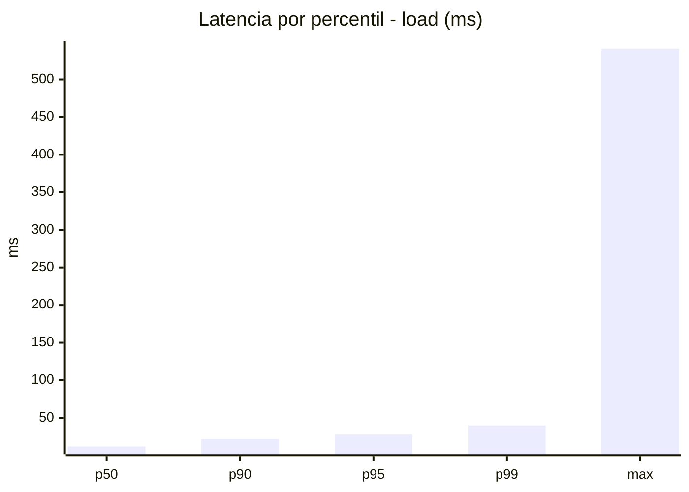
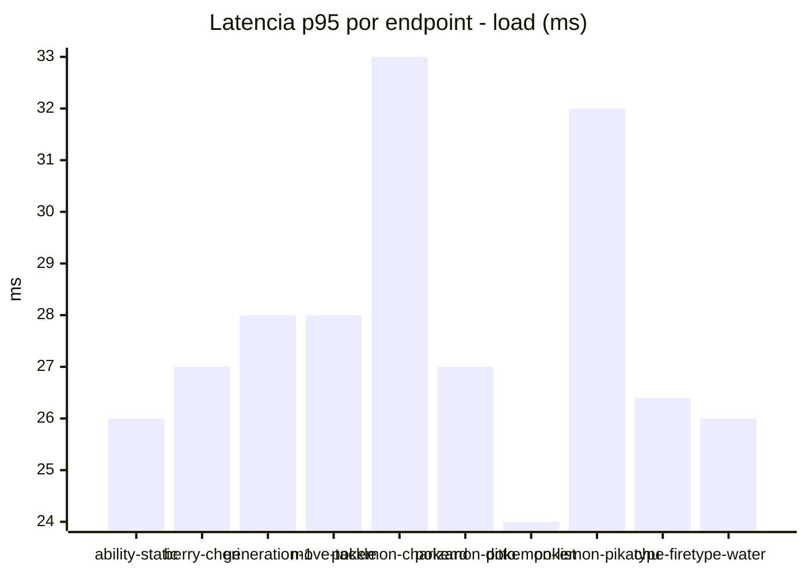
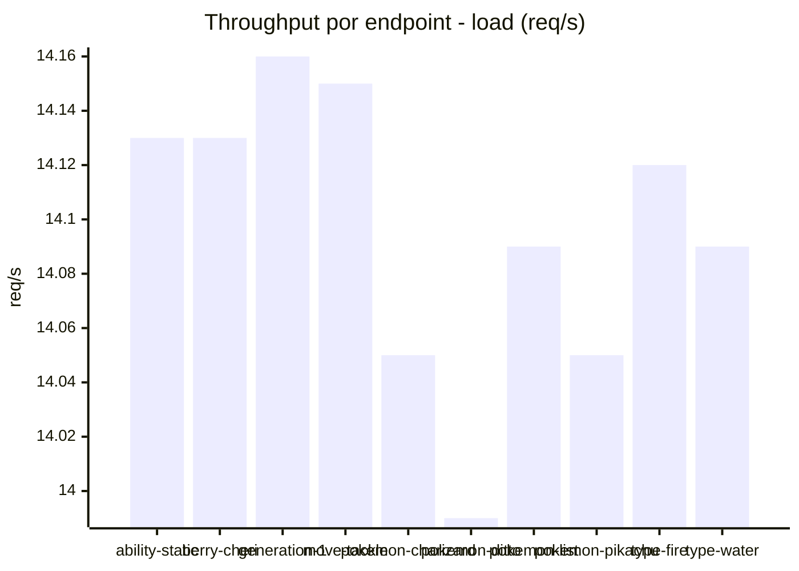
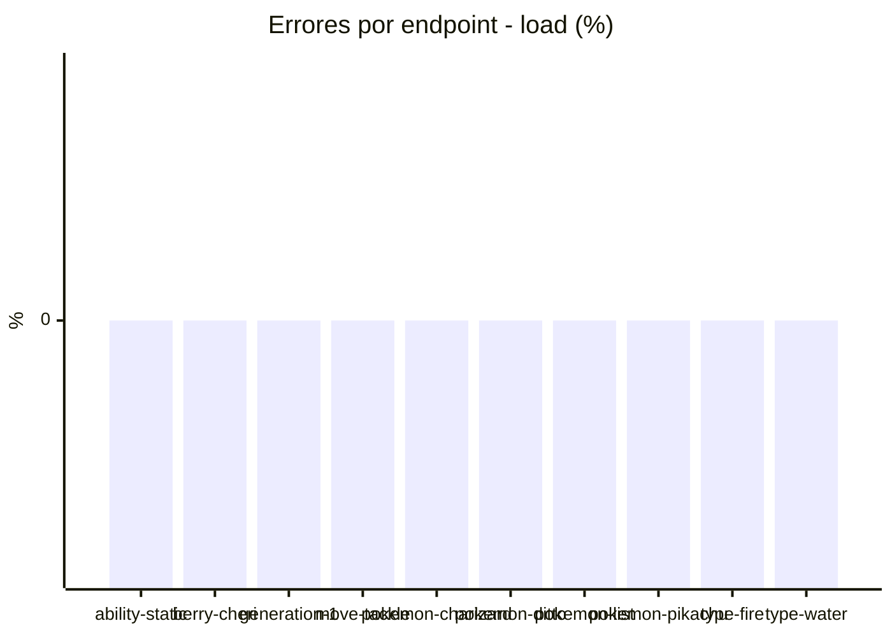
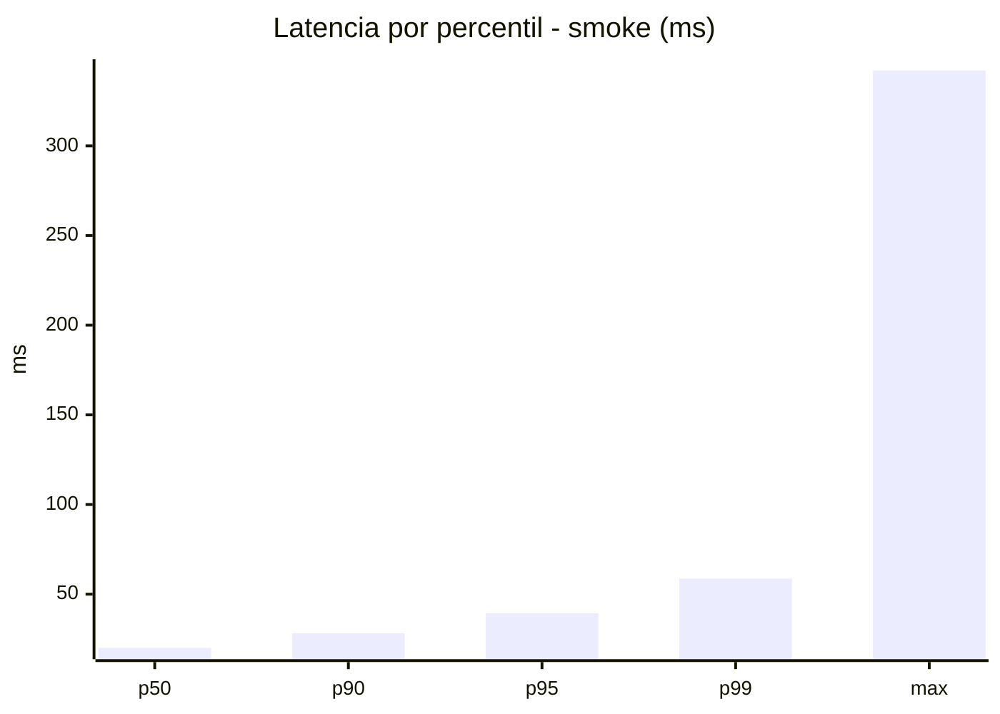
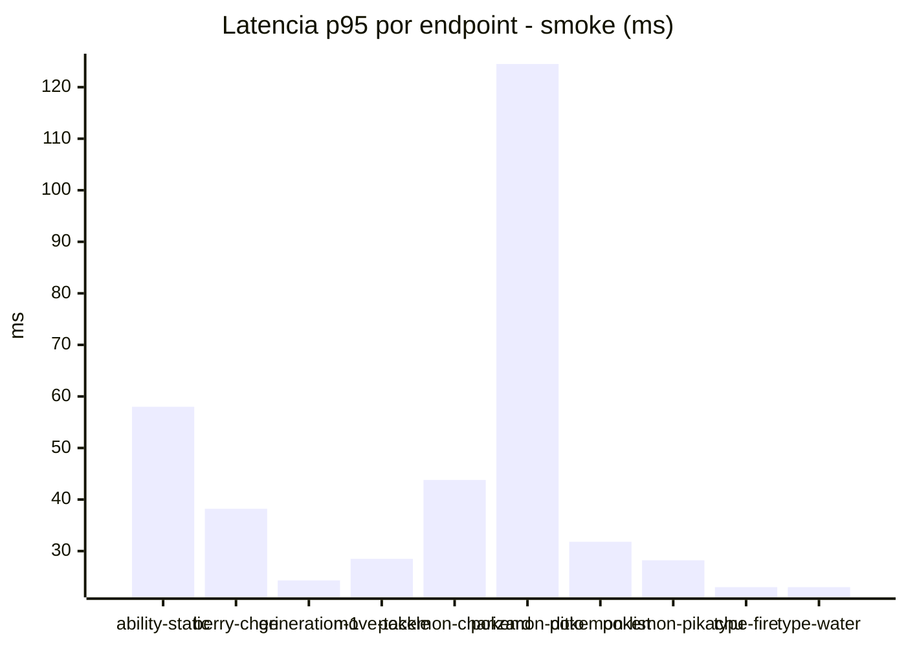
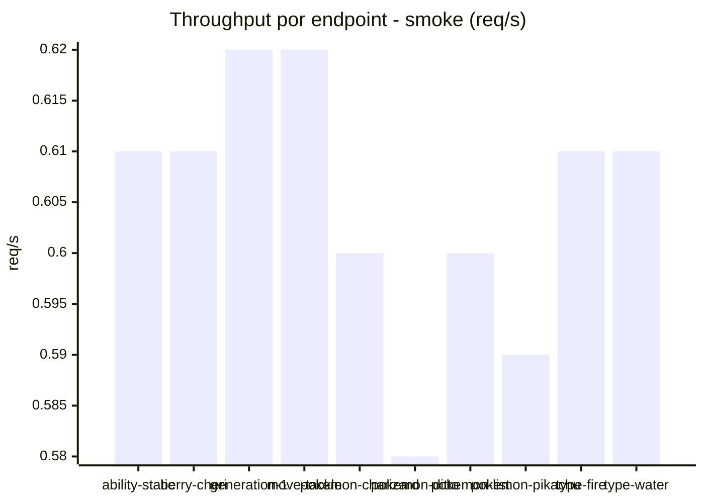

# Reporte de performance - PokeAPI

**Fecha:** 2026-11-20 20:56 UTC  
**Veredicto del agente:** `PASS`  
**Corrida:** [ver en GitHub Actions](https://github.com/lrbg/jmeter-pokeapi-lab/actions/runs/44815464009)  

## Validacion del agente de IA

PASS (fallback por umbrales)

- Error maximo: 0.0%
- p95 maximo: 39.3 ms

## Resultados

### Escenario: `load`

| Metrica | Valor |
| --- | --- |
| Muestras | 16722 |
| Errores | 0 (0.0%) |
| Latencia media | 14.2 ms |
| p50 / p90 / p95 / p99 | 12.0 / 22.0 / 28.0 / 40.0 ms |
| Min / Max | 6 / 541 ms |
| Throughput | 139.79 req/s |
| Duracion | 119.6 s |

Detalle por endpoint

| Endpoint | Muestras | Error % | avg | p95 | p99 | req/s |
| --- | --- | --- | --- | --- | --- | --- |
| ability-static | 1673 | 0.0% | 13.9 | 26.0 | 37.0 | 14.13 |
| berry-cheri | 1673 | 0.0% | 13.5 | 27.0 | 33.3 | 14.13 |
| generation-1 | 1671 | 0.0% | 13.9 | 28.0 | 34.0 | 14.16 |
| move-tackle | 1671 | 0.0% | 14.7 | 28.0 | 37.3 | 14.15 |
| pokemon-charizard | 1673 | 0.0% | 16.8 | 33.0 | 46.0 | 14.05 |
| pokemon-ditto | 1672 | 0.0% | 13.6 | 27.0 | 35.3 | 13.99 |
| pokemon-list | 1672 | 0.0% | 12.6 | 24.0 | 33.3 | 14.09 |
| pokemon-pikachu | 1672 | 0.0% | 15.8 | 32.0 | 46.0 | 14.05 |
| type-fire | 1673 | 0.0% | 13.8 | 26.4 | 35.0 | 14.12 |
| type-water | 1672 | 0.0% | 13.5 | 26.0 | 35.0 | 14.09 |

### Escenario: `smoke`

| Metrica | Valor |
| --- | --- |
| Muestras | 159 |
| Errores | 0 (0.0%) |
| Latencia media | 22.6 ms |
| p50 / p90 / p95 / p99 | 20.0 / 28.2 / 39.3 / 58.7 ms |
| Min / Max | 9 / 342 ms |
| Throughput | 5.49 req/s |
| Duracion | 29.0 s |

Detalle por endpoint

| Endpoint | Muestras | Error % | avg | p95 | p99 | req/s |
| --- | --- | --- | --- | --- | --- | --- |
| ability-static | 16 | 0.0% | 22.7 | 58.0 | 60.4 | 0.61 |
| berry-cheri | 16 | 0.0% | 19.8 | 38.2 | 41.2 | 0.61 |
| generation-1 | 15 | 0.0% | 18.9 | 24.3 | 24.9 | 0.62 |
| move-tackle | 16 | 0.0% | 20.2 | 28.5 | 36.9 | 0.62 |
| pokemon-charizard | 16 | 0.0% | 27.3 | 43.8 | 47.9 | 0.6 |
| pokemon-ditto | 16 | 0.0% | 39.8 | 124.5 | 298.5 | 0.58 |
| pokemon-list | 16 | 0.0% | 19.3 | 31.8 | 50.3 | 0.6 |
| pokemon-pikachu | 16 | 0.0% | 22.9 | 28.2 | 28.9 | 0.59 |
| type-fire | 16 | 0.0% | 17.4 | 23.0 | 23.0 | 0.61 |
| type-water | 16 | 0.0% | 17.2 | 23.0 | 23.0 | 0.61 |

