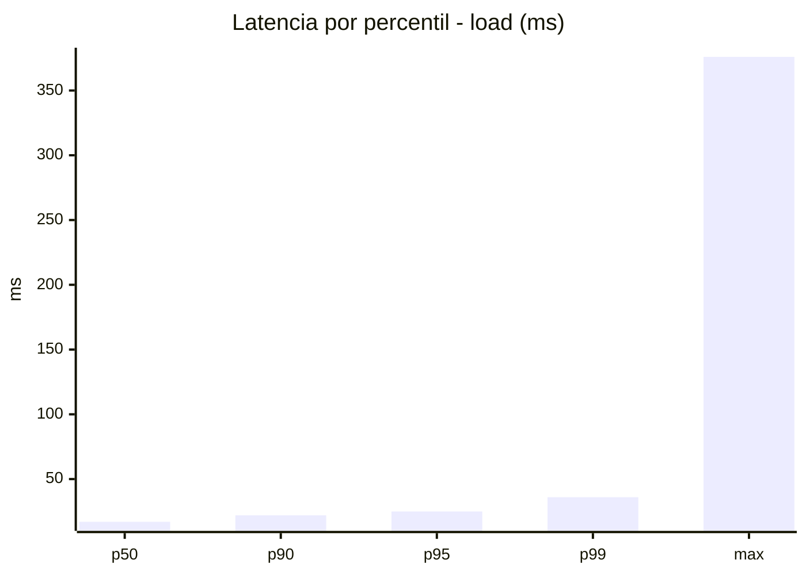
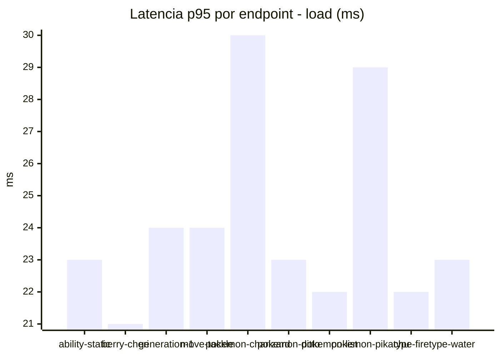
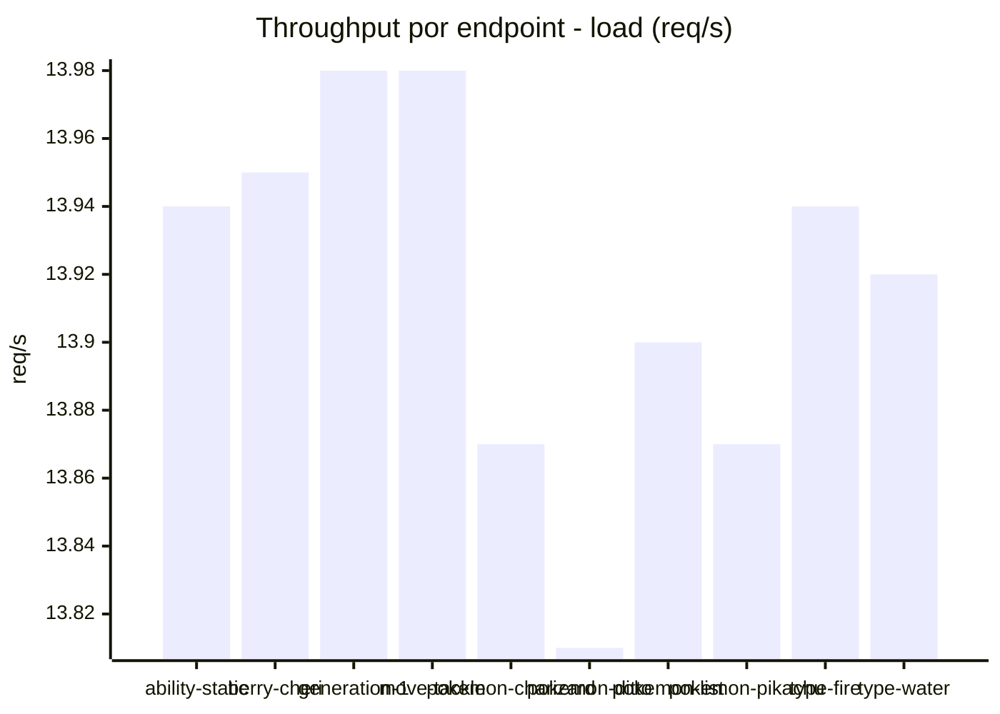
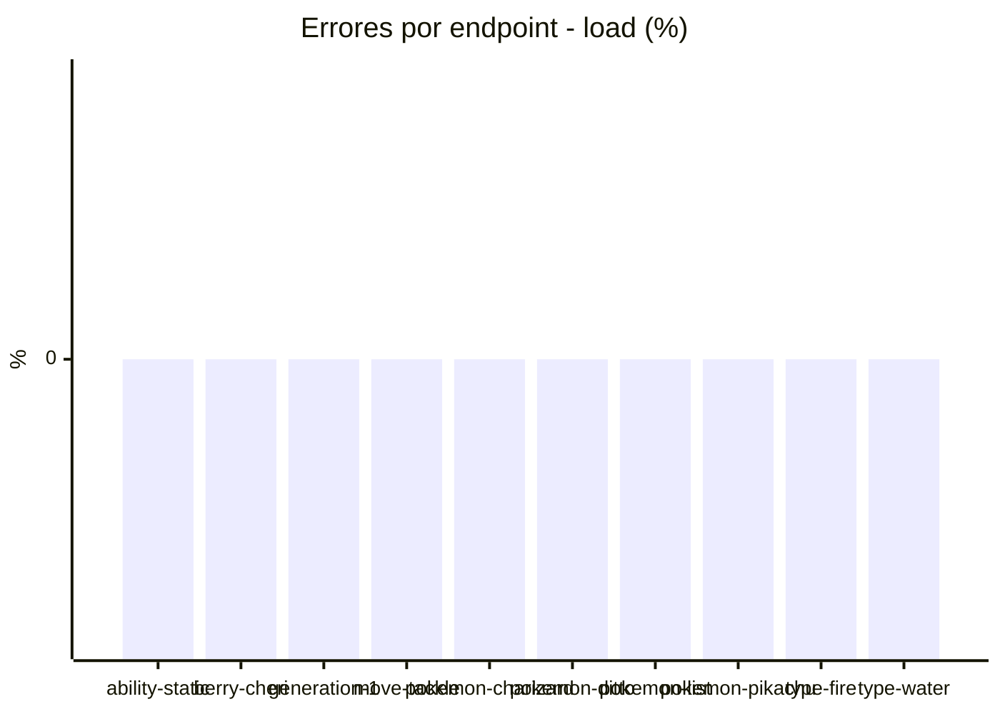
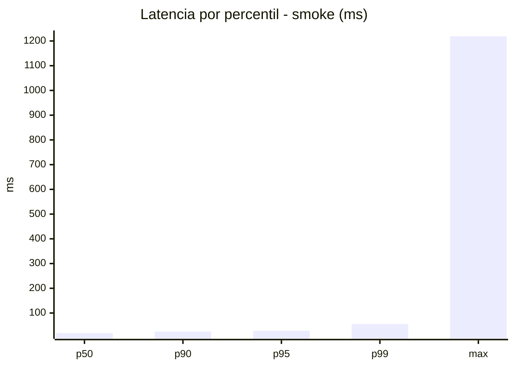
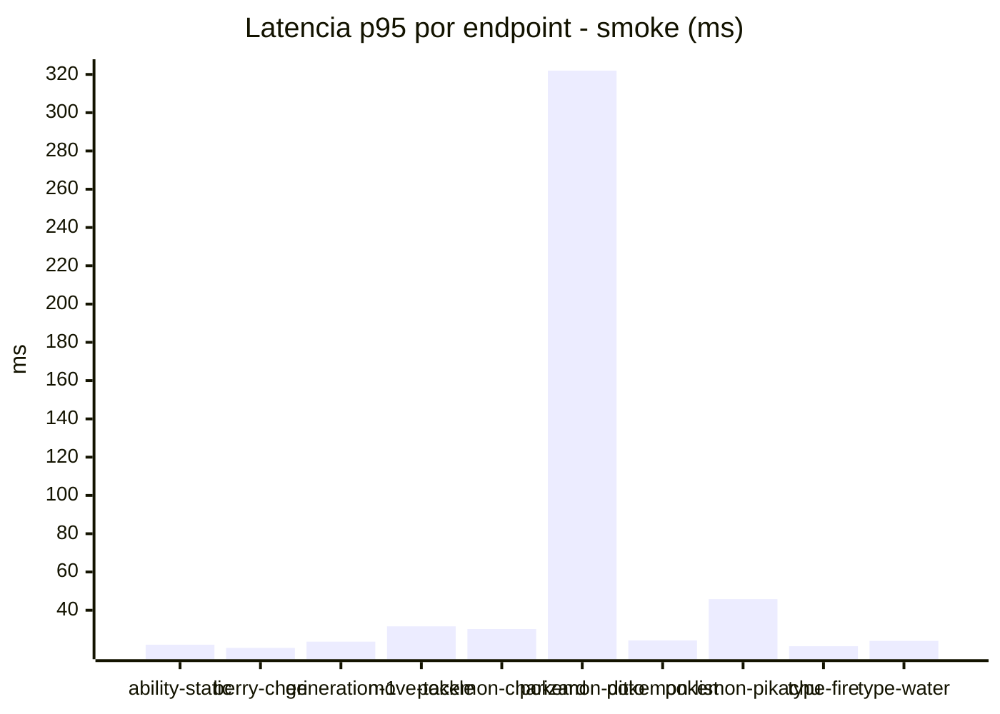
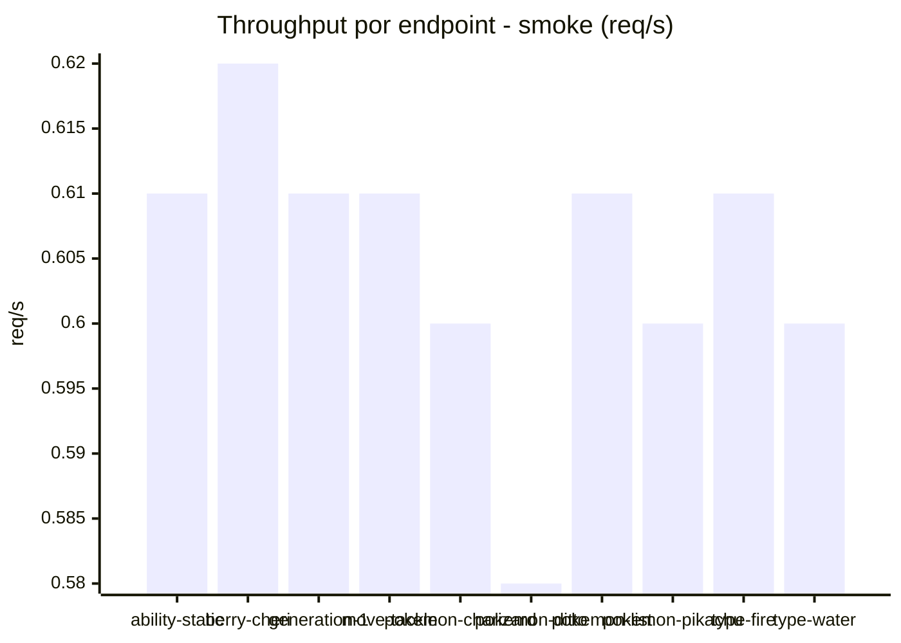

# Reporte de performance - PokeAPI

**Fecha:** 2026-11-21 19:57 UTC  
**Veredicto del agente:** `PASS`  
**Corrida:** [ver en GitHub Actions](https://github.com/lrbg/jmeter-pokeapi-lab/actions/runs/44943443876)  

## Validacion del agente de IA

PASS (fallback por umbrales)

- Error maximo: 0.0%
- p95 maximo: 28.4 ms

## Resultados

### Escenario: `load`

| Metrica | Valor |
| --- | --- |
| Muestras | 16516 |
| Errores | 0 (0.0%) |
| Latencia media | 18.2 ms |
| p50 / p90 / p95 / p99 | 17.0 / 22.0 / 25.0 / 36.0 ms |
| Min / Max | 11 / 376 ms |
| Throughput | 138.07 req/s |
| Duracion | 119.6 s |

Detalle por endpoint

| Endpoint | Muestras | Error % | avg | p95 | p99 | req/s |
| --- | --- | --- | --- | --- | --- | --- |
| ability-static | 1651 | 0.0% | 17.5 | 23.0 | 33.0 | 13.94 |
| berry-cheri | 1651 | 0.0% | 16.3 | 21.0 | 32.5 | 13.95 |
| generation-1 | 1651 | 0.0% | 17.8 | 24.0 | 33.0 | 13.98 |
| move-tackle | 1651 | 0.0% | 18.1 | 24.0 | 33.0 | 13.98 |
| pokemon-charizard | 1652 | 0.0% | 21.9 | 30.0 | 50.0 | 13.87 |
| pokemon-ditto | 1652 | 0.0% | 17.5 | 23.0 | 36.0 | 13.81 |
| pokemon-list | 1652 | 0.0% | 16.8 | 22.0 | 31.0 | 13.9 |
| pokemon-pikachu | 1652 | 0.0% | 21.5 | 29.0 | 50.0 | 13.87 |
| type-fire | 1652 | 0.0% | 16.7 | 22.0 | 28.0 | 13.94 |
| type-water | 1652 | 0.0% | 17.6 | 23.0 | 36.5 | 13.92 |

### Escenario: `smoke`

| Metrica | Valor |
| --- | --- |
| Muestras | 157 |
| Errores | 0 (0.0%) |
| Latencia media | 27.9 ms |
| p50 / p90 / p95 / p99 | 19.0 / 25.0 / 28.4 / 55.4 ms |
| Min / Max | 14 / 1219 ms |
| Throughput | 5.45 req/s |
| Duracion | 28.8 s |

Detalle por endpoint

| Endpoint | Muestras | Error % | avg | p95 | p99 | req/s |
| --- | --- | --- | --- | --- | --- | --- |
| ability-static | 16 | 0.0% | 18.5 | 22.0 | 22.0 | 0.61 |
| berry-cheri | 15 | 0.0% | 17.2 | 20.3 | 20.9 | 0.62 |
| generation-1 | 15 | 0.0% | 19.3 | 23.6 | 24.7 | 0.61 |
| move-tackle | 15 | 0.0% | 20.5 | 31.6 | 43.9 | 0.61 |
| pokemon-charizard | 16 | 0.0% | 23.8 | 30.2 | 35.6 | 0.6 |
| pokemon-ditto | 16 | 0.0% | 93.1 | 322.0 | 1039.6 | 0.58 |
| pokemon-list | 16 | 0.0% | 19 | 24.2 | 24.9 | 0.61 |
| pokemon-pikachu | 16 | 0.0% | 28.4 | 45.8 | 61.9 | 0.6 |
| type-fire | 16 | 0.0% | 17.8 | 21.2 | 24.2 | 0.61 |
| type-water | 16 | 0.0% | 19.5 | 24.0 | 24.0 | 0.6 |

