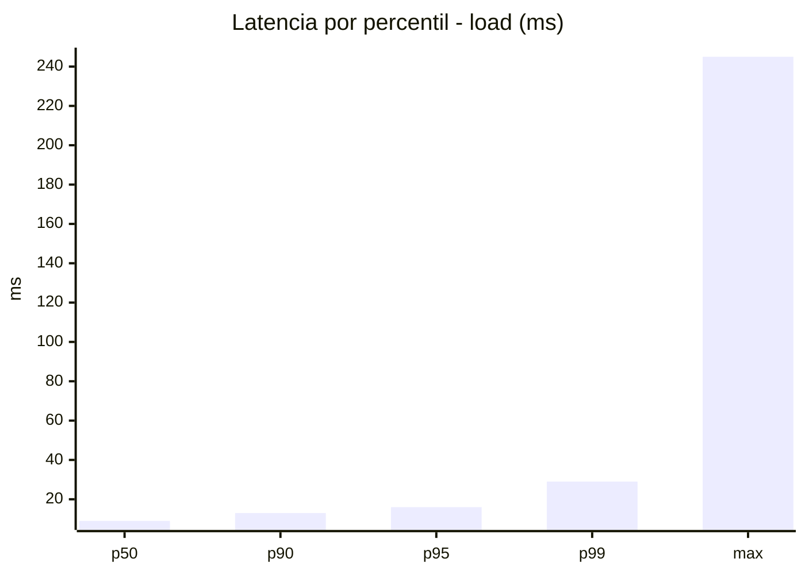
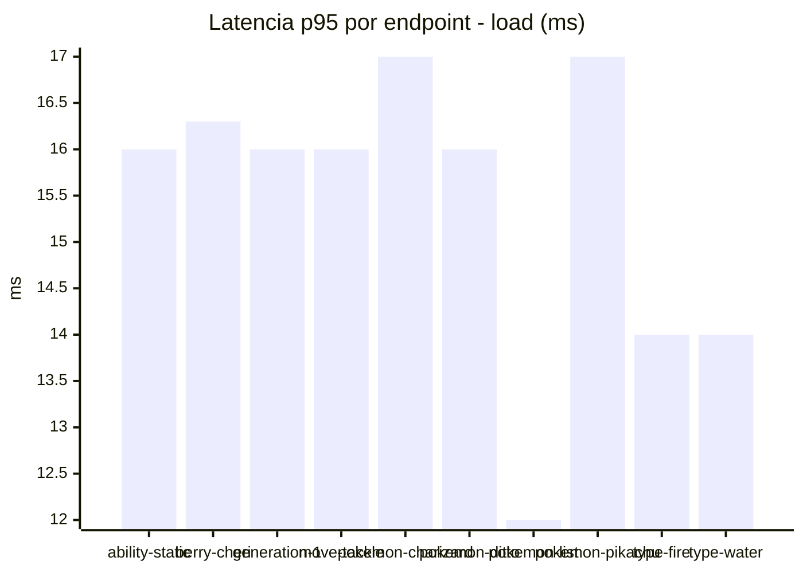
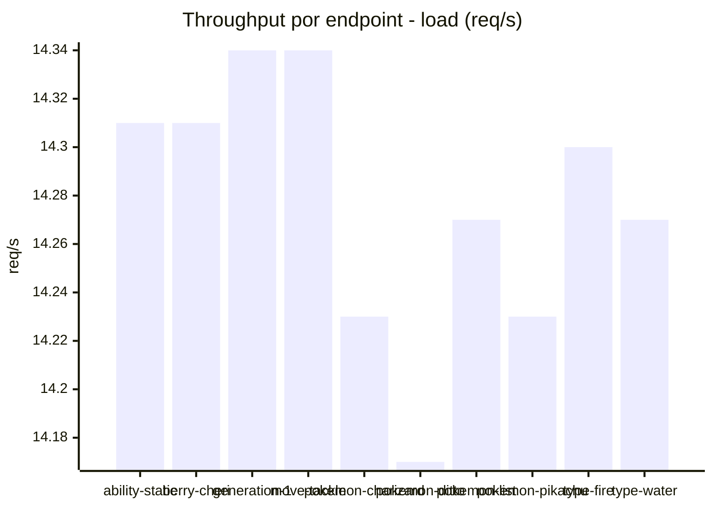
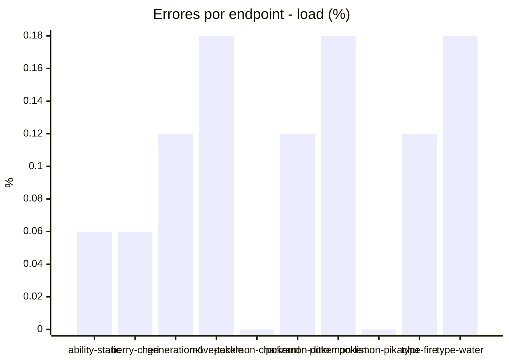
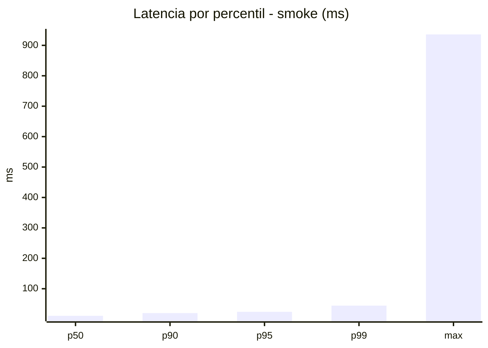
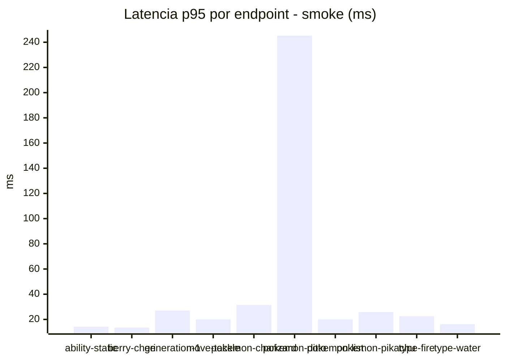
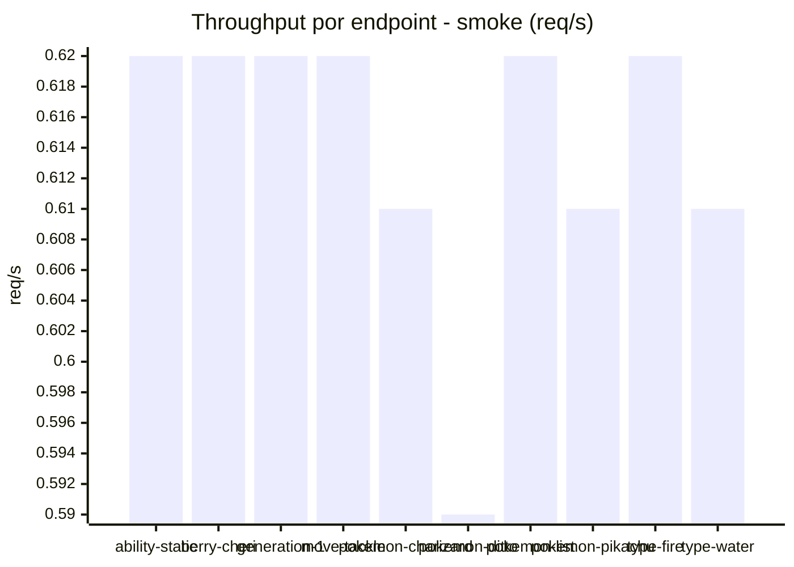
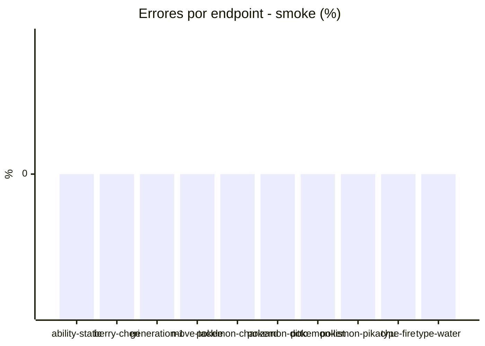

# Reporte de performance - PokeAPI

**Fecha:** 2026-11-22 20:09 UTC  
**Veredicto del agente:** `PASS`  
**Corrida:** [ver en GitHub Actions](https://github.com/lrbg/jmeter-pokeapi-lab/actions/runs/45064563526)  

## Validacion del agente de IA

PASS (fallback por umbrales)

- Error maximo: 0.1%
- p95 maximo: 24.0 ms

## Resultados

### Escenario: `load`

| Metrica | Valor |
| --- | --- |
| Muestras | 16944 |
| Errores | 17 (0.1%) |
| Latencia media | 10.2 ms |
| p50 / p90 / p95 / p99 | 9.0 / 13.0 / 16.0 / 29.0 ms |
| Min / Max | 0 / 245 ms |
| Throughput | 141.63 req/s |
| Duracion | 119.6 s |

Detalle por endpoint

| Endpoint | Muestras | Error % | avg | p95 | p99 | req/s |
| --- | --- | --- | --- | --- | --- | --- |
| ability-static | 1694 | 0.06% | 9.8 | 16.0 | 30.0 | 14.31 |
| berry-cheri | 1694 | 0.06% | 9.7 | 16.3 | 36.1 | 14.31 |
| generation-1 | 1694 | 0.12% | 9.8 | 16.0 | 27.0 | 14.34 |
| move-tackle | 1694 | 0.18% | 10.3 | 16.0 | 30.0 | 14.34 |
| pokemon-charizard | 1695 | 0.0% | 12.3 | 17.0 | 27.0 | 14.23 |
| pokemon-ditto | 1695 | 0.12% | 10.1 | 16.0 | 36.0 | 14.17 |
| pokemon-list | 1694 | 0.18% | 8.7 | 12.0 | 21.0 | 14.27 |
| pokemon-pikachu | 1695 | 0.0% | 11.8 | 17.0 | 28.1 | 14.23 |
| type-fire | 1695 | 0.12% | 9.6 | 14.0 | 27.1 | 14.3 |
| type-water | 1694 | 0.18% | 9.5 | 14.0 | 26.0 | 14.27 |

### Escenario: `smoke`

| Metrica | Valor |
| --- | --- |
| Muestras | 160 |
| Errores | 0 (0.0%) |
| Latencia media | 18.9 ms |
| p50 / p90 / p95 / p99 | 11.0 / 20.0 / 24.0 / 44.5 ms |
| Min / Max | 7 / 936 ms |
| Throughput | 5.54 req/s |
| Duracion | 28.9 s |

Detalle por endpoint

| Endpoint | Muestras | Error % | avg | p95 | p99 | req/s |
| --- | --- | --- | --- | --- | --- | --- |
| ability-static | 16 | 0.0% | 10.7 | 14.2 | 14.8 | 0.62 |
| berry-cheri | 16 | 0.0% | 9.6 | 13.5 | 14.7 | 0.62 |
| generation-1 | 16 | 0.0% | 13.2 | 27.0 | 27.0 | 0.62 |
| move-tackle | 16 | 0.0% | 13 | 20.0 | 22.4 | 0.62 |
| pokemon-charizard | 16 | 0.0% | 20.8 | 31.5 | 44.7 | 0.61 |
| pokemon-ditto | 16 | 0.0% | 68.6 | 245.2 | 797.8 | 0.59 |
| pokemon-list | 16 | 0.0% | 12 | 20.0 | 22.4 | 0.62 |
| pokemon-pikachu | 16 | 0.0% | 17.6 | 25.8 | 29.9 | 0.61 |
| type-fire | 16 | 0.0% | 13.1 | 22.5 | 38.1 | 0.62 |
| type-water | 16 | 0.0% | 10.8 | 16.2 | 16.9 | 0.61 |

