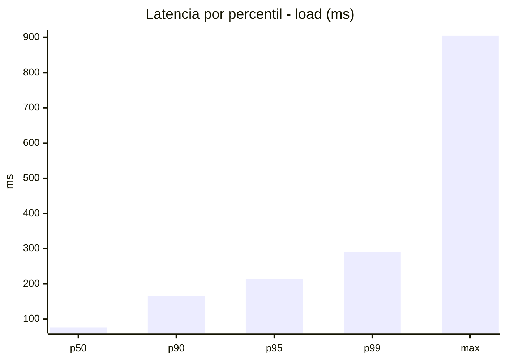
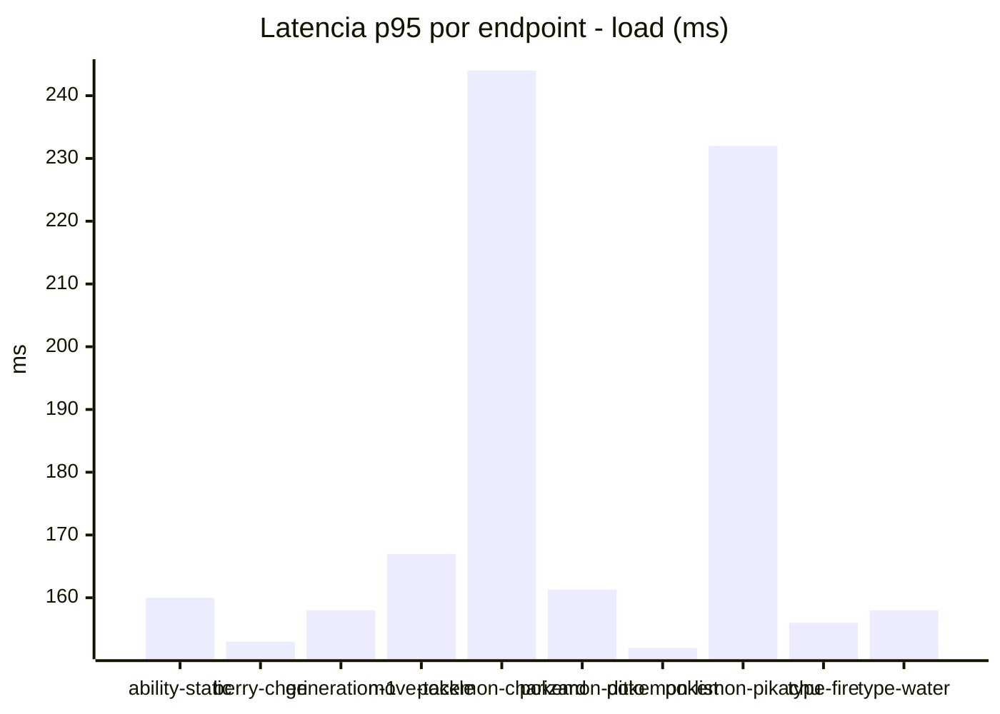
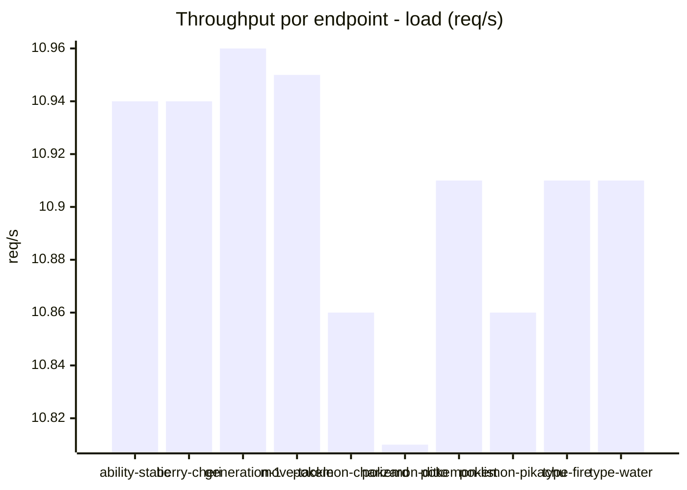
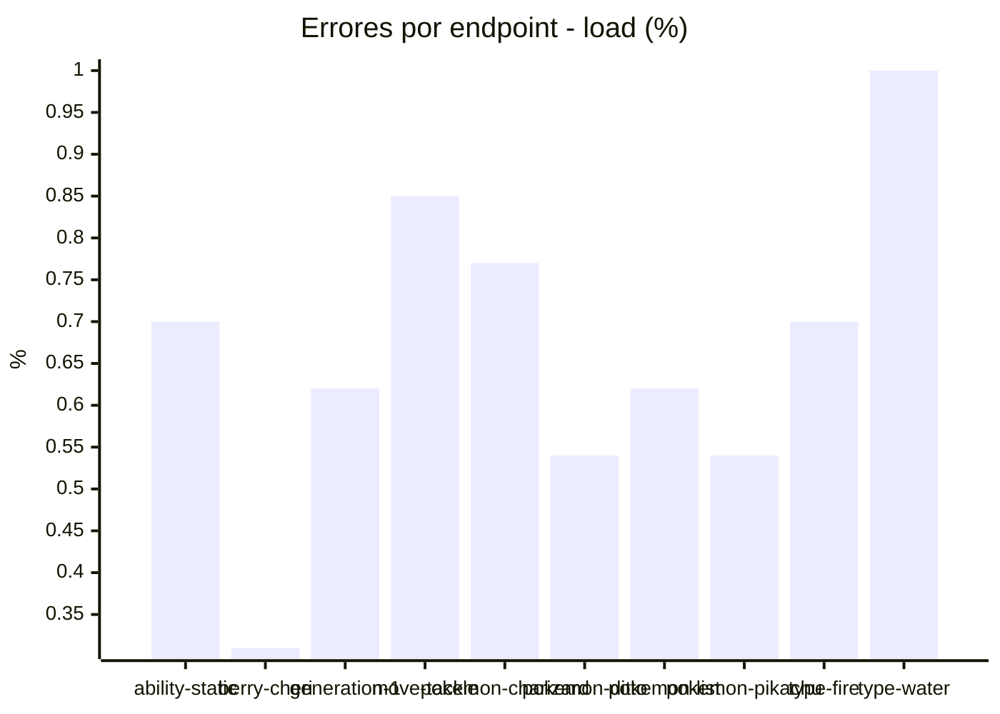
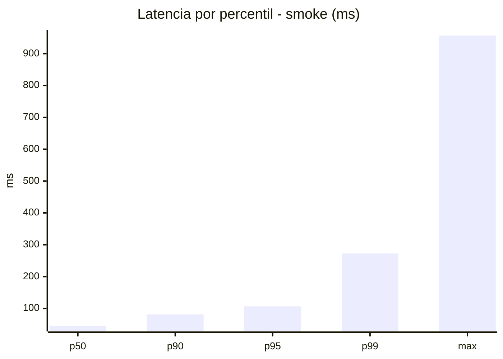
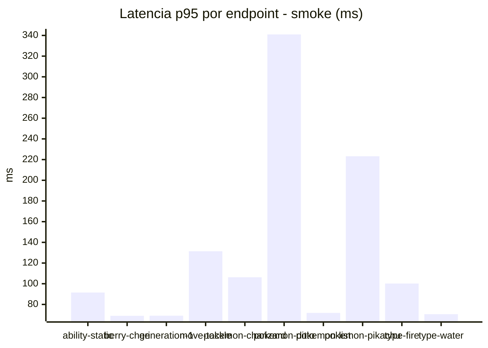
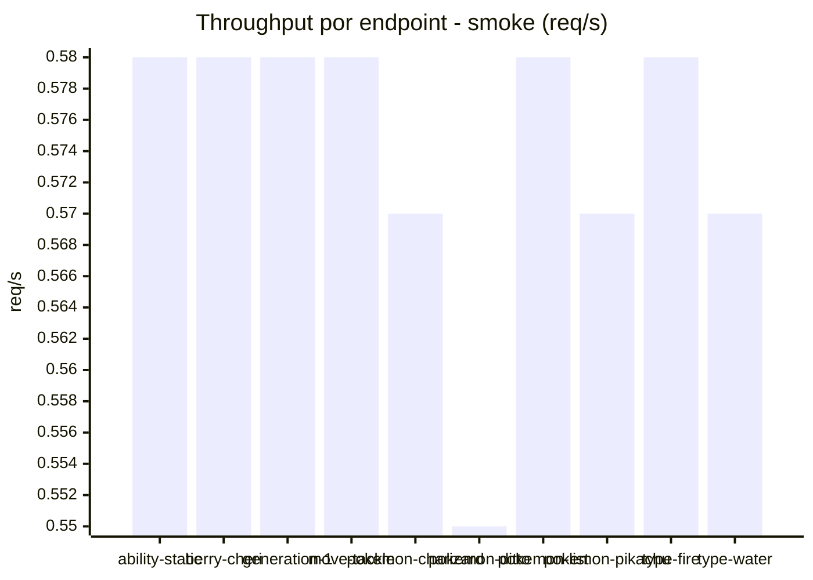
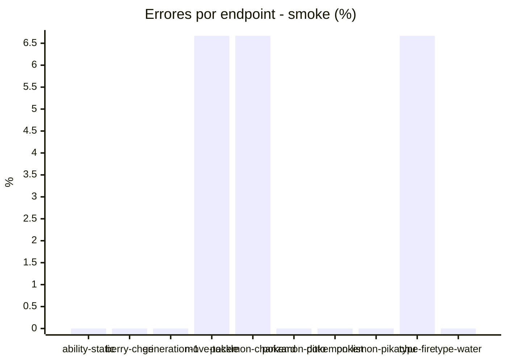

# Reporte de performance - PokeAPI

**Fecha:** 2026-11-24 00:36 UTC  
**Veredicto del agente:** `FAIL`  
**Corrida:** [ver en GitHub Actions](https://github.com/lrbg/jmeter-pokeapi-lab/actions/runs/45298108453)  

## Validacion del agente de IA

FAIL (fallback por umbrales)

- Error maximo: 2.0%
- p95 maximo: 214.0 ms

## Resultados

### Escenario: `load`

| Metrica | Valor |
| --- | --- |
| Muestras | 12939 |
| Errores | 86 (0.66%) |
| Latencia media | 106.4 ms |
| p50 / p90 / p95 / p99 | 76.0 / 165.0 / 214.0 / 290.0 ms |
| Min / Max | 0 / 905 ms |
| Throughput | 108.03 req/s |
| Duracion | 119.8 s |

Detalle por endpoint

| Endpoint | Muestras | Error % | avg | p95 | p99 | req/s |
| --- | --- | --- | --- | --- | --- | --- |
| ability-static | 1294 | 0.7% | 97.3 | 160.0 | 175.0 | 10.94 |
| berry-cheri | 1294 | 0.31% | 95.1 | 153.0 | 159.2 | 10.94 |
| generation-1 | 1293 | 0.62% | 97.4 | 158.0 | 167.1 | 10.96 |
| move-tackle | 1294 | 0.85% | 103.8 | 167.0 | 202.1 | 10.95 |
| pokemon-charizard | 1294 | 0.77% | 148.2 | 244.0 | 524.0 | 10.86 |
| pokemon-ditto | 1294 | 0.54% | 98.4 | 161.3 | 183.1 | 10.81 |
| pokemon-list | 1294 | 0.62% | 93.3 | 152.0 | 167.3 | 10.91 |
| pokemon-pikachu | 1294 | 0.54% | 137.6 | 232.0 | 492.3 | 10.86 |
| type-fire | 1294 | 0.7% | 95.8 | 156.0 | 164.0 | 10.91 |
| type-water | 1294 | 1.0% | 97.1 | 158.0 | 171.1 | 10.91 |

### Escenario: `smoke`

| Metrica | Valor |
| --- | --- |
| Muestras | 150 |
| Errores | 3 (2.0%) |
| Latencia media | 56.3 ms |
| p50 / p90 / p95 / p99 | 45.5 / 81.2 / 106.5 / 272.7 ms |
| Min / Max | 15 / 957 ms |
| Throughput | 5.15 req/s |
| Duracion | 29.1 s |

Detalle por endpoint

| Endpoint | Muestras | Error % | avg | p95 | p99 | req/s |
| --- | --- | --- | --- | --- | --- | --- |
| ability-static | 15 | 0.0% | 42.6 | 91.5 | 127.9 | 0.58 |
| berry-cheri | 15 | 0.0% | 37.6 | 69.0 | 69.0 | 0.58 |
| generation-1 | 15 | 0.0% | 36.5 | 69.1 | 78.6 | 0.58 |
| move-tackle | 15 | 6.67% | 69.1 | 131.4 | 236.7 | 0.58 |
| pokemon-charizard | 15 | 6.67% | 57.1 | 106.3 | 106.9 | 0.57 |
| pokemon-ditto | 15 | 0.0% | 100.5 | 341.0 | 833.8 | 0.55 |
| pokemon-list | 15 | 0.0% | 37.5 | 71.8 | 80.8 | 0.58 |
| pokemon-pikachu | 15 | 0.0% | 86.5 | 223.2 | 270.2 | 0.57 |
| type-fire | 15 | 6.67% | 55 | 100.2 | 147.2 | 0.58 |
| type-water | 15 | 0.0% | 40.6 | 70.6 | 71.7 | 0.57 |

