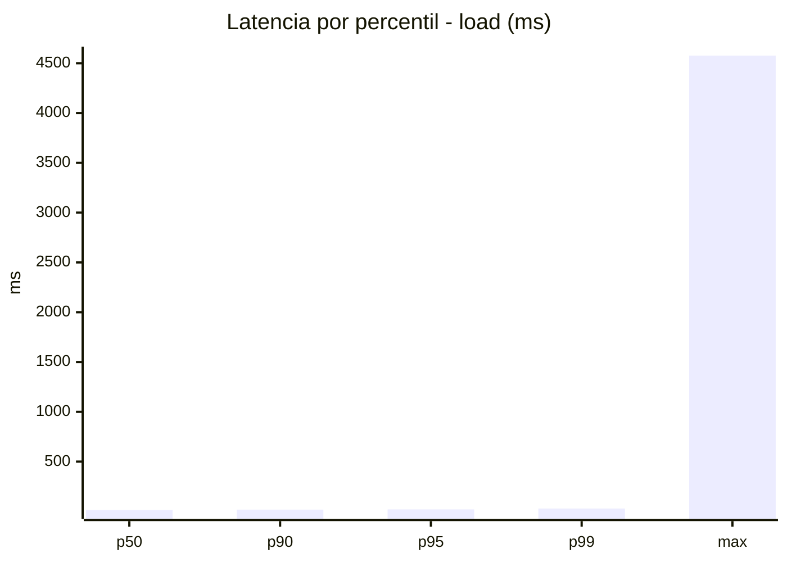
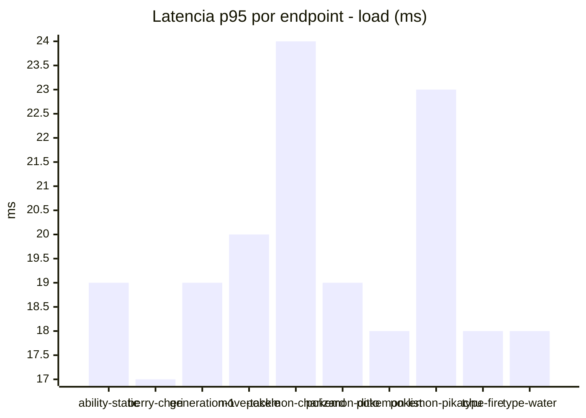
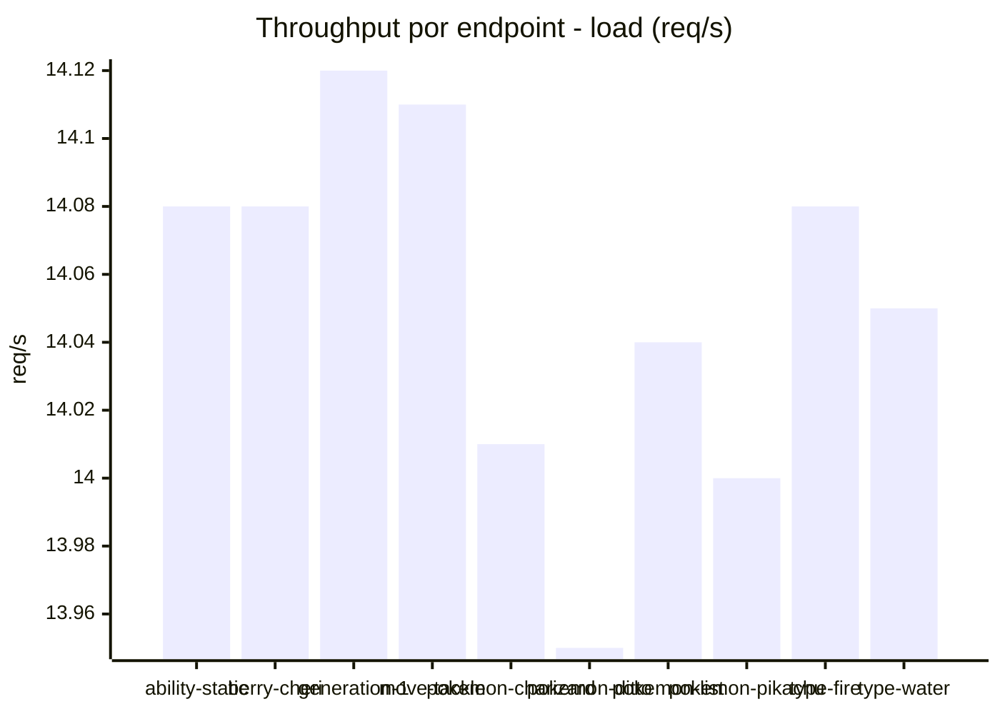
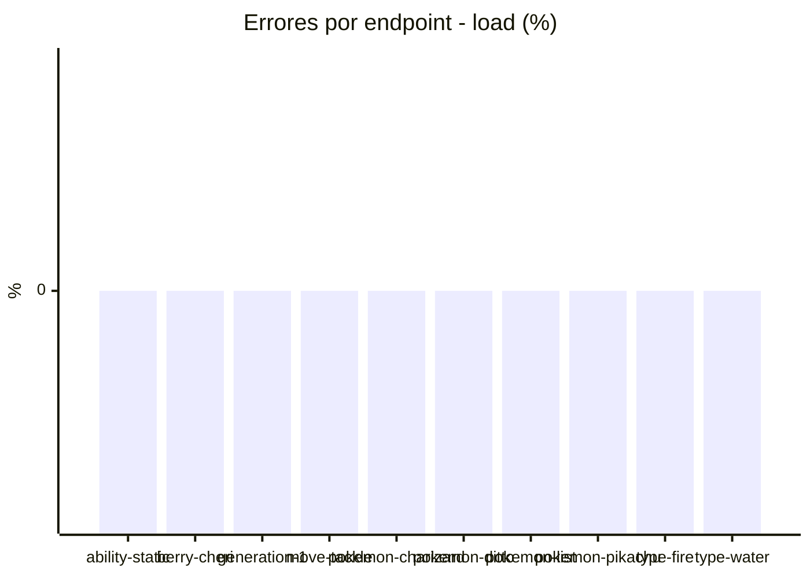
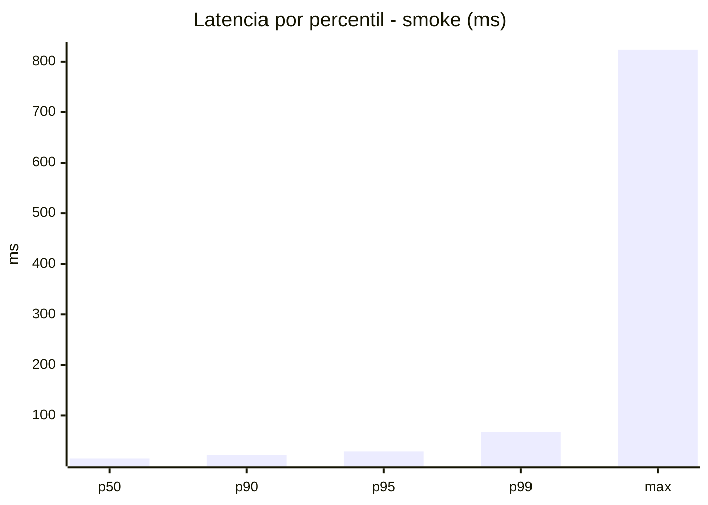
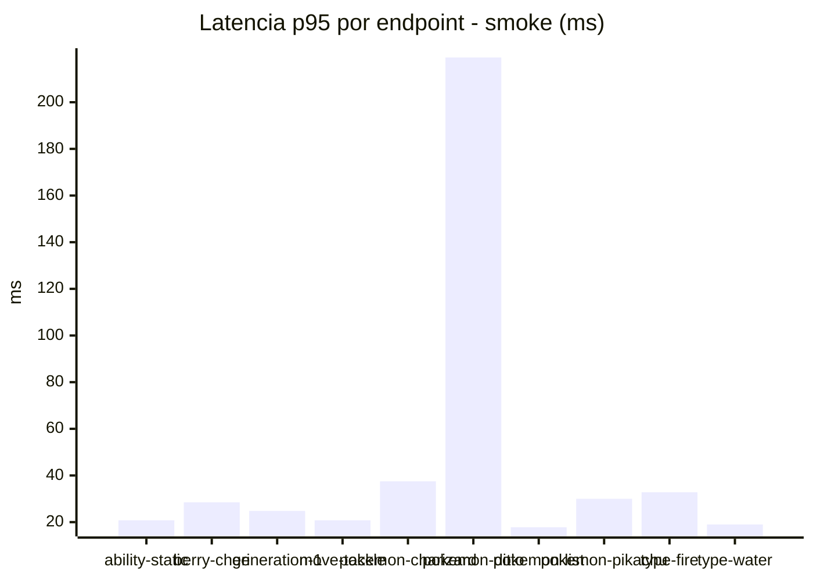
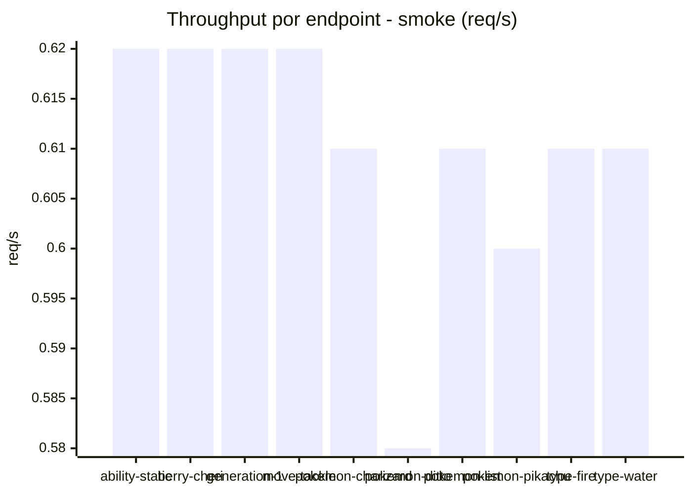

# Reporte de performance - PokeAPI

**Fecha:** 2026-11-24 22:55 UTC  
**Veredicto del agente:** `PASS`  
**Corrida:** [ver en GitHub Actions](https://github.com/lrbg/jmeter-pokeapi-lab/actions/runs/45505048005)  

## Validacion del agente de IA

PASS (fallback por umbrales)

- Error maximo: 0.0%
- p95 maximo: 28.1 ms

## Resultados

### Escenario: `load`

| Metrica | Valor |
| --- | --- |
| Muestras | 16678 |
| Errores | 0 (0.0%) |
| Latencia media | 15.2 ms |
| p50 / p90 / p95 / p99 | 14.0 / 18.0 / 20.0 / 29.0 ms |
| Min / Max | 9 / 4577 ms |
| Throughput | 139.38 req/s |
| Duracion | 119.7 s |

Detalle por endpoint

| Endpoint | Muestras | Error % | avg | p95 | p99 | req/s |
| --- | --- | --- | --- | --- | --- | --- |
| ability-static | 1667 | 0.0% | 17.2 | 19.0 | 31.0 | 14.08 |
| berry-cheri | 1667 | 0.0% | 13.0 | 17.0 | 24.3 | 14.08 |
| generation-1 | 1668 | 0.0% | 16.5 | 19.0 | 30.0 | 14.12 |
| move-tackle | 1667 | 0.0% | 15.0 | 20.0 | 35.0 | 14.11 |
| pokemon-charizard | 1668 | 0.0% | 18.1 | 24.0 | 31.0 | 14.01 |
| pokemon-ditto | 1669 | 0.0% | 14.0 | 19.0 | 29.3 | 13.95 |
| pokemon-list | 1668 | 0.0% | 13.8 | 18.0 | 27.0 | 14.04 |
| pokemon-pikachu | 1668 | 0.0% | 16.6 | 23.0 | 30.3 | 14.0 |
| type-fire | 1669 | 0.0% | 13.8 | 18.0 | 26.3 | 14.08 |
| type-water | 1667 | 0.0% | 13.7 | 18.0 | 25.0 | 14.05 |

### Escenario: `smoke`

| Metrica | Valor |
| --- | --- |
| Muestras | 160 |
| Errores | 0 (0.0%) |
| Latencia media | 22.2 ms |
| p50 / p90 / p95 / p99 | 15.0 / 22.0 / 28.1 / 66.8 ms |
| Min / Max | 11 / 823 ms |
| Throughput | 5.49 req/s |
| Duracion | 29.2 s |

Detalle por endpoint

| Endpoint | Muestras | Error % | avg | p95 | p99 | req/s |
| --- | --- | --- | --- | --- | --- | --- |
| ability-static | 16 | 0.0% | 15.6 | 20.8 | 22.5 | 0.62 |
| berry-cheri | 16 | 0.0% | 16.5 | 28.5 | 58.5 | 0.62 |
| generation-1 | 16 | 0.0% | 16.5 | 24.8 | 40.9 | 0.62 |
| move-tackle | 16 | 0.0% | 16.9 | 20.8 | 22.5 | 0.62 |
| pokemon-charizard | 16 | 0.0% | 23.4 | 37.5 | 53.1 | 0.61 |
| pokemon-ditto | 16 | 0.0% | 64.8 | 219.2 | 702.2 | 0.58 |
| pokemon-list | 16 | 0.0% | 14.1 | 17.8 | 19.5 | 0.61 |
| pokemon-pikachu | 16 | 0.0% | 21.9 | 30.0 | 34.8 | 0.6 |
| type-fire | 16 | 0.0% | 17.9 | 32.8 | 60.9 | 0.61 |
| type-water | 16 | 0.0% | 14.2 | 19.0 | 28.6 | 0.61 |

