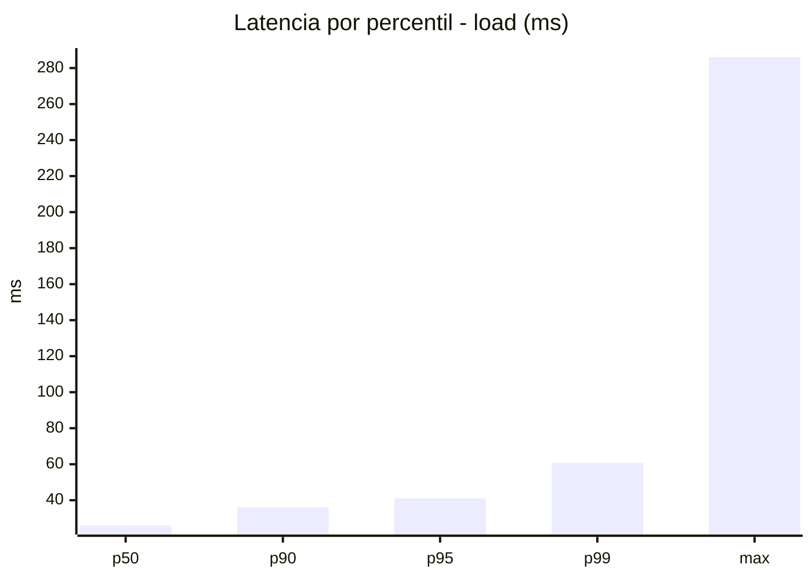
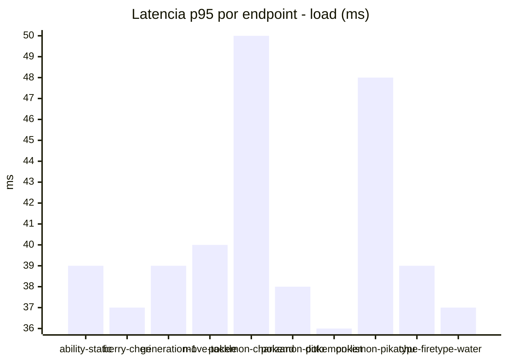
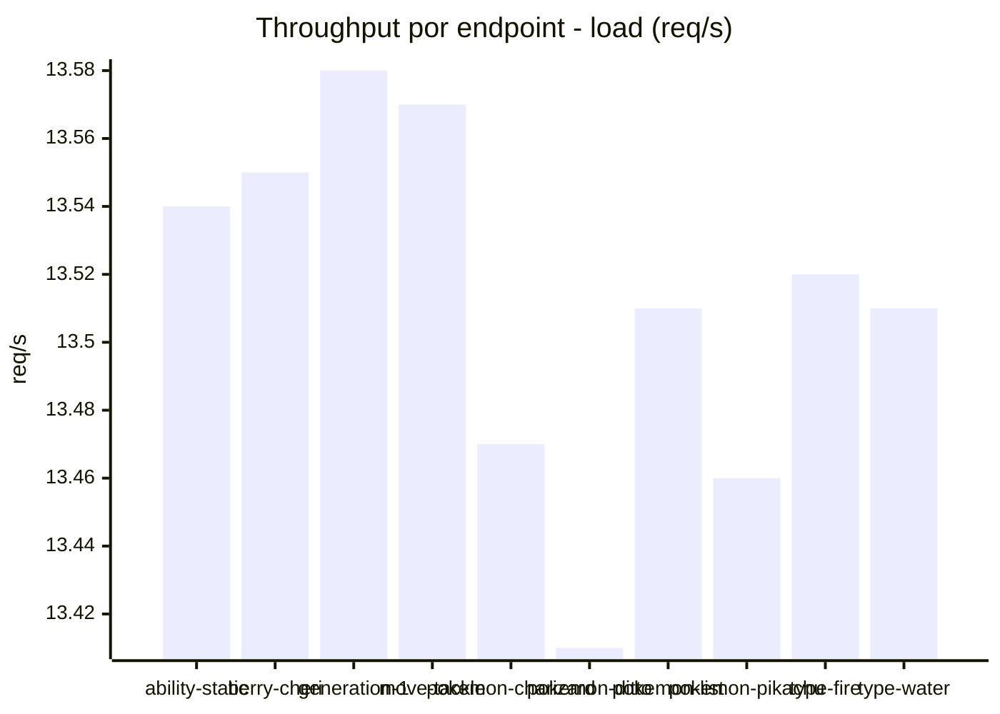
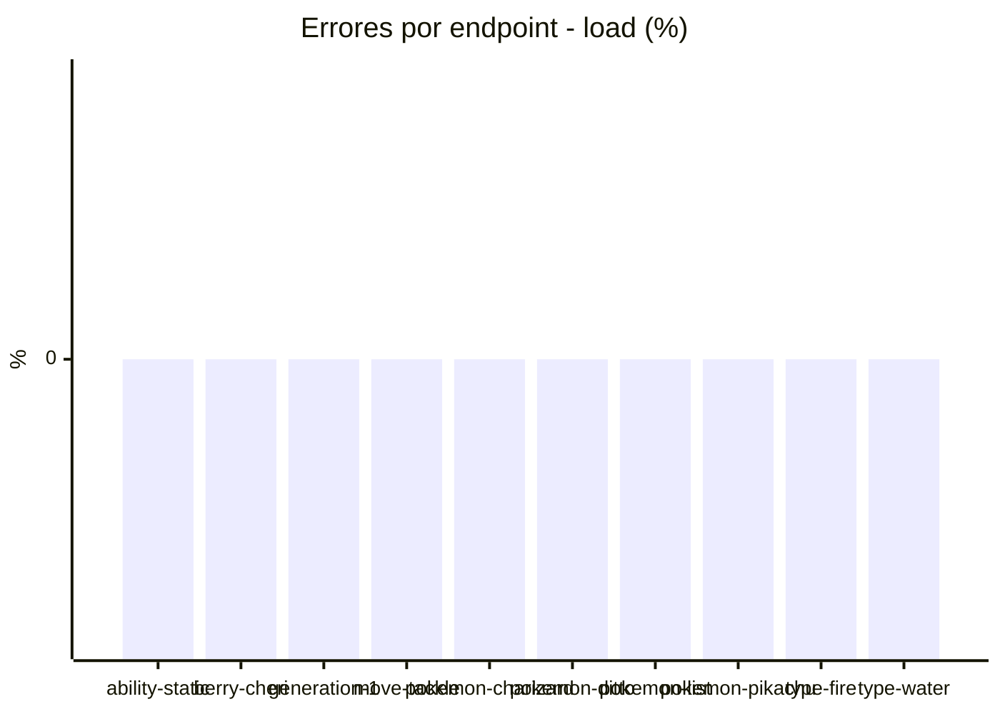
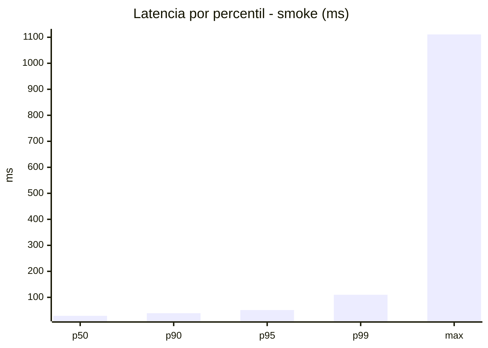
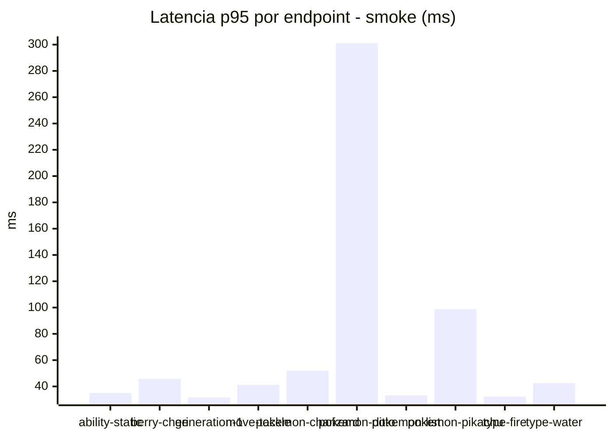
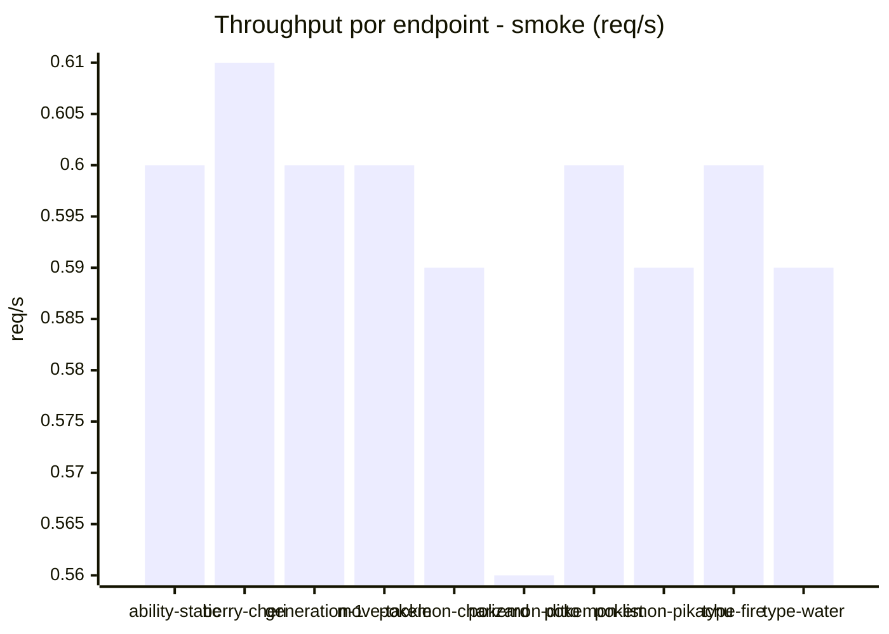

# Reporte de performance - PokeAPI

**Fecha:** 2026-11-25 22:09 UTC  
**Veredicto del agente:** `PASS`  
**Corrida:** [ver en GitHub Actions](https://github.com/lrbg/jmeter-pokeapi-lab/actions/runs/45710400629)  

## Validacion del agente de IA

PASS (fallback por umbrales)

- Error maximo: 0.0%
- p95 maximo: 51.0 ms

## Resultados

### Escenario: `load`

| Metrica | Valor |
| --- | --- |
| Muestras | 16027 |
| Errores | 0 (0.0%) |
| Latencia media | 27.8 ms |
| p50 / p90 / p95 / p99 | 26.0 / 36.0 / 41.0 / 60.7 ms |
| Min / Max | 16 / 286 ms |
| Throughput | 133.96 req/s |
| Duracion | 119.6 s |

Detalle por endpoint

| Endpoint | Muestras | Error % | avg | p95 | p99 | req/s |
| --- | --- | --- | --- | --- | --- | --- |
| ability-static | 1602 | 0.0% | 27.3 | 39.0 | 53.0 | 13.54 |
| berry-cheri | 1603 | 0.0% | 26.5 | 37.0 | 54.0 | 13.55 |
| generation-1 | 1603 | 0.0% | 27.2 | 39.0 | 58.0 | 13.58 |
| move-tackle | 1603 | 0.0% | 28.0 | 40.0 | 56.0 | 13.57 |
| pokemon-charizard | 1602 | 0.0% | 32.8 | 50.0 | 80.0 | 13.47 |
| pokemon-ditto | 1604 | 0.0% | 27.3 | 38.0 | 60.9 | 13.41 |
| pokemon-list | 1603 | 0.0% | 24.7 | 36.0 | 55.9 | 13.51 |
| pokemon-pikachu | 1602 | 0.0% | 31.9 | 48.0 | 83.0 | 13.46 |
| type-fire | 1602 | 0.0% | 26.5 | 39.0 | 61.0 | 13.52 |
| type-water | 1603 | 0.0% | 26.2 | 37.0 | 50.0 | 13.51 |

### Escenario: `smoke`

| Metrica | Valor |
| --- | --- |
| Muestras | 154 |
| Errores | 0 (0.0%) |
| Latencia media | 38.2 ms |
| p50 / p90 / p95 / p99 | 29.0 / 39.0 / 51.0 / 110.0 ms |
| Min / Max | 19 / 1111 ms |
| Throughput | 5.31 req/s |
| Duracion | 29.0 s |

Detalle por endpoint

| Endpoint | Muestras | Error % | avg | p95 | p99 | req/s |
| --- | --- | --- | --- | --- | --- | --- |
| ability-static | 15 | 0.0% | 27.3 | 35.0 | 40.6 | 0.6 |
| berry-cheri | 15 | 0.0% | 29.2 | 45.8 | 77.2 | 0.61 |
| generation-1 | 15 | 0.0% | 26.4 | 31.6 | 32.7 | 0.6 |
| move-tackle | 15 | 0.0% | 31.1 | 41.2 | 49.0 | 0.6 |
| pokemon-charizard | 16 | 0.0% | 38.7 | 52.0 | 54.4 | 0.59 |
| pokemon-ditto | 16 | 0.0% | 94.7 | 301.0 | 949.0 | 0.56 |
| pokemon-list | 16 | 0.0% | 27.7 | 33.2 | 36.2 | 0.6 |
| pokemon-pikachu | 16 | 0.0% | 44.5 | 98.8 | 129.3 | 0.59 |
| type-fire | 15 | 0.0% | 27.6 | 32.3 | 32.9 | 0.6 |
| type-water | 15 | 0.0% | 30.8 | 42.6 | 49.3 | 0.59 |

