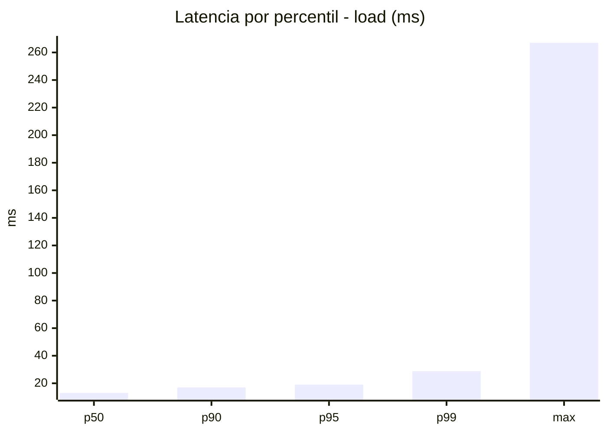
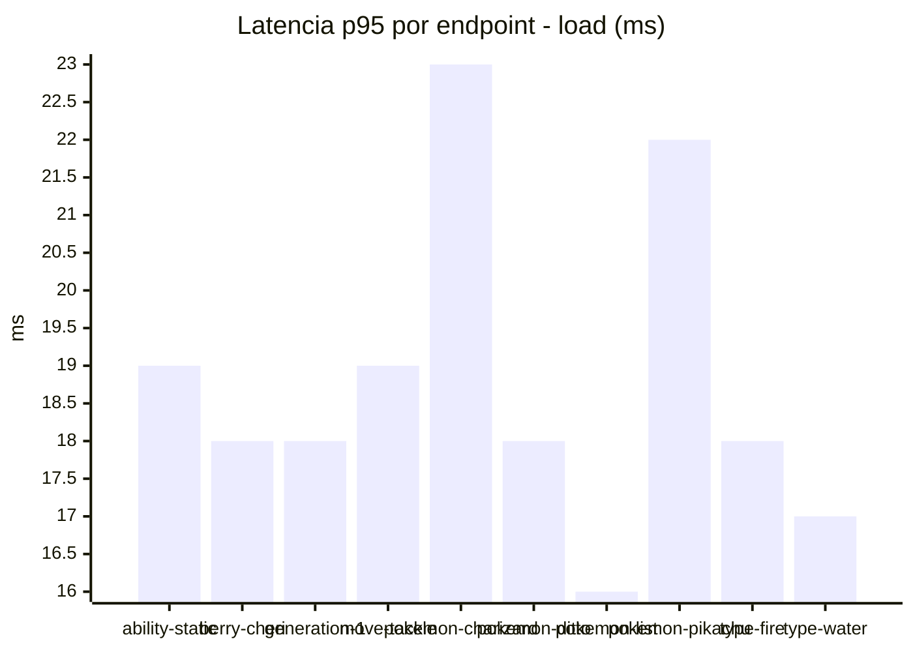
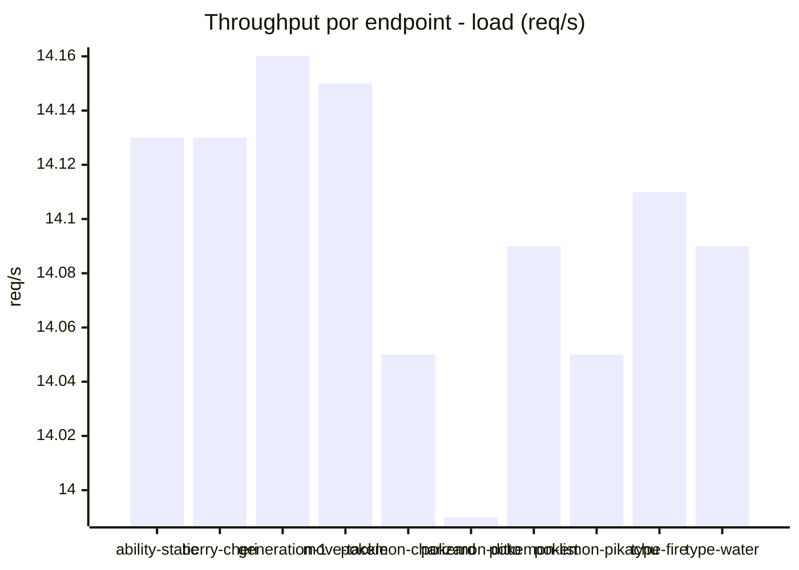
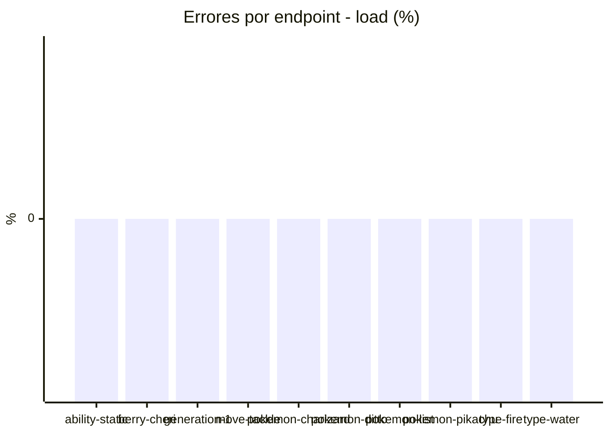
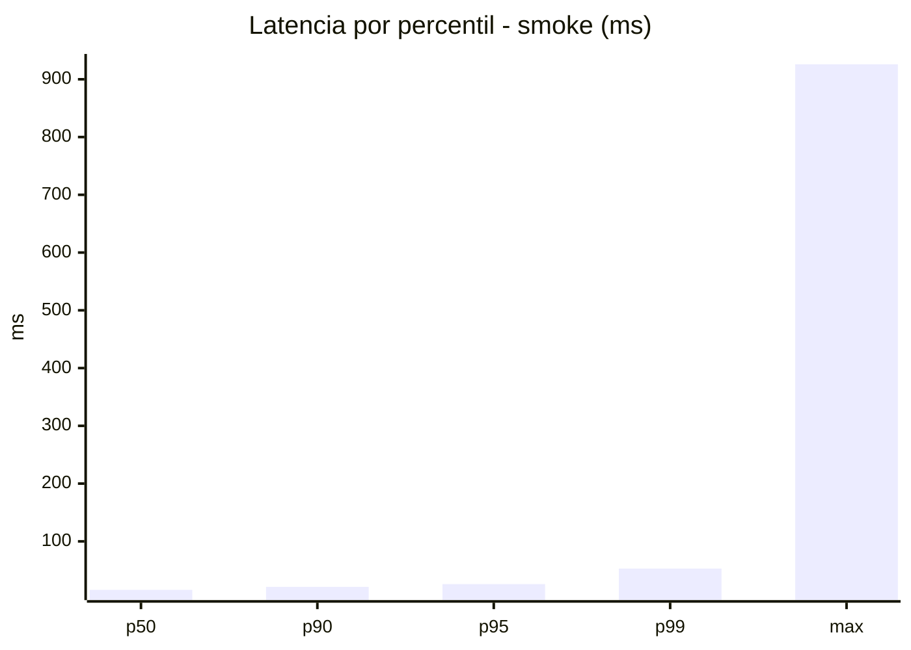
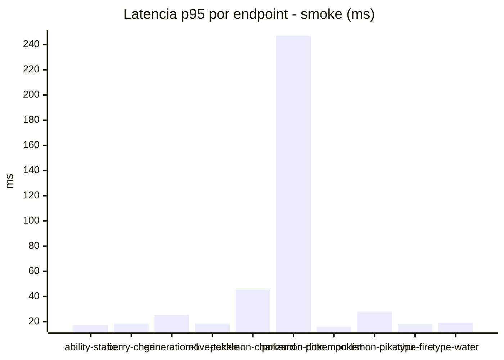
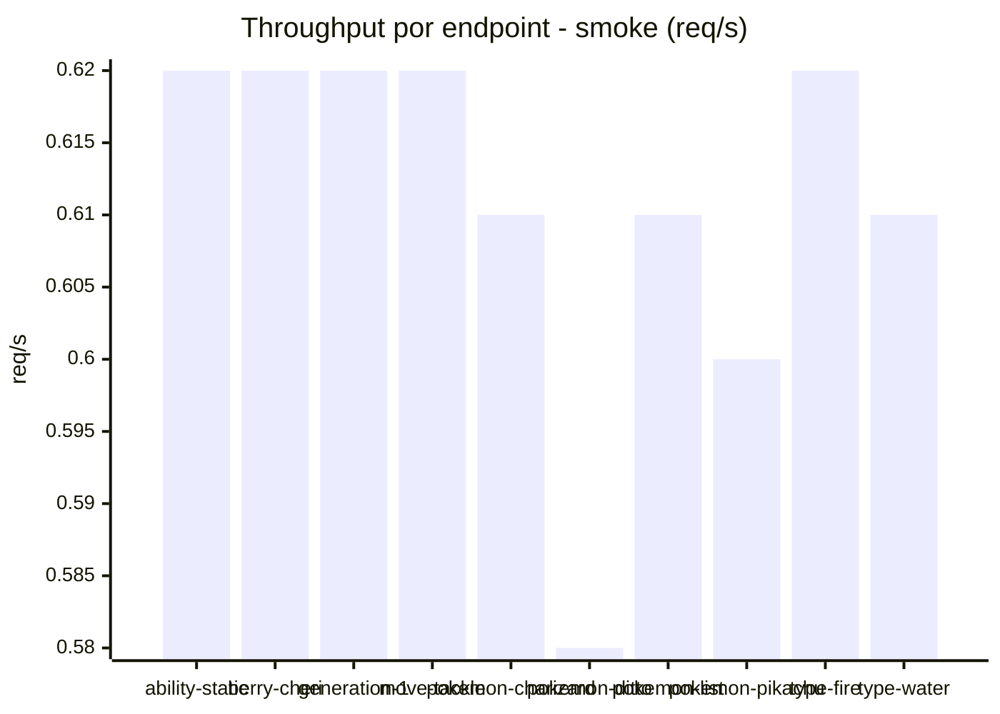

# Reporte de performance - PokeAPI

**Fecha:** 2026-11-26 22:08 UTC  
**Veredicto del agente:** `PASS`  
**Corrida:** [ver en GitHub Actions](https://github.com/lrbg/jmeter-pokeapi-lab/actions/runs/45902478707)  

## Validacion del agente de IA

PASS (fallback por umbrales)

- Error maximo: 0.0%
- p95 maximo: 26.0 ms

## Resultados

### Escenario: `load`

| Metrica | Valor |
| --- | --- |
| Muestras | 16723 |
| Errores | 0 (0.0%) |
| Latencia media | 14.3 ms |
| p50 / p90 / p95 / p99 | 13.0 / 17.0 / 19.0 / 28.8 ms |
| Min / Max | 9 / 267 ms |
| Throughput | 139.76 req/s |
| Duracion | 119.7 s |

Detalle por endpoint

| Endpoint | Muestras | Error % | avg | p95 | p99 | req/s |
| --- | --- | --- | --- | --- | --- | --- |
| ability-static | 1672 | 0.0% | 13.8 | 19.0 | 33.0 | 14.13 |
| berry-cheri | 1672 | 0.0% | 13.3 | 18.0 | 24.3 | 14.13 |
| generation-1 | 1672 | 0.0% | 13.8 | 18.0 | 28.0 | 14.16 |
| move-tackle | 1673 | 0.0% | 14.4 | 19.0 | 25.0 | 14.15 |
| pokemon-charizard | 1672 | 0.0% | 17.2 | 23.0 | 31.3 | 14.05 |
| pokemon-ditto | 1673 | 0.0% | 14.1 | 18.0 | 28.3 | 13.99 |
| pokemon-list | 1672 | 0.0% | 12.6 | 16.0 | 21.0 | 14.09 |
| pokemon-pikachu | 1672 | 0.0% | 16.5 | 22.0 | 35.3 | 14.05 |
| type-fire | 1673 | 0.0% | 13.6 | 18.0 | 25.3 | 14.11 |
| type-water | 1672 | 0.0% | 13.3 | 17.0 | 22.3 | 14.09 |

### Escenario: `smoke`

| Metrica | Valor |
| --- | --- |
| Muestras | 159 |
| Errores | 0 (0.0%) |
| Latencia media | 22.6 ms |
| p50 / p90 / p95 / p99 | 16.0 / 21.2 / 26.0 / 52.9 ms |
| Min / Max | 11 / 926 ms |
| Throughput | 5.49 req/s |
| Duracion | 29.0 s |

Detalle por endpoint

| Endpoint | Muestras | Error % | avg | p95 | p99 | req/s |
| --- | --- | --- | --- | --- | --- | --- |
| ability-static | 16 | 0.0% | 14.4 | 17.2 | 17.9 | 0.62 |
| berry-cheri | 16 | 0.0% | 14.8 | 18.5 | 19.7 | 0.62 |
| generation-1 | 15 | 0.0% | 16.7 | 25.2 | 38.6 | 0.62 |
| move-tackle | 16 | 0.0% | 16.1 | 18.5 | 19.7 | 0.62 |
| pokemon-charizard | 16 | 0.0% | 25 | 45.5 | 63.5 | 0.61 |
| pokemon-ditto | 16 | 0.0% | 72.7 | 247.2 | 790.2 | 0.58 |
| pokemon-list | 16 | 0.0% | 13.7 | 16.0 | 16.0 | 0.61 |
| pokemon-pikachu | 16 | 0.0% | 21.8 | 28.0 | 32.8 | 0.6 |
| type-fire | 16 | 0.0% | 14.6 | 18.0 | 18.0 | 0.62 |
| type-water | 16 | 0.0% | 15.7 | 19.2 | 19.9 | 0.61 |

