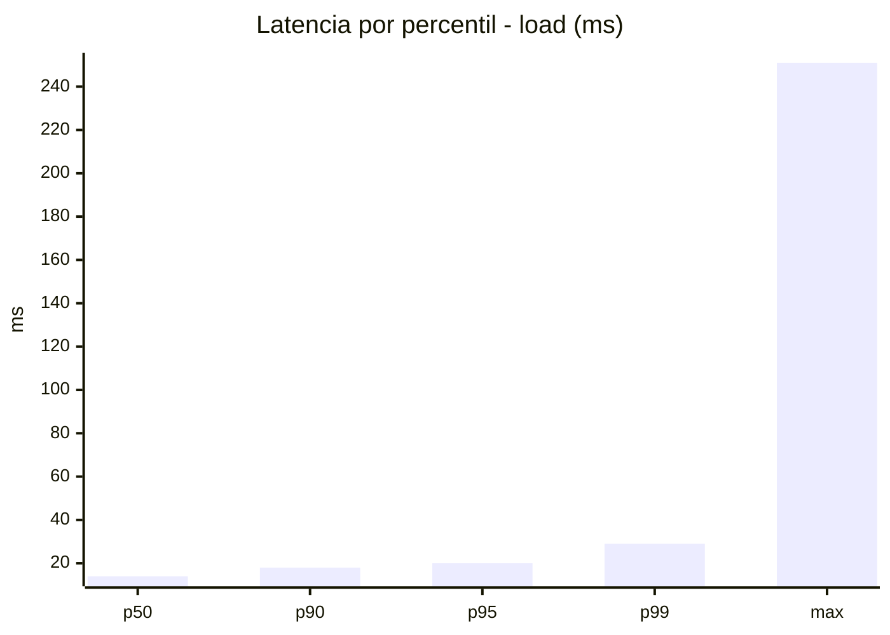
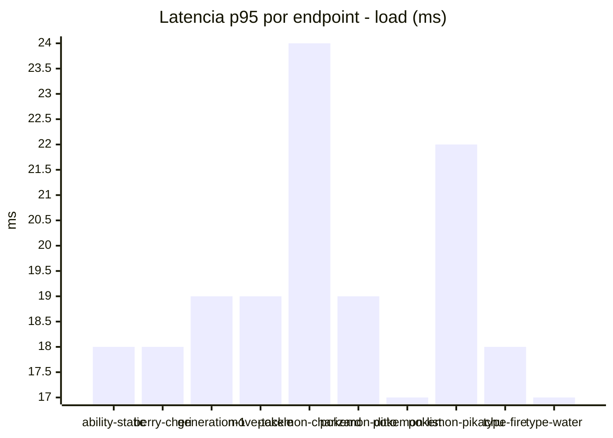
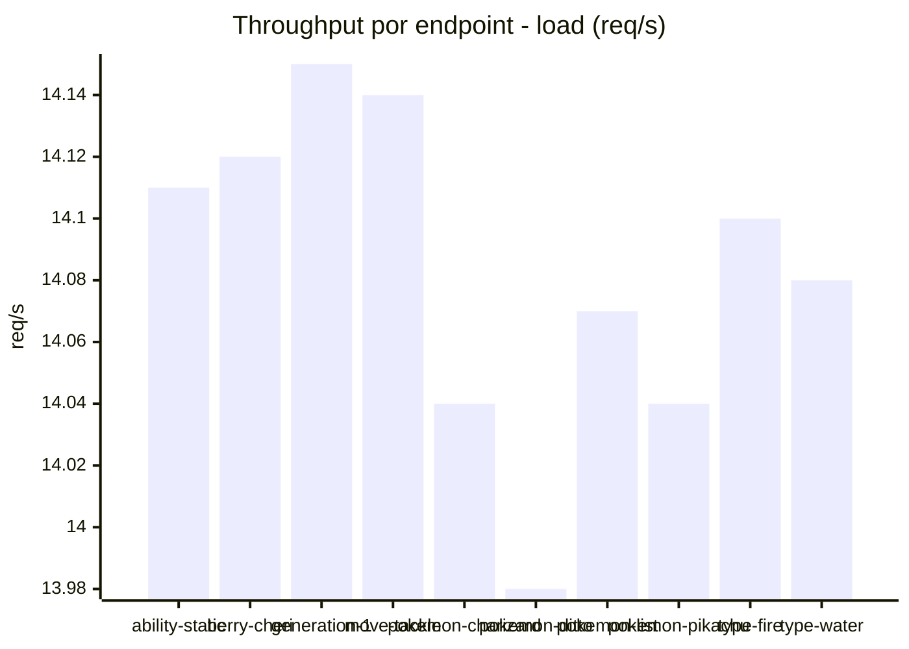
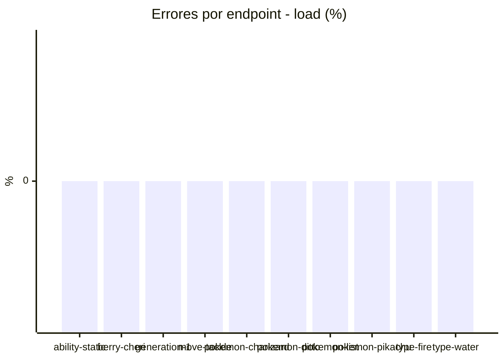
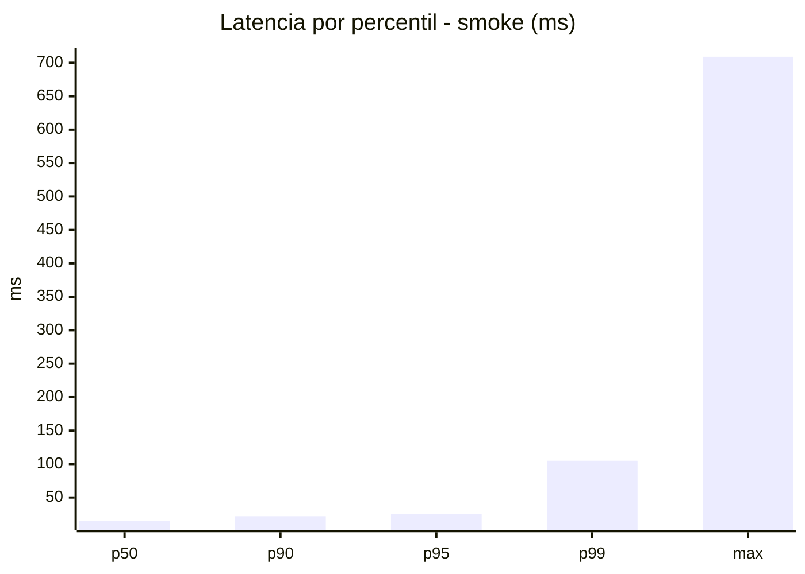
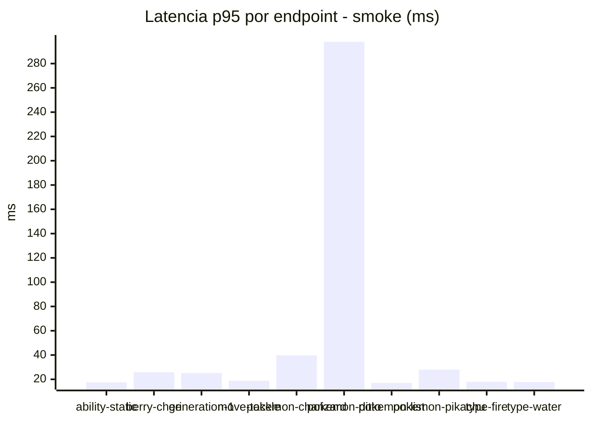
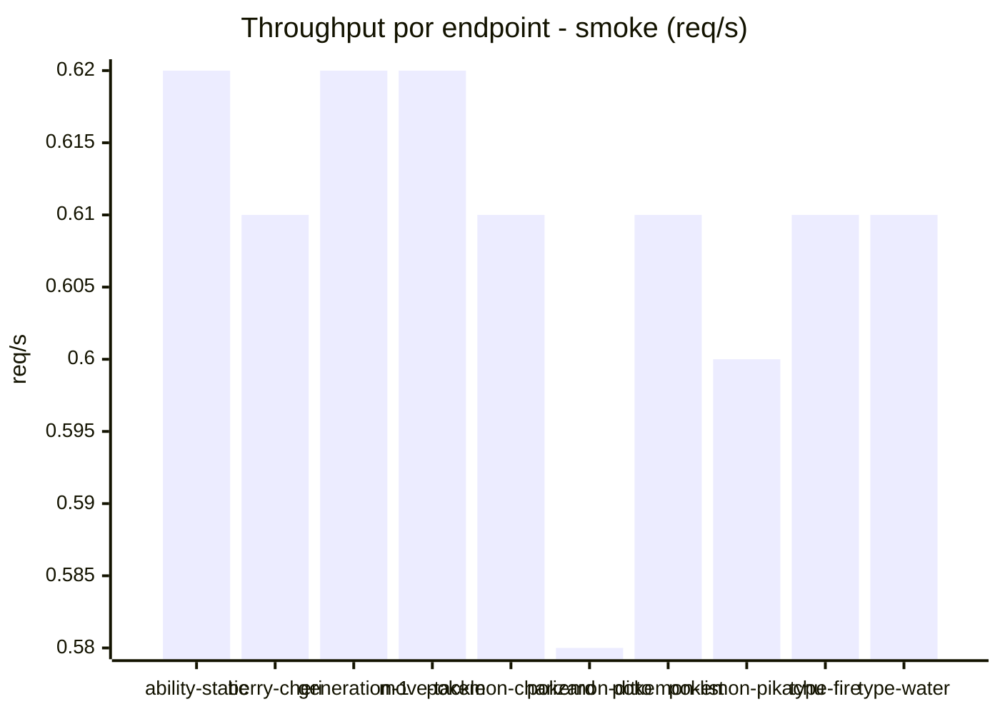

# Reporte de performance - PokeAPI

**Fecha:** 2026-11-27 21:49 UTC  
**Veredicto del agente:** `PASS`  
**Corrida:** [ver en GitHub Actions](https://github.com/lrbg/jmeter-pokeapi-lab/actions/runs/46072518984)  

## Validacion del agente de IA

PASS (fallback por umbrales)

- Error maximo: 0.0%
- p95 maximo: 25.1 ms

## Resultados

### Escenario: `load`

| Metrica | Valor |
| --- | --- |
| Muestras | 16706 |
| Errores | 0 (0.0%) |
| Latencia media | 14.5 ms |
| p50 / p90 / p95 / p99 | 14.0 / 18.0 / 20.0 / 29.0 ms |
| Min / Max | 9 / 251 ms |
| Throughput | 139.64 req/s |
| Duracion | 119.6 s |

Detalle por endpoint

| Endpoint | Muestras | Error % | avg | p95 | p99 | req/s |
| --- | --- | --- | --- | --- | --- | --- |
| ability-static | 1670 | 0.0% | 13.6 | 18.0 | 23.0 | 14.11 |
| berry-cheri | 1670 | 0.0% | 13.3 | 18.0 | 28.0 | 14.12 |
| generation-1 | 1670 | 0.0% | 13.8 | 19.0 | 26.3 | 14.15 |
| move-tackle | 1671 | 0.0% | 14.4 | 19.0 | 24.3 | 14.14 |
| pokemon-charizard | 1670 | 0.0% | 17.8 | 24.0 | 38.6 | 14.04 |
| pokemon-ditto | 1671 | 0.0% | 14.4 | 19.0 | 31.6 | 13.98 |
| pokemon-list | 1671 | 0.0% | 13.2 | 17.0 | 27.0 | 14.07 |
| pokemon-pikachu | 1672 | 0.0% | 16.9 | 22.0 | 40.2 | 14.04 |
| type-fire | 1671 | 0.0% | 13.7 | 18.0 | 29.0 | 14.1 |
| type-water | 1670 | 0.0% | 13.5 | 17.0 | 24.0 | 14.08 |

### Escenario: `smoke`

| Metrica | Valor |
| --- | --- |
| Muestras | 160 |
| Errores | 0 (0.0%) |
| Latencia media | 22.1 ms |
| p50 / p90 / p95 / p99 | 15.0 / 22.0 / 25.1 / 104.9 ms |
| Min / Max | 12 / 709 ms |
| Throughput | 5.49 req/s |
| Duracion | 29.2 s |

Detalle por endpoint

| Endpoint | Muestras | Error % | avg | p95 | p99 | req/s |
| --- | --- | --- | --- | --- | --- | --- |
| ability-static | 16 | 0.0% | 14.4 | 17.5 | 18.7 | 0.62 |
| berry-cheri | 16 | 0.0% | 16.1 | 25.8 | 41.9 | 0.61 |
| generation-1 | 16 | 0.0% | 16.5 | 25.2 | 40.2 | 0.62 |
| move-tackle | 16 | 0.0% | 16 | 18.8 | 20.5 | 0.62 |
| pokemon-charizard | 16 | 0.0% | 24.5 | 39.8 | 60.7 | 0.61 |
| pokemon-ditto | 16 | 0.0% | 67.2 | 298.0 | 626.8 | 0.58 |
| pokemon-list | 16 | 0.0% | 14.7 | 17.0 | 17.0 | 0.61 |
| pokemon-pikachu | 16 | 0.0% | 21.3 | 28.0 | 35.2 | 0.6 |
| type-fire | 16 | 0.0% | 14.8 | 18.0 | 18.0 | 0.61 |
| type-water | 16 | 0.0% | 15.1 | 17.8 | 19.5 | 0.61 |

